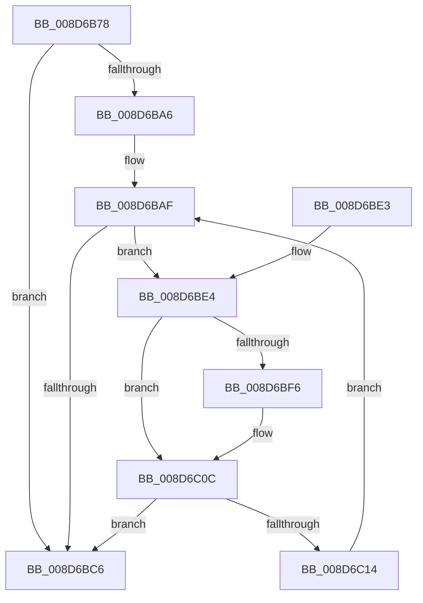

# EtwpCovSampProcessRemoveModule

- RVA: `0x008D6B78`–`0x008D6C16` (길이 `158` bytes)
- VA: `0x00000001408D6B78`
- 실행 섹션: `PAGE`
- PDB 이름 있음: `예`; PDB Function 태그: `아니요`
- unwind 정보 RVA: `0x00085378`
- 디코드: `49`개 명령, `158/158` bytes 표시
- 미해석 바이트: `0` (있으면 어셈블리에 `.byte`로 보존)

> 이 문서는 커널 이미지의 기계어와 PDB 기호를 분석해 생성했습니다. 4번과 5번은 함수 원형과 자료형을 바이너리 사용 방식에서 추정한 C 해석이며 원본 소스 복구 결과는 아닙니다.

## 1. Dependencies

- 직접 호출 지점: **3**; 고유 호출 대상: **3**
- 직접 호출자로 확인된 함수: **2**
- RIP 상대 이미지 참조: **0**

### Outgoing calls
- `0x008D6B9A` → [EtwpCovSampProcessUpperBoundModule](EtwpCovSampProcessUpperBoundModule_function_008D7800.md) (function, `0x008D7800`)
- `0x008D6BE7` → [EtwpCovSampModuleDereference](EtwpCovSampModuleDereference_function_008D7F38.md) (function, `0x008D7F38`)
- `0x008D6C07` → [memcpy](../../text/6C/memcpy_function_006C6840.md) (function, `0x006C6840`)

### Direct callers
- [EtwpCovSampProcessAddModule](EtwpCovSampProcessAddModule_function_008D8F58.md) at `0x008D9000`
- [EtwpCovSampProcessAddModule](EtwpCovSampProcessAddModule_function_008D8F58.md) at `0x008D9028`
- [EtwpCoverageSamplerUnloadImage](../A2/EtwpCoverageSamplerUnloadImage_function_00A22400.md) at `0x00A224C4`

### Static image references
- 디코드된 RIP-relative 메모리 참조가 없습니다.

## 2. Other-region calls and transfers

- 다른 실행 섹션으로 향하는 call: **1**
  - `0x008D6C07` → [memcpy](../../text/6C/memcpy_function_006C6840.md) (`PAGE` → `.text`)
- 별도 외부 분기/꼬리 이동을 확인하지 못했습니다.

## 3. Assembly (complete function range)

```asm
008D6B78  48 8B C4                        mov rax, rsp
008D6B7B  48 89 58 08                     mov qword ptr [rax + 8], rbx
008D6B7F  48 89 68 10                     mov qword ptr [rax + 0x10], rbp
008D6B83  48 89 70 18                     mov qword ptr [rax + 0x18], rsi
008D6B87  48 89 78 20                     mov qword ptr [rax + 0x20], rdi
008D6B8B  41 56                           push r14
008D6B8D  48 83 EC 20                     sub rsp, 0x20
008D6B91  49 8B E8                        mov rbp, r8
008D6B94  4C 8B F2                        mov r14, rdx
008D6B97  48 8B D9                        mov rbx, rcx
008D6B9A  E8 61 0C 00 00                  call 0x1408d7800
008D6B9F  8B F8                           mov edi, eax
008D6BA1  3B 43 20                        cmp eax, dword ptr [rbx + 0x20]
008D6BA4  73 20                           jae 0x1408d6bc6
008D6BA6  8B F7                           mov esi, edi
008D6BA8  48 C1 E6 04                     shl rsi, 4
008D6BAC  49 03 EE                        add rbp, r14
008D6BAF  4C 8B 4B 18                     mov r9, qword ptr [rbx + 0x18]
008D6BB3  4C 03 CE                        add r9, rsi
008D6BB6  49 8B 51 08                     mov rdx, qword ptr [r9 + 8]
008D6BBA  49 8B 09                        mov rcx, qword ptr [r9]
008D6BBD  48 2B 4A 28                     sub rcx, qword ptr [rdx + 0x28]
008D6BC1  48 3B CD                        cmp rcx, rbp
008D6BC4  72 1E                           jb 0x1408d6be4
008D6BC6  48 8B 5C 24 30                  mov rbx, qword ptr [rsp + 0x30]
008D6BCB  8B C7                           mov eax, edi
008D6BCD  48 8B 7C 24 48                  mov rdi, qword ptr [rsp + 0x48]
008D6BD2  48 8B 6C 24 38                  mov rbp, qword ptr [rsp + 0x38]
008D6BD7  48 8B 74 24 40                  mov rsi, qword ptr [rsp + 0x40]
008D6BDC  48 83 C4 20                     add rsp, 0x20
008D6BE0  41 5E                           pop r14
008D6BE2  C3                              ret
008D6BE3  CC                              int3
008D6BE4  48 8B 0B                        mov rcx, qword ptr [rbx]
008D6BE7  E8 4C 13 00 00                  call 0x1408d7f38
008D6BEC  8B 53 20                        mov edx, dword ptr [rbx + 0x20]
008D6BEF  8D 47 01                        lea eax, [rdi + 1]
008D6BF2  3B D0                           cmp edx, eax
008D6BF4  76 16                           jbe 0x1408d6c0c
008D6BF6  2B D7                           sub edx, edi
008D6BF8  49 8B C9                        mov rcx, r9
008D6BFB  44 8D 42 FF                     lea r8d, [rdx - 1]
008D6BFF  49 C1 E0 04                     shl r8, 4
008D6C03  49 8D 51 10                     lea rdx, [r9 + 0x10]
008D6C07  E8 34 FC DE FF                  call 0x1406c6840
008D6C0C  FF 4B 20                        dec dword ptr [rbx + 0x20]
008D6C0F  3B 7B 20                        cmp edi, dword ptr [rbx + 0x20]
008D6C12  73 B2                           jae 0x1408d6bc6
008D6C14  EB 99                           jmp 0x1408d6baf
```

## 4. C-style interpretation (structured pseudocode)

```c
__int64 __fastcall EtwpCovSampProcessRemoveModule(__int64 a1, __int64 a2, __int64 a3)
{
    __int64 result;
    __int64 v_rbp;
    __int64 v_rsi;
    __int64 v_rsp;
    unsigned __int64 v_stack_p10;
    unsigned __int64 v_stack_p18;
    unsigned __int64 v_stack_p20;
    unsigned __int64 v_stack_p8;

    *(unsigned __int64 *)(v_rsp + 8) = v_rbx;
    *(unsigned __int64 *)(v_rsp + 16) = v_rbp;
    *(unsigned __int64 *)(v_rsp + 24) = v_rsi;
    *(unsigned __int64 *)(v_rsp + 32) = v_rdi;
    v_rsp = (v_rsp) - (32);
    result = EtwpCovSampProcessUpperBoundModule(a1, a2, a3, a4);
    if (((unsigned int)(result)) >= (*(unsigned int *)(a1 + 32))) goto loc_008D6BC6;
    v_rsi = ((unsigned int)((unsigned int)((unsigned int)((unsigned int)(result))))) << (4);
    v_rbp = (a3) + (a2);
loc_008D6BAF:
    a4 = (*(unsigned __int64 *)(a1 + 24)) + (v_rsi);
    a1 = (*(unsigned __int64 *)(a4)) - (*(unsigned __int64 *)(*(unsigned __int64 *)(a4 + 8) + 40));
    if (a1 < v_rbp) goto loc_008D6BE4;
loc_008D6BC6:
    v_rsp = (v_rsp) + (32);
    return (unsigned int)((unsigned int)((unsigned int)((unsigned int)(result))));
loc_008D6BE4:
    result = EtwpCovSampModuleDereference(*(unsigned __int64 *)(v_stack_p8), *(unsigned __int64 *)(a4 + 8), a3, a4);
    result = v_stack_p20 + 1;
    if (((unsigned int)((unsigned int)(*(unsigned int *)(v_stack_p8 + 32)))) >= = ((unsigned int)(v_stack_p20 + 1))) {
        a2 = (unsigned int)(((unsigned int)(*(unsigned int *)(v_stack_p8 + 32))) - ((unsigned int)(v_stack_p20)));
        a1 = a4;
        a3 = a2 - 1;
        a3 = (a3) << (4);
        a2 = a4 + 16;
        result = memcpy(a1, a2, a3, a4);
    }
    if (((unsigned int)(v_stack_p20)) >= (*(unsigned int *)(v_stack_p8 + 32))) goto loc_008D6BC6;
    goto loc_008D6BAF;
}
```

## 5. (Beta) C Style

```c
int64_t EtwpCovSampProcessRemoveModule(void *Arg1, int64_t Arg2, int64_t Arg3)
{
    uint8_t *arg1 = (uint8_t *)Arg1;

    int64_t result;
    int64_t local_rbp;
    int64_t local_rsi;
    int64_t local_rsp;
    uint64_t v_stack_p10;
    uint64_t v_stack_p18;
    uint64_t v_stack_p20;
    uint64_t v_stack_p8;

    *(uint64_t *)(local_rsp + 0x8) = local_rbx;
    *(uint64_t *)(local_rsp + 0x10) = local_rbp;
    *(uint64_t *)(local_rsp + 0x18) = local_rsi;
    *(uint64_t *)(local_rsp + 0x20) = local_rdi;
    local_rsp = (local_rsp) - (32);
    result = EtwpCovSampProcessUpperBoundModule(Arg1, Arg2, Arg3, a4);
    if (((uint32_t)(result)) >= (*(uint32_t *)(arg1 + 0x20))) goto loc_008D6BC6;
    local_rsi = ((uint32_t)((uint32_t)((uint32_t)((uint32_t)(result))))) << (4);
    local_rbp = (Arg3) + (Arg2);
loc_008D6BAF:
    a4 = (*(uint64_t *)(arg1 + 0x18)) + (local_rsi);
    Arg1 = (*(uint64_t *)(a4)) - (*(uint64_t *)(*(uint64_t *)(a4 + 0x8) + 0x28));
    if (Arg1 < local_rbp) goto loc_008D6BE4;
loc_008D6BC6:
    local_rsp = (local_rsp) + (32);
    return (uint32_t)((uint32_t)((uint32_t)((uint32_t)(result))));
loc_008D6BE4:
    result = EtwpCovSampModuleDereference(*(uint64_t *)(v_stack_p8), *(uint64_t *)(a4 + 0x8), Arg3, a4);
    result = v_stack_p20 + 1;
    if (((uint32_t)((uint32_t)(*(uint32_t *)(v_stack_p8 + 0x20)))) >= = ((uint32_t)(v_stack_p20 + 1))) {
        Arg2 = (uint32_t)(((uint32_t)(*(uint32_t *)(v_stack_p8 + 0x20))) - ((uint32_t)(v_stack_p20)));
        Arg1 = a4;
        Arg3 = Arg2 - 1;
        Arg3 = (Arg3) << (4);
        Arg2 = a4 + 16;
        result = memcpy(Arg1, Arg2, Arg3, a4);
    }
    if (((uint32_t)(v_stack_p20)) >= (*(uint32_t *)(v_stack_p8 + 0x20))) goto loc_008D6BC6;
    goto loc_008D6BAF;
}
```

### 관측된 메모리 오프셋

구조체 형식이 확인되지 않은 접근은 인자 기준의 오프셋으로만 기록했습니다.

| 기준 인자 | 오프셋 표현 | 폭 (bit) | 접근 |
|---|---:|---:|---|
| `Arg1` | `+ 0x0` | `64` | `R` |
| `Arg1` | `+ 0x18` | `64` | `R` |
| `Arg1` | `+ 0x20` | `32` | `R` |
| `Arg1` | `+ 0x20` | `32` | `R/W` |

## 6. Execution-region graph

[열기: 2D/3D 그래프와 함수 탐색 컨트롤 패널](../../../control-panel.html?section=page&rva=0x008D6B78&view=graph)

- 2D 그래프는 위에서 아래로 흐르고, 3D 그래프는 빈 공간을 드래그해 회전합니다. Shift+드래그는 이동, 휠은 확대·축소, 함수 노드 선택은 대상 보고서 이동입니다.

### Static fallback


