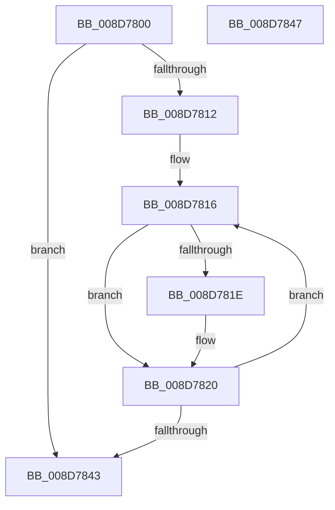

# EtwpCovSampProcessUpperBoundModule

- RVA: `0x008D7800`–`0x008D7848` (길이 `72` bytes)
- VA: `0x00000001408D7800`
- 실행 섹션: `PAGE`
- PDB 이름 있음: `예`; PDB Function 태그: `아니요`
- unwind 정보 RVA: `0x000DB714`
- 디코드: `24`개 명령, `72/72` bytes 표시
- 미해석 바이트: `0` (있으면 어셈블리에 `.byte`로 보존)

> 이 문서는 커널 이미지의 기계어와 PDB 기호를 분석해 생성했습니다. 4번과 5번은 함수 원형과 자료형을 바이너리 사용 방식에서 추정한 C 해석이며 원본 소스 복구 결과는 아닙니다.

## 1. Dependencies

- 직접 호출 지점: **0**; 고유 호출 대상: **0**
- 직접 호출자로 확인된 함수: **3**
- RIP 상대 이미지 참조: **0**

### Outgoing calls
- 직접 디코드된 call 명령이 없습니다.

### Direct callers
- [EtwpCovSampProcessRemoveModule](EtwpCovSampProcessRemoveModule_function_008D6B78.md) at `0x008D6B9A`
- [EtwpCovSampCaptureBufferMapAddressesAndQueue](EtwpCovSampCaptureBufferMapAddressesAndQueue_function_008D7430.md) at `0x008D7682`
- [EtwpCovSampProcessMapAddresses](EtwpCovSampProcessMapAddresses_function_008D7A38.md) at `0x008D7BB1`

### Static image references
- 디코드된 RIP-relative 메모리 참조가 없습니다.

## 2. Other-region calls and transfers

- 다른 실행 섹션으로 향하는 call: **0**
- 별도 외부 분기/꼬리 이동을 확인하지 못했습니다.

## 3. Assembly (complete function range)

```asm
008D7800  44 8B 49 20                     mov r9d, dword ptr [rcx + 0x20]
008D7804  4C 8B D2                        mov r10, rdx
008D7807  41 B8 FF FF FF FF               mov r8d, 0xffffffff
008D780D  45 85 C9                        test r9d, r9d
008D7810  74 31                           je 0x1408d7843
008D7812  4C 8B 59 18                     mov r11, qword ptr [rcx + 0x18]
008D7816  41 8B C1                        mov eax, r9d
008D7819  41 2B C0                        sub eax, r8d
008D781C  79 02                           jns 0x1408d7820
008D781E  FF C0                           inc eax
008D7820  D1 F8                           sar eax, 1
008D7822  42 8D 14 00                     lea edx, [rax + r8]
008D7826  48 63 C2                        movsxd rax, edx
008D7829  48 03 C0                        add rax, rax
008D782C  4D 3B 14 C3                     cmp r10, qword ptr [r11 + rax*8]
008D7830  44 0F 43 C2                     cmovae r8d, edx
008D7834  41 0F 43 D1                     cmovae edx, r9d
008D7838  44 8B CA                        mov r9d, edx
008D783B  41 8D 48 01                     lea ecx, [r8 + 1]
008D783F  3B CA                           cmp ecx, edx
008D7841  75 D3                           jne 0x1408d7816
008D7843  41 8B C1                        mov eax, r9d
008D7846  C3                              ret
008D7847  CC                              int3
```

## 4. C-style interpretation (structured pseudocode)

```c
__int64 __fastcall EtwpCovSampProcessUpperBoundModule(__int64 a1, __int64 a2)
{
    __int64 result;

    if ((unsigned int)((unsigned int)(*(unsigned int *)(a1 + 32))) == 0) goto loc_008D7843;
loc_008D7816:
    result = (unsigned int)(((unsigned int)((unsigned int)((unsigned int)(*(unsigned int *)(a1 + 32))))) - ((unsigned int)((unsigned int)(0xFFFFFFFFULL))));
    if (sign_flag) {
        result = (unsigned int)((result) + 1);
    }
    result = (unsigned int)((result) >> (1));
    result = ((int)((unsigned int)(result + (unsigned int)(0xFFFFFFFFULL) * 1))) + ((int)((unsigned int)(result + (unsigned int)(0xFFFFFFFFULL) * 1)));
    a3 = (unsigned int)(0xFFFFFFFFULL);
    if (a2 >= (*(unsigned __int64 *)(*(unsigned __int64 *)(a1 + 24) + result * 8))) { a3 = (unsigned int)(result + (unsigned int)(0xFFFFFFFFULL) * 1); }
    a2 = result + (unsigned int)(0xFFFFFFFFULL) * 1;
    if (a2 >= (*(unsigned __int64 *)(*(unsigned __int64 *)(a1 + 24) + result * 8))) { a2 = (unsigned int)((unsigned int)(*(unsigned int *)(a1 + 32))); }
    if (((unsigned int)(a3 + 1)) != ((unsigned int)(a2))) goto loc_008D7816;
loc_008D7843:
    return (unsigned int)((unsigned int)((unsigned int)((unsigned int)(a2))));
}
```

## 5. (Beta) C Style

```c
int64_t EtwpCovSampProcessUpperBoundModule(void *Arg1, int64_t Arg2)
{
    uint8_t *arg1 = (uint8_t *)Arg1;

    int64_t result;

    if ((uint32_t)((uint32_t)(*(uint32_t *)(arg1 + 0x20))) == 0) goto loc_008D7843;
loc_008D7816:
    result = (uint32_t)(((uint32_t)((uint32_t)((uint32_t)(*(uint32_t *)(arg1 + 0x20))))) - ((uint32_t)((uint32_t)(0xFFFFFFFFULL))));
    if (sign_flag) {
        result = (uint32_t)((result) + 1);
    }
    result = (uint32_t)((result) >> (1));
    result = ((int32_t)((uint32_t)(result + (uint32_t)(0xFFFFFFFFULL) * 1))) + ((int32_t)((uint32_t)(result + (uint32_t)(0xFFFFFFFFULL) * 1)));
    a3 = (uint32_t)(0xFFFFFFFFULL);
    if (Arg2 >= (*(uint64_t *)(*(uint64_t *)(arg1 + 0x18) + result * 8))) { a3 = (uint32_t)(result + (uint32_t)(0xFFFFFFFFULL) * 1); }
    Arg2 = result + (uint32_t)(0xFFFFFFFFULL) * 1;
    if (Arg2 >= (*(uint64_t *)(*(uint64_t *)(arg1 + 0x18) + result * 8))) { Arg2 = (uint32_t)((uint32_t)(*(uint32_t *)(arg1 + 0x20))); }
    if (((uint32_t)(a3 + 1)) != ((uint32_t)(Arg2))) goto loc_008D7816;
loc_008D7843:
    return (uint32_t)((uint32_t)((uint32_t)((uint32_t)(Arg2))));
}
```

### 관측된 메모리 오프셋

구조체 형식이 확인되지 않은 접근은 인자 기준의 오프셋으로만 기록했습니다.

| 기준 인자 | 오프셋 표현 | 폭 (bit) | 접근 |
|---|---:|---:|---|
| `Arg1` | `+ 0x18` | `64` | `R` |
| `Arg1` | `+ 0x20` | `32` | `R` |

## 6. Execution-region graph

[열기: 2D/3D 그래프와 함수 탐색 컨트롤 패널](../../../control-panel.html?section=page&rva=0x008D7800&view=graph)

- 2D 그래프는 위에서 아래로 흐르고, 3D 그래프는 빈 공간을 드래그해 회전합니다. Shift+드래그는 이동, 휠은 확대·축소, 함수 노드 선택은 대상 보고서 이동입니다.

### Static fallback


