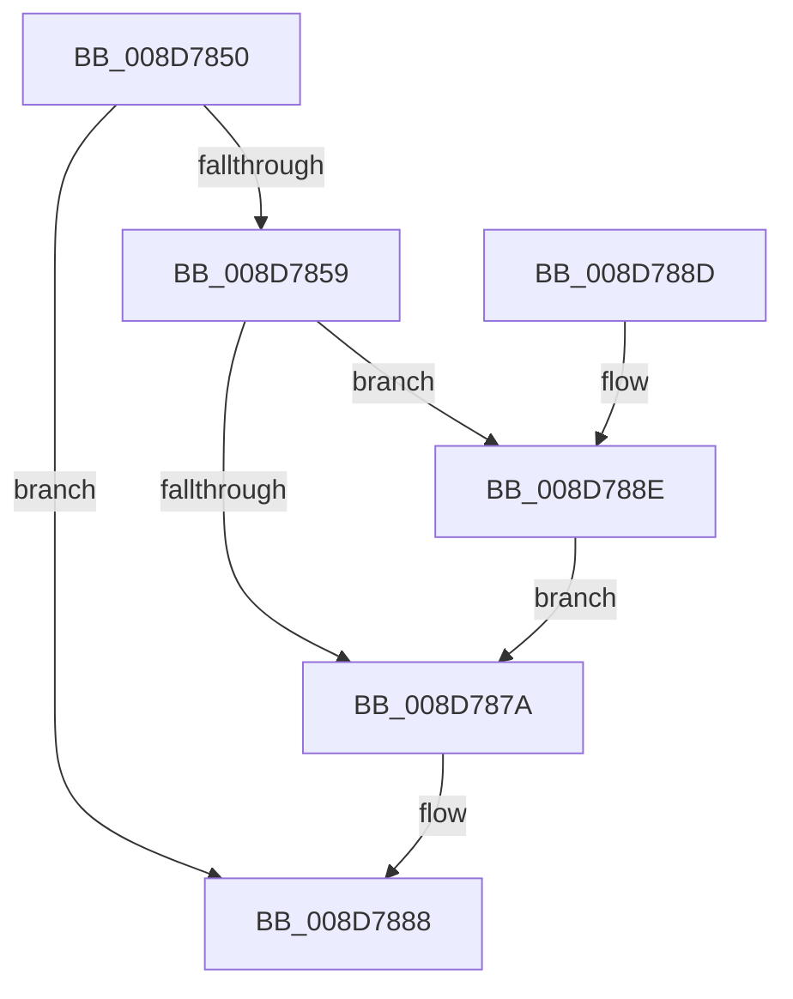

# EtwpCovSampReleaseSamplerRundown

- RVA: `0x008D7850`–`0x008D789C` (길이 `76` bytes)
- VA: `0x00000001408D7850`
- 실행 섹션: `PAGE`
- PDB 이름 있음: `예`; PDB Function 태그: `아니요`
- unwind 정보 RVA: `0x00064C74`
- 디코드: `17`개 명령, `76/76` bytes 표시
- 미해석 바이트: `0` (있으면 어셈블리에 `.byte`로 보존)

> 이 문서는 커널 이미지의 기계어와 PDB 기호를 분석해 생성했습니다. 4번과 5번은 함수 원형과 자료형을 바이너리 사용 방식에서 추정한 C 해석이며 원본 소스 복구 결과는 아닙니다.

## 1. Dependencies

- 직접 호출 지점: **2**; 고유 호출 대상: **2**
- 직접 호출자로 확인된 함수: **6**
- RIP 상대 이미지 참조: **1**

### Outgoing calls
- `0x008D7883` → [KeLeaveCriticalRegionThread](../../text/25/KeLeaveCriticalRegionThread_function_0025EFF0.md) (function, `0x0025EFF0`)
- `0x008D7895` → [ExfReleaseRundownProtection](../../text/34/ExfReleaseRundownProtection_function_00349EB0.md) (function, `0x00349EB0`)

### Direct callers
- [EtwpCovSampImageNotify](EtwpCovSampImageNotify_function_008D70C0.md) at `0x008D7192`
- [EtwpCovSampCaptureBufferProcess](EtwpCovSampCaptureBufferProcess_function_008D71C0.md) at `0x008D7259`
- [EtwpCovSampCaptureBufferMapAddressesAndQueue](EtwpCovSampCaptureBufferMapAddressesAndQueue_function_008D7430.md) at `0x008D761F`
- [EtwpCovSampSampleBufferProcess](EtwpCovSampSampleBufferProcess_function_008D96EC.md) at `0x008D97EF`
- [EtwpCoverageSamplerQuery](../95/EtwpCoverageSamplerQuery_function_0095C4A0.md) at `0x0095D118`
- [EtwpCoverageSamplerUnloadImage](../A2/EtwpCoverageSamplerUnloadImage_function_00A22400.md) at `0x00A224F8`

### Static image references
- `0x008D7859` → RVA `0x00EFF1E0` (`.data`; read)

## 2. Other-region calls and transfers

- 다른 실행 섹션으로 향하는 call: **2**
  - `0x008D7883` → [KeLeaveCriticalRegionThread](../../text/25/KeLeaveCriticalRegionThread_function_0025EFF0.md) (`PAGE` → `.text`)
  - `0x008D7895` → [ExfReleaseRundownProtection](../../text/34/ExfReleaseRundownProtection_function_00349EB0.md) (`PAGE` → `.text`)
- 별도 외부 분기/꼬리 이동을 확인하지 못했습니다.

## 3. Assembly (complete function range)

```asm
008D7850  48 83 EC 28                     sub rsp, 0x28
008D7854  48 85 C9                        test rcx, rcx
008D7857  74 2F                           je 0x1408d7888
008D7859  0F 0D 0D 80 79 62 00            prefetchw byte ptr [rip + 0x627980]
008D7860  48 8B 05 79 79 62 00            mov rax, qword ptr [rip + 0x627979]
008D7867  48 83 E0 FE                     and rax, 0xfffffffffffffffe
008D786B  48 8D 48 FE                     lea rcx, [rax - 2]
008D786F  F0 48 0F B1 0D 68 79 62 00      lock cmpxchg qword ptr [rip + 0x627968], rcx
008D7878  75 14                           jne 0x1408d788e
008D787A  65 48 8B 0C 25 88 01 00 00      mov rcx, qword ptr gs:[0x188]
008D7883  E8 68 77 98 FF                  call 0x14025eff0
008D7888  48 83 C4 28                     add rsp, 0x28
008D788C  C3                              ret
008D788D  CC                              int3
008D788E  48 8D 0D 4B 79 62 00            lea rcx, [rip + 0x62794b]
008D7895  E8 16 26 A7 FF                  call 0x140349eb0
008D789A  EB DE                           jmp 0x1408d787a
```

## 4. C-style interpretation (structured pseudocode)

```c
__int64 __fastcall EtwpCovSampReleaseSamplerRundown(__int64 a1)
{
    __int64 result;
    __int64 v_rsp;

    v_rsp = (v_rsp) - (40);
    if (a1 == 0) goto loc_008D7888;
    result = (*(unsigned __int64 *)(v_rip + 6453625)) & (-2);
    if (condition_is_not_equal) goto loc_008D788E;
loc_008D787A:
    result = KeLeaveCriticalRegionThread(*(unsigned __int64 *)(gs_base + (0 + 392)), a2, a3, a4);
loc_008D7888:
    v_rsp = (v_rsp) + (40);
    return result;
loc_008D788E:
    result = ExfReleaseRundownProtection(v_rip + 6453579, a2, a3, a4);
    goto loc_008D787A;
}
```

## 5. (Beta) C Style

```c
int64_t EtwpCovSampReleaseSamplerRundown(int64_t Arg1)
{
    int64_t result;
    int64_t local_rsp;

    local_rsp = (local_rsp) - (40);
    if (Arg1 == 0) goto loc_008D7888;
    result = (*(uint64_t *)(v_rip + 0x627979)) & (-2);
    if (condition_is_not_equal) goto loc_008D788E;
loc_008D787A:
    result = KeLeaveCriticalRegionThread(*(uint64_t *)(gs_base + (0 + 0x188)), a2, a3, a4);
loc_008D7888:
    local_rsp = (local_rsp) + (40);
    return result;
loc_008D788E:
    result = ExfReleaseRundownProtection(v_rip + 6453579, a2, a3, a4);
    goto loc_008D787A;
}
```

## 6. Execution-region graph

[열기: 2D/3D 그래프와 함수 탐색 컨트롤 패널](../../../control-panel.html?section=page&rva=0x008D7850&view=graph)

- 2D 그래프는 위에서 아래로 흐르고, 3D 그래프는 빈 공간을 드래그해 회전합니다. Shift+드래그는 이동, 휠은 확대·축소, 함수 노드 선택은 대상 보고서 이동입니다.

### Static fallback


