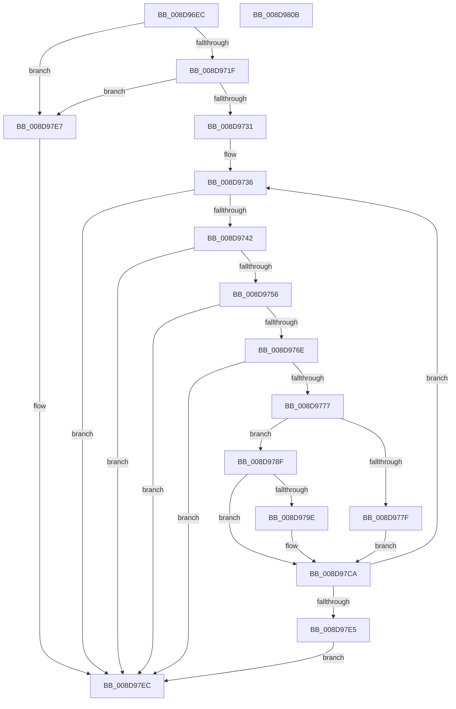

# EtwpCovSampSampleBufferProcess

- RVA: `0x008D96EC`–`0x008D980C` (길이 `288` bytes)
- VA: `0x00000001408D96EC`
- 실행 섹션: `PAGE`
- PDB 이름 있음: `예`; PDB Function 태그: `아니요`
- unwind 정보 RVA: `0x00085624`
- 디코드: `82`개 명령, `288/288` bytes 표시
- 미해석 바이트: `0` (있으면 어셈블리에 `.byte`로 보존)

> 이 문서는 커널 이미지의 기계어와 PDB 기호를 분석해 생성했습니다. 4번과 5번은 함수 원형과 자료형을 바이너리 사용 방식에서 추정한 C 해석이며 원본 소스 복구 결과는 아닙니다.

## 1. Dependencies

- 직접 호출 지점: **5**; 고유 호출 대상: **5**
- 직접 호출자로 확인된 함수: **1**
- RIP 상대 이미지 참조: **0**

### Outgoing calls
- `0x008D9712` → [EtwpCovSampAcquireSamplerRundown](EtwpCovSampAcquireSamplerRundown_function_008D7F7C.md) (function, `0x008D7F7C`)
- `0x008D9788` → [EtwpCovSampContextAddSamples](EtwpCovSampContextAddSamples_function_008D7C9C.md) (function, `0x008D7C9C`)
- `0x008D9795` → [EtwpCovSampStackHashCheck](../AA/EtwpCovSampStackHashCheck_function_00AA14C4.md) (function, `0x00AA14C4`)
- `0x008D97C5` → [EtwpCovSampContextAddAddresses](EtwpCovSampContextAddAddresses_function_008D7930.md) (function, `0x008D7930`)
- `0x008D97EF` → [EtwpCovSampReleaseSamplerRundown](EtwpCovSampReleaseSamplerRundown_function_008D7850.md) (function, `0x008D7850`)

### Direct callers
- [EtwpCovSampCaptureWorkerThread](../7C/EtwpCovSampCaptureWorkerThread_function_007C19B0.md) at `0x007C1A60`

### Static image references
- 디코드된 RIP-relative 메모리 참조가 없습니다.

## 2. Other-region calls and transfers

- 다른 실행 섹션으로 향하는 call: **0**
- 별도 외부 분기/꼬리 이동을 확인하지 못했습니다.

## 3. Assembly (complete function range)

```asm
008D96EC  48 8B C4                        mov rax, rsp
008D96EF  48 89 58 08                     mov qword ptr [rax + 8], rbx
008D96F3  48 89 68 10                     mov qword ptr [rax + 0x10], rbp
008D96F7  56                              push rsi
008D96F8  57                              push rdi
008D96F9  41 54                           push r12
008D96FB  41 56                           push r14
008D96FD  41 57                           push r15
008D96FF  48 83 EC 20                     sub rsp, 0x20
008D9703  48 83 60 18 00                  and qword ptr [rax + 0x18], 0
008D9708  4C 8B E1                        mov r12, rcx
008D970B  48 8D 48 18                     lea rcx, [rax + 0x18]
008D970F  48 8B FA                        mov rdi, rdx
008D9712  E8 65 E8 FF FF                  call 0x1408d7f7c
008D9717  85 C0                           test eax, eax
008D9719  0F 88 C8 00 00 00               js 0x1408d97e7
008D971F  33 ED                           xor ebp, ebp
008D9721  48 8D 77 48                     lea rsi, [rdi + 0x48]
008D9725  45 33 FF                        xor r15d, r15d
008D9728  39 6F 38                        cmp dword ptr [rdi + 0x38], ebp
008D972B  0F 8E B6 00 00 00               jle 0x1408d97e7
008D9731  48 8B 5C 24 60                  mov rbx, qword ptr [rsp + 0x60]
008D9736  8D 45 10                        lea eax, [rbp + 0x10]
008D9739  3B 47 40                        cmp eax, dword ptr [rdi + 0x40]
008D973C  0F 8F AA 00 00 00               jg 0x1408d97ec
008D9742  8B 4E 04                        mov ecx, dword ptr [rsi + 4]
008D9745  44 8B C9                        mov r9d, ecx
008D9748  8B 16                           mov edx, dword ptr [rsi]
008D974A  41 C1 E9 10                     shr r9d, 0x10
008D974E  3B D5                           cmp edx, ebp
008D9750  0F 85 96 00 00 00               jne 0x1408d97ec
008D9756  41 81 E1 FF 7F 00 00            and r9d, 0x7fff
008D975D  44 0F B7 C1                     movzx r8d, cx
008D9761  42 8D 04 CD 00 00 00 00         lea eax, [r9*8]
008D9769  44 3B C0                        cmp r8d, eax
008D976C  72 7E                           jb 0x1408d97ec
008D976E  41 8D 04 10                     lea eax, [r8 + rdx]
008D9772  3B 47 3C                        cmp eax, dword ptr [rdi + 0x3c]
008D9775  77 75                           ja 0x1408d97ec
008D9777  4C 8D 76 08                     lea r14, [rsi + 8]
008D977B  85 C9                           test ecx, ecx
008D977D  79 10                           jns 0x1408d978f
008D977F  45 8B C1                        mov r8d, r9d
008D9782  49 8B D6                        mov rdx, r14
008D9785  48 8B CB                        mov rcx, rbx
008D9788  E8 0F E5 FF FF                  call 0x1408d7c9c
008D978D  EB 3B                           jmp 0x1408d97ca
008D978F  4D 8B C6                        mov r8, r14
008D9792  49 8B CC                        mov rcx, r12
008D9795  E8 2A 7D 1C 00                  call 0x140aa14c4
008D979A  85 C0                           test eax, eax
008D979C  75 2C                           jne 0x1408d97ca
008D979E  65 48 8B 14 25 88 01 00 00      mov rdx, qword ptr gs:[0x188]
008D97A7  4D 8B C6                        mov r8, r14
008D97AA  44 0F B7 4E 06                  movzx r9d, word ptr [rsi + 6]
008D97AF  48 8B 5C 24 60                  mov rbx, qword ptr [rsp + 0x60]
008D97B4  41 81 E1 FF 7F 00 00            and r9d, 0x7fff
008D97BB  48 8B CB                        mov rcx, rbx
008D97BE  48 8B 92 B8 00 00 00            mov rdx, qword ptr [rdx + 0xb8]
008D97C5  E8 66 E1 FF FF                  call 0x1408d7930
008D97CA  8B 4E 04                        mov ecx, dword ptr [rsi + 4]
008D97CD  41 FF C7                        inc r15d
008D97D0  0F B7 C1                        movzx eax, cx
008D97D3  03 E8                           add ebp, eax
008D97D5  0F B7 C1                        movzx eax, cx
008D97D8  48 03 F0                        add rsi, rax
008D97DB  44 3B 7F 38                     cmp r15d, dword ptr [rdi + 0x38]
008D97DF  0F 8C 51 FF FF FF               jl 0x1408d9736
008D97E5  EB 05                           jmp 0x1408d97ec
008D97E7  48 8B 5C 24 60                  mov rbx, qword ptr [rsp + 0x60]
008D97EC  48 8B CB                        mov rcx, rbx
008D97EF  E8 5C E0 FF FF                  call 0x1408d7850
008D97F4  48 8B 5C 24 50                  mov rbx, qword ptr [rsp + 0x50]
008D97F9  48 8B 6C 24 58                  mov rbp, qword ptr [rsp + 0x58]
008D97FE  48 83 C4 20                     add rsp, 0x20
008D9802  41 5F                           pop r15
008D9804  41 5E                           pop r14
008D9806  41 5C                           pop r12
008D9808  5F                              pop rdi
008D9809  5E                              pop rsi
008D980A  C3                              ret
008D980B  CC                              int3
```

## 4. C-style interpretation (structured pseudocode)

```c
__int64 __fastcall EtwpCovSampSampleBufferProcess(__int64 a1, __int64 a2)
{
    __int64 result;
    __int64 v_r15;
    __int64 v_rbp;
    __int64 v_rbx;
    __int64 v_rsi;
    __int64 v_rsp;
    unsigned __int64 v_stack_p10;
    unsigned __int64 v_stack_p18;
    unsigned __int64 v_stack_p8;

    *(unsigned __int64 *)(v_rsp + 8) = v_rbx;
    *(unsigned __int64 *)(v_rsp + 16) = v_rbp;
    v_rsp = (v_rsp) - (32);
    result = EtwpCovSampAcquireSamplerRundown(v_rsp + 24, a2, a3, a4);
    if (sign_flag) goto loc_008D97E7;
    v_rbp = 0;
    v_r15 = 0;
    if ((*(unsigned int *)(a2 + 56)) <= 0) goto loc_008D97E7;
loc_008D9736:
    if (((unsigned int)(v_rbp + 16)) > (*(unsigned int *)(a2 + 64))) goto loc_008D97EC;
    a4 = (unsigned int)(((unsigned int)((unsigned int)((unsigned int)(*(unsigned int *)(a2 + 72 + 4))))) >> (16));
    if (((unsigned int)((unsigned int)(*(unsigned int *)(a2 + 72)))) != 0) goto loc_008D97EC;
    a4 = (unsigned int)((a4) & (0x7FFFULL));
    if (((unsigned int)((unsigned __int16)((unsigned int)(*(unsigned int *)(a2 + 72 + 4))))) < ((unsigned int)(a4 * 8))) goto loc_008D97EC;
    if (((unsigned int)((unsigned __int16)((unsigned int)(*(unsigned int *)(a2 + 72 + 4))) + (unsigned int)(*(unsigned int *)(a2 + 72)) * 1)) > (*(unsigned int *)(a2 + 60))) goto loc_008D97EC;
    if (!sign_flag) goto loc_008D978F;
    result = EtwpCovSampContextAddSamples(v_stack_p18, a2 + 72 + 8, (unsigned int)((unsigned int)(a4)), a4);
    goto loc_008D97CA;
loc_008D978F:
    result = EtwpCovSampStackHashCheck(a1, a2 + 72 + 8, a2 + 72 + 8, a4);
    v_rbx = v_stack_p18;
    if ((unsigned int)(result) == 0) {
        a2 = *(unsigned __int64 *)(gs_base + (0 + 392));
        a3 = a2 + 72 + 8;
        a4 = *(unsigned __int16 *)(a2 + 72 + 6);
        v_rbx = v_stack_p18;
        a4 = (unsigned int)((a4) & (0x7FFFULL));
        a1 = v_rbx;
        a2 = *(unsigned __int64 *)(a2 + 184);
        result = EtwpCovSampContextAddAddresses(a1, a2, a3, a4);
    }
    v_r15 = (unsigned int)((v_r15) + 1);
    v_rbp = (unsigned int)((v_rbp) + ((unsigned int)((unsigned __int16)((unsigned int)(*(unsigned int *)(a2 + 72 + 4))))));
    v_rsi = (a2 + 72) + ((unsigned __int16)((unsigned int)(*(unsigned int *)(a2 + 72 + 4))));
    if (((unsigned int)(v_r15)) < (*(unsigned int *)(a2 + 56))) goto loc_008D9736;
    goto loc_008D97EC;
loc_008D97E7:
loc_008D97EC:
    result = EtwpCovSampReleaseSamplerRundown(v_stack_p18, a2, a3, a4);
    v_rsp = (v_rsp) + (32);
    return result;
}
```

## 5. (Beta) C Style

```c
int64_t EtwpCovSampSampleBufferProcess(int64_t Arg1, void *Arg2)
{
    uint8_t *arg2 = (uint8_t *)Arg2;

    int64_t result;
    int64_t local_r15;
    int64_t local_rbp;
    int64_t local_rbx;
    int64_t local_rsi;
    int64_t local_rsp;
    uint64_t v_stack_p10;
    uint64_t v_stack_p18;
    uint64_t v_stack_p8;

    *(uint64_t *)(local_rsp + 0x8) = local_rbx;
    *(uint64_t *)(local_rsp + 0x10) = local_rbp;
    local_rsp = (local_rsp) - (32);
    result = EtwpCovSampAcquireSamplerRundown(local_rsp + 24, Arg2, a3, a4);
    if (sign_flag) goto loc_008D97E7;
    local_rbp = 0;
    local_r15 = 0;
    if ((*(uint32_t *)(arg2 + 0x38)) <= 0) goto loc_008D97E7;
loc_008D9736:
    if (((uint32_t)(local_rbp + 16)) > (*(uint32_t *)(arg2 + 0x40))) goto loc_008D97EC;
    a4 = (uint32_t)(((uint32_t)((uint32_t)((uint32_t)(*(uint32_t *)(arg2 + 0x48 + 0x4))))) >> (16));
    if (((uint32_t)((uint32_t)(*(uint32_t *)(arg2 + 0x48)))) != 0) goto loc_008D97EC;
    a4 = (uint32_t)((a4) & (0x7FFFULL));
    if (((uint32_t)((uint16_t)((uint32_t)(*(uint32_t *)(arg2 + 0x48 + 0x4))))) < ((uint32_t)(a4 * 8))) goto loc_008D97EC;
    if (((uint32_t)((uint16_t)((uint32_t)(*(uint32_t *)(arg2 + 0x48 + 0x4))) + (uint32_t)(*(uint32_t *)(arg2 + 0x48)) * 1)) > (*(uint32_t *)(arg2 + 0x3C))) goto loc_008D97EC;
    if (!sign_flag) goto loc_008D978F;
    result = EtwpCovSampContextAddSamples(v_stack_p18, Arg2 + 72 + 8, (uint32_t)((uint32_t)(a4)), a4);
    goto loc_008D97CA;
loc_008D978F:
    result = EtwpCovSampStackHashCheck(Arg1, Arg2 + 72 + 8, Arg2 + 72 + 8, a4);
    local_rbx = v_stack_p18;
    if ((uint32_t)(result) == 0) {
        Arg2 = *(uint64_t *)(gs_base + (0 + 0x188));
        a3 = Arg2 + 72 + 8;
        a4 = *(uint16_t *)(arg2 + 0x48 + 0x6);
        local_rbx = v_stack_p18;
        a4 = (uint32_t)((a4) & (0x7FFFULL));
        Arg1 = local_rbx;
        Arg2 = *(uint64_t *)(arg2 + 0xB8);
        result = EtwpCovSampContextAddAddresses(Arg1, Arg2, a3, a4);
    }
    local_r15 = (uint32_t)((local_r15) + 1);
    local_rbp = (uint32_t)((local_rbp) + ((uint32_t)((uint16_t)((uint32_t)(*(uint32_t *)(arg2 + 0x48 + 0x4))))));
    local_rsi = (Arg2 + 72) + ((uint16_t)((uint32_t)(*(uint32_t *)(arg2 + 0x48 + 0x4))));
    if (((uint32_t)(local_r15)) < (*(uint32_t *)(arg2 + 0x38))) goto loc_008D9736;
    goto loc_008D97EC;
loc_008D97E7:
loc_008D97EC:
    result = EtwpCovSampReleaseSamplerRundown(v_stack_p18, Arg2, a3, a4);
    local_rsp = (local_rsp) + (32);
    return result;
}
```

### 관측된 메모리 오프셋

구조체 형식이 확인되지 않은 접근은 인자 기준의 오프셋으로만 기록했습니다.

| 기준 인자 | 오프셋 표현 | 폭 (bit) | 접근 |
|---|---:|---:|---|
| `Arg2` | `+ 0x0` | `32` | `R` |
| `Arg2` | `+ 0x4` | `32` | `R` |
| `Arg2` | `+ 0x6` | `16` | `R` |
| `Arg2` | `+ 0x8` | `64` | `R` |
| `Arg2` | `+ 0x38` | `32` | `R` |
| `Arg2` | `+ 0x3C` | `32` | `R` |
| `Arg2` | `+ 0x40` | `32` | `R` |
| `Arg2` | `+ 0x48` | `64` | `R` |

## 6. Execution-region graph

[열기: 2D/3D 그래프와 함수 탐색 컨트롤 패널](../../../control-panel.html?section=page&rva=0x008D96EC&view=graph)

- 2D 그래프는 위에서 아래로 흐르고, 3D 그래프는 빈 공간을 드래그해 회전합니다. Shift+드래그는 이동, 휠은 확대·축소, 함수 노드 선택은 대상 보고서 이동입니다.

### Static fallback


