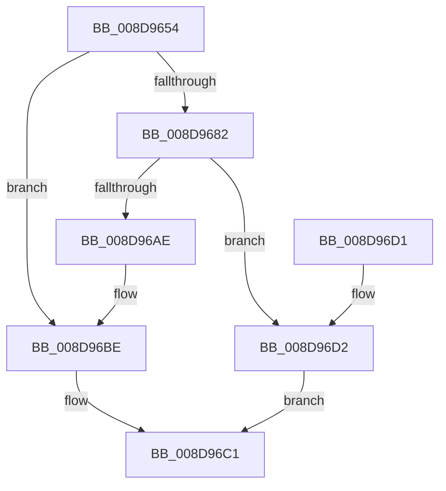

# EtwpCoverageSamplerAllocateTable

- RVA: `0x008D9654`–`0x008D96E3` (길이 `143` bytes)
- VA: `0x00000001408D9654`
- 실행 섹션: `PAGE`
- PDB 이름 있음: `예`; PDB Function 태그: `아니요`
- unwind 정보 RVA: `0x00078D6C`
- 디코드: `40`개 명령, `143/143` bytes 표시
- 미해석 바이트: `0` (있으면 어셈블리에 `.byte`로 보존)

> 이 문서는 커널 이미지의 기계어와 PDB 기호를 분석해 생성했습니다. 4번과 5번은 함수 원형과 자료형을 바이너리 사용 방식에서 추정한 C 해석이며 원본 소스 복구 결과는 아닙니다.

## 1. Dependencies

- 직접 호출 지점: **4**; 고유 호출 대상: **3**
- 직접 호출자로 확인된 함수: **2**
- RIP 상대 이미지 참조: **0**

### Outgoing calls
- `0x008D9675` → [ExAllocatePool2](../../poolcode/B8/ExAllocatePool2_function_00B820F0.md) (function, `0x00B820F0`)
- `0x008D96A0` → [ExAllocatePool2](../../poolcode/B8/ExAllocatePool2_function_00B820F0.md) (function, `0x00B820F0`)
- `0x008D96B6` → [memset](../../text/6C/memset_function_006C6C40.md) (function, `0x006C6C40`)
- `0x008D96DA` → [ExFreePoolWithTag](../../poolcode/B8/ExFreePoolWithTag_function_00B82870.md) (function, `0x00B82870`)

### Direct callers
- [EtwpCoverageSamplerStart](../7C/EtwpCoverageSamplerStart_function_007C2248.md) at `0x007C227D`
- [EtwpCovSampHashMakeRoomAndAcquireLock](EtwpCovSampHashMakeRoomAndAcquireLock_function_008D91F8.md) at `0x008D9334`

### Static image references
- 디코드된 RIP-relative 메모리 참조가 없습니다.

## 2. Other-region calls and transfers

- 다른 실행 섹션으로 향하는 call: **4**
  - `0x008D9675` → [ExAllocatePool2](../../poolcode/B8/ExAllocatePool2_function_00B820F0.md) (`PAGE` → `POOLCODE`)
  - `0x008D96A0` → [ExAllocatePool2](../../poolcode/B8/ExAllocatePool2_function_00B820F0.md) (`PAGE` → `POOLCODE`)
  - `0x008D96B6` → [memset](../../text/6C/memset_function_006C6C40.md) (`PAGE` → `.text`)
  - `0x008D96DA` → [ExFreePoolWithTag](../../poolcode/B8/ExFreePoolWithTag_function_00B82870.md) (`PAGE` → `POOLCODE`)
- 별도 외부 분기/꼬리 이동을 확인하지 못했습니다.

## 3. Assembly (complete function range)

```asm
008D9654  48 89 5C 24 08                  mov qword ptr [rsp + 8], rbx
008D9659  48 89 74 24 10                  mov qword ptr [rsp + 0x10], rsi
008D965E  57                              push rdi
008D965F  48 83 EC 20                     sub rsp, 0x20
008D9663  8B F9                           mov edi, ecx
008D9665  BA 20 00 00 00                  mov edx, 0x20
008D966A  B9 00 01 00 00                  mov ecx, 0x100
008D966F  41 B8 45 74 77 56               mov r8d, 0x56777445
008D9675  E8 76 8A 2A 00                  call 0x140b820f0
008D967A  48 8B D8                        mov rbx, rax
008D967D  48 85 C0                        test rax, rax
008D9680  74 3C                           je 0x1408d96be
008D9682  0F 57 C0                        xorps xmm0, xmm0
008D9685  8D 34 FD 00 00 00 00            lea esi, [rdi*8]
008D968C  0F 11 00                        movups xmmword ptr [rax], xmm0
008D968F  8B D6                           mov edx, esi
008D9691  41 B8 45 74 77 56               mov r8d, 0x56777445
008D9697  B9 00 01 00 00                  mov ecx, 0x100
008D969C  0F 11 40 10                     movups xmmword ptr [rax + 0x10], xmm0
008D96A0  E8 4B 8A 2A 00                  call 0x140b820f0
008D96A5  48 89 43 18                     mov qword ptr [rbx + 0x18], rax
008D96A9  48 85 C0                        test rax, rax
008D96AC  74 24                           je 0x1408d96d2
008D96AE  44 8B C6                        mov r8d, esi
008D96B1  33 D2                           xor edx, edx
008D96B3  48 8B C8                        mov rcx, rax
008D96B6  E8 85 D5 DE FF                  call 0x1406c6c40
008D96BB  89 7B 14                        mov dword ptr [rbx + 0x14], edi
008D96BE  48 8B C3                        mov rax, rbx
008D96C1  48 8B 5C 24 30                  mov rbx, qword ptr [rsp + 0x30]
008D96C6  48 8B 74 24 38                  mov rsi, qword ptr [rsp + 0x38]
008D96CB  48 83 C4 20                     add rsp, 0x20
008D96CF  5F                              pop rdi
008D96D0  C3                              ret
008D96D1  CC                              int3
008D96D2  BA 45 74 77 56                  mov edx, 0x56777445
008D96D7  48 8B CB                        mov rcx, rbx
008D96DA  E8 91 91 2A 00                  call 0x140b82870
008D96DF  33 C0                           xor eax, eax
008D96E1  EB DE                           jmp 0x1408d96c1
```

## 4. C-style interpretation (structured pseudocode)

```c
__int64 __fastcall EtwpCoverageSamplerAllocateTable(int a1)
{
    __int64 result;
    __int64 v_rsp;
    unsigned __int64 v_stack_p10;
    unsigned __int64 v_stack_p8;

    v_stack_p8 = v_rbx;
    v_stack_p10 = v_rsi;
    v_rsp = (v_rsp) - (32);
    result = ExAllocatePool2(256, 32, (unsigned int)(0x56777445ULL), a4);
    if (result == 0) goto loc_008D96BE;
    *(unsigned __int64 *)(result) = v_xmm0;
    *(unsigned __int64 *)(result + 16) = v_xmm0;
    result = ExAllocatePool2(256, (unsigned int)((unsigned int)((unsigned int)(a1) * 8)), (unsigned int)(0x56777445ULL), a4);
    *(unsigned __int64 *)(result + 24) = result;
    if (result == 0) goto loc_008D96D2;
    a2 = 0;
    result = memset(result, a2, (unsigned int)((unsigned int)((unsigned int)(a1) * 8)), a4);
    *(unsigned int *)(result + 20) = (unsigned int)((unsigned int)(a1));
loc_008D96BE:
loc_008D96C1:
    v_rsp = (v_rsp) + (32);
    return result;
loc_008D96D2:
    result = ExFreePoolWithTag(v_stack_p8, (unsigned int)(0x56777445ULL), (unsigned int)((unsigned int)((unsigned int)(a1) * 8)), a4);
    result = 0;
    goto loc_008D96C1;
}
```

## 5. (Beta) C Style

```c
int64_t EtwpCoverageSamplerAllocateTable(int32_t Arg1)
{
    int64_t result;
    int64_t local_rsp;
    uint64_t v_stack_p10;
    uint64_t v_stack_p8;

    v_stack_p8 = local_rbx;
    v_stack_p10 = local_rsi;
    local_rsp = (local_rsp) - (32);
    result = ExAllocatePool2(256, 32, (uint32_t)(0x56777445ULL), a4);
    if (result == 0) goto loc_008D96BE;
    *(uint64_t *)(result) = v_xmm0;
    *(uint64_t *)(result + 0x10) = v_xmm0;
    result = ExAllocatePool2(256, (uint32_t)((uint32_t)((uint32_t)(Arg1) * 8)), (uint32_t)(0x56777445ULL), a4);
    *(uint64_t *)(result + 0x18) = result;
    if (result == 0) goto loc_008D96D2;
    a2 = 0;
    result = memset(result, a2, (uint32_t)((uint32_t)((uint32_t)(Arg1) * 8)), a4);
    *(uint32_t *)(result + 0x14) = (uint32_t)((uint32_t)(Arg1));
loc_008D96BE:
loc_008D96C1:
    local_rsp = (local_rsp) + (32);
    return result;
loc_008D96D2:
    result = ExFreePoolWithTag(v_stack_p8, (uint32_t)(0x56777445ULL), (uint32_t)((uint32_t)((uint32_t)(Arg1) * 8)), a4);
    result = 0;
    goto loc_008D96C1;
}
```

## 6. Execution-region graph

[열기: 2D/3D 그래프와 함수 탐색 컨트롤 패널](../../../control-panel.html?section=page&rva=0x008D9654&view=graph)

- 2D 그래프는 위에서 아래로 흐르고, 3D 그래프는 빈 공간을 드래그해 회전합니다. Shift+드래그는 이동, 휠은 확대·축소, 함수 노드 선택은 대상 보고서 이동입니다.

### Static fallback


