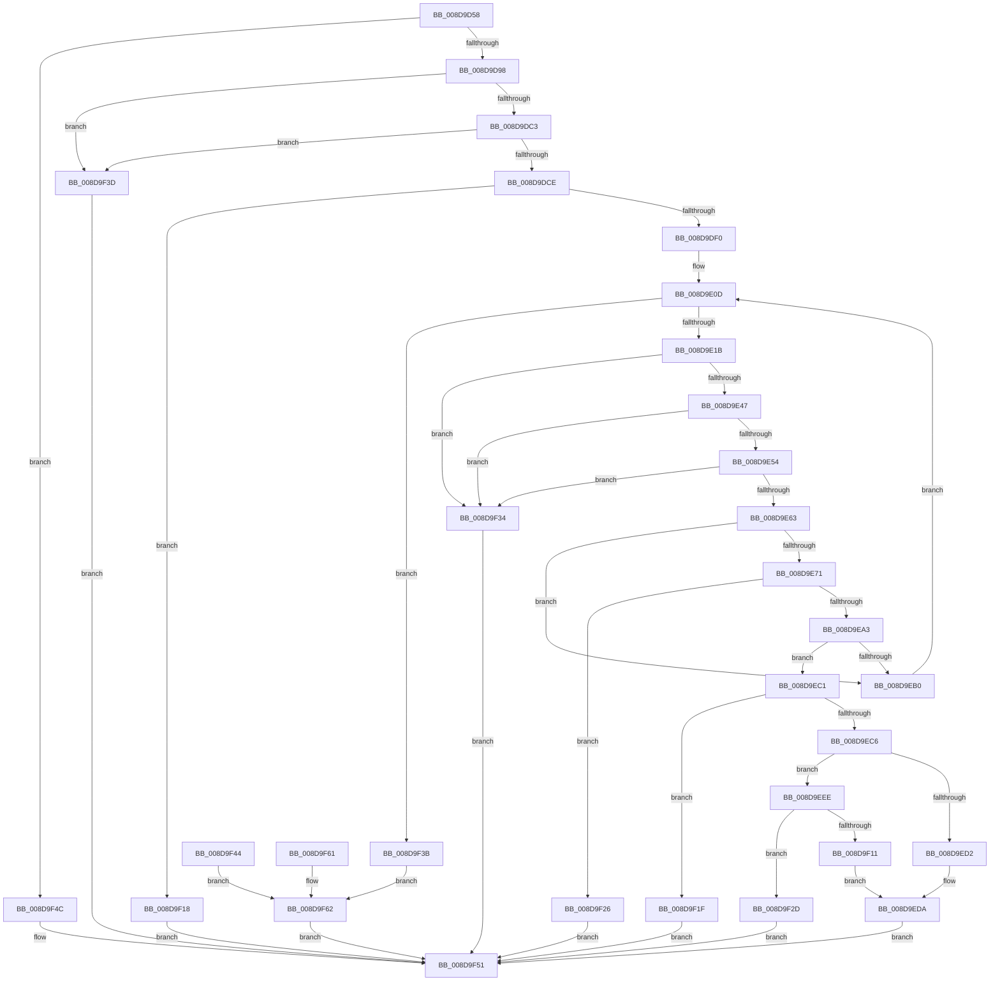

# EtwpFindDebugId

- RVA: `0x008D9D58`–`0x008D9F67` (길이 `527` bytes)
- VA: `0x00000001408D9D58`
- 실행 섹션: `PAGE`
- PDB 이름 있음: `예`; PDB Function 태그: `아니요`
- unwind 정보 RVA: `0x000856D8`
- 디코드: `139`개 명령, `527/527` bytes 표시
- 미해석 바이트: `0` (있으면 어셈블리에 `.byte`로 보존)

> 이 문서는 커널 이미지의 기계어와 PDB 기호를 분석해 생성했습니다. 4번과 5번은 함수 원형과 자료형을 바이너리 사용 방식에서 추정한 C 해석이며 원본 소스 복구 결과는 아닙니다.

## 1. Dependencies

- 직접 호출 지점: **6**; 고유 호출 대상: **5**
- 직접 호출자로 확인된 함수: **2**
- RIP 상대 이미지 참조: **0**

### Outgoing calls
- `0x008D9D82` → [RtlImageNtHeader](../../text/44/RtlImageNtHeader_function_00443B60.md) (function, `0x00443B60`)
- `0x008D9DAD` → [RtlImageDirectoryEntryToData](../../text/43/RtlImageDirectoryEntryToData_function_004328D0.md) (function, `0x004328D0`)
- `0x008D9DE3` → [EtwpIsValidImageAddress](EtwpIsValidImageAddress_function_008D9F70.md) (function, `0x008D9F70`)
- `0x008D9E96` → [EtwpIsValidImageAddress](EtwpIsValidImageAddress_function_008D9F70.md) (function, `0x008D9F70`)
- `0x008D9EE5` → [memcpy](../../text/6C/memcpy_function_006C6840.md) (function, `0x006C6840`)
- `0x008D9EFC` → [ExAllocatePool2](../../poolcode/B8/ExAllocatePool2_function_00B820F0.md) (function, `0x00B820F0`)

### Direct callers
- [EtwpCovSampContextGetModule](EtwpCovSampContextGetModule_function_008D7FEC.md) at `0x008D82E8`
- [EtwpLocateDbgIdForRegEntry](EtwpLocateDbgIdForRegEntry_function_008D99A4.md) at `0x008D9AA9`

### Static image references
- 디코드된 RIP-relative 메모리 참조가 없습니다.

## 2. Other-region calls and transfers

- 다른 실행 섹션으로 향하는 call: **4**
  - `0x008D9D82` → [RtlImageNtHeader](../../text/44/RtlImageNtHeader_function_00443B60.md) (`PAGE` → `.text`)
  - `0x008D9DAD` → [RtlImageDirectoryEntryToData](../../text/43/RtlImageDirectoryEntryToData_function_004328D0.md) (`PAGE` → `.text`)
  - `0x008D9EE5` → [memcpy](../../text/6C/memcpy_function_006C6840.md) (`PAGE` → `.text`)
  - `0x008D9EFC` → [ExAllocatePool2](../../poolcode/B8/ExAllocatePool2_function_00B820F0.md) (`PAGE` → `POOLCODE`)
- 별도 외부 분기/꼬리 이동을 확인하지 못했습니다.

## 3. Assembly (complete function range)

```asm
008D9D58  4C 89 4C 24 20                  mov qword ptr [rsp + 0x20], r9
008D9D5D  4C 89 44 24 18                  mov qword ptr [rsp + 0x18], r8
008D9D62  48 89 4C 24 08                  mov qword ptr [rsp + 8], rcx
008D9D67  53                              push rbx
008D9D68  56                              push rsi
008D9D69  57                              push rdi
008D9D6A  41 54                           push r12
008D9D6C  41 55                           push r13
008D9D6E  41 56                           push r14
008D9D70  41 57                           push r15
008D9D72  48 83 EC 70                     sub rsp, 0x70
008D9D76  4C 8B E2                        mov r12, rdx
008D9D79  48 8B F9                        mov rdi, rcx
008D9D7C  41 BD 25 02 00 C0               mov r13d, 0xc0000225
008D9D82  E8 D9 9D B6 FF                  call 0x140443b60
008D9D87  4C 8B F0                        mov r14, rax
008D9D8A  48 89 44 24 40                  mov qword ptr [rsp + 0x40], rax
008D9D8F  48 85 C0                        test rax, rax
008D9D92  0F 84 B4 01 00 00               je 0x1408d9f4c
008D9D98  83 64 24 30 00                  and dword ptr [rsp + 0x30], 0
008D9D9D  41 B8 06 00 00 00               mov r8d, 6
008D9DA3  4C 8D 4C 24 30                  lea r9, [rsp + 0x30]
008D9DA8  B2 01                           mov dl, 1
008D9DAA  48 8B CF                        mov rcx, rdi
008D9DAD  E8 1E 8B B5 FF                  call 0x1404328d0
008D9DB2  48 8B D8                        mov rbx, rax
008D9DB5  48 89 44 24 48                  mov qword ptr [rsp + 0x48], rax
008D9DBA  48 85 C0                        test rax, rax
008D9DBD  0F 84 7A 01 00 00               je 0x1408d9f3d
008D9DC3  83 7C 24 30 1C                  cmp dword ptr [rsp + 0x30], 0x1c
008D9DC8  0F 82 6F 01 00 00               jb 0x1408d9f3d
008D9DCE  8B 74 24 30                     mov esi, dword ptr [rsp + 0x30]
008D9DD2  48 89 74 24 20                  mov qword ptr [rsp + 0x20], rsi
008D9DD7  4C 8B C8                        mov r9, rax
008D9DDA  4D 8B C4                        mov r8, r12
008D9DDD  48 8B D7                        mov rdx, rdi
008D9DE0  49 8B CE                        mov rcx, r14
008D9DE3  E8 88 01 00 00                  call 0x1408d9f70
008D9DE8  84 C0                           test al, al
008D9DEA  0F 84 28 01 00 00               je 0x1408d9f18
008D9DF0  48 B8 93 24 49 92 24 49 92 24   movabs rax, 0x2492492492492493
008D9DFA  48 F7 E6                        mul rsi
008D9DFD  48 2B F2                        sub rsi, rdx
008D9E00  48 D1 EE                        shr rsi, 1
008D9E03  48 03 F2                        add rsi, rdx
008D9E06  48 C1 EE 04                     shr rsi, 4
008D9E0A  45 33 FF                        xor r15d, r15d
008D9E0D  44 89 7C 24 38                  mov dword ptr [rsp + 0x38], r15d
008D9E12  44 3B FE                        cmp r15d, esi
008D9E15  0F 83 20 01 00 00               jae 0x1408d9f3b
008D9E1B  0F 10 03                        movups xmm0, xmmword ptr [rbx]
008D9E1E  0F 11 44 24 50                  movups xmmword ptr [rsp + 0x50], xmm0
008D9E23  F2 0F 10 4B 10                  movsd xmm1, qword ptr [rbx + 0x10]
008D9E28  F2 0F 11 4C 24 60               movsd qword ptr [rsp + 0x60], xmm1
008D9E2E  8B 43 18                        mov eax, dword ptr [rbx + 0x18]
008D9E31  89 44 24 68                     mov dword ptr [rsp + 0x68], eax
008D9E35  48 8B 4C 24 60                  mov rcx, qword ptr [rsp + 0x60]
008D9E3A  48 C1 E9 20                     shr rcx, 0x20
008D9E3E  49 3B CC                        cmp rcx, r12
008D9E41  0F 87 ED 00 00 00               ja 0x1408d9f34
008D9E47  8B 7C 24 60                     mov edi, dword ptr [rsp + 0x60]
008D9E4B  49 3B FC                        cmp rdi, r12
008D9E4E  0F 87 E0 00 00 00               ja 0x1408d9f34
008D9E54  49 8B C4                        mov rax, r12
008D9E57  48 2B C7                        sub rax, rdi
008D9E5A  48 3B C8                        cmp rcx, rax
008D9E5D  0F 87 D1 00 00 00               ja 0x1408d9f34
008D9E63  48 8B 44 24 58                  mov rax, qword ptr [rsp + 0x58]
008D9E68  48 C1 E8 20                     shr rax, 0x20
008D9E6C  83 F8 02                        cmp eax, 2
008D9E6F  75 3F                           jne 0x1408d9eb0
008D9E71  48 03 8C 24 B0 00 00 00         add rcx, qword ptr [rsp + 0xb0]
008D9E79  48 89 4C 24 30                  mov qword ptr [rsp + 0x30], rcx
008D9E7E  48 89 7C 24 20                  mov qword ptr [rsp + 0x20], rdi
008D9E83  4C 8B C9                        mov r9, rcx
008D9E86  4D 8B C4                        mov r8, r12
008D9E89  48 8B 94 24 B0 00 00 00         mov rdx, qword ptr [rsp + 0xb0]
008D9E91  48 8B 4C 24 40                  mov rcx, qword ptr [rsp + 0x40]
008D9E96  E8 D5 00 00 00                  call 0x1408d9f70
008D9E9B  84 C0                           test al, al
008D9E9D  0F 84 83 00 00 00               je 0x1408d9f26
008D9EA3  48 8B 44 24 30                  mov rax, qword ptr [rsp + 0x30]
008D9EA8  81 38 52 53 44 53               cmp dword ptr [rax], 0x53445352
008D9EAE  74 11                           je 0x1408d9ec1
008D9EB0  48 83 C3 1C                     add rbx, 0x1c
008D9EB4  48 89 5C 24 48                  mov qword ptr [rsp + 0x48], rbx
008D9EB9  41 FF C7                        inc r15d
008D9EBC  E9 4C FF FF FF                  jmp 0x1408d9e0d
008D9EC1  83 FF 1C                        cmp edi, 0x1c
008D9EC4  72 59                           jb 0x1408d9f1f
008D9EC6  48 8B 9C 24 C8 00 00 00         mov rbx, qword ptr [rsp + 0xc8]
008D9ECE  39 3B                           cmp dword ptr [rbx], edi
008D9ED0  72 1C                           jb 0x1408d9eee
008D9ED2  48 8B 8C 24 C0 00 00 00         mov rcx, qword ptr [rsp + 0xc0]
008D9EDA  89 3B                           mov dword ptr [rbx], edi
008D9EDC  4C 8B C7                        mov r8, rdi
008D9EDF  48 8B D0                        mov rdx, rax
008D9EE2  48 8B 09                        mov rcx, qword ptr [rcx]
008D9EE5  E8 56 C9 DE FF                  call 0x1406c6840
008D9EEA  33 C0                           xor eax, eax
008D9EEC  EB 63                           jmp 0x1408d9f51
008D9EEE  41 B8 45 74 77 62               mov r8d, 0x62777445
008D9EF4  48 8B D7                        mov rdx, rdi
008D9EF7  B9 00 01 00 00                  mov ecx, 0x100
008D9EFC  E8 EF 81 2A 00                  call 0x140b820f0
008D9F01  48 8B 8C 24 C0 00 00 00         mov rcx, qword ptr [rsp + 0xc0]
008D9F09  48 89 01                        mov qword ptr [rcx], rax
008D9F0C  48 85 C0                        test rax, rax
008D9F0F  74 1C                           je 0x1408d9f2d
008D9F11  48 8B 44 24 30                  mov rax, qword ptr [rsp + 0x30]
008D9F16  EB C2                           jmp 0x1408d9eda
008D9F18  B8 7B 00 00 C0                  mov eax, 0xc000007b
008D9F1D  EB 32                           jmp 0x1408d9f51
008D9F1F  B8 7B 00 00 C0                  mov eax, 0xc000007b
008D9F24  EB 2B                           jmp 0x1408d9f51
008D9F26  B8 7B 00 00 C0                  mov eax, 0xc000007b
008D9F2B  EB 24                           jmp 0x1408d9f51
008D9F2D  B8 17 00 00 C0                  mov eax, 0xc0000017
008D9F32  EB 1D                           jmp 0x1408d9f51
008D9F34  B8 0D 00 00 C0                  mov eax, 0xc000000d
008D9F39  EB 16                           jmp 0x1408d9f51
008D9F3B  EB 25                           jmp 0x1408d9f62
008D9F3D  B8 0D 00 00 C0                  mov eax, 0xc000000d
008D9F42  EB 0D                           jmp 0x1408d9f51
008D9F44  41 BD 7B 00 00 C0               mov r13d, 0xc000007b
008D9F4A  EB 16                           jmp 0x1408d9f62
008D9F4C  B8 7B 00 00 C0                  mov eax, 0xc000007b
008D9F51  48 83 C4 70                     add rsp, 0x70
008D9F55  41 5F                           pop r15
008D9F57  41 5E                           pop r14
008D9F59  41 5D                           pop r13
008D9F5B  41 5C                           pop r12
008D9F5D  5F                              pop rdi
008D9F5E  5E                              pop rsi
008D9F5F  5B                              pop rbx
008D9F60  C3                              ret
008D9F61  CC                              int3
008D9F62  41 8B C5                        mov eax, r13d
008D9F65  EB EA                           jmp 0x1408d9f51
```

## 4. C-style interpretation (structured pseudocode)

```c
__int64 __fastcall EtwpFindDebugId(__int64 a1, __int64 a2, __int64 a3, __int64 a4)
{
    __int64 result;
    __int64 v_r15;
    __int64 v_rbx;
    __int64 v_rsi;
    __int64 v_rsp;
    unsigned int v_stack_m40;
    unsigned __int64 v_stack_m48;
    unsigned __int64 v_stack_m50;
    unsigned __int64 v_stack_m58;
    unsigned __int64 v_stack_m60;
    unsigned __int64 v_stack_m68;
    unsigned int v_stack_m70;
    unsigned int v_stack_m78;
    unsigned __int64 v_stack_m88;
    unsigned __int64 v_stack_p18;
    unsigned __int64 v_stack_p20;
    unsigned __int64 v_stack_p8;

    v_stack_p20 = a4;
    v_stack_p18 = a3;
    v_stack_p8 = a1;
    v_rsp = (v_rsp) - (112);
    result = RtlImageNtHeader(a1, a2, a3, a4);
    v_stack_m68 = result;
    if (result == 0) goto loc_008D9F4C;
    result = RtlImageDirectoryEntryToData(a1, 1, 6, v_stack_m78);
    v_stack_m60 = result;
    if (result == 0) goto loc_008D9F3D;
    if (v_stack_m78 < 28) goto loc_008D9F3D;
    v_stack_m88 = (unsigned int)(v_stack_m78);
    result = EtwpIsValidImageAddress(result, a1, a2, result);
    if ((unsigned __int8)(result) == 0) goto loc_008D9F18;
    v_rsi = ((unsigned int)(v_stack_m78)) - (a1);
    v_rsi = (v_rsi) >> (1);
    v_rsi = (v_rsi) + (a1);
    v_rsi = (v_rsi) >> (4);
    v_r15 = 0;
loc_008D9E0D:
    v_stack_m70 = 0;
    if (0 >= ((unsigned int)(v_rsi))) goto loc_008D9F3B;
    v_stack_m58 = v_xmm0;
    v_stack_m48 = v_xmm1;
    v_stack_m40 = (unsigned int)((unsigned int)(*(unsigned int *)(result + 24)));
    a1 = (v_stack_m48) >> (32);
    if (a1 > a2) goto loc_008D9F34;
    if (((unsigned int)(v_stack_m48)) > a2) goto loc_008D9F34;
    result = (a2) - ((unsigned int)(v_stack_m48));
    if (a1 > result) goto loc_008D9F34;
    result = (v_stack_m50) >> (32);
    if (((unsigned int)(result)) != 2) goto loc_008D9EB0;
    a1 = (a1) + (v_stack_p8);
    v_stack_m78 = a1;
    v_stack_m88 = (unsigned int)(v_stack_m48);
    result = EtwpIsValidImageAddress(v_stack_m68, v_stack_p8, a2, a1);
    if ((unsigned __int8)(result) == 0) goto loc_008D9F26;
    if ((*(unsigned int *)(v_stack_m78)) == 0x53445352ULL) goto loc_008D9EC1;
loc_008D9EB0:
    v_rbx = (result) + (28);
    v_stack_m60 = v_rbx;
    v_r15 = (unsigned int)((v_r15) + 1);
    goto loc_008D9E0D;
loc_008D9EC1:
    if (((unsigned int)((unsigned int)(v_stack_m48))) < 28) goto loc_008D9F1F;
    if ((*(unsigned int *)(v_stack_p20)) < ((unsigned int)((unsigned int)(v_stack_m48)))) goto loc_008D9EEE;
loc_008D9EDA:
    *(unsigned int *)(v_stack_p20) = (unsigned int)((unsigned int)(v_stack_m48));
    result = memcpy(*(unsigned __int64 *)(v_stack_p18), v_stack_m78, (unsigned int)(v_stack_m48), a1);
    result = 0;
    goto loc_008D9F51;
loc_008D9EEE:
    result = ExAllocatePool2(256, (unsigned int)(v_stack_m48), (unsigned int)(0x62777445ULL), a1);
    *(unsigned __int64 *)(v_stack_p18) = result;
    if (result == 0) goto loc_008D9F2D;
    goto loc_008D9EDA;
loc_008D9F18:
    goto loc_008D9F51;
loc_008D9F1F:
    goto loc_008D9F51;
loc_008D9F26:
    goto loc_008D9F51;
loc_008D9F2D:
    goto loc_008D9F51;
loc_008D9F34:
    goto loc_008D9F51;
loc_008D9F3B:
    goto loc_008D9F62;
loc_008D9F3D:
    goto loc_008D9F51;
loc_008D9F4C:
loc_008D9F51:
    v_rsp = (v_rsp) + (112);
    return (unsigned int)(0xC000007BULL);
loc_008D9F62:
    goto loc_008D9F51;
}
```

## 5. (Beta) C Style

```c
int64_t EtwpFindDebugId(int64_t Arg1, int64_t Arg2, int64_t Arg3, int64_t Arg4)
{
    int64_t result;
    int64_t local_r15;
    int64_t local_rbx;
    int64_t local_rsi;
    int64_t local_rsp;
    uint32_t v_stack_m40;
    uint64_t v_stack_m48;
    uint64_t v_stack_m50;
    uint64_t v_stack_m58;
    uint64_t v_stack_m60;
    uint64_t v_stack_m68;
    uint32_t v_stack_m70;
    uint32_t v_stack_m78;
    uint64_t v_stack_m88;
    uint64_t v_stack_p18;
    uint64_t v_stack_p20;
    uint64_t v_stack_p8;

    v_stack_p20 = Arg4;
    v_stack_p18 = Arg3;
    v_stack_p8 = Arg1;
    local_rsp = (local_rsp) - (112);
    result = RtlImageNtHeader(Arg1, Arg2, Arg3, Arg4);
    v_stack_m68 = result;
    if (result == 0) goto loc_008D9F4C;
    result = RtlImageDirectoryEntryToData(Arg1, 1, 6, v_stack_m78);
    v_stack_m60 = result;
    if (result == 0) goto loc_008D9F3D;
    if (v_stack_m78 < 28) goto loc_008D9F3D;
    v_stack_m88 = (uint32_t)(v_stack_m78);
    result = EtwpIsValidImageAddress(result, Arg1, Arg2, result);
    if ((uint8_t)(result) == 0) goto loc_008D9F18;
    local_rsi = ((uint32_t)(v_stack_m78)) - (Arg1);
    local_rsi = (local_rsi) >> (1);
    local_rsi = (local_rsi) + (Arg1);
    local_rsi = (local_rsi) >> (4);
    local_r15 = 0;
loc_008D9E0D:
    v_stack_m70 = 0;
    if (0 >= ((uint32_t)(local_rsi))) goto loc_008D9F3B;
    v_stack_m58 = v_xmm0;
    v_stack_m48 = v_xmm1;
    v_stack_m40 = (uint32_t)((uint32_t)(*(uint32_t *)(result + 0x18)));
    Arg1 = (v_stack_m48) >> (32);
    if (Arg1 > Arg2) goto loc_008D9F34;
    if (((uint32_t)(v_stack_m48)) > Arg2) goto loc_008D9F34;
    result = (Arg2) - ((uint32_t)(v_stack_m48));
    if (Arg1 > result) goto loc_008D9F34;
    result = (v_stack_m50) >> (32);
    if (((uint32_t)(result)) != 2) goto loc_008D9EB0;
    Arg1 = (Arg1) + (v_stack_p8);
    v_stack_m78 = Arg1;
    v_stack_m88 = (uint32_t)(v_stack_m48);
    result = EtwpIsValidImageAddress(v_stack_m68, v_stack_p8, Arg2, Arg1);
    if ((uint8_t)(result) == 0) goto loc_008D9F26;
    if ((*(uint32_t *)(v_stack_m78)) == 0x53445352ULL) goto loc_008D9EC1;
loc_008D9EB0:
    local_rbx = (result) + (28);
    v_stack_m60 = local_rbx;
    local_r15 = (uint32_t)((local_r15) + 1);
    goto loc_008D9E0D;
loc_008D9EC1:
    if (((uint32_t)((uint32_t)(v_stack_m48))) < 28) goto loc_008D9F1F;
    if ((*(uint32_t *)(v_stack_p20)) < ((uint32_t)((uint32_t)(v_stack_m48)))) goto loc_008D9EEE;
loc_008D9EDA:
    *(uint32_t *)(v_stack_p20) = (uint32_t)((uint32_t)(v_stack_m48));
    result = memcpy(*(uint64_t *)(v_stack_p18), v_stack_m78, (uint32_t)(v_stack_m48), Arg1);
    result = 0;
    goto loc_008D9F51;
loc_008D9EEE:
    result = ExAllocatePool2(256, (uint32_t)(v_stack_m48), (uint32_t)(0x62777445ULL), Arg1);
    *(uint64_t *)(v_stack_p18) = result;
    if (result == 0) goto loc_008D9F2D;
    goto loc_008D9EDA;
loc_008D9F18:
    goto loc_008D9F51;
loc_008D9F1F:
    goto loc_008D9F51;
loc_008D9F26:
    goto loc_008D9F51;
loc_008D9F2D:
    goto loc_008D9F51;
loc_008D9F34:
    goto loc_008D9F51;
loc_008D9F3B:
    goto loc_008D9F62;
loc_008D9F3D:
    goto loc_008D9F51;
loc_008D9F4C:
loc_008D9F51:
    local_rsp = (local_rsp) + (112);
    return (uint32_t)(0xC000007BULL);
loc_008D9F62:
    goto loc_008D9F51;
}
```

## 6. Execution-region graph

[열기: 2D/3D 그래프와 함수 탐색 컨트롤 패널](../../../control-panel.html?section=page&rva=0x008D9D58&view=graph)

- 2D 그래프는 위에서 아래로 흐르고, 3D 그래프는 빈 공간을 드래그해 회전합니다. Shift+드래그는 이동, 휠은 확대·축소, 함수 노드 선택은 대상 보고서 이동입니다.

### Static fallback


