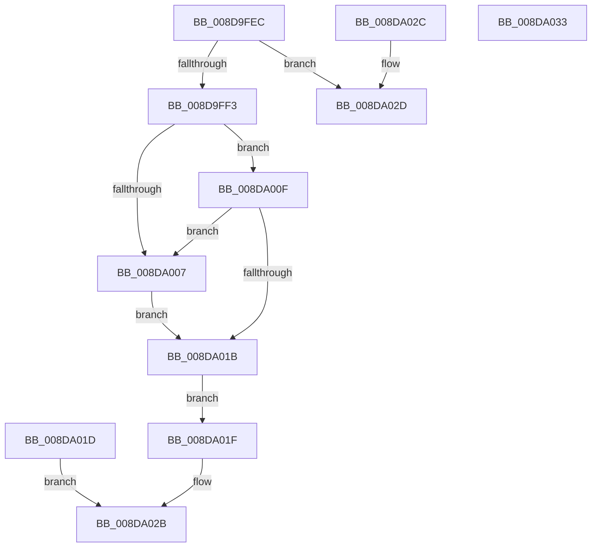

# EtwpGetImageSize

- RVA: `0x008D9FEC`–`0x008DA034` (길이 `72` bytes)
- VA: `0x00000001408D9FEC`
- 실행 섹션: `PAGE`
- PDB 이름 있음: `예`; PDB Function 태그: `아니요`
- unwind 정보 RVA: `0x00085708`
- 디코드: `25`개 명령, `72/72` bytes 표시
- 미해석 바이트: `0` (있으면 어셈블리에 `.byte`로 보존)

> 이 문서는 커널 이미지의 기계어와 PDB 기호를 분석해 생성했습니다. 4번과 5번은 함수 원형과 자료형을 바이너리 사용 방식에서 추정한 C 해석이며 원본 소스 복구 결과는 아닙니다.

## 1. Dependencies

- 직접 호출 지점: **0**; 고유 호출 대상: **0**
- 직접 호출자로 확인된 함수: **1**
- RIP 상대 이미지 참조: **0**

### Outgoing calls
- 직접 디코드된 call 명령이 없습니다.

### Direct callers
- [EtwpLocateDbgIdForRegEntry](EtwpLocateDbgIdForRegEntry_function_008D99A4.md) at `0x008D9A5D`

### Static image references
- 디코드된 RIP-relative 메모리 참조가 없습니다.

## 2. Other-region calls and transfers

- 다른 실행 섹션으로 향하는 call: **0**
- 별도 외부 분기/꼬리 이동을 확인하지 못했습니다.

## 3. Assembly (complete function range)

```asm
008D9FEC  33 C0                           xor eax, eax
008D9FEE  48 85 C9                        test rcx, rcx
008D9FF1  74 3A                           je 0x1408da02d
008D9FF3  48 89 02                        mov qword ptr [rdx], rax
008D9FF6  44 0F B7 41 18                  movzx r8d, word ptr [rcx + 0x18]
008D9FFB  41 B9 0B 01 00 00               mov r9d, 0x10b
008DA001  66 45 3B C1                     cmp r8w, r9w
008DA005  75 08                           jne 0x1408da00f
008DA007  8B 41 50                        mov eax, dword ptr [rcx + 0x50]
008DA00A  48 89 02                        mov qword ptr [rdx], rax
008DA00D  EB 0C                           jmp 0x1408da01b
008DA00F  41 B9 0B 02 00 00               mov r9d, 0x20b
008DA015  66 45 3B C1                     cmp r8w, r9w
008DA019  74 EC                           je 0x1408da007
008DA01B  EB 02                           jmp 0x1408da01f
008DA01D  EB 0C                           jmp 0x1408da02b
008DA01F  48 F7 D8                        neg rax
008DA022  1B C0                           sbb eax, eax
008DA024  F7 D0                           not eax
008DA026  25 7B 00 00 C0                  and eax, 0xc000007b
008DA02B  C3                              ret
008DA02C  CC                              int3
008DA02D  B8 0D 00 00 C0                  mov eax, 0xc000000d
008DA032  C3                              ret
008DA033  CC                              int3
```

## 4. C-style interpretation (structured pseudocode)

```c
__int64 __fastcall EtwpGetImageSize(__int64 a1, __int64 a2)
{
    __int64 result;

    result = 0;
    if (a1 == 0) goto loc_008DA02D;
    *(unsigned __int64 *)(a2) = 0;
    if (((unsigned __int16)(*(unsigned __int16 *)(a1 + 24))) != 267) goto loc_008DA00F;
loc_008DA007:
    *(unsigned __int64 *)(a2) = (unsigned int)(*(unsigned int *)(a1 + 80));
    goto loc_008DA01B;
loc_008DA00F:
    if (((unsigned __int16)(*(unsigned __int16 *)(a1 + 24))) == 523) goto loc_008DA007;
loc_008DA01B:
    goto loc_008DA01F;
loc_008DA01F:
    result = -((unsigned int)(*(unsigned int *)(a1 + 80)));
    result = (unsigned int)(~(result));
    result = (unsigned int)((result) & (0xC000007BULL));
loc_008DA02B:
    return result;
loc_008DA02D:
    return (unsigned int)(0xC000000DULL);
}
```

## 5. (Beta) C Style

```c
int64_t EtwpGetImageSize(int64_t Arg1, void *Arg2)
{
    uint8_t *arg2 = (uint8_t *)Arg2;

    int64_t result;

    result = 0;
    if (Arg1 == 0) goto loc_008DA02D;
    *(uint64_t *)(arg2) = 0;
    if (((uint16_t)(*(uint16_t *)(Arg1 + 0x18))) != 267) goto loc_008DA00F;
loc_008DA007:
    *(uint64_t *)(arg2) = (uint32_t)(*(uint32_t *)(Arg1 + 0x50));
    goto loc_008DA01B;
loc_008DA00F:
    if (((uint16_t)(*(uint16_t *)(Arg1 + 0x18))) == 523) goto loc_008DA007;
loc_008DA01B:
    goto loc_008DA01F;
loc_008DA01F:
    result = -((uint32_t)(*(uint32_t *)(Arg1 + 0x50)));
    result = (uint32_t)(~(result));
    result = (uint32_t)((result) & (0xC000007BULL));
loc_008DA02B:
    return result;
loc_008DA02D:
    return (uint32_t)(0xC000000DULL);
}
```

### 관측된 메모리 오프셋

구조체 형식이 확인되지 않은 접근은 인자 기준의 오프셋으로만 기록했습니다.

| 기준 인자 | 오프셋 표현 | 폭 (bit) | 접근 |
|---|---:|---:|---|
| `Arg2` | `+ 0x0` | `64` | `W` |

## 6. Execution-region graph

[열기: 2D/3D 그래프와 함수 탐색 컨트롤 패널](../../../control-panel.html?section=page&rva=0x008D9FEC&view=graph)

- 2D 그래프는 위에서 아래로 흐르고, 3D 그래프는 빈 공간을 드래그해 회전합니다. Shift+드래그는 이동, 휠은 확대·축소, 함수 노드 선택은 대상 보고서 이동입니다.

### Static fallback


