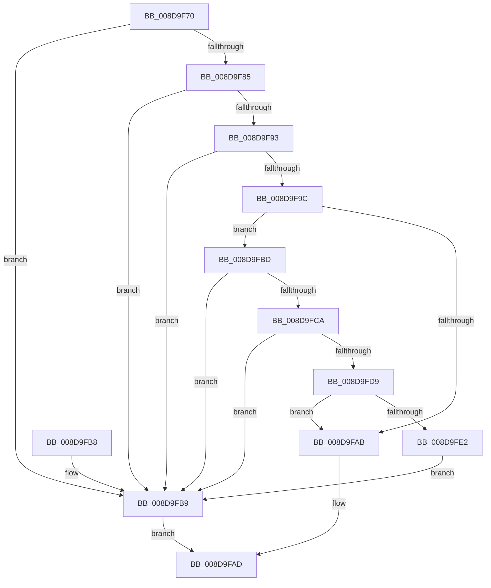

# EtwpIsValidImageAddress

- RVA: `0x008D9F70`–`0x008D9FE4` (길이 `116` bytes)
- VA: `0x00000001408D9F70`
- 실행 섹션: `PAGE`
- PDB 이름 있음: `예`; PDB Function 태그: `아니요`
- unwind 정보 RVA: `0x0005D210`
- 디코드: `37`개 명령, `116/116` bytes 표시
- 미해석 바이트: `0` (있으면 어셈블리에 `.byte`로 보존)

> 이 문서는 커널 이미지의 기계어와 PDB 기호를 분석해 생성했습니다. 4번과 5번은 함수 원형과 자료형을 바이너리 사용 방식에서 추정한 C 해석이며 원본 소스 복구 결과는 아닙니다.

## 1. Dependencies

- 직접 호출 지점: **1**; 고유 호출 대상: **1**
- 직접 호출자로 확인된 함수: **1**
- RIP 상대 이미지 참조: **0**

### Outgoing calls
- `0x008D9FC0` → [RtlSectionTableFromVirtualAddress](../../text/43/RtlSectionTableFromVirtualAddress_function_00432CF0.md) (function, `0x00432CF0`)

### Direct callers
- [EtwpFindDebugId](EtwpFindDebugId_function_008D9D58.md) at `0x008D9DE3`
- [EtwpFindDebugId](EtwpFindDebugId_function_008D9D58.md) at `0x008D9E96`

### Static image references
- 디코드된 RIP-relative 메모리 참조가 없습니다.

## 2. Other-region calls and transfers

- 다른 실행 섹션으로 향하는 call: **1**
  - `0x008D9FC0` → [RtlSectionTableFromVirtualAddress](../../text/43/RtlSectionTableFromVirtualAddress_function_00432CF0.md) (`PAGE` → `.text`)
- 별도 외부 분기/꼬리 이동을 확인하지 못했습니다.

## 3. Assembly (complete function range)

```asm
008D9F70  48 89 5C 24 08                  mov qword ptr [rsp + 8], rbx
008D9F75  57                              push rdi
008D9F76  48 83 EC 20                     sub rsp, 0x20
008D9F7A  49 8B D9                        mov rbx, r9
008D9F7D  48 2B DA                        sub rbx, rdx
008D9F80  4C 3B CA                        cmp r9, rdx
008D9F83  72 34                           jb 0x1408d9fb9
008D9F85  48 8B 7C 24 50                  mov rdi, qword ptr [rsp + 0x50]
008D9F8A  4D 8D 14 39                     lea r10, [r9 + rdi]
008D9F8E  4D 3B D1                        cmp r10, r9
008D9F91  72 26                           jb 0x1408d9fb9
008D9F93  4A 8D 04 02                     lea rax, [rdx + r8]
008D9F97  4C 3B D0                        cmp r10, rax
008D9F9A  77 1D                           ja 0x1408d9fb9
008D9F9C  48 B8 00 00 00 00 00 80 FF FF   movabs rax, 0xffff800000000000
008D9FA6  48 3B D0                        cmp rdx, rax
008D9FA9  73 12                           jae 0x1408d9fbd
008D9FAB  B0 01                           mov al, 1
008D9FAD  48 8B 5C 24 30                  mov rbx, qword ptr [rsp + 0x30]
008D9FB2  48 83 C4 20                     add rsp, 0x20
008D9FB6  5F                              pop rdi
008D9FB7  C3                              ret
008D9FB8  CC                              int3
008D9FB9  32 C0                           xor al, al
008D9FBB  EB F0                           jmp 0x1408d9fad
008D9FBD  44 8B C3                        mov r8d, ebx
008D9FC0  E8 2B 8D B5 FF                  call 0x140432cf0
008D9FC5  48 85 C0                        test rax, rax
008D9FC8  74 EF                           je 0x1408d9fb9
008D9FCA  8B 50 10                        mov edx, dword ptr [rax + 0x10]
008D9FCD  48 8D 0C 3B                     lea rcx, [rbx + rdi]
008D9FD1  03 50 0C                        add edx, dword ptr [rax + 0xc]
008D9FD4  48 3B CA                        cmp rcx, rdx
008D9FD7  77 E0                           ja 0x1408d9fb9
008D9FD9  F7 40 24 00 00 00 02            test dword ptr [rax + 0x24], 0x2000000
008D9FE0  74 C9                           je 0x1408d9fab
008D9FE2  EB D5                           jmp 0x1408d9fb9
```

## 4. C-style interpretation (structured pseudocode)

```c
__int64 __fastcall EtwpIsValidImageAddress(__int64 a1, __int64 a2, __int64 a3, __int64 a4, __int64 a5)
{
    __int64 result;
    __int64 v_rbx;
    __int64 v_rsp;
    unsigned __int64 v_stack_p8;

    v_stack_p8 = v_rbx;
    v_rsp = (v_rsp) - (32);
    v_rbx = (a4) - (a2);
    if (a4 < a2) goto loc_008D9FB9;
    if ((a4 + a5 * 1) < a4) goto loc_008D9FB9;
    if ((a4 + a5 * 1) > (a2 + a3 * 1)) goto loc_008D9FB9;
    if (a2 >= (a2 + a3 * 1)) goto loc_008D9FBD;
loc_008D9FAB:
loc_008D9FAD:
    v_rsp = (v_rsp) + (32);
    return 1;
loc_008D9FB9:
    result = 0;
    goto loc_008D9FAD;
loc_008D9FBD:
    result = RtlSectionTableFromVirtualAddress(a1, a2, (unsigned int)((unsigned int)(v_stack_p8)), a4);
    if (result == 0) goto loc_008D9FB9;
    a2 = (unsigned int)(((unsigned int)(*(unsigned int *)(result + 16))) + (*(unsigned int *)(result + 12)));
    if ((v_stack_p8 + a5 * 1) > a2) goto loc_008D9FB9;
    if (((*(unsigned int *)(result + 36)) & (0x2000000ULL)) == 0) goto loc_008D9FAB;
    goto loc_008D9FB9;
}
```

## 5. (Beta) C Style

```c
int64_t EtwpIsValidImageAddress(int64_t Arg1, void *Arg2, int64_t Arg3, void *Arg4, int64_t Arg5)
{
    uint8_t *arg2 = (uint8_t *)Arg2;
    uint8_t *arg4 = (uint8_t *)Arg4;

    int64_t result;
    int64_t local_rbx;
    int64_t local_rsp;
    uint64_t v_stack_p8;

    v_stack_p8 = local_rbx;
    local_rsp = (local_rsp) - (32);
    local_rbx = (Arg4) - (Arg2);
    if (Arg4 < Arg2) goto loc_008D9FB9;
    if ((Arg4 + Arg5 * 1) < Arg4) goto loc_008D9FB9;
    if ((Arg4 + Arg5 * 1) > (Arg2 + Arg3 * 1)) goto loc_008D9FB9;
    if (Arg2 >= (Arg2 + Arg3 * 1)) goto loc_008D9FBD;
loc_008D9FAB:
loc_008D9FAD:
    local_rsp = (local_rsp) + (32);
    return 1;
loc_008D9FB9:
    result = 0;
    goto loc_008D9FAD;
loc_008D9FBD:
    result = RtlSectionTableFromVirtualAddress(Arg1, Arg2, (uint32_t)((uint32_t)(v_stack_p8)), Arg4);
    if (result == 0) goto loc_008D9FB9;
    Arg2 = (uint32_t)(((uint32_t)(*(uint32_t *)(result + 0x10))) + (*(uint32_t *)(result + 0xC)));
    if ((v_stack_p8 + Arg5 * 1) > Arg2) goto loc_008D9FB9;
    if (((*(uint32_t *)(result + 0x24)) & (0x2000000ULL)) == 0) goto loc_008D9FAB;
    goto loc_008D9FB9;
}
```

### 관측된 메모리 오프셋

구조체 형식이 확인되지 않은 접근은 인자 기준의 오프셋으로만 기록했습니다.

| 기준 인자 | 오프셋 표현 | 폭 (bit) | 접근 |
|---|---:|---:|---|
| `Arg2` | `+ 0x0 + r8*1` | `64` | `R` |
| `Arg4` | `+ 0x0 + rdi*1` | `64` | `R` |

## 6. Execution-region graph

[열기: 2D/3D 그래프와 함수 탐색 컨트롤 패널](../../../control-panel.html?section=page&rva=0x008D9F70&view=graph)

- 2D 그래프는 위에서 아래로 흐르고, 3D 그래프는 빈 공간을 드래그해 회전합니다. Shift+드래그는 이동, 휠은 확대·축소, 함수 노드 선택은 대상 보고서 이동입니다.

### Static fallback


