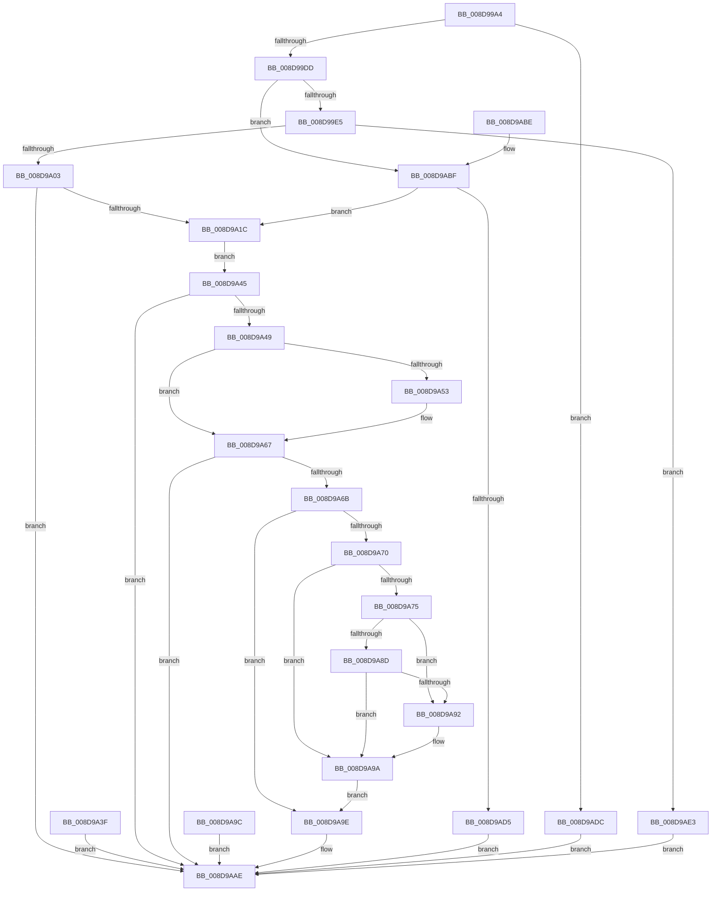

# EtwpLocateDbgIdForRegEntry

- RVA: `0x008D99A4`–`0x008D9AF0` (길이 `332` bytes)
- VA: `0x00000001408D99A4`
- 실행 섹션: `PAGE`
- PDB 이름 있음: `예`; PDB Function 태그: `아니요`
- unwind 정보 RVA: `0x00085658`
- 디코드: `85`개 명령, `332/332` bytes 표시
- 미해석 바이트: `0` (있으면 어셈블리에 `.byte`로 보존)

> 이 문서는 커널 이미지의 기계어와 PDB 기호를 분석해 생성했습니다. 4번과 5번은 함수 원형과 자료형을 바이너리 사용 방식에서 추정한 C 해석이며 원본 소스 복구 결과는 아닙니다.

## 1. Dependencies

- 직접 호출 지점: **6**; 고유 호출 대상: **6**
- 직접 호출자로 확인된 함수: **1**
- RIP 상대 이미지 참조: **0**

### Outgoing calls
- `0x008D9A0F` → [MmGetImageInformation](MmGetImageInformation_function_008D9C68.md) (function, `0x008D9C68`)
- `0x008D9A34` → [RtlImageNtHeaderEx](../../text/41/RtlImageNtHeaderEx_function_0041EAA0.md) (function, `0x0041EAA0`)
- `0x008D9A5D` → [EtwpGetImageSize](EtwpGetImageSize_function_008D9FEC.md) (function, `0x008D9FEC`)
- `0x008D9AA9` → [EtwpFindDebugId](EtwpFindDebugId_function_008D9D58.md) (function, `0x008D9D58`)
- `0x008D9AC4` → [RtlPcToFileHeader](../../text/2F/RtlPcToFileHeader_function_002F1C50.md) (function, `0x002F1C50`)
- `0x008D9AE9` → [VslGetEtwDebugId](../../text/58/VslGetEtwDebugId_function_0058E3B4.md) (function, `0x0058E3B4`)

### Direct callers
- [EtwpProviderArrivalCallback](../A0/EtwpProviderArrivalCallback_function_00A03F94.md) at `0x00A040A2`

### Static image references
- 디코드된 RIP-relative 메모리 참조가 없습니다.

## 2. Other-region calls and transfers

- 다른 실행 섹션으로 향하는 call: **3**
  - `0x008D9A34` → [RtlImageNtHeaderEx](../../text/41/RtlImageNtHeaderEx_function_0041EAA0.md) (`PAGE` → `.text`)
  - `0x008D9AC4` → [RtlPcToFileHeader](../../text/2F/RtlPcToFileHeader_function_002F1C50.md) (`PAGE` → `.text`)
  - `0x008D9AE9` → [VslGetEtwDebugId](../../text/58/VslGetEtwDebugId_function_0058E3B4.md) (`PAGE` → `.text`)
- 별도 외부 분기/꼬리 이동을 확인하지 못했습니다.

## 3. Assembly (complete function range)

```asm
008D99A4  4C 8B DC                        mov r11, rsp
008D99A7  49 89 5B 08                     mov qword ptr [r11 + 8], rbx
008D99AB  49 89 73 18                     mov qword ptr [r11 + 0x18], rsi
008D99AF  57                              push rdi
008D99B0  48 83 EC 40                     sub rsp, 0x40
008D99B4  49 8B F9                        mov rdi, r9
008D99B7  49 8B F0                        mov rsi, r8
008D99BA  8A D9                           mov bl, cl
008D99BC  83 64 24 58 00                  and dword ptr [rsp + 0x58], 0
008D99C1  49 83 63 F0 00                  and qword ptr [r11 - 0x10], 0
008D99C6  49 83 63 E8 00                  and qword ptr [r11 - 0x18], 0
008D99CB  49 83 63 E0 00                  and qword ptr [r11 - 0x20], 0
008D99D0  48 8B 4A 58                     mov rcx, qword ptr [rdx + 0x58]
008D99D4  48 85 C9                        test rcx, rcx
008D99D7  0F 84 FF 00 00 00               je 0x1408d9adc
008D99DD  84 DB                           test bl, bl
008D99DF  0F 84 DA 00 00 00               je 0x1408d9abf
008D99E5  65 48 8B 04 25 88 01 00 00      mov rax, qword ptr gs:[0x188]
008D99EE  4C 8B 90 B8 00 00 00            mov r10, qword ptr [rax + 0xb8]
008D99F5  41 F6 82 70 01 00 00 01         test byte ptr [r10 + 0x170], 1
008D99FD  0F 85 E0 00 00 00               jne 0x1408d9ae3
008D9A03  4D 8D 4B 10                     lea r9, [r11 + 0x10]
008D9A07  4D 8D 43 E0                     lea r8, [r11 - 0x20]
008D9A0B  49 8D 53 E8                     lea rdx, [r11 - 0x18]
008D9A0F  E8 54 02 00 00                  call 0x1408d9c68
008D9A14  85 C0                           test eax, eax
008D9A16  0F 88 92 00 00 00               js 0x1408d9aae
008D9A1C  48 8B 54 24 30                  mov rdx, qword ptr [rsp + 0x30]
008D9A21  48 83 E2 FC                     and rdx, 0xfffffffffffffffc
008D9A25  4C 8D 4C 24 38                  lea r9, [rsp + 0x38]
008D9A2A  4C 8B 44 24 28                  mov r8, qword ptr [rsp + 0x28]
008D9A2F  B9 01 00 00 00                  mov ecx, 1
008D9A34  E8 67 50 B4 FF                  call 0x14041eaa0
008D9A39  89 44 24 20                     mov dword ptr [rsp + 0x20], eax
008D9A3D  EB 06                           jmp 0x1408d9a45
008D9A3F  89 44 24 20                     mov dword ptr [rsp + 0x20], eax
008D9A43  EB 69                           jmp 0x1408d9aae
008D9A45  85 C0                           test eax, eax
008D9A47  78 65                           js 0x1408d9aae
008D9A49  48 8B 54 24 28                  mov rdx, qword ptr [rsp + 0x28]
008D9A4E  48 85 D2                        test rdx, rdx
008D9A51  75 14                           jne 0x1408d9a67
008D9A53  48 8D 54 24 28                  lea rdx, [rsp + 0x28]
008D9A58  48 8B 4C 24 38                  mov rcx, qword ptr [rsp + 0x38]
008D9A5D  E8 8A 05 00 00                  call 0x1408d9fec
008D9A62  48 8B 54 24 28                  mov rdx, qword ptr [rsp + 0x28]
008D9A67  85 C0                           test eax, eax
008D9A69  78 43                           js 0x1408d9aae
008D9A6B  80 FB 01                        cmp bl, 1
008D9A6E  75 2E                           jne 0x1408d9a9e
008D9A70  48 85 D2                        test rdx, rdx
008D9A73  74 25                           je 0x1408d9a9a
008D9A75  48 8B 44 24 30                  mov rax, qword ptr [rsp + 0x30]
008D9A7A  48 8D 0C 02                     lea rcx, [rdx + rax]
008D9A7E  49 B8 00 00 FF FF FF 7F 00 00   movabs r8, 0x7fffffff0000
008D9A88  49 3B C8                        cmp rcx, r8
008D9A8B  77 05                           ja 0x1408d9a92
008D9A8D  48 3B C8                        cmp rcx, rax
008D9A90  73 08                           jae 0x1408d9a9a
008D9A92  41 8A 00                        mov al, byte ptr [r8]
008D9A95  48 8B 54 24 28                  mov rdx, qword ptr [rsp + 0x28]
008D9A9A  EB 02                           jmp 0x1408d9a9e
008D9A9C  EB 10                           jmp 0x1408d9aae
008D9A9E  4C 8B CF                        mov r9, rdi
008D9AA1  4C 8B C6                        mov r8, rsi
008D9AA4  48 8B 4C 24 30                  mov rcx, qword ptr [rsp + 0x30]
008D9AA9  E8 AA 02 00 00                  call 0x1408d9d58
008D9AAE  48 8B 5C 24 50                  mov rbx, qword ptr [rsp + 0x50]
008D9AB3  48 8B 74 24 60                  mov rsi, qword ptr [rsp + 0x60]
008D9AB8  48 83 C4 40                     add rsp, 0x40
008D9ABC  5F                              pop rdi
008D9ABD  C3                              ret
008D9ABE  CC                              int3
008D9ABF  48 8D 54 24 30                  lea rdx, [rsp + 0x30]
008D9AC4  E8 87 81 A1 FF                  call 0x1402f1c50
008D9AC9  48 83 7C 24 30 00               cmp qword ptr [rsp + 0x30], 0
008D9ACF  0F 85 47 FF FF FF               jne 0x1408d9a1c
008D9AD5  B8 25 02 00 C0                  mov eax, 0xc0000225
008D9ADA  EB D2                           jmp 0x1408d9aae
008D9ADC  B8 41 01 00 C0                  mov eax, 0xc0000141
008D9AE1  EB CB                           jmp 0x1408d9aae
008D9AE3  48 8B D1                        mov rdx, rcx
008D9AE6  49 8B CA                        mov rcx, r10
008D9AE9  E8 C6 48 CB FF                  call 0x14058e3b4
008D9AEE  EB BE                           jmp 0x1408d9aae
```

## 4. C-style interpretation (structured pseudocode)

```c
__int64 __fastcall EtwpLocateDbgIdForRegEntry(unsigned __int8 a1, __int64 a2, __int64 a3, __int64 a4)
{
    __int64 result;
    __int64 v_rsp;
    unsigned __int64 v_stack_m10;
    unsigned __int64 v_stack_m18;
    unsigned __int64 v_stack_m20;
    unsigned int v_stack_m28;
    unsigned int v_stack_p10;
    unsigned __int64 v_stack_p18;
    unsigned __int64 v_stack_p30;
    unsigned __int64 v_stack_p8;

    *(unsigned __int64 *)(v_rsp + 8) = v_rbx;
    *(unsigned __int64 *)(v_rsp + 24) = v_rsi;
    v_rsp = (v_rsp) - (64);
    if (*(unsigned __int64 *)(a2 + 88) == 0) goto loc_008D9ADC;
    if (a1 == 0) goto loc_008D9ABF;
    if (((*(unsigned __int8 *)(*(unsigned __int64 *)(*(unsigned __int64 *)(gs_base + (0 + 392)) + 184) + 368)) & (1)) != 0) goto loc_008D9AE3;
    result = MmGetImageInformation(*(unsigned __int64 *)(a2 + 88), v_rsp - 24, v_rsp - 32, v_rsp + 16);
    if (sign_flag) goto loc_008D9AAE;
loc_008D9A1C:
    a2 = (v_stack_m18) & (-4);
    result = RtlImageNtHeaderEx(1, a2, v_stack_m20, v_stack_m10);
    v_stack_m28 = (unsigned int)(result);
    goto loc_008D9A45;
loc_008D9A45:
    if (sign_flag) goto loc_008D9AAE;
    if (v_stack_m20 == 0) {
        a2 = v_stack_m20;
        a1 = v_stack_m10;
        result = EtwpGetImageSize(a1, a2, v_stack_m20, v_stack_m10);
        a2 = v_stack_m20;
    }
    if (sign_flag) goto loc_008D9AAE;
    if (a1 != 1) goto loc_008D9A9E;
    if (a2 == 0) goto loc_008D9A9A;
    if ((a2 + v_stack_m18 * 1) > v_stack_m20) goto loc_008D9A92;
    result = v_stack_m18;
    if ((a2 + v_stack_m18 * 1) < v_stack_m18) {
        result = *(unsigned __int8 *)(v_stack_m20);
        a2 = v_stack_m20;
    }
    goto loc_008D9A9E;
loc_008D9A9E:
    result = EtwpFindDebugId(v_stack_m18, a2, a3, a4);
loc_008D9AAE:
    v_rsp = (v_rsp) + (64);
    return result;
loc_008D9ABF:
    result = RtlPcToFileHeader(v_stack_m18, v_stack_p30, a3, a4);
    if (v_stack_p30 != 0) goto loc_008D9A1C;
    goto loc_008D9AAE;
loc_008D9ADC:
    goto loc_008D9AAE;
loc_008D9AE3:
    result = VslGetEtwDebugId(*(unsigned __int64 *)(*(unsigned __int64 *)(gs_base + (0 + 392)) + 184), v_stack_m18, a3, a4);
    goto loc_008D9AAE;
}
```

## 5. (Beta) C Style

```c
int64_t EtwpLocateDbgIdForRegEntry(uint8_t Arg1, void *Arg2, int64_t Arg3, int64_t Arg4)
{
    uint8_t *arg2 = (uint8_t *)Arg2;

    int64_t result;
    int64_t local_rsp;
    uint64_t v_stack_m10;
    uint64_t v_stack_m18;
    uint64_t v_stack_m20;
    uint32_t v_stack_m28;
    uint32_t v_stack_p10;
    uint64_t v_stack_p18;
    uint64_t v_stack_p30;
    uint64_t v_stack_p8;

    *(uint64_t *)(local_rsp + 0x8) = local_rbx;
    *(uint64_t *)(local_rsp + 0x18) = local_rsi;
    local_rsp = (local_rsp) - (64);
    if (*(uint64_t *)(arg2 + 0x58) == 0) goto loc_008D9ADC;
    if (Arg1 == 0) goto loc_008D9ABF;
    if (((*(uint8_t *)(*(uint64_t *)(*(uint64_t *)(gs_base + (0 + 0x188)) + 0xB8) + 0x170)) & (1)) != 0) goto loc_008D9AE3;
    result = MmGetImageInformation(*(uint64_t *)(arg2 + 0x58), local_rsp - 24, local_rsp - 32, local_rsp + 16);
    if (sign_flag) goto loc_008D9AAE;
loc_008D9A1C:
    Arg2 = (v_stack_m18) & (-4);
    result = RtlImageNtHeaderEx(1, Arg2, v_stack_m20, v_stack_m10);
    v_stack_m28 = (uint32_t)(result);
    goto loc_008D9A45;
loc_008D9A45:
    if (sign_flag) goto loc_008D9AAE;
    if (v_stack_m20 == 0) {
        Arg2 = v_stack_m20;
        Arg1 = v_stack_m10;
        result = EtwpGetImageSize(Arg1, Arg2, v_stack_m20, v_stack_m10);
        Arg2 = v_stack_m20;
    }
    if (sign_flag) goto loc_008D9AAE;
    if (Arg1 != 1) goto loc_008D9A9E;
    if (Arg2 == NULL) goto loc_008D9A9A;
    if ((Arg2 + v_stack_m18 * 1) > v_stack_m20) goto loc_008D9A92;
    result = v_stack_m18;
    if ((Arg2 + v_stack_m18 * 1) < v_stack_m18) {
        result = *(uint8_t *)(v_stack_m20);
        Arg2 = v_stack_m20;
    }
    goto loc_008D9A9E;
loc_008D9A9E:
    result = EtwpFindDebugId(v_stack_m18, Arg2, Arg3, Arg4);
loc_008D9AAE:
    local_rsp = (local_rsp) + (64);
    return result;
loc_008D9ABF:
    result = RtlPcToFileHeader(v_stack_m18, v_stack_p30, Arg3, Arg4);
    if (v_stack_p30 != 0) goto loc_008D9A1C;
    goto loc_008D9AAE;
loc_008D9ADC:
    goto loc_008D9AAE;
loc_008D9AE3:
    result = VslGetEtwDebugId(*(uint64_t *)(*(uint64_t *)(gs_base + (0 + 0x188)) + 0xB8), v_stack_m18, Arg3, Arg4);
    goto loc_008D9AAE;
}
```

### 관측된 메모리 오프셋

구조체 형식이 확인되지 않은 접근은 인자 기준의 오프셋으로만 기록했습니다.

| 기준 인자 | 오프셋 표현 | 폭 (bit) | 접근 |
|---|---:|---:|---|
| `Arg2` | `+ 0x58` | `64` | `R` |

## 6. Execution-region graph

[열기: 2D/3D 그래프와 함수 탐색 컨트롤 패널](../../../control-panel.html?section=page&rva=0x008D99A4&view=graph)

- 2D 그래프는 위에서 아래로 흐르고, 3D 그래프는 빈 공간을 드래그해 회전합니다. Shift+드래그는 이동, 휠은 확대·축소, 함수 노드 선택은 대상 보고서 이동입니다.

### Static fallback


