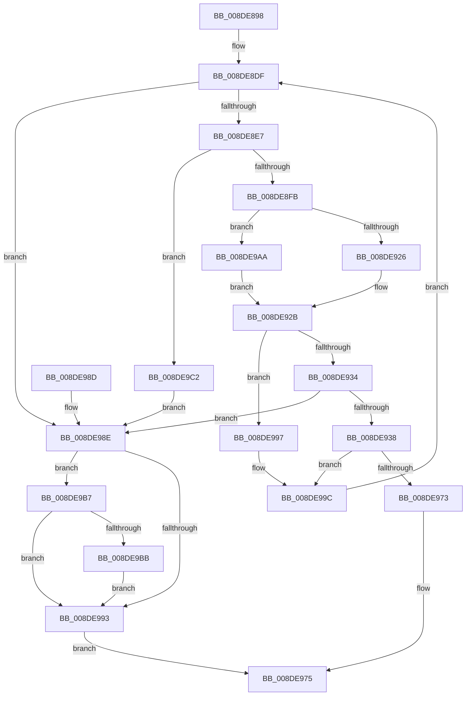

# FilterEvalImpliedAnd

- RVA: `0x008DE898`–`0x008DE9C9` (길이 `305` bytes)
- VA: `0x00000001408DE898`
- 실행 섹션: `PAGE`
- PDB 이름 있음: `예`; PDB Function 태그: `아니요`
- unwind 정보 RVA: `0x00085B24`
- 디코드: `91`개 명령, `305/305` bytes 표시
- 미해석 바이트: `0` (있으면 어셈블리에 `.byte`로 보존)

> 이 문서는 커널 이미지의 기계어와 PDB 기호를 분석해 생성했습니다. 4번과 5번은 함수 원형과 자료형을 바이너리 사용 방식에서 추정한 C 해석이며 원본 소스 복구 결과는 아닙니다.

## 1. Dependencies

- 직접 호출 지점: **3**; 고유 호출 대상: **3**
- 직접 호출자로 확인된 함수: **3**
- RIP 상대 이미지 참조: **1**

### Outgoing calls
- `0x008DE926` → [PiDqPropertyCallback](PiDqPropertyCallback_function_008DF580.md) (function, `0x008DF580`)
- `0x008DE968` → [PropertyEval](../9C/PropertyEval_function_009CB300.md) (function, `0x009CB300`)
- `0x008DE9AD` → [guard_dispatch_icall](../../text/6B/guard_dispatch_icall_function_006BAAD0.md) (function, `0x006BAAD0`)

### Direct callers
- [ValidFilter](ValidFilter_function_008DBDC8.md) at `0x008DBE8C`
- [ConstraintEval](ConstraintEval_function_008DC1D0.md) at `0x008DC4A2`
- [PiDqQueryEvaluateFilter](../8E/PiDqQueryEvaluateFilter_function_008E01C4.md) at `0x008E0314`

### Static image references
- `0x008DE8FB` → RVA `0x008DF580` (`PiDqPropertyCallback`; read)

## 2. Other-region calls and transfers

- 다른 실행 섹션으로 향하는 call: **1**
  - `0x008DE9AD` → [guard_dispatch_icall](../../text/6B/guard_dispatch_icall_function_006BAAD0.md) (`PAGE` → `.text`)
- 별도 외부 분기/꼬리 이동을 확인하지 못했습니다.

## 3. Assembly (complete function range)

```asm
008DE898  48 89 5C 24 08                  mov qword ptr [rsp + 8], rbx
008DE89D  44 89 44 24 18                  mov dword ptr [rsp + 0x18], r8d
008DE8A2  48 89 54 24 10                  mov qword ptr [rsp + 0x10], rdx
008DE8A7  55                              push rbp
008DE8A8  56                              push rsi
008DE8A9  57                              push rdi
008DE8AA  41 54                           push r12
008DE8AC  41 55                           push r13
008DE8AE  41 56                           push r14
008DE8B0  41 57                           push r15
008DE8B2  48 8B EC                        mov rbp, rsp
008DE8B5  48 83 EC 50                     sub rsp, 0x50
008DE8B9  4C 8B 65 60                     mov r12, qword ptr [rbp + 0x60]
008DE8BD  33 DB                           xor ebx, ebx
008DE8BF  21 5D F4                        and dword ptr [rbp - 0xc], ebx
008DE8C2  4D 8B F1                        mov r14, r9
008DE8C5  48 21 5D F8                     and qword ptr [rbp - 8], rbx
008DE8C9  41 8B C0                        mov eax, r8d
008DE8CC  21 5D F0                        and dword ptr [rbp - 0x10], ebx
008DE8CF  4C 8B D2                        mov r10, rdx
008DE8D2  41 21 1C 24                     and dword ptr [r12], ebx
008DE8D6  44 8D 7B 01                     lea r15d, [rbx + 1]
008DE8DA  33 F6                           xor esi, esi
008DE8DC  4C 8B E9                        mov r13, rcx
008DE8DF  3B F0                           cmp esi, eax
008DE8E1  0F 83 A7 00 00 00               jae 0x1408de98e
008DE8E7  8B C6                           mov eax, esi
008DE8E9  48 6B F8 38                     imul rdi, rax, 0x38
008DE8ED  42 F7 04 37 00 00 F0 0F         test dword ptr [rdi + r14], 0xff00000
008DE8F5  0F 85 C7 00 00 00               jne 0x1408de9c2
008DE8FB  48 8D 05 7E 0C 00 00            lea rax, [rip + 0xc7e]
008DE902  49 8B CA                        mov rcx, r10
008DE905  49 8D 56 08                     lea rdx, [r14 + 8]
008DE909  48 03 D7                        add rdx, rdi
008DE90C  4C 8D 4D F0                     lea r9, [rbp - 0x10]
008DE910  4C 3B E8                        cmp r13, rax
008DE913  4C 8D 45 F4                     lea r8, [rbp - 0xc]
008DE917  48 8D 45 F8                     lea rax, [rbp - 8]
008DE91B  48 89 44 24 20                  mov qword ptr [rsp + 0x20], rax
008DE920  0F 85 84 00 00 00               jne 0x1408de9aa
008DE926  E8 55 0C 00 00                  call 0x1408df580
008DE92B  8B D8                           mov ebx, eax
008DE92D  3D 25 02 00 C0                  cmp eax, 0xc0000225
008DE932  74 63                           je 0x1408de997
008DE934  85 C0                           test eax, eax
008DE936  75 56                           jne 0x1408de98e
008DE938  42 8B 44 37 2C                  mov eax, dword ptr [rdi + r14 + 0x2c]
008DE93D  46 8B 0C 37                     mov r9d, dword ptr [rdi + r14]
008DE941  44 8B 45 F0                     mov r8d, dword ptr [rbp - 0x10]
008DE945  48 8B 55 F8                     mov rdx, qword ptr [rbp - 8]
008DE949  8B 4D F4                        mov ecx, dword ptr [rbp - 0xc]
008DE94C  4C 89 64 24 38                  mov qword ptr [rsp + 0x38], r12
008DE951  89 44 24 30                     mov dword ptr [rsp + 0x30], eax
008DE955  4A 8B 44 37 30                  mov rax, qword ptr [rdi + r14 + 0x30]
008DE95A  48 89 44 24 28                  mov qword ptr [rsp + 0x28], rax
008DE95F  42 8B 44 37 28                  mov eax, dword ptr [rdi + r14 + 0x28]
008DE964  89 44 24 20                     mov dword ptr [rsp + 0x20], eax
008DE968  E8 93 C9 0E 00                  call 0x1409cb300
008DE96D  41 39 1C 24                     cmp dword ptr [r12], ebx
008DE971  75 29                           jne 0x1408de99c
008DE973  33 C0                           xor eax, eax
008DE975  48 8B 9C 24 90 00 00 00         mov rbx, qword ptr [rsp + 0x90]
008DE97D  48 83 C4 50                     add rsp, 0x50
008DE981  41 5F                           pop r15
008DE983  41 5E                           pop r14
008DE985  41 5D                           pop r13
008DE987  41 5C                           pop r12
008DE989  5F                              pop rdi
008DE98A  5E                              pop rsi
008DE98B  5D                              pop rbp
008DE98C  C3                              ret
008DE98D  CC                              int3
008DE98E  45 85 FF                        test r15d, r15d
008DE991  74 24                           je 0x1408de9b7
008DE993  8B C3                           mov eax, ebx
008DE995  EB DE                           jmp 0x1408de975
008DE997  33 DB                           xor ebx, ebx
008DE999  45 33 FF                        xor r15d, r15d
008DE99C  8B 45 50                        mov eax, dword ptr [rbp + 0x50]
008DE99F  FF C6                           inc esi
008DE9A1  4C 8B 55 48                     mov r10, qword ptr [rbp + 0x48]
008DE9A5  E9 35 FF FF FF                  jmp 0x1408de8df
008DE9AA  49 8B C5                        mov rax, r13
008DE9AD  E8 1E C1 DD FF                  call 0x1406baad0
008DE9B2  E9 74 FF FF FF                  jmp 0x1408de92b
008DE9B7  85 DB                           test ebx, ebx
008DE9B9  75 D8                           jne 0x1408de993
008DE9BB  BB 01 00 00 C0                  mov ebx, 0xc0000001
008DE9C0  EB D1                           jmp 0x1408de993
008DE9C2  BB 0D 00 00 C0                  mov ebx, 0xc000000d
008DE9C7  EB C5                           jmp 0x1408de98e
```

## 4. C-style interpretation (structured pseudocode)

```c
__int64 __fastcall FilterEvalImpliedAnd(__int64 a1, __int64 a2, int a3, __int64 a4, __int64 a5)
{
    __int64 result;
    __int64 v_r15;
    __int64 v_rbx;
    __int64 v_rdi;
    __int64 v_rsi;
    __int64 v_rsp;
    unsigned __int64 v_stack_m40;
    unsigned int v_stack_m44;
    unsigned int v_stack_m48;
    unsigned __int64 v_stack_m50;
    unsigned int v_stack_m58;
    unsigned __int64 v_stack_m60;
    unsigned __int64 v_stack_m68;
    unsigned __int64 v_stack_p10;
    unsigned int v_stack_p18;
    unsigned __int64 v_stack_p8;

    v_stack_p8 = v_rbx;
    v_stack_p18 = a3;
    v_stack_p10 = a2;
    v_rsp = (v_rsp) - (80);
    v_rbx = 0;
    v_rsi = 0;
loc_008DE8DF:
    if (0 >= ((unsigned int)((unsigned int)(a3)))) goto loc_008DE98E;
    v_rdi = (v_rdi) * (0);
    if (((*(unsigned int *)(v_rdi + a4 * 1)) & (0xFF00000ULL)) != 0) goto loc_008DE9C2;
    a2 = (a4 + 8) + (v_rdi);
    v_stack_m68 = v_stack_m40;
    if (a1 != (v_rip + 3198)) goto loc_008DE9AA;
    result = PiDqPropertyCallback(a2, a2, v_stack_m44, v_stack_m48);
loc_008DE92B:
    if (((unsigned int)(result)) == 0xC0000225ULL) goto loc_008DE997;
    if ((unsigned int)(result) != 0) goto loc_008DE98E;
    v_stack_m50 = a5;
    v_stack_m58 = (unsigned int)((unsigned int)(*(unsigned int *)(v_rdi + a4 * 1 + 44)));
    v_stack_m60 = *(unsigned __int64 *)(v_rdi + a4 * 1 + 48);
    v_stack_m68 = (unsigned int)((unsigned int)(*(unsigned int *)(v_rdi + a4 * 1 + 40)));
    result = PropertyEval((unsigned int)(v_stack_m44), v_stack_m40, (unsigned int)(v_stack_m48), (unsigned int)(*(unsigned int *)(v_rdi + a4 * 1)));
    if ((*(unsigned int *)(a5)) != ((unsigned int)((unsigned int)((unsigned int)(result))))) goto loc_008DE99C;
    result = 0;
loc_008DE975:
    v_rsp = (v_rsp) + (80);
    return result;
loc_008DE98E:
    if ((unsigned int)(v_rbx + 1) == 0) goto loc_008DE9B7;
loc_008DE993:
    goto loc_008DE975;
loc_008DE997:
    v_rbx = 0;
    v_r15 = 0;
loc_008DE99C:
    v_rsi = (unsigned int)((v_rsi) + 1);
    goto loc_008DE8DF;
loc_008DE9AA:
    result = guard_dispatch_icall((unsigned int)(v_stack_m44), v_stack_m40, (unsigned int)(v_stack_m48), (unsigned int)(*(unsigned int *)(v_rdi + a4 * 1)));
    goto loc_008DE92B;
loc_008DE9B7:
    if (0 != 0) goto loc_008DE993;
    goto loc_008DE993;
loc_008DE9C2:
    goto loc_008DE98E;
}
```

## 5. (Beta) C Style

```c
int64_t FilterEvalImpliedAnd(int64_t Arg1, int64_t Arg2, int32_t Arg3, void *Arg4, void *Arg5)
{
    uint8_t *arg4 = (uint8_t *)Arg4;
    uint8_t *arg5 = (uint8_t *)Arg5;

    int64_t result;
    int64_t local_r15;
    int64_t local_rbx;
    int64_t local_rdi;
    int64_t local_rsi;
    int64_t local_rsp;
    uint64_t v_stack_m40;
    uint32_t v_stack_m44;
    uint32_t v_stack_m48;
    uint64_t v_stack_m50;
    uint32_t v_stack_m58;
    uint64_t v_stack_m60;
    uint64_t v_stack_m68;
    uint64_t v_stack_p10;
    uint32_t v_stack_p18;
    uint64_t v_stack_p8;

    v_stack_p8 = local_rbx;
    v_stack_p18 = Arg3;
    v_stack_p10 = Arg2;
    local_rsp = (local_rsp) - (80);
    local_rbx = 0;
    local_rsi = 0;
loc_008DE8DF:
    if (0 >= ((uint32_t)((uint32_t)(Arg3)))) goto loc_008DE98E;
    local_rdi = (local_rdi) * (0);
    if (((*(uint32_t *)(local_rdi + arg4 * 1)) & (0xFF00000ULL)) != 0) goto loc_008DE9C2;
    Arg2 = (Arg4 + 8) + (local_rdi);
    v_stack_m68 = v_stack_m40;
    if (Arg1 != (v_rip + 3198)) goto loc_008DE9AA;
    result = PiDqPropertyCallback(Arg2, Arg2, v_stack_m44, v_stack_m48);
loc_008DE92B:
    if (((uint32_t)(result)) == 0xC0000225ULL) goto loc_008DE997;
    if ((uint32_t)(result) != 0) goto loc_008DE98E;
    v_stack_m50 = Arg5;
    v_stack_m58 = (uint32_t)((uint32_t)(*(uint32_t *)(local_rdi + arg4 * 1 + 0x2C)));
    v_stack_m60 = *(uint64_t *)(local_rdi + arg4 * 1 + 0x30);
    v_stack_m68 = (uint32_t)((uint32_t)(*(uint32_t *)(local_rdi + arg4 * 1 + 0x28)));
    result = PropertyEval((uint32_t)(v_stack_m44), v_stack_m40, (uint32_t)(v_stack_m48), (uint32_t)(*(uint32_t *)(local_rdi + arg4 * 1)));
    if ((*(uint32_t *)(arg5)) != ((uint32_t)((uint32_t)((uint32_t)(result))))) goto loc_008DE99C;
    result = 0;
loc_008DE975:
    local_rsp = (local_rsp) + (80);
    return result;
loc_008DE98E:
    if ((uint32_t)(local_rbx + 1) == 0) goto loc_008DE9B7;
loc_008DE993:
    goto loc_008DE975;
loc_008DE997:
    local_rbx = 0;
    local_r15 = 0;
loc_008DE99C:
    local_rsi = (uint32_t)((local_rsi) + 1);
    goto loc_008DE8DF;
loc_008DE9AA:
    result = guard_dispatch_icall((uint32_t)(v_stack_m44), v_stack_m40, (uint32_t)(v_stack_m48), (uint32_t)(*(uint32_t *)(local_rdi + arg4 * 1)));
    goto loc_008DE92B;
loc_008DE9B7:
    if (0 != 0) goto loc_008DE993;
    goto loc_008DE993;
loc_008DE9C2:
    goto loc_008DE98E;
}
```

### 관측된 메모리 오프셋

구조체 형식이 확인되지 않은 접근은 인자 기준의 오프셋으로만 기록했습니다.

| 기준 인자 | 오프셋 표현 | 폭 (bit) | 접근 |
|---|---:|---:|---|
| `Arg4` | `+ 0x8` | `64` | `R` |
| `Arg5` | `+ 0x0` | `32` | `R` |
| `Arg5` | `+ 0x0` | `32` | `R/W` |

## 6. Execution-region graph

[열기: 2D/3D 그래프와 함수 탐색 컨트롤 패널](../../../control-panel.html?section=page&rva=0x008DE898&view=graph)

- 2D 그래프는 위에서 아래로 흐르고, 3D 그래프는 빈 공간을 드래그해 회전합니다. Shift+드래그는 이동, 휠은 확대·축소, 함수 노드 선택은 대상 보고서 이동입니다.

### Static fallback


