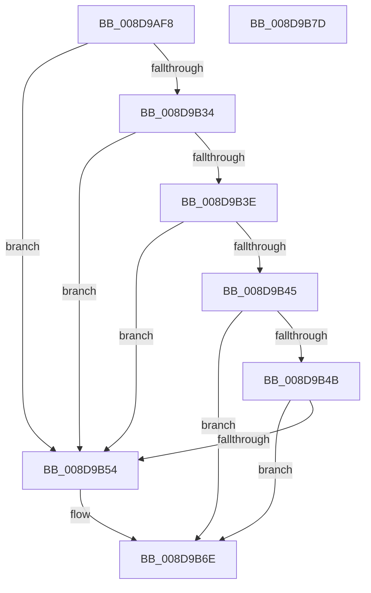

# KiCheckUserAddressCetCompat

- RVA: `0x008D9AF8`–`0x008D9B7E` (길이 `134` bytes)
- VA: `0x00000001408D9AF8`
- 실행 섹션: `PAGE`
- PDB 이름 있음: `예`; PDB Function 태그: `아니요`
- unwind 정보 RVA: `0x00085694`
- 디코드: `44`개 명령, `134/134` bytes 표시
- 미해석 바이트: `0` (있으면 어셈블리에 `.byte`로 보존)

> 이 문서는 커널 이미지의 기계어와 PDB 기호를 분석해 생성했습니다. 4번과 5번은 함수 원형과 자료형을 바이너리 사용 방식에서 추정한 C 해석이며 원본 소스 복구 결과는 아닙니다.

## 1. Dependencies

- 직접 호출 지점: **2**; 고유 호출 대상: **2**
- 직접 호출자로 확인된 함수: **1**
- RIP 상대 이미지 참조: **0**

### Outgoing calls
- `0x008D9B28` → [MmGetImageInformation](MmGetImageInformation_function_008D9C68.md) (function, `0x008D9C68`)
- `0x008D9B5E` → [RtlFindDynamicEnforcedAddressInRanges](RtlFindDynamicEnforcedAddressInRanges_function_008D9B84.md) (function, `0x008D9B84`)

### Direct callers
- [KiProcessControlProtection](../../text/44/KiProcessControlProtection_function_00444750.md) at `0x00444911`
- [KiProcessControlProtection](../../text/44/KiProcessControlProtection_function_00444750.md) at `0x00444922`

### Static image references
- 디코드된 RIP-relative 메모리 참조가 없습니다.

## 2. Other-region calls and transfers

- 다른 실행 섹션으로 향하는 call: **0**
- 별도 외부 분기/꼬리 이동을 확인하지 못했습니다.

## 3. Assembly (complete function range)

```asm
008D9AF8  48 8B C4                        mov rax, rsp
008D9AFB  48 89 58 08                     mov qword ptr [rax + 8], rbx
008D9AFF  55                              push rbp
008D9B00  56                              push rsi
008D9B01  57                              push rdi
008D9B02  48 83 EC 30                     sub rsp, 0x30
008D9B06  48 8B F2                        mov rsi, rdx
008D9B09  4C 8D 48 18                     lea r9, [rax + 0x18]
008D9B0D  33 ED                           xor ebp, ebp
008D9B0F  4C 8D 40 D8                     lea r8, [rax - 0x28]
008D9B13  48 8B F9                        mov rdi, rcx
008D9B16  48 89 68 20                     mov qword ptr [rax + 0x20], rbp
008D9B1A  48 8B CE                        mov rcx, rsi
008D9B1D  89 68 18                        mov dword ptr [rax + 0x18], ebp
008D9B20  48 8D 50 20                     lea rdx, [rax + 0x20]
008D9B24  48 89 68 D8                     mov qword ptr [rax - 0x28], rbp
008D9B28  E8 3B 01 00 00                  call 0x1408d9c68
008D9B2D  8D 5D 01                        lea ebx, [rbp + 1]
008D9B30  85 C0                           test eax, eax
008D9B32  78 20                           js 0x1408d9b54
008D9B34  48 8B 44 24 68                  mov rax, qword ptr [rsp + 0x68]
008D9B39  48 85 C0                        test rax, rax
008D9B3C  74 16                           je 0x1408d9b54
008D9B3E  48 39 6C 24 20                  cmp qword ptr [rsp + 0x20], rbp
008D9B43  74 0F                           je 0x1408d9b54
008D9B45  84 5C 24 60                     test byte ptr [rsp + 0x60], bl
008D9B49  75 23                           jne 0x1408d9b6e
008D9B4B  48 3B 87 B0 02 00 00            cmp rax, qword ptr [rdi + 0x2b0]
008D9B52  74 1A                           je 0x1408d9b6e
008D9B54  48 8D 8F 90 07 00 00            lea rcx, [rdi + 0x790]
008D9B5B  48 8B D6                        mov rdx, rsi
008D9B5E  E8 21 00 00 00                  call 0x1408d9b84
008D9B63  84 C0                           test al, al
008D9B65  40 0F B6 CD                     movzx ecx, bpl
008D9B69  0F 45 CB                        cmovne ecx, ebx
008D9B6C  8A D9                           mov bl, cl
008D9B6E  8A C3                           mov al, bl
008D9B70  48 8B 5C 24 50                  mov rbx, qword ptr [rsp + 0x50]
008D9B75  48 83 C4 30                     add rsp, 0x30
008D9B79  5F                              pop rdi
008D9B7A  5E                              pop rsi
008D9B7B  5D                              pop rbp
008D9B7C  C3                              ret
008D9B7D  CC                              int3
```

## 4. C-style interpretation (structured pseudocode)

```c
__int64 __fastcall KiCheckUserAddressCetCompat(__int64 a1, __int64 a2)
{
    __int64 result;
    __int64 v_rbp;
    __int64 v_rbx;
    __int64 v_rsp;
    unsigned __int64 v_stack_m28;
    unsigned __int8 v_stack_p18;
    unsigned __int64 v_stack_p20;
    unsigned __int64 v_stack_p8;

    *(unsigned __int64 *)(v_rsp + 8) = v_rbx;
    v_rsp = (v_rsp) - (48);
    v_rbp = 0;
    *(unsigned __int64 *)(v_rsp + 32) = 0;
    *(unsigned int *)(v_rsp + 24) = 0;
    *(unsigned __int64 *)(v_rsp - 40) = 0;
    result = MmGetImageInformation(a2, v_rsp + 32, v_rsp - 40, v_rsp + 24);
    if (sign_flag) goto loc_008D9B54;
    if (v_stack_p20 == 0) goto loc_008D9B54;
    if (v_stack_m28 == 0) goto loc_008D9B54;
    if (((v_stack_p18) & ((unsigned __int8)(v_rbp + 1))) != 0) goto loc_008D9B6E;
    result = v_stack_p20;
    v_rbx = v_rbp + 1;
    if (v_stack_p20 != (*(unsigned __int64 *)(a1 + 688))) {
        a1 = a1 + 1936;
        a2 = a2;
        result = RtlFindDynamicEnforcedAddressInRanges(a1, a2, v_rsp - 40, v_rsp + 24);
        a1 = 0;
        if ((unsigned __int8)(result) != 0) { a1 = (unsigned int)(v_rbp + 1); }
        v_rbx = (unsigned __int8)(a1);
    }
    v_rsp = (v_rsp) + (48);
    return (unsigned __int8)(v_rbx);
}
```

## 5. (Beta) C Style

```c
int64_t KiCheckUserAddressCetCompat(void *Arg1, int64_t Arg2)
{
    uint8_t *arg1 = (uint8_t *)Arg1;

    int64_t result;
    int64_t local_rbp;
    int64_t local_rbx;
    int64_t local_rsp;
    uint64_t v_stack_m28;
    uint8_t v_stack_p18;
    uint64_t v_stack_p20;
    uint64_t v_stack_p8;

    *(uint64_t *)(local_rsp + 0x8) = local_rbx;
    local_rsp = (local_rsp) - (48);
    local_rbp = 0;
    *(uint64_t *)(local_rsp + 0x20) = 0;
    *(uint32_t *)(local_rsp + 0x18) = 0;
    *(uint64_t *)(local_rsp - 0x28) = 0;
    result = MmGetImageInformation(Arg2, local_rsp + 32, local_rsp - 40, local_rsp + 24);
    if (sign_flag) goto loc_008D9B54;
    if (v_stack_p20 == 0) goto loc_008D9B54;
    if (v_stack_m28 == 0) goto loc_008D9B54;
    if (((v_stack_p18) & ((uint8_t)(local_rbp + 1))) != 0) goto loc_008D9B6E;
    result = v_stack_p20;
    local_rbx = local_rbp + 1;
    if (v_stack_p20 != (*(uint64_t *)(arg1 + 0x2B0))) {
        Arg1 = Arg1 + 1936;
        Arg2 = Arg2;
        result = RtlFindDynamicEnforcedAddressInRanges(Arg1, Arg2, local_rsp - 40, local_rsp + 24);
        Arg1 = 0;
        if ((uint8_t)(result) != 0) { Arg1 = (uint32_t)(local_rbp + 1); }
        local_rbx = (uint8_t)(Arg1);
    }
    local_rsp = (local_rsp) + (48);
    return (uint8_t)(local_rbx);
}
```

### 관측된 메모리 오프셋

구조체 형식이 확인되지 않은 접근은 인자 기준의 오프셋으로만 기록했습니다.

| 기준 인자 | 오프셋 표현 | 폭 (bit) | 접근 |
|---|---:|---:|---|
| `Arg1` | `+ 0x2B0` | `64` | `R` |
| `Arg1` | `+ 0x790` | `64` | `R` |

## 6. Execution-region graph

[열기: 2D/3D 그래프와 함수 탐색 컨트롤 패널](../../../control-panel.html?section=page&rva=0x008D9AF8&view=graph)

- 2D 그래프는 위에서 아래로 흐르고, 3D 그래프는 빈 공간을 드래그해 회전합니다. Shift+드래그는 이동, 휠은 확대·축소, 함수 노드 선택은 대상 보고서 이동입니다.

### Static fallback


