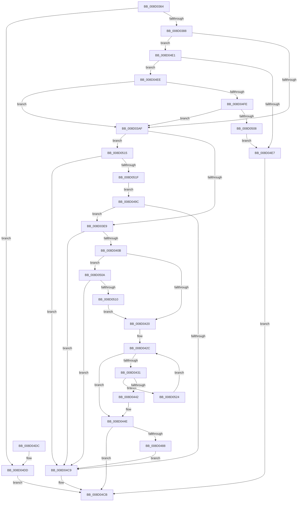

# MiCfgInitializeProcess

- RVA: `0x008D0364`–`0x008D052B` (길이 `455` bytes)
- VA: `0x00000001408D0364`
- 실행 섹션: `PAGE`
- PDB 이름 있음: `예`; PDB Function 태그: `아니요`
- unwind 정보 RVA: `0x00084A6C`
- 디코드: `113`개 명령, `455/455` bytes 표시
- 미해석 바이트: `0` (있으면 어셈블리에 `.byte`로 보존)

> 이 문서는 커널 이미지의 기계어와 PDB 기호를 분석해 생성했습니다. 4번과 5번은 함수 원형과 자료형을 바이너리 사용 방식에서 추정한 C 해석이며 원본 소스 복구 결과는 아닙니다.

## 1. Dependencies

- 직접 호출 지점: **5**; 고유 호출 대상: **2**
- 직접 호출자로 확인된 함수: **1**
- RIP 상대 이미지 참조: **3**

### Outgoing calls
- `0x008D03DA` → [MiMapSecurePureReserveView](../A4/MiMapSecurePureReserveView_function_00A49114.md) (function, `0x00A49114`)
- `0x008D03FC` → [MiReferenceCfgVad](../AA/MiReferenceCfgVad_function_00AABD28.md) (function, `0x00AABD28`)
- `0x008D047D` → [MiMapSecurePureReserveView](../A4/MiMapSecurePureReserveView_function_00A49114.md) (function, `0x00A49114`)
- `0x008D0495` → [MiReferenceCfgVad](../AA/MiReferenceCfgVad_function_00AABD28.md) (function, `0x00AABD28`)
- `0x008D04BA` → [MiMapSecurePureReserveView](../A4/MiMapSecurePureReserveView_function_00A49114.md) (function, `0x00A49114`)

### Direct callers
- [MiMapProcessExecutable](../8C/MiMapProcessExecutable_function_008CFDB4.md) at `0x008CFE97`

### Static image references
- `0x008D03AF` → RVA `0x00E2D800` (`.data`; read)
- `0x008D03BA` → RVA `0x00E2DB88` (`.data`; read)
- `0x008D0423` → RVA `0x00000000` (`image boundary/outside`; read)

## 2. Other-region calls and transfers

- 다른 실행 섹션으로 향하는 call: **0**
- 별도 외부 분기/꼬리 이동을 확인하지 못했습니다.

## 3. Assembly (complete function range)

```asm
008D0364  48 89 5C 24 18                  mov qword ptr [rsp + 0x18], rbx
008D0369  55                              push rbp
008D036A  56                              push rsi
008D036B  57                              push rdi
008D036C  41 55                           push r13
008D036E  41 56                           push r14
008D0370  48 8B EC                        mov rbp, rsp
008D0373  48 83 EC 30                     sub rsp, 0x30
008D0377  8B 81 50 07 00 00               mov eax, dword ptr [rcx + 0x750]
008D037D  48 8B F9                        mov rdi, rcx
008D0380  A8 01                           test al, 1
008D0382  0F 84 55 01 00 00               je 0x1408d04dd
008D0388  48 8D B1 10 03 00 00            lea rsi, [rcx + 0x310]
008D038F  48 B8 00 00 00 00 01 00 00 00   movabs rax, 0x100000000
008D0399  B9 4C 01 00 00                  mov ecx, 0x14c
008D039E  44 8D 69 78                     lea r13d, [rcx + 0x78]
008D03A2  48 39 87 68 03 00 00            cmp qword ptr [rdi + 0x368], rax
008D03A9  0F 86 32 01 00 00               jbe 0x1408d04e1
008D03AF  4C 8B 35 4A D4 55 00            mov r14, qword ptr [rip + 0x55d44a]
008D03B6  4C 8D 4D 30                     lea r9, [rbp + 0x30]
008D03BA  48 8B 05 C7 D7 55 00            mov rax, qword ptr [rip + 0x55d7c7]
008D03C1  4C 8D 45 38                     lea r8, [rbp + 0x38]
008D03C5  48 83 65 30 00                  and qword ptr [rbp + 0x30], 0
008D03CA  49 8B D6                        mov rdx, r14
008D03CD  48 83 64 24 20 00               and qword ptr [rsp + 0x20], 0
008D03D3  48 8B CF                        mov rcx, rdi
008D03D6  48 89 45 38                     mov qword ptr [rbp + 0x38], rax
008D03DA  E8 35 8D 17 00                  call 0x140a49114
008D03DF  8B D8                           mov ebx, eax
008D03E1  85 C0                           test eax, eax
008D03E3  0F 88 2C 01 00 00               js 0x1408d0515
008D03E9  65 4C 8B 34 25 88 01 00 00      mov r14, qword ptr gs:[0x188]
008D03F2  45 33 C0                        xor r8d, r8d
008D03F5  48 8B 55 38                     mov rdx, qword ptr [rbp + 0x38]
008D03F9  49 8B CE                        mov rcx, r14
008D03FC  E8 27 B9 1D 00                  call 0x140aabd28
008D0401  48 83 3E 00                     cmp qword ptr [rsi], 0
008D0405  0F 84 BE 00 00 00               je 0x1408d04c9
008D040B  0F B7 97 EC 06 00 00            movzx edx, word ptr [rdi + 0x6ec]
008D0412  B8 4C 01 00 00                  mov eax, 0x14c
008D0417  66 3B D0                        cmp dx, ax
008D041A  0F 85 EA 00 00 00               jne 0x1408d050a
008D0420  45 33 D2                        xor r10d, r10d
008D0423  4C 8D 05 D6 FB 72 FF            lea r8, [rip - 0x8d042a]
008D042A  33 C0                           xor eax, eax
008D042C  83 F8 01                        cmp eax, 1
008D042F  73 1D                           jae 0x1408d044e
008D0431  8B C8                           mov ecx, eax
008D0433  66 41 3B 94 40 E0 13 01 00      cmp dx, word ptr [r8 + rax*2 + 0x113e0]
008D043C  0F 85 E2 00 00 00               jne 0x1408d0524
008D0442  48 C1 E1 06                     shl rcx, 6
008D0446  4E 8B 94 01 98 D7 E2 00         mov r10, qword ptr [rcx + r8 + 0xe2d798]
008D044E  48 8B 87 68 03 00 00            mov rax, qword ptr [rdi + 0x368]
008D0455  4C 8D 4D 30                     lea r9, [rbp + 0x30]
008D0459  48 83 65 38 00                  and qword ptr [rbp + 0x38], 0
008D045E  4C 8D 45 38                     lea r8, [rbp + 0x38]
008D0462  48 83 64 24 20 00               and qword ptr [rsp + 0x20], 0
008D0468  49 8B D2                        mov rdx, r10
008D046B  48 C1 E8 04                     shr rax, 4
008D046F  48 8B CF                        mov rcx, rdi
008D0472  48 03 C0                        add rax, rax
008D0475  48 C1 E8 03                     shr rax, 3
008D0479  48 89 45 30                     mov qword ptr [rbp + 0x30], rax
008D047D  E8 92 8C 17 00                  call 0x140a49114
008D0482  8B D8                           mov ebx, eax
008D0484  85 C0                           test eax, eax
008D0486  78 43                           js 0x1408d04cb
008D0488  48 8B 55 38                     mov rdx, qword ptr [rbp + 0x38]
008D048C  41 B8 01 00 00 00               mov r8d, 1
008D0492  49 8B CE                        mov rcx, r14
008D0495  E8 8E B8 1D 00                  call 0x140aabd28
008D049A  EB 2D                           jmp 0x1408d04c9
008D049C  48 83 65 38 00                  and qword ptr [rbp + 0x38], 0
008D04A1  4C 8D 4D 30                     lea r9, [rbp + 0x30]
008D04A5  48 83 65 30 00                  and qword ptr [rbp + 0x30], 0
008D04AA  4C 8D 45 38                     lea r8, [rbp + 0x38]
008D04AE  48 83 64 24 20 00               and qword ptr [rsp + 0x20], 0
008D04B4  49 8B D6                        mov rdx, r14
008D04B7  48 8B CF                        mov rcx, rdi
008D04BA  E8 55 8C 17 00                  call 0x140a49114
008D04BF  8B D8                           mov ebx, eax
008D04C1  85 C0                           test eax, eax
008D04C3  0F 89 20 FF FF FF               jns 0x1408d03e9
008D04C9  8B C3                           mov eax, ebx
008D04CB  48 8B 5C 24 70                  mov rbx, qword ptr [rsp + 0x70]
008D04D0  48 83 C4 30                     add rsp, 0x30
008D04D4  41 5E                           pop r14
008D04D6  41 5D                           pop r13
008D04D8  5F                              pop rdi
008D04D9  5E                              pop rsi
008D04DA  5D                              pop rbp
008D04DB  C3                              ret
008D04DC  CC                              int3
008D04DD  33 C0                           xor eax, eax
008D04DF  EB EA                           jmp 0x1408d04cb
008D04E1  48 83 3E 00                     cmp qword ptr [rsi], 0
008D04E5  75 07                           jne 0x1408d04ee
008D04E7  B8 7B 00 00 C0                  mov eax, 0xc000007b
008D04EC  EB DD                           jmp 0x1408d04cb
008D04EE  0F B7 87 EC 06 00 00            movzx eax, word ptr [rdi + 0x6ec]
008D04F5  66 3B C1                        cmp ax, cx
008D04F8  0F 84 B1 FE FF FF               je 0x1408d03af
008D04FE  66 41 3B C5                     cmp ax, r13w
008D0502  0F 84 A7 FE FF FF               je 0x1408d03af
008D0508  EB DD                           jmp 0x1408d04e7
008D050A  66 41 3B D5                     cmp dx, r13w
008D050E  75 B9                           jne 0x1408d04c9
008D0510  E9 0B FF FF FF                  jmp 0x1408d0420
008D0515  48 83 3D 6B D6 55 00 00         cmp qword ptr [rip + 0x55d66b], 0
008D051D  74 AA                           je 0x1408d04c9
008D051F  E9 78 FF FF FF                  jmp 0x1408d049c
008D0524  FF C0                           inc eax
008D0526  E9 01 FF FF FF                  jmp 0x1408d042c
```

## 4. C-style interpretation (structured pseudocode)

```c
__int64 __fastcall MiCfgInitializeProcess(__int64 a1)
{
    __int64 result;
    __int64 v_r10;
    __int64 v_rsp;
    unsigned __int64 v_stack_m38;
    unsigned __int64 v_stack_p10;
    unsigned __int64 v_stack_p18;
    unsigned __int64 v_stack_p8;

    v_stack_p18 = v_rbx;
    v_rsp = (v_rsp) - (48);
    if ((((unsigned __int8)((unsigned int)(*(unsigned int *)(a1 + 1872)))) & (1)) == 0) goto loc_008D04DD;
    if ((*(unsigned __int64 *)(a1 + 872)) <= ((unsigned int)(*(unsigned int *)(a1 + 1872)))) goto loc_008D04E1;
loc_008D03AF:
    v_stack_p10 = *(unsigned __int64 *)(v_rip + 5625799);
    result = MiMapSecurePureReserveView(a1, *(unsigned __int64 *)(v_rip + 5624906), v_stack_p10, v_stack_p8);
    if (sign_flag) goto loc_008D0515;
loc_008D03E9:
    a3 = 0;
    result = MiReferenceCfgVad(*(unsigned __int64 *)(gs_base + (0 + 392)), v_stack_p10, a3, v_stack_p8);
    if ((*(unsigned __int64 *)(a1 + 784)) == 0) goto loc_008D04C9;
    if (((unsigned __int16)(*(unsigned __int16 *)(a1 + 1772))) != 332) goto loc_008D050A;
loc_008D0420:
    v_r10 = 0;
    result = 0;
loc_008D042C:
    if (0 >= 1) goto loc_008D044E;
    if (((unsigned __int16)(*(unsigned __int16 *)(a1 + 1772))) != (*(unsigned __int16 *)(v_rip - 9241642 + result * 2 + 70624))) goto loc_008D0524;
    a1 = (0) << (6);
loc_008D044E:
    result = (*(unsigned __int64 *)(a1 + 872)) >> (4);
    result = (result) + (result);
    result = (result) >> (3);
    v_stack_p8 = result;
    result = MiMapSecurePureReserveView(a1, *(unsigned __int64 *)(a1 + v_rip - 9241642 * 1 + 14866328), v_stack_p10, v_stack_p8);
    if (sign_flag) goto loc_008D04CB;
    result = MiReferenceCfgVad(*(unsigned __int64 *)(gs_base + (0 + 392)), v_stack_p10, 1, v_stack_p8);
    goto loc_008D04C9;
loc_008D049C:
    result = MiMapSecurePureReserveView(a1, *(unsigned __int64 *)(gs_base + (0 + 392)), v_stack_p10, v_stack_p8);
    if (!sign_flag) goto loc_008D03E9;
loc_008D04C9:
loc_008D04CB:
    v_rsp = (v_rsp) + (48);
    return (unsigned int)((unsigned int)((unsigned int)((unsigned int)(result))));
loc_008D04DD:
    result = 0;
    goto loc_008D04CB;
loc_008D04E1:
    if ((*(unsigned __int64 *)(a1 + 784)) != 0) goto loc_008D04EE;
loc_008D04E7:
    goto loc_008D04CB;
loc_008D04EE:
    if (((unsigned __int16)(*(unsigned __int16 *)(a1 + 1772))) == ((unsigned __int16)(a1))) goto loc_008D03AF;
    if (((unsigned __int16)(*(unsigned __int16 *)(a1 + 1772))) == ((unsigned __int16)(332 + 120))) goto loc_008D03AF;
    goto loc_008D04E7;
loc_008D050A:
    if (((unsigned __int16)(*(unsigned __int64 *)(gs_base + (0 + 392)))) != ((unsigned __int16)(332 + 120))) goto loc_008D04C9;
    goto loc_008D0420;
loc_008D0515:
    if ((*(unsigned __int64 *)(v_rip + 5625451)) == 0) goto loc_008D04C9;
    goto loc_008D049C;
loc_008D0524:
    result = (unsigned int)((*(unsigned __int16 *)(a1 + 1772)) + 1);
    goto loc_008D042C;
}
```

## 5. (Beta) C Style

```c
int64_t MiCfgInitializeProcess(void *Arg1)
{
    uint8_t *arg1 = (uint8_t *)Arg1;

    int64_t result;
    int64_t local_r10;
    int64_t local_rsp;
    uint64_t v_stack_m38;
    uint64_t v_stack_p10;
    uint64_t v_stack_p18;
    uint64_t v_stack_p8;

    v_stack_p18 = local_rbx;
    local_rsp = (local_rsp) - (48);
    if ((((uint8_t)((uint32_t)(*(uint32_t *)(arg1 + 0x750)))) & (1)) == 0) goto loc_008D04DD;
    if ((*(uint64_t *)(arg1 + 0x368)) <= ((uint32_t)(*(uint32_t *)(arg1 + 0x750)))) goto loc_008D04E1;
loc_008D03AF:
    v_stack_p10 = *(uint64_t *)(v_rip + 0x55D7C7);
    result = MiMapSecurePureReserveView(Arg1, *(uint64_t *)(v_rip + 0x55D44A), v_stack_p10, v_stack_p8);
    if (sign_flag) goto loc_008D0515;
loc_008D03E9:
    a3 = 0;
    result = MiReferenceCfgVad(*(uint64_t *)(gs_base + (0 + 0x188)), v_stack_p10, a3, v_stack_p8);
    if ((*(uint64_t *)(arg1 + 0x310)) == 0) goto loc_008D04C9;
    if (((uint16_t)(*(uint16_t *)(arg1 + 0x6EC))) != 332) goto loc_008D050A;
loc_008D0420:
    local_r10 = 0;
    result = 0;
loc_008D042C:
    if (0 >= 1) goto loc_008D044E;
    if (((uint16_t)(*(uint16_t *)(arg1 + 0x6EC))) != (*(uint16_t *)(v_rip - 0x8D042A + result * 2 + 0x113E0))) goto loc_008D0524;
    Arg1 = (0) << (6);
loc_008D044E:
    result = (*(uint64_t *)(arg1 + 0x368)) >> (4);
    result = (result) + (result);
    result = (result) >> (3);
    v_stack_p8 = result;
    result = MiMapSecurePureReserveView(Arg1, *(uint64_t *)(arg1 + v_rip - 0x8D042A * 1 + 0xE2D798), v_stack_p10, v_stack_p8);
    if (sign_flag) goto loc_008D04CB;
    result = MiReferenceCfgVad(*(uint64_t *)(gs_base + (0 + 0x188)), v_stack_p10, 1, v_stack_p8);
    goto loc_008D04C9;
loc_008D049C:
    result = MiMapSecurePureReserveView(Arg1, *(uint64_t *)(gs_base + (0 + 0x188)), v_stack_p10, v_stack_p8);
    if (!sign_flag) goto loc_008D03E9;
loc_008D04C9:
loc_008D04CB:
    local_rsp = (local_rsp) + (48);
    return (uint32_t)((uint32_t)((uint32_t)((uint32_t)(result))));
loc_008D04DD:
    result = 0;
    goto loc_008D04CB;
loc_008D04E1:
    if ((*(uint64_t *)(arg1 + 0x310)) != 0) goto loc_008D04EE;
loc_008D04E7:
    goto loc_008D04CB;
loc_008D04EE:
    if (((uint16_t)(*(uint16_t *)(arg1 + 0x6EC))) == ((uint16_t)(Arg1))) goto loc_008D03AF;
    if (((uint16_t)(*(uint16_t *)(arg1 + 0x6EC))) == ((uint16_t)(332 + 120))) goto loc_008D03AF;
    goto loc_008D04E7;
loc_008D050A:
    if (((uint16_t)(*(uint64_t *)(gs_base + (0 + 0x188)))) != ((uint16_t)(332 + 120))) goto loc_008D04C9;
    goto loc_008D0420;
loc_008D0515:
    if ((*(uint64_t *)(v_rip + 0x55D66B)) == 0) goto loc_008D04C9;
    goto loc_008D049C;
loc_008D0524:
    result = (uint32_t)((*(uint16_t *)(arg1 + 0x6EC)) + 1);
    goto loc_008D042C;
}
```

### 관측된 메모리 오프셋

구조체 형식이 확인되지 않은 접근은 인자 기준의 오프셋으로만 기록했습니다.

| 기준 인자 | 오프셋 표현 | 폭 (bit) | 접근 |
|---|---:|---:|---|
| `Arg1` | `+ 0x0` | `64` | `R` |
| `Arg1` | `+ 0x310` | `64` | `R` |
| `Arg1` | `+ 0x368` | `64` | `R` |
| `Arg1` | `+ 0x6EC` | `16` | `R` |
| `Arg1` | `+ 0x750` | `32` | `R` |

## 6. Execution-region graph

[열기: 2D/3D 그래프와 함수 탐색 컨트롤 패널](../../../control-panel.html?section=page&rva=0x008D0364&view=graph)

- 2D 그래프는 위에서 아래로 흐르고, 3D 그래프는 빈 공간을 드래그해 회전합니다. Shift+드래그는 이동, 휠은 확대·축소, 함수 노드 선택은 대상 보고서 이동입니다.

### Static fallback


