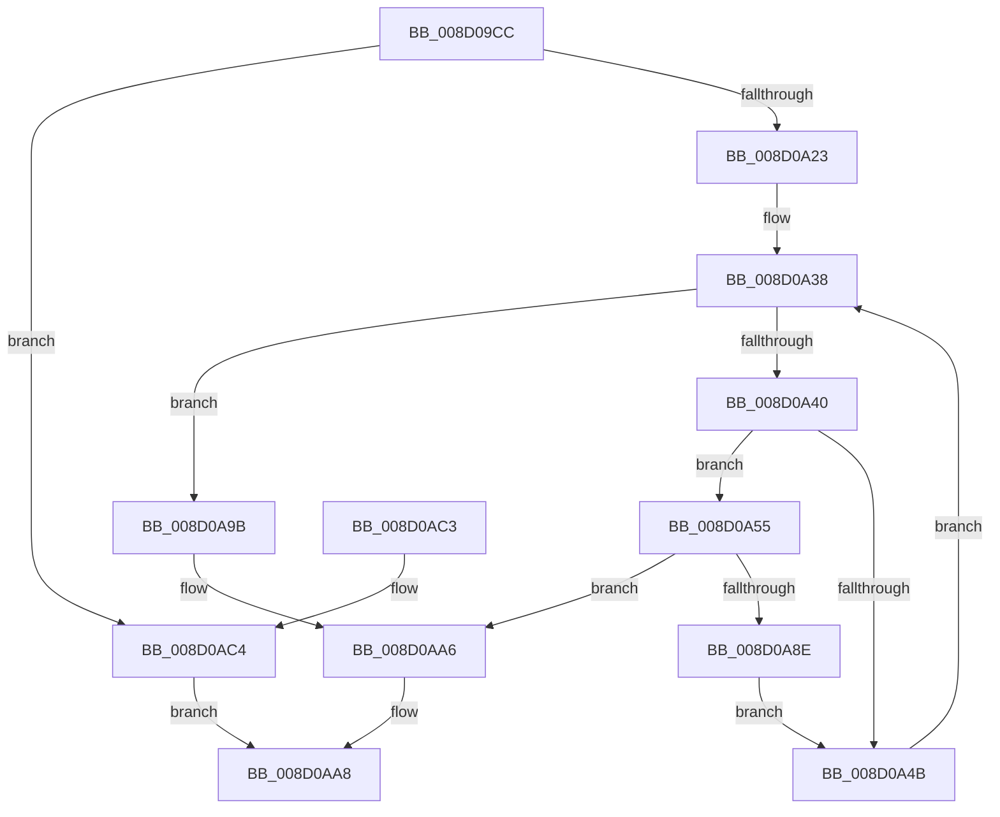

# MiCommitInitialVadMetadataBits

- RVA: `0x008D09CC`–`0x008D0AC8` (길이 `252` bytes)
- VA: `0x00000001408D09CC`
- 실행 섹션: `PAGE`
- PDB 이름 있음: `예`; PDB Function 태그: `아니요`
- unwind 정보 RVA: `0x0005FD64`
- 디코드: `71`개 명령, `252/252` bytes 표시
- 미해석 바이트: `0` (있으면 어셈블리에 `.byte`로 보존)

> 이 문서는 커널 이미지의 기계어와 PDB 기호를 분석해 생성했습니다. 4번과 5번은 함수 원형과 자료형을 바이너리 사용 방식에서 추정한 C 해석이며 원본 소스 복구 결과는 아닙니다.

## 1. Dependencies

- 직접 호출 지점: **11**; 고유 호출 대상: **9**
- 직접 호출자로 확인된 함수: **1**
- RIP 상대 이미지 참조: **0**

### Outgoing calls
- `0x008D0A08` → [HalAdjustResourceList](../../text/48/HalAdjustResourceList_function_0048FDC0.md) (function, `0x0048FDC0`)
- `0x008D0A2B` → [LOCK_ADDRESS_SPACE_SHARED](../../text/2A/LOCK_ADDRESS_SPACE_SHARED_function_002A8B3C.md) (function, `0x002A8B3C`)
- `0x008D0A33` → [MiGetFirstVad](../../text/2A/MiGetFirstVad_function_002A8BBC.md) (function, `0x002A8BBC`)
- `0x008D0A4E` → [MiGetNextVad](../../text/29/MiGetNextVad_function_00297224.md) (function, `0x00297224`)
- `0x008D0A58` → [MiReferenceVad](../../text/29/MiReferenceVad_function_00295890.md) (function, `0x00295890`)
- `0x008D0A63` → [UNLOCK_ADDRESS_SPACE_SHARED](../../text/2A/UNLOCK_ADDRESS_SPACE_SHARED_function_002A8ACC.md) (function, `0x002A8ACC`)
- `0x008D0A6E` → [MiLockVad](../../text/29/MiLockVad_function_00295810.md) (function, `0x00295810`)
- `0x008D0A7B` → [MiCommitVadMetadataBits](MiCommitVadMetadataBits_function_008D1A00.md) (function, `0x008D1A00`)
- `0x008D0A85` → [MiUnlockAndDereferenceVad](../../text/31/MiUnlockAndDereferenceVad_function_00316E60.md) (function, `0x00316E60`)
- `0x008D0A94` → [LOCK_ADDRESS_SPACE_SHARED](../../text/2A/LOCK_ADDRESS_SPACE_SHARED_function_002A8B3C.md) (function, `0x002A8B3C`)
- `0x008D0AA1` → [UNLOCK_ADDRESS_SPACE_SHARED](../../text/2A/UNLOCK_ADDRESS_SPACE_SHARED_function_002A8ACC.md) (function, `0x002A8ACC`)

### Direct callers
- [MiMapProcessExecutable](../8C/MiMapProcessExecutable_function_008CFDB4.md) at `0x008CFEA0`

### Static image references
- 디코드된 RIP-relative 메모리 참조가 없습니다.

## 2. Other-region calls and transfers

- 다른 실행 섹션으로 향하는 call: **10**
  - `0x008D0A08` → [HalAdjustResourceList](../../text/48/HalAdjustResourceList_function_0048FDC0.md) (`PAGE` → `.text`)
  - `0x008D0A2B` → [LOCK_ADDRESS_SPACE_SHARED](../../text/2A/LOCK_ADDRESS_SPACE_SHARED_function_002A8B3C.md) (`PAGE` → `.text`)
  - `0x008D0A33` → [MiGetFirstVad](../../text/2A/MiGetFirstVad_function_002A8BBC.md) (`PAGE` → `.text`)
  - `0x008D0A4E` → [MiGetNextVad](../../text/29/MiGetNextVad_function_00297224.md) (`PAGE` → `.text`)
  - `0x008D0A58` → [MiReferenceVad](../../text/29/MiReferenceVad_function_00295890.md) (`PAGE` → `.text`)
  - `0x008D0A63` → [UNLOCK_ADDRESS_SPACE_SHARED](../../text/2A/UNLOCK_ADDRESS_SPACE_SHARED_function_002A8ACC.md) (`PAGE` → `.text`)
  - `0x008D0A6E` → [MiLockVad](../../text/29/MiLockVad_function_00295810.md) (`PAGE` → `.text`)
  - `0x008D0A85` → [MiUnlockAndDereferenceVad](../../text/31/MiUnlockAndDereferenceVad_function_00316E60.md) (`PAGE` → `.text`)
  - `0x008D0A94` → [LOCK_ADDRESS_SPACE_SHARED](../../text/2A/LOCK_ADDRESS_SPACE_SHARED_function_002A8B3C.md) (`PAGE` → `.text`)
  - `0x008D0AA1` → [UNLOCK_ADDRESS_SPACE_SHARED](../../text/2A/UNLOCK_ADDRESS_SPACE_SHARED_function_002A8ACC.md) (`PAGE` → `.text`)
- 별도 외부 분기/꼬리 이동을 확인하지 못했습니다.

## 3. Assembly (complete function range)

```asm
008D09CC  48 8B C4                        mov rax, rsp
008D09CF  48 89 58 08                     mov qword ptr [rax + 8], rbx
008D09D3  48 89 68 10                     mov qword ptr [rax + 0x10], rbp
008D09D7  48 89 70 18                     mov qword ptr [rax + 0x18], rsi
008D09DB  48 89 78 20                     mov qword ptr [rax + 0x20], rdi
008D09DF  41 56                           push r14
008D09E1  48 83 EC 20                     sub rsp, 0x20
008D09E5  65 48 8B 34 25 88 01 00 00      mov rsi, qword ptr gs:[0x188]
008D09EE  33 C9                           xor ecx, ecx
008D09F0  48 8B BE B8 00 00 00            mov rdi, qword ptr [rsi + 0xb8]
008D09F7  48 8B 87 10 04 00 00            mov rax, qword ptr [rdi + 0x410]
008D09FE  48 39 88 A8 04 00 00            cmp qword ptr [rax + 0x4a8], rcx
008D0A05  0F 95 C1                        setne cl
008D0A08  E8 B3 F3 BB FF                  call 0x14048fdc0
008D0A0D  44 8B F1                        mov r14d, ecx
008D0A10  41 83 CE 04                     or r14d, 4
008D0A14  85 C0                           test eax, eax
008D0A16  44 0F 44 F1                     cmove r14d, ecx
008D0A1A  45 85 F6                        test r14d, r14d
008D0A1D  0F 84 A1 00 00 00               je 0x1408d0ac4
008D0A23  48 8B D7                        mov rdx, rdi
008D0A26  48 8B CE                        mov rcx, rsi
008D0A29  33 ED                           xor ebp, ebp
008D0A2B  E8 0C 81 9D FF                  call 0x1402a8b3c
008D0A30  48 8B CF                        mov rcx, rdi
008D0A33  E8 84 81 9D FF                  call 0x1402a8bbc
008D0A38  48 8B D8                        mov rbx, rax
008D0A3B  48 85 C0                        test rax, rax
008D0A3E  74 5B                           je 0x1408d0a9b
008D0A40  8B 48 30                        mov ecx, dword ptr [rax + 0x30]
008D0A43  80 E1 70                        and cl, 0x70
008D0A46  80 F9 20                        cmp cl, 0x20
008D0A49  74 0A                           je 0x1408d0a55
008D0A4B  48 8B CB                        mov rcx, rbx
008D0A4E  E8 D1 67 9C FF                  call 0x140297224
008D0A53  EB E3                           jmp 0x1408d0a38
008D0A55  48 8B CB                        mov rcx, rbx
008D0A58  E8 33 4E 9C FF                  call 0x140295890
008D0A5D  48 8B CE                        mov rcx, rsi
008D0A60  48 8B D7                        mov rdx, rdi
008D0A63  E8 64 80 9D FF                  call 0x1402a8acc
008D0A68  48 8B D3                        mov rdx, rbx
008D0A6B  48 8B CE                        mov rcx, rsi
008D0A6E  E8 9D 4D 9C FF                  call 0x140295810
008D0A73  45 8B C6                        mov r8d, r14d
008D0A76  33 D2                           xor edx, edx
008D0A78  48 8B CB                        mov rcx, rbx
008D0A7B  E8 80 0F 00 00                  call 0x1408d1a00
008D0A80  48 8B CB                        mov rcx, rbx
008D0A83  8B E8                           mov ebp, eax
008D0A85  E8 D6 63 A4 FF                  call 0x140316e60
008D0A8A  85 ED                           test ebp, ebp
008D0A8C  78 18                           js 0x1408d0aa6
008D0A8E  48 8B D7                        mov rdx, rdi
008D0A91  48 8B CE                        mov rcx, rsi
008D0A94  E8 A3 80 9D FF                  call 0x1402a8b3c
008D0A99  EB B0                           jmp 0x1408d0a4b
008D0A9B  48 8B D7                        mov rdx, rdi
008D0A9E  48 8B CE                        mov rcx, rsi
008D0AA1  E8 26 80 9D FF                  call 0x1402a8acc
008D0AA6  8B C5                           mov eax, ebp
008D0AA8  48 8B 5C 24 30                  mov rbx, qword ptr [rsp + 0x30]
008D0AAD  48 8B 6C 24 38                  mov rbp, qword ptr [rsp + 0x38]
008D0AB2  48 8B 74 24 40                  mov rsi, qword ptr [rsp + 0x40]
008D0AB7  48 8B 7C 24 48                  mov rdi, qword ptr [rsp + 0x48]
008D0ABC  48 83 C4 20                     add rsp, 0x20
008D0AC0  41 5E                           pop r14
008D0AC2  C3                              ret
008D0AC3  CC                              int3
008D0AC4  33 C0                           xor eax, eax
008D0AC6  EB E0                           jmp 0x1408d0aa8
```

## 4. C-style interpretation (structured pseudocode)

```c
__int64 __fastcall MiCommitInitialVadMetadataBits(int a1)
{
    __int64 result;
    __int64 v_r14;
    __int64 v_rbp;
    __int64 v_rsp;
    unsigned __int64 v_stack_p10;
    unsigned __int64 v_stack_p18;
    unsigned __int64 v_stack_p20;
    unsigned __int64 v_stack_p8;

    *(unsigned __int64 *)(v_rsp + 8) = v_rbx;
    *(unsigned __int64 *)(v_rsp + 16) = v_rbp;
    *(unsigned __int64 *)(v_rsp + 24) = v_rsi;
    *(unsigned __int64 *)(v_rsp + 32) = v_rdi;
    v_rsp = (v_rsp) - (32);
    a1 = 0;
    a1 = ((*(unsigned __int64 *)(*(unsigned __int64 *)(*(unsigned __int64 *)(*(unsigned __int64 *)(gs_base + (0 + 392)) + 184) + 1040) + 1192)) != 0) ? 1 : 0;
    result = HalAdjustResourceList(a1, a2, a3, a4);
    v_r14 = (unsigned int)(((unsigned int)(a1)) | (4));
    if ((unsigned int)(result) == 0) { v_r14 = a1; }
    if ((unsigned int)(v_r14) == 0) goto loc_008D0AC4;
    v_rbp = 0;
    result = LOCK_ADDRESS_SPACE_SHARED(*(unsigned __int64 *)(gs_base + (0 + 392)), *(unsigned __int64 *)(*(unsigned __int64 *)(gs_base + (0 + 392)) + 184), a3, a4);
    result = MiGetFirstVad(*(unsigned __int64 *)(*(unsigned __int64 *)(gs_base + (0 + 392)) + 184), *(unsigned __int64 *)(*(unsigned __int64 *)(gs_base + (0 + 392)) + 184), a3, a4);
loc_008D0A38:
    if (result == 0) goto loc_008D0A9B;
    a1 = (unsigned __int8)(((unsigned int)(*(unsigned int *)(result + 48))) & (112));
    if (((unsigned __int8)(a1)) == 32) goto loc_008D0A55;
loc_008D0A4B:
    result = MiGetNextVad(result, *(unsigned __int64 *)(*(unsigned __int64 *)(gs_base + (0 + 392)) + 184), a3, a4);
    goto loc_008D0A38;
loc_008D0A55:
    result = MiReferenceVad(result, *(unsigned __int64 *)(*(unsigned __int64 *)(gs_base + (0 + 392)) + 184), a3, a4);
    result = UNLOCK_ADDRESS_SPACE_SHARED(*(unsigned __int64 *)(gs_base + (0 + 392)), *(unsigned __int64 *)(*(unsigned __int64 *)(gs_base + (0 + 392)) + 184), a3, a4);
    result = MiLockVad(*(unsigned __int64 *)(gs_base + (0 + 392)), result, a3, a4);
    a2 = 0;
    result = MiCommitVadMetadataBits(result, a2, (unsigned int)((unsigned int)(v_r14)), a4);
    result = MiUnlockAndDereferenceVad(result, a2, (unsigned int)((unsigned int)(v_r14)), a4);
    if (sign_flag) goto loc_008D0AA6;
    result = LOCK_ADDRESS_SPACE_SHARED(*(unsigned __int64 *)(gs_base + (0 + 392)), *(unsigned __int64 *)(*(unsigned __int64 *)(gs_base + (0 + 392)) + 184), (unsigned int)((unsigned int)(v_r14)), a4);
    goto loc_008D0A4B;
loc_008D0A9B:
    result = UNLOCK_ADDRESS_SPACE_SHARED(*(unsigned __int64 *)(gs_base + (0 + 392)), *(unsigned __int64 *)(*(unsigned __int64 *)(gs_base + (0 + 392)) + 184), (unsigned int)((unsigned int)(v_r14)), a4);
loc_008D0AA6:
loc_008D0AA8:
    v_rsp = (v_rsp) + (32);
    return (unsigned int)((unsigned int)((unsigned int)((unsigned int)(result))));
loc_008D0AC4:
    result = 0;
    goto loc_008D0AA8;
}
```

## 5. (Beta) C Style

```c
int64_t MiCommitInitialVadMetadataBits(int32_t Arg1)
{
    int64_t result;
    int64_t local_r14;
    int64_t local_rbp;
    int64_t local_rsp;
    uint64_t v_stack_p10;
    uint64_t v_stack_p18;
    uint64_t v_stack_p20;
    uint64_t v_stack_p8;

    *(uint64_t *)(local_rsp + 0x8) = local_rbx;
    *(uint64_t *)(local_rsp + 0x10) = local_rbp;
    *(uint64_t *)(local_rsp + 0x18) = local_rsi;
    *(uint64_t *)(local_rsp + 0x20) = local_rdi;
    local_rsp = (local_rsp) - (32);
    Arg1 = 0;
    Arg1 = ((*(uint64_t *)(*(uint64_t *)(*(uint64_t *)(*(uint64_t *)(gs_base + (0 + 0x188)) + 0xB8) + 0x410) + 0x4A8)) != 0) ? 1 : 0;
    result = HalAdjustResourceList(Arg1, a2, a3, a4);
    local_r14 = (uint32_t)(((uint32_t)(Arg1)) | (4));
    if ((uint32_t)(result) == 0) { local_r14 = Arg1; }
    if ((uint32_t)(local_r14) == 0) goto loc_008D0AC4;
    local_rbp = 0;
    result = LOCK_ADDRESS_SPACE_SHARED(*(uint64_t *)(gs_base + (0 + 0x188)), *(uint64_t *)(*(uint64_t *)(gs_base + (0 + 0x188)) + 0xB8), a3, a4);
    result = MiGetFirstVad(*(uint64_t *)(*(uint64_t *)(gs_base + (0 + 0x188)) + 0xB8), *(uint64_t *)(*(uint64_t *)(gs_base + (0 + 0x188)) + 0xB8), a3, a4);
loc_008D0A38:
    if (result == 0) goto loc_008D0A9B;
    Arg1 = (uint8_t)(((uint32_t)(*(uint32_t *)(result + 0x30))) & (112));
    if (((uint8_t)(Arg1)) == 32) goto loc_008D0A55;
loc_008D0A4B:
    result = MiGetNextVad(result, *(uint64_t *)(*(uint64_t *)(gs_base + (0 + 0x188)) + 0xB8), a3, a4);
    goto loc_008D0A38;
loc_008D0A55:
    result = MiReferenceVad(result, *(uint64_t *)(*(uint64_t *)(gs_base + (0 + 0x188)) + 0xB8), a3, a4);
    result = UNLOCK_ADDRESS_SPACE_SHARED(*(uint64_t *)(gs_base + (0 + 0x188)), *(uint64_t *)(*(uint64_t *)(gs_base + (0 + 0x188)) + 0xB8), a3, a4);
    result = MiLockVad(*(uint64_t *)(gs_base + (0 + 0x188)), result, a3, a4);
    a2 = 0;
    result = MiCommitVadMetadataBits(result, a2, (uint32_t)((uint32_t)(local_r14)), a4);
    result = MiUnlockAndDereferenceVad(result, a2, (uint32_t)((uint32_t)(local_r14)), a4);
    if (sign_flag) goto loc_008D0AA6;
    result = LOCK_ADDRESS_SPACE_SHARED(*(uint64_t *)(gs_base + (0 + 0x188)), *(uint64_t *)(*(uint64_t *)(gs_base + (0 + 0x188)) + 0xB8), (uint32_t)((uint32_t)(local_r14)), a4);
    goto loc_008D0A4B;
loc_008D0A9B:
    result = UNLOCK_ADDRESS_SPACE_SHARED(*(uint64_t *)(gs_base + (0 + 0x188)), *(uint64_t *)(*(uint64_t *)(gs_base + (0 + 0x188)) + 0xB8), (uint32_t)((uint32_t)(local_r14)), a4);
loc_008D0AA6:
loc_008D0AA8:
    local_rsp = (local_rsp) + (32);
    return (uint32_t)((uint32_t)((uint32_t)((uint32_t)(result))));
loc_008D0AC4:
    result = 0;
    goto loc_008D0AA8;
}
```

## 6. Execution-region graph

[열기: 2D/3D 그래프와 함수 탐색 컨트롤 패널](../../../control-panel.html?section=page&rva=0x008D09CC&view=graph)

- 2D 그래프는 위에서 아래로 흐르고, 3D 그래프는 빈 공간을 드래그해 회전합니다. Shift+드래그는 이동, 휠은 확대·축소, 함수 노드 선택은 대상 보고서 이동입니다.

### Static fallback


