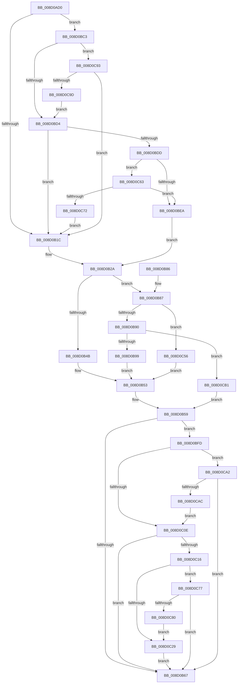

# MiCommitVadCfgBits

- RVA: `0x008D0AD0`–`0x008D0CBB` (길이 `491` bytes)
- VA: `0x00000001408D0AD0`
- 실행 섹션: `PAGE`
- PDB 이름 있음: `예`; PDB Function 태그: `아니요`
- unwind 정보 RVA: `0x00084AD0`
- 디코드: `106`개 명령, `491/491` bytes 표시
- 미해석 바이트: `0` (있으면 어셈블리에 `.byte`로 보존)

> 이 문서는 커널 이미지의 기계어와 PDB 기호를 분석해 생성했습니다. 4번과 5번은 함수 원형과 자료형을 바이너리 사용 방식에서 추정한 C 해석이며 원본 소스 복구 결과는 아닙니다.

## 1. Dependencies

- 직접 호출 지점: **4**; 고유 호출 대상: **3**
- 직접 호출자로 확인된 함수: **1**
- RIP 상대 이미지 참조: **0**

### Outgoing calls
- `0x008D0B4E` → [MiMarkSharedImageCfgBits](MiMarkSharedImageCfgBits_function_008D0CC4.md) (function, `0x008D0CC4`)
- `0x008D0BBC` → [MiPopulateCfgBitMap](MiPopulateCfgBitMap_function_008D0FA4.md) (function, `0x008D0FA4`)
- `0x008D0C4C` → [MiPopulateCfgBitMap](MiPopulateCfgBitMap_function_008D0FA4.md) (function, `0x008D0FA4`)
- `0x008D0C59` → [MiMarkPrivateImageCfgBits](MiMarkPrivateImageCfgBits_function_008D07FC.md) (function, `0x008D07FC`)

### Direct callers
- [MiCommitVadMetadataBits](MiCommitVadMetadataBits_function_008D1A00.md) at `0x008D1B5B`

### Static image references
- 디코드된 RIP-relative 메모리 참조가 없습니다.

## 2. Other-region calls and transfers

- 다른 실행 섹션으로 향하는 call: **0**
- 별도 외부 분기/꼬리 이동을 확인하지 못했습니다.

## 3. Assembly (complete function range)

```asm
008D0AD0  48 8B C4                        mov rax, rsp
008D0AD3  48 89 58 08                     mov qword ptr [rax + 8], rbx
008D0AD7  48 89 68 10                     mov qword ptr [rax + 0x10], rbp
008D0ADB  48 89 70 18                     mov qword ptr [rax + 0x18], rsi
008D0ADF  48 89 78 20                     mov qword ptr [rax + 0x20], rdi
008D0AE3  41 54                           push r12
008D0AE5  41 55                           push r13
008D0AE7  41 56                           push r14
008D0AE9  48 83 EC 40                     sub rsp, 0x40
008D0AED  48 83 B9 10 03 00 00 00         cmp qword ptr [rcx + 0x310], 0
008D0AF5  41 BC 4C 01 00 00               mov r12d, 0x14c
008D0AFB  4D 8B F0                        mov r14, r8
008D0AFE  49 8B E9                        mov rbp, r9
008D0B01  4C 8B C2                        mov r8, rdx
008D0B04  48 8B F9                        mov rdi, rcx
008D0B07  48 BE 00 00 00 00 01 00 00 00   movabs rsi, 0x100000000
008D0B11  45 8D 6C 24 78                  lea r13d, [r12 + 0x78]
008D0B16  0F 85 A7 00 00 00               jne 0x1408d0bc3
008D0B1C  48 8B 99 10 04 00 00            mov rbx, qword ptr [rcx + 0x410]
008D0B23  48 81 C3 A0 04 00 00            add rbx, 0x4a0
008D0B2A  F6 84 24 90 00 00 00 02         test byte ptr [rsp + 0x90], 2
008D0B32  BA 00 00 00 00                  mov edx, 0
008D0B37  8B 8C 24 88 00 00 00            mov ecx, dword ptr [rsp + 0x88]
008D0B3E  44 8D 52 01                     lea r10d, [rdx + 1]
008D0B42  41 0F 45 D2                     cmovne edx, r10d
008D0B46  41 2B CA                        sub ecx, r10d
008D0B49  75 3C                           jne 0x1408d0b87
008D0B4B  48 8B CB                        mov rcx, rbx
008D0B4E  E8 71 01 00 00                  call 0x1408d0cc4
008D0B53  41 BA 01 00 00 00               mov r10d, 1
008D0B59  48 83 BF 10 03 00 00 00         cmp qword ptr [rdi + 0x310], 0
008D0B61  0F 85 96 00 00 00               jne 0x1408d0bfd
008D0B67  48 8B 5C 24 60                  mov rbx, qword ptr [rsp + 0x60]
008D0B6C  48 8B 6C 24 68                  mov rbp, qword ptr [rsp + 0x68]
008D0B71  48 8B 74 24 70                  mov rsi, qword ptr [rsp + 0x70]
008D0B76  48 8B 7C 24 78                  mov rdi, qword ptr [rsp + 0x78]
008D0B7B  48 83 C4 40                     add rsp, 0x40
008D0B7F  41 5E                           pop r14
008D0B81  41 5D                           pop r13
008D0B83  41 5C                           pop r12
008D0B85  C3                              ret
008D0B86  CC                              int3
008D0B87  41 2B CA                        sub ecx, r10d
008D0B8A  0F 84 C6 00 00 00               je 0x1408d0c56
008D0B90  41 3B CA                        cmp ecx, r10d
008D0B93  0F 85 18 01 00 00               jne 0x1408d0cb1
008D0B99  48 83 64 24 30 00               and qword ptr [rsp + 0x30], 0
008D0B9F  49 8D 81 FF 0F 00 00            lea rax, [r9 + 0xfff]
008D0BA6  48 25 00 F0 FF FF               and rax, 0xfffffffffffff000
008D0BAC  45 33 C9                        xor r9d, r9d
008D0BAF  48 89 44 24 28                  mov qword ptr [rsp + 0x28], rax
008D0BB4  48 8B CB                        mov rcx, rbx
008D0BB7  4C 89 74 24 20                  mov qword ptr [rsp + 0x20], r14
008D0BBC  E8 E3 03 00 00                  call 0x1408d0fa4
008D0BC1  EB 90                           jmp 0x1408d0b53
008D0BC3  0F B7 81 EC 06 00 00            movzx eax, word ptr [rcx + 0x6ec]
008D0BCA  66 41 3B C4                     cmp ax, r12w
008D0BCE  0F 85 BF 00 00 00               jne 0x1408d0c93
008D0BD4  4C 3B F6                        cmp r14, rsi
008D0BD7  0F 83 3F FF FF FF               jae 0x1408d0b1c
008D0BDD  48 8B 84 24 80 00 00 00         mov rax, qword ptr [rsp + 0x80]
008D0BE5  48 85 C0                        test rax, rax
008D0BE8  75 79                           jne 0x1408d0c63
008D0BEA  48 8B 99 10 04 00 00            mov rbx, qword ptr [rcx + 0x410]
008D0BF1  48 81 C3 C0 04 00 00            add rbx, 0x4c0
008D0BF8  E9 2D FF FF FF                  jmp 0x1408d0b2a
008D0BFD  0F B7 8F EC 06 00 00            movzx ecx, word ptr [rdi + 0x6ec]
008D0C04  66 41 3B CC                     cmp cx, r12w
008D0C08  0F 85 94 00 00 00               jne 0x1408d0ca2
008D0C0E  85 C0                           test eax, eax
008D0C10  0F 88 51 FF FF FF               js 0x1408d0b67
008D0C16  48 8B 97 10 04 00 00            mov rdx, qword ptr [rdi + 0x410]
008D0C1D  48 8D 8A A0 04 00 00            lea rcx, [rdx + 0x4a0]
008D0C24  48 3B D9                        cmp rbx, rcx
008D0C27  74 4E                           je 0x1408d0c77
008D0C29  48 83 64 24 30 00               and qword ptr [rsp + 0x30], 0
008D0C2F  48 8D 85 FF 0F 00 00            lea rax, [rbp + 0xfff]
008D0C36  48 25 00 F0 FF FF               and rax, 0xfffffffffffff000
008D0C3C  45 33 C9                        xor r9d, r9d
008D0C3F  48 89 44 24 28                  mov qword ptr [rsp + 0x28], rax
008D0C44  49 8B D2                        mov rdx, r10
008D0C47  4C 89 74 24 20                  mov qword ptr [rsp + 0x20], r14
008D0C4C  E8 53 03 00 00                  call 0x1408d0fa4
008D0C51  E9 11 FF FF FF                  jmp 0x1408d0b67
008D0C56  48 8B CB                        mov rcx, rbx
008D0C59  E8 9E FB FF FF                  call 0x1408d07fc
008D0C5E  E9 F0 FE FF FF                  jmp 0x1408d0b53
008D0C63  48 8B 00                        mov rax, qword ptr [rax]
008D0C66  66 0F BA 60 0C 0F               bt word ptr [rax + 0xc], 0xf
008D0C6C  0F 82 78 FF FF FF               jb 0x1408d0bea
008D0C72  E9 A5 FE FF FF                  jmp 0x1408d0b1c
008D0C77  4C 3B F6                        cmp r14, rsi
008D0C7A  0F 87 E7 FE FF FF               ja 0x1408d0b67
008D0C80  48 3B EE                        cmp rbp, rsi
008D0C83  48 8D 8A C0 04 00 00            lea rcx, [rdx + 0x4c0]
008D0C8A  48 0F 46 F5                     cmovbe rsi, rbp
008D0C8E  48 8B EE                        mov rbp, rsi
008D0C91  EB 96                           jmp 0x1408d0c29
008D0C93  66 41 3B C5                     cmp ax, r13w
008D0C97  0F 85 7F FE FF FF               jne 0x1408d0b1c
008D0C9D  E9 32 FF FF FF                  jmp 0x1408d0bd4
008D0CA2  66 41 3B CD                     cmp cx, r13w
008D0CA6  0F 85 BB FE FF FF               jne 0x1408d0b67
008D0CAC  E9 5D FF FF FF                  jmp 0x1408d0c0e
008D0CB1  B8 01 00 00 C0                  mov eax, 0xc0000001
008D0CB6  E9 9E FE FF FF                  jmp 0x1408d0b59
```

## 4. C-style interpretation (structured pseudocode)

```c
__int64 __fastcall MiCommitVadCfgBits(__int64 a1, __int64 a2, __int64 a3, __int64 a4, __int64 a5, unsigned int a6, unsigned __int8 a7)
{
    __int64 result;
    __int64 v_rbx;
    __int64 v_rsi;
    __int64 v_rsp;
    unsigned __int64 v_stack_p10;
    unsigned __int64 v_stack_p18;
    unsigned __int64 v_stack_p20;
    unsigned __int64 v_stack_p28;
    unsigned __int64 v_stack_p30;
    unsigned __int64 v_stack_p8;

    *(unsigned __int64 *)(v_rsp + 8) = v_rbx;
    *(unsigned __int64 *)(v_rsp + 16) = v_rbp;
    *(unsigned __int64 *)(v_rsp + 24) = v_rsi;
    *(unsigned __int64 *)(v_rsp + 32) = v_rdi;
    v_rsp = (v_rsp) - (64);
    if ((*(unsigned __int64 *)(a1 + 784)) != 0) goto loc_008D0BC3;
loc_008D0B1C:
    v_rbx = (*(unsigned __int64 *)(a1 + 1040)) + (0x4A0ULL);
loc_008D0B2A:
    a2 = 0;
    if (((a7) & (2)) != 0) { a2 = (unsigned int)(0 + 1); }
    a1 = (unsigned int)(((unsigned int)(a6)) - ((unsigned int)(0 + 1)));
    if (condition_is_not_equal) goto loc_008D0B87;
    result = MiMarkSharedImageCfgBits(v_rbx, a2, a2, a4);
loc_008D0B53:
loc_008D0B59:
    if ((*(unsigned __int64 *)(a1 + 784)) != 0) goto loc_008D0BFD;
loc_008D0B67:
    v_rsp = (v_rsp) + (64);
    return result;
loc_008D0B87:
    a1 = (unsigned int)((v_rbx) - (1));
    if (condition_is_equal) goto loc_008D0C56;
    if (((unsigned int)(a1)) != 1) goto loc_008D0CB1;
    result = (a4 + 4095) & (0xFFFFFFFFFFFFF000ULL);
    a4 = 0;
    v_stack_p28 = result;
    v_stack_p20 = a3;
    result = MiPopulateCfgBitMap(v_stack_p8, a2, a2, a4);
    goto loc_008D0B53;
loc_008D0BC3:
    if (((unsigned __int16)(*(unsigned __int16 *)(v_stack_p8 + 1772))) != 332) goto loc_008D0C93;
loc_008D0BD4:
    if (a3 >= v_stack_p18) goto loc_008D0B1C;
    if (a5 != 0) goto loc_008D0C63;
loc_008D0BEA:
    v_rbx = (*(unsigned __int64 *)(v_stack_p8 + 1040)) + (0x4C0ULL);
    goto loc_008D0B2A;
loc_008D0BFD:
    if (((unsigned __int16)(*(unsigned __int16 *)(v_stack_p20 + 1772))) != 332) goto loc_008D0CA2;
loc_008D0C0E:
    if (sign_flag) goto loc_008D0B67;
    if (v_rbx == (*(unsigned __int64 *)(v_stack_p20 + 1040) + 1184)) goto loc_008D0C77;
loc_008D0C29:
    result = (v_stack_p10 + 4095) & (0xFFFFFFFFFFFFF000ULL);
    a4 = 0;
    v_stack_p28 = result;
    v_stack_p20 = a3;
    result = MiPopulateCfgBitMap(*(unsigned __int64 *)(v_stack_p20 + 1040) + 1184, 1, a2, a4);
    goto loc_008D0B67;
loc_008D0C56:
    result = MiMarkPrivateImageCfgBits(v_rbx, 1, a2, a4);
    goto loc_008D0B53;
loc_008D0C63:
    if (condition_is_below) goto loc_008D0BEA;
    goto loc_008D0B1C;
loc_008D0C77:
    if (a3 > v_stack_p18) goto loc_008D0B67;
    v_rsi = v_stack_p18;
    if (v_stack_p10 <= v_stack_p18) { v_rsi = v_stack_p10; }
    goto loc_008D0C29;
loc_008D0C93:
    if (((unsigned __int16)(*(unsigned __int64 *)(result))) != ((unsigned __int16)(332 + 120))) goto loc_008D0B1C;
    goto loc_008D0BD4;
loc_008D0CA2:
    if (((unsigned __int16)(1 + 1216)) != ((unsigned __int16)(332 + 120))) goto loc_008D0B67;
    goto loc_008D0C0E;
loc_008D0CB1:
    goto loc_008D0B59;
}
```

## 5. (Beta) C Style

```c
int64_t MiCommitVadCfgBits(void *Arg1, int64_t Arg2, int64_t Arg3, void *Arg4, int64_t Arg5, uint32_t Arg6, uint8_t Arg7)
{
    uint8_t *arg1 = (uint8_t *)Arg1;
    uint8_t *arg4 = (uint8_t *)Arg4;

    int64_t result;
    int64_t local_rbx;
    int64_t local_rsi;
    int64_t local_rsp;
    uint64_t v_stack_p10;
    uint64_t v_stack_p18;
    uint64_t v_stack_p20;
    uint64_t v_stack_p28;
    uint64_t v_stack_p30;
    uint64_t v_stack_p8;

    *(uint64_t *)(local_rsp + 0x8) = local_rbx;
    *(uint64_t *)(local_rsp + 0x10) = local_rbp;
    *(uint64_t *)(local_rsp + 0x18) = local_rsi;
    *(uint64_t *)(local_rsp + 0x20) = local_rdi;
    local_rsp = (local_rsp) - (64);
    if ((*(uint64_t *)(arg1 + 0x310)) != 0) goto loc_008D0BC3;
loc_008D0B1C:
    local_rbx = (*(uint64_t *)(arg1 + 0x410)) + (0x4A0ULL);
loc_008D0B2A:
    Arg2 = 0;
    if (((Arg7) & (2)) != 0) { Arg2 = (uint32_t)(0 + 1); }
    Arg1 = (uint32_t)(((uint32_t)(Arg6)) - ((uint32_t)(0 + 1)));
    if (condition_is_not_equal) goto loc_008D0B87;
    result = MiMarkSharedImageCfgBits(local_rbx, Arg2, Arg2, Arg4);
loc_008D0B53:
loc_008D0B59:
    if ((*(uint64_t *)(arg1 + 0x310)) != 0) goto loc_008D0BFD;
loc_008D0B67:
    local_rsp = (local_rsp) + (64);
    return result;
loc_008D0B87:
    Arg1 = (uint32_t)((local_rbx) - (1));
    if (condition_is_equal) goto loc_008D0C56;
    if (((uint32_t)(Arg1)) != 1) goto loc_008D0CB1;
    result = (Arg4 + 4095) & (0xFFFFFFFFFFFFF000ULL);
    Arg4 = 0;
    v_stack_p28 = result;
    v_stack_p20 = Arg3;
    result = MiPopulateCfgBitMap(v_stack_p8, Arg2, Arg2, Arg4);
    goto loc_008D0B53;
loc_008D0BC3:
    if (((uint16_t)(*(uint16_t *)(v_stack_p8 + 0x6EC))) != 332) goto loc_008D0C93;
loc_008D0BD4:
    if (Arg3 >= v_stack_p18) goto loc_008D0B1C;
    if (Arg5 != 0) goto loc_008D0C63;
loc_008D0BEA:
    local_rbx = (*(uint64_t *)(v_stack_p8 + 0x410)) + (0x4C0ULL);
    goto loc_008D0B2A;
loc_008D0BFD:
    if (((uint16_t)(*(uint16_t *)(v_stack_p20 + 0x6EC))) != 332) goto loc_008D0CA2;
loc_008D0C0E:
    if (sign_flag) goto loc_008D0B67;
    if (local_rbx == (*(uint64_t *)(v_stack_p20 + 0x410) + 1184)) goto loc_008D0C77;
loc_008D0C29:
    result = (v_stack_p10 + 4095) & (0xFFFFFFFFFFFFF000ULL);
    Arg4 = 0;
    v_stack_p28 = result;
    v_stack_p20 = Arg3;
    result = MiPopulateCfgBitMap(*(uint64_t *)(v_stack_p20 + 0x410) + 1184, 1, Arg2, Arg4);
    goto loc_008D0B67;
loc_008D0C56:
    result = MiMarkPrivateImageCfgBits(local_rbx, 1, Arg2, Arg4);
    goto loc_008D0B53;
loc_008D0C63:
    if (condition_is_below) goto loc_008D0BEA;
    goto loc_008D0B1C;
loc_008D0C77:
    if (Arg3 > v_stack_p18) goto loc_008D0B67;
    local_rsi = v_stack_p18;
    if (v_stack_p10 <= v_stack_p18) { local_rsi = v_stack_p10; }
    goto loc_008D0C29;
loc_008D0C93:
    if (((uint16_t)(*(uint64_t *)(result))) != ((uint16_t)(332 + 120))) goto loc_008D0B1C;
    goto loc_008D0BD4;
loc_008D0CA2:
    if (((uint16_t)(1 + 1216)) != ((uint16_t)(332 + 120))) goto loc_008D0B67;
    goto loc_008D0C0E;
loc_008D0CB1:
    goto loc_008D0B59;
}
```

### 관측된 메모리 오프셋

구조체 형식이 확인되지 않은 접근은 인자 기준의 오프셋으로만 기록했습니다.

| 기준 인자 | 오프셋 표현 | 폭 (bit) | 접근 |
|---|---:|---:|---|
| `Arg1` | `+ 0x310` | `64` | `R` |
| `Arg1` | `+ 0x410` | `64` | `R` |
| `Arg1` | `+ 0x6EC` | `16` | `R` |
| `Arg4` | `+ 0xFFF` | `64` | `R` |

## 6. Execution-region graph

[열기: 2D/3D 그래프와 함수 탐색 컨트롤 패널](../../../control-panel.html?section=page&rva=0x008D0AD0&view=graph)

- 2D 그래프는 위에서 아래로 흐르고, 3D 그래프는 빈 공간을 드래그해 회전합니다. Shift+드래그는 이동, 휠은 확대·축소, 함수 노드 선택은 대상 보고서 이동입니다.

### Static fallback


