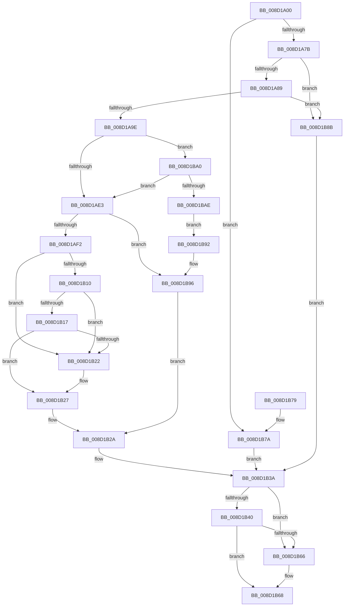

# MiCommitVadMetadataBits

- RVA: `0x008D1A00`–`0x008D1BB0` (길이 `432` bytes)
- VA: `0x00000001408D1A00`
- 실행 섹션: `PAGE`
- PDB 이름 있음: `예`; PDB Function 태그: `아니요`
- unwind 정보 RVA: `0x00084C10`
- 디코드: `114`개 명령, `432/432` bytes 표시
- 미해석 바이트: `0` (있으면 어셈블리에 `.byte`로 보존)

> 이 문서는 커널 이미지의 기계어와 PDB 기호를 분석해 생성했습니다. 4번과 5번은 함수 원형과 자료형을 바이너리 사용 방식에서 추정한 C 해석이며 원본 소스 복구 결과는 아닙니다.

## 1. Dependencies

- 직접 호출 지점: **2**; 고유 호출 대상: **2**
- 직접 호출자로 확인된 함수: **7**
- RIP 상대 이미지 참조: **0**

### Outgoing calls
- `0x008D1ACD` → [PsWow64GetProcessMachine](PsWow64GetProcessMachine_function_008D2130.md) (function, `0x008D2130`)
- `0x008D1B5B` → [MiCommitVadCfgBits](MiCommitVadCfgBits_function_008D0AD0.md) (function, `0x008D0AD0`)

### Direct callers
- [MmProtectVirtualMemory](../88/MmProtectVirtualMemory_function_00881050.md) at `0x008816EF`
- [MiAllocateVirtualMemory](../88/MiAllocateVirtualMemory_function_00883B40.md) at `0x00884059`
- [MiReserveUserMemory](../88/MiReserveUserMemory_function_00884498.md) at `0x00884B1F`
- [sub_0088535F](../88/Unknown_function_0088535F.md) at `0x008853D2`
- [MiCommitInitialVadMetadataBits](MiCommitInitialVadMetadataBits_function_008D09CC.md) at `0x008D0A7B`
- [MiMapViewOfImageSection](../97/MiMapViewOfImageSection_function_0097E92C.md) at `0x0097F1A0`
- [MiMapViewOfPhysicalSection](../97/MiMapViewOfPhysicalSection_function_0097F984.md) at `0x0097FC66`

### Static image references
- 디코드된 RIP-relative 메모리 참조가 없습니다.

## 2. Other-region calls and transfers

- 다른 실행 섹션으로 향하는 call: **0**
- 별도 외부 분기/꼬리 이동을 확인하지 못했습니다.

## 3. Assembly (complete function range)

```asm
008D1A00  40 53                           push rbx
008D1A02  55                              push rbp
008D1A03  56                              push rsi
008D1A04  57                              push rdi
008D1A05  41 54                           push r12
008D1A07  41 55                           push r13
008D1A09  41 56                           push r14
008D1A0B  41 57                           push r15
008D1A0D  48 83 EC 68                     sub rsp, 0x68
008D1A11  65 48 8B 04 25 88 01 00 00      mov rax, qword ptr gs:[0x188]
008D1A1A  4C 8B F1                        mov r14, rcx
008D1A1D  0F B6 79 20                     movzx edi, byte ptr [rcx + 0x20]
008D1A21  41 B9 FF 0F 00 00               mov r9d, 0xfff
008D1A27  45 8B F8                        mov r15d, r8d
008D1A2A  33 ED                           xor ebp, ebp
008D1A2C  45 33 C0                        xor r8d, r8d
008D1A2F  4C 8B 90 B8 00 00 00            mov r10, qword ptr [rax + 0xb8]
008D1A36  8B 41 18                        mov eax, dword ptr [rcx + 0x18]
008D1A39  8B CF                           mov ecx, edi
008D1A3B  41 0F B6 5E 21                  movzx ebx, byte ptr [r14 + 0x21]
008D1A40  48 C1 E3 20                     shl rbx, 0x20
008D1A44  48 C1 E1 20                     shl rcx, 0x20
008D1A48  48 0B C8                        or rcx, rax
008D1A4B  48 89 44 24 48                  mov qword ptr [rsp + 0x48], rax
008D1A50  41 8B 46 1C                     mov eax, dword ptr [r14 + 0x1c]
008D1A54  48 0B D8                        or rbx, rax
008D1A57  48 C1 E1 0C                     shl rcx, 0xc
008D1A5B  48 C1 E3 0C                     shl rbx, 0xc
008D1A5F  49 0B D9                        or rbx, r9
008D1A62  4C 89 94 24 B8 00 00 00         mov qword ptr [rsp + 0xb8], r10
008D1A6A  48 89 8C 24 B0 00 00 00         mov qword ptr [rsp + 0xb0], rcx
008D1A72  48 85 D2                        test rdx, rdx
008D1A75  0F 85 FF 00 00 00               jne 0x1408d1b7a
008D1A7B  41 F7 46 30 00 00 20 00         test dword ptr [r14 + 0x30], 0x200000
008D1A83  0F 85 02 01 00 00               jne 0x1408d1b8b
008D1A89  49 8B 46 48                     mov rax, qword ptr [r14 + 0x48]
008D1A8D  48 8B 30                        mov rsi, qword ptr [rax]
008D1A90  44 8B 66 38                     mov r12d, dword ptr [rsi + 0x38]
008D1A94  41 F6 C4 20                     test r12b, 0x20
008D1A98  0F 84 ED 00 00 00               je 0x1408d1b8b
008D1A9E  48 8B 0E                        mov rcx, qword ptr [rsi]
008D1AA1  4D 8B 6E 50                     mov r13, qword ptr [r14 + 0x50]
008D1AA5  4C 2B AE 88 00 00 00            sub r13, qword ptr [rsi + 0x88]
008D1AAC  48 89 4C 24 50                  mov qword ptr [rsp + 0x50], rcx
008D1AB1  48 8B 41 38                     mov rax, qword ptr [rcx + 0x38]
008D1AB5  49 8B CA                        mov rcx, r10
008D1AB8  48 89 44 24 40                  mov qword ptr [rsp + 0x40], rax
008D1ABD  49 C1 FD 03                     sar r13, 3
008D1AC1  0F B7 40 30                     movzx eax, word ptr [rax + 0x30]
008D1AC5  66 89 84 24 C0 00 00 00         mov word ptr [rsp + 0xc0], ax
008D1ACD  E8 5E 06 00 00                  call 0x1408d2130
008D1AD2  0F B7 8C 24 C0 00 00 00         movzx ecx, word ptr [rsp + 0xc0]
008D1ADA  66 3B C8                        cmp cx, ax
008D1ADD  0F 85 BD 00 00 00               jne 0x1408d1ba0
008D1AE3  48 8B 44 24 40                  mov rax, qword ptr [rsp + 0x40]
008D1AE8  F6 40 33 04                     test byte ptr [rax + 0x33], 4
008D1AEC  0F 84 A4 00 00 00               je 0x1408d1b96
008D1AF2  48 8B 44 24 50                  mov rax, qword ptr [rsp + 0x50]
008D1AF7  48 C1 E7 20                     shl rdi, 0x20
008D1AFB  48 0B 7C 24 48                  or rdi, qword ptr [rsp + 0x48]
008D1B00  49 2B FD                        sub rdi, r13
008D1B03  48 8B 40 20                     mov rax, qword ptr [rax + 0x20]
008D1B07  48 C1 E8 0C                     shr rax, 0xc
008D1B0B  48 3B F8                        cmp rdi, rax
008D1B0E  75 12                           jne 0x1408d1b22
008D1B10  41 0F BA E4 1D                  bt r12d, 0x1d
008D1B15  72 0B                           jb 0x1408d1b22
008D1B17  83 7E 58 FF                     cmp dword ptr [rsi + 0x58], -1
008D1B1B  B8 01 00 00 00                  mov eax, 1
008D1B20  75 05                           jne 0x1408d1b27
008D1B22  B8 02 00 00 00                  mov eax, 2
008D1B27  4C 8B C6                        mov r8, rsi
008D1B2A  48 8B 8C 24 B0 00 00 00         mov rcx, qword ptr [rsp + 0xb0]
008D1B32  4C 8B 94 24 B8 00 00 00         mov r10, qword ptr [rsp + 0xb8]
008D1B3A  41 F6 C7 01                     test r15b, 1
008D1B3E  74 26                           je 0x1408d1b66
008D1B40  44 89 7C 24 30                  mov dword ptr [rsp + 0x30], r15d
008D1B45  4C 8D 4B 01                     lea r9, [rbx + 1]
008D1B49  89 44 24 28                     mov dword ptr [rsp + 0x28], eax
008D1B4D  49 8B D6                        mov rdx, r14
008D1B50  4C 89 44 24 20                  mov qword ptr [rsp + 0x20], r8
008D1B55  4C 8B C1                        mov r8, rcx
008D1B58  49 8B CA                        mov rcx, r10
008D1B5B  E8 70 EF FF FF                  call 0x1408d0ad0
008D1B60  8B E8                           mov ebp, eax
008D1B62  85 C0                           test eax, eax
008D1B64  78 02                           js 0x1408d1b68
008D1B66  8B C5                           mov eax, ebp
008D1B68  48 83 C4 68                     add rsp, 0x68
008D1B6C  41 5F                           pop r15
008D1B6E  41 5E                           pop r14
008D1B70  41 5D                           pop r13
008D1B72  41 5C                           pop r12
008D1B74  5F                              pop rdi
008D1B75  5E                              pop rsi
008D1B76  5D                              pop rbp
008D1B77  5B                              pop rbx
008D1B78  C3                              ret
008D1B79  CC                              int3
008D1B7A  48 8B 5A 08                     mov rbx, qword ptr [rdx + 8]
008D1B7E  B8 03 00 00 00                  mov eax, 3
008D1B83  48 8B 0A                        mov rcx, qword ptr [rdx]
008D1B86  49 0B D9                        or rbx, r9
008D1B89  EB AF                           jmp 0x1408d1b3a
008D1B8B  B8 03 00 00 00                  mov eax, 3
008D1B90  EB A8                           jmp 0x1408d1b3a
008D1B92  41 83 CF 02                     or r15d, 2
008D1B96  B8 03 00 00 00                  mov eax, 3
008D1B9B  4C 8B C5                        mov r8, rbp
008D1B9E  EB 8A                           jmp 0x1408d1b2a
008D1BA0  B8 64 86 00 00                  mov eax, 0x8664
008D1BA5  66 3B C8                        cmp cx, ax
008D1BA8  0F 84 35 FF FF FF               je 0x1408d1ae3
008D1BAE  EB E2                           jmp 0x1408d1b92
```

## 4. C-style interpretation (structured pseudocode)

```c
__int64 __fastcall MiCommitVadMetadataBits(__int64 a1, __int64 a2, int a3)
{
    __int64 result;
    __int64 v_r13;
    __int64 v_r15;
    __int64 v_rbp;
    __int64 v_rbx;
    __int64 v_rdi;
    __int64 v_rsp;
    unsigned __int64 v_stack_m58;
    unsigned __int64 v_stack_m60;
    unsigned __int64 v_stack_m68;
    unsigned int v_stack_m78;
    unsigned int v_stack_m80;
    unsigned __int64 v_stack_m88;
    unsigned __int64 v_stack_p10;
    unsigned __int16 v_stack_p18;
    unsigned __int64 v_stack_p8;

    v_rsp = (v_rsp) - (104);
    v_rbp = 0;
    a3 = 0;
    v_rbx = (*(unsigned __int8 *)(a1 + 33)) << (32);
    a1 = ((unsigned int)((unsigned int)(*(unsigned __int8 *)(a1 + 32)))) << (32);
    a1 = (a1) | ((unsigned int)(*(unsigned int *)(a1 + 24)));
    v_stack_m60 = (unsigned int)(*(unsigned int *)(a1 + 24));
    v_rbx = (v_rbx) | ((unsigned int)(*(unsigned int *)(a1 + 28)));
    a1 = (a1) << (12);
    v_rbx = (v_rbx) << (12);
    v_rbx = (v_rbx) | ((unsigned int)(0xFFFULL));
    v_stack_p10 = *(unsigned __int64 *)(*(unsigned __int64 *)(gs_base + (0 + 392)) + 184);
    v_stack_p8 = a1;
    if (a2 != 0) goto loc_008D1B7A;
    if (((*(unsigned int *)(a1 + 48)) & (0x200000ULL)) != 0) goto loc_008D1B8B;
    if ((((unsigned __int8)((unsigned int)(*(unsigned int *)(*(unsigned __int64 *)(*(unsigned __int64 *)(a1 + 72)) + 56)))) & (32)) == 0) goto loc_008D1B8B;
    v_r13 = (*(unsigned __int64 *)(a1 + 80)) - (*(unsigned __int64 *)(*(unsigned __int64 *)(*(unsigned __int64 *)(a1 + 72)) + 136));
    v_stack_m58 = *(unsigned __int64 *)(*(unsigned __int64 *)(*(unsigned __int64 *)(a1 + 72)));
    v_stack_m68 = *(unsigned __int64 *)(*(unsigned __int64 *)(*(unsigned __int64 *)(*(unsigned __int64 *)(a1 + 72))) + 56);
    v_r13 = (v_r13) >> (3);
    v_stack_p18 = (unsigned __int16)(*(unsigned __int16 *)(*(unsigned __int64 *)(*(unsigned __int64 *)(*(unsigned __int64 *)(*(unsigned __int64 *)(a1 + 72))) + 56) + 48));
    result = PsWow64GetProcessMachine(*(unsigned __int64 *)(*(unsigned __int64 *)(gs_base + (0 + 392)) + 184), a2, a3, (unsigned int)(0xFFFULL));
    if (((unsigned __int16)(v_stack_p18)) != ((unsigned __int16)(result))) goto loc_008D1BA0;
loc_008D1AE3:
    if (((*(unsigned __int8 *)(v_stack_m68 + 51)) & (4)) == 0) goto loc_008D1B96;
    v_rdi = (*(unsigned __int8 *)(a1 + 32)) << (32);
    v_rdi = (v_rdi) | (v_stack_m60);
    v_rdi = (v_rdi) - (v_r13);
    result = (*(unsigned __int64 *)(v_stack_m58 + 32)) >> (12);
    if (v_rdi != result) goto loc_008D1B22;
    if (v_rdi < result) goto loc_008D1B22;
    result = 1;
    if ((*(unsigned int *)(*(unsigned __int64 *)(*(unsigned __int64 *)(a1 + 72)) + 88)) == -1) {
        result = 2;
    }
loc_008D1B2A:
loc_008D1B3A:
    if ((((unsigned __int8)((unsigned int)(a3))) & (1)) == 0) goto loc_008D1B66;
    v_stack_m78 = (unsigned int)((unsigned int)(a3));
    v_stack_m80 = (unsigned int)(result);
    v_stack_m88 = *(unsigned __int64 *)(*(unsigned __int64 *)(a1 + 72));
    result = MiCommitVadCfgBits(v_stack_p10, a1, v_stack_p8, v_rbx + 1);
    if (!(sign_flag)) {
        result = (unsigned int)((unsigned int)((unsigned int)(result)));
    }
    v_rsp = (v_rsp) + (104);
    return result;
loc_008D1B7A:
    v_rbx = (*(unsigned __int64 *)(a1 + 8)) | (v_rbx + 1);
    goto loc_008D1B3A;
loc_008D1B8B:
    goto loc_008D1B3A;
loc_008D1B92:
    v_r15 = (unsigned int)(((unsigned int)(a3)) | (2));
loc_008D1B96:
    goto loc_008D1B2A;
loc_008D1BA0:
    if (((unsigned __int16)(*(unsigned __int64 *)(a1))) == ((unsigned __int16)((unsigned int)(0x8664ULL)))) goto loc_008D1AE3;
    goto loc_008D1B92;
}
```

## 5. (Beta) C Style

```c
int64_t MiCommitVadMetadataBits(void *Arg1, int64_t Arg2, int32_t Arg3)
{
    uint8_t *arg1 = (uint8_t *)Arg1;

    int64_t result;
    int64_t local_r13;
    int64_t local_r15;
    int64_t local_rbp;
    int64_t local_rbx;
    int64_t local_rdi;
    int64_t local_rsp;
    uint64_t v_stack_m58;
    uint64_t v_stack_m60;
    uint64_t v_stack_m68;
    uint32_t v_stack_m78;
    uint32_t v_stack_m80;
    uint64_t v_stack_m88;
    uint64_t v_stack_p10;
    uint16_t v_stack_p18;
    uint64_t v_stack_p8;

    local_rsp = (local_rsp) - (104);
    local_rbp = 0;
    Arg3 = 0;
    local_rbx = (*(uint8_t *)(arg1 + 0x21)) << (32);
    Arg1 = ((uint32_t)((uint32_t)(*(uint8_t *)(arg1 + 0x20)))) << (32);
    Arg1 = (Arg1) | ((uint32_t)(*(uint32_t *)(arg1 + 0x18)));
    v_stack_m60 = (uint32_t)(*(uint32_t *)(arg1 + 0x18));
    local_rbx = (local_rbx) | ((uint32_t)(*(uint32_t *)(arg1 + 0x1C)));
    Arg1 = (Arg1) << (12);
    local_rbx = (local_rbx) << (12);
    local_rbx = (local_rbx) | ((uint32_t)(0xFFFULL));
    v_stack_p10 = *(uint64_t *)(*(uint64_t *)(gs_base + (0 + 0x188)) + 0xB8);
    v_stack_p8 = Arg1;
    if (Arg2 != 0) goto loc_008D1B7A;
    if (((*(uint32_t *)(arg1 + 0x30)) & (0x200000ULL)) != 0) goto loc_008D1B8B;
    if ((((uint8_t)((uint32_t)(*(uint32_t *)(*(uint64_t *)(*(uint64_t *)(arg1 + 0x48)) + 0x38)))) & (32)) == 0) goto loc_008D1B8B;
    local_r13 = (*(uint64_t *)(arg1 + 0x50)) - (*(uint64_t *)(*(uint64_t *)(*(uint64_t *)(arg1 + 0x48)) + 0x88));
    v_stack_m58 = *(uint64_t *)(*(uint64_t *)(*(uint64_t *)(arg1 + 0x48)));
    v_stack_m68 = *(uint64_t *)(*(uint64_t *)(*(uint64_t *)(*(uint64_t *)(arg1 + 0x48))) + 0x38);
    local_r13 = (local_r13) >> (3);
    v_stack_p18 = (uint16_t)(*(uint16_t *)(*(uint64_t *)(*(uint64_t *)(*(uint64_t *)(*(uint64_t *)(arg1 + 0x48))) + 0x38) + 0x30));
    result = PsWow64GetProcessMachine(*(uint64_t *)(*(uint64_t *)(gs_base + (0 + 0x188)) + 0xB8), Arg2, Arg3, (uint32_t)(0xFFFULL));
    if (((uint16_t)(v_stack_p18)) != ((uint16_t)(result))) goto loc_008D1BA0;
loc_008D1AE3:
    if (((*(uint8_t *)(v_stack_m68 + 0x33)) & (4)) == 0) goto loc_008D1B96;
    local_rdi = (*(uint8_t *)(arg1 + 0x20)) << (32);
    local_rdi = (local_rdi) | (v_stack_m60);
    local_rdi = (local_rdi) - (local_r13);
    result = (*(uint64_t *)(v_stack_m58 + 0x20)) >> (12);
    if (local_rdi != result) goto loc_008D1B22;
    if (local_rdi < result) goto loc_008D1B22;
    result = 1;
    if ((*(uint32_t *)(*(uint64_t *)(*(uint64_t *)(arg1 + 0x48)) + 0x58)) == -1) {
        result = 2;
    }
loc_008D1B2A:
loc_008D1B3A:
    if ((((uint8_t)((uint32_t)(Arg3))) & (1)) == 0) goto loc_008D1B66;
    v_stack_m78 = (uint32_t)((uint32_t)(Arg3));
    v_stack_m80 = (uint32_t)(result);
    v_stack_m88 = *(uint64_t *)(*(uint64_t *)(arg1 + 0x48));
    result = MiCommitVadCfgBits(v_stack_p10, Arg1, v_stack_p8, local_rbx + 1);
    if (!(sign_flag)) {
        result = (uint32_t)((uint32_t)((uint32_t)(result)));
    }
    local_rsp = (local_rsp) + (104);
    return result;
loc_008D1B7A:
    local_rbx = (*(uint64_t *)(arg1 + 0x8)) | (local_rbx + 1);
    goto loc_008D1B3A;
loc_008D1B8B:
    goto loc_008D1B3A;
loc_008D1B92:
    local_r15 = (uint32_t)(((uint32_t)(Arg3)) | (2));
loc_008D1B96:
    goto loc_008D1B2A;
loc_008D1BA0:
    if (((uint16_t)(*(uint64_t *)(arg1))) == ((uint16_t)((uint32_t)(0x8664ULL)))) goto loc_008D1AE3;
    goto loc_008D1B92;
}
```

### 관측된 메모리 오프셋

구조체 형식이 확인되지 않은 접근은 인자 기준의 오프셋으로만 기록했습니다.

| 기준 인자 | 오프셋 표현 | 폭 (bit) | 접근 |
|---|---:|---:|---|
| `Arg1` | `+ 0x18` | `32` | `R` |
| `Arg1` | `+ 0x1C` | `32` | `R` |
| `Arg1` | `+ 0x20` | `8` | `R` |
| `Arg1` | `+ 0x21` | `8` | `R` |
| `Arg1` | `+ 0x30` | `32` | `R` |
| `Arg1` | `+ 0x48` | `64` | `R` |
| `Arg1` | `+ 0x50` | `64` | `R` |

## 6. Execution-region graph

[열기: 2D/3D 그래프와 함수 탐색 컨트롤 패널](../../../control-panel.html?section=page&rva=0x008D1A00&view=graph)

- 2D 그래프는 위에서 아래로 흐르고, 3D 그래프는 빈 공간을 드래그해 회전합니다. Shift+드래그는 이동, 휠은 확대·축소, 함수 노드 선택은 대상 보고서 이동입니다.

### Static fallback


