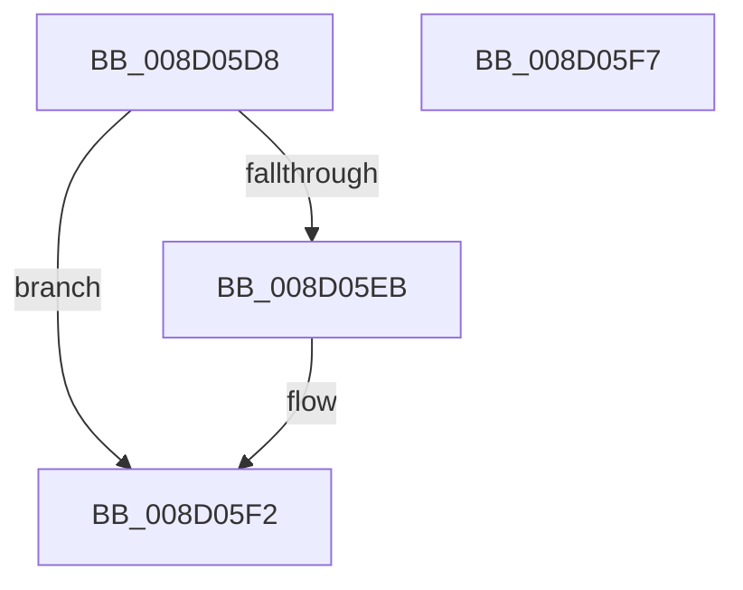

# MiDoesImageContainFunctionOverrideFixups

- RVA: `0x008D05D8`–`0x008D05F8` (길이 `32` bytes)
- VA: `0x00000001408D05D8`
- 실행 섹션: `PAGE`
- PDB 이름 있음: `예`; PDB Function 태그: `아니요`
- unwind 정보 RVA: `0x0005C788`
- 디코드: `11`개 명령, `32/32` bytes 표시
- 미해석 바이트: `0` (있으면 어셈블리에 `.byte`로 보존)

> 이 문서는 커널 이미지의 기계어와 PDB 기호를 분석해 생성했습니다. 4번과 5번은 함수 원형과 자료형을 바이너리 사용 방식에서 추정한 C 해석이며 원본 소스 복구 결과는 아닙니다.

## 1. Dependencies

- 직접 호출 지점: **1**; 고유 호출 대상: **1**
- 직접 호출자로 확인된 함수: **3**
- RIP 상대 이미지 참조: **0**

### Outgoing calls
- `0x008D05DC` → [MiGetControlAreaLoadConfig](../../text/46/MiGetControlAreaLoadConfig_function_0046E9D4.md) (function, `0x0046E9D4`)

### Direct callers
- [PspLocateSystemDll](../77/PspLocateSystemDll_function_0077F0D0.md) at `0x0077F2C5`
- [MiMapAllImageScpPages](MiMapAllImageScpPages_function_008D0534.md) at `0x008D05BC`
- [MiMapViewOfImageSection](../97/MiMapViewOfImageSection_function_0097E92C.md) at `0x0097F1B7`
- [MiMapViewOfImageSection](../97/MiMapViewOfImageSection_function_0097E92C.md) at `0x0097F452`

### Static image references
- 디코드된 RIP-relative 메모리 참조가 없습니다.

## 2. Other-region calls and transfers

- 다른 실행 섹션으로 향하는 call: **1**
  - `0x008D05DC` → [MiGetControlAreaLoadConfig](../../text/46/MiGetControlAreaLoadConfig_function_0046E9D4.md) (`PAGE` → `.text`)
- 별도 외부 분기/꼬리 이동을 확인하지 못했습니다.

## 3. Assembly (complete function range)

```asm
008D05D8  48 83 EC 28                     sub rsp, 0x28
008D05DC  E8 F3 E3 B9 FF                  call 0x14046e9d4
008D05E1  4C 8B C0                        mov r8, rax
008D05E4  33 C0                           xor eax, eax
008D05E6  4D 85 C0                        test r8, r8
008D05E9  74 07                           je 0x1408d05f2
008D05EB  49 39 40 18                     cmp qword ptr [r8 + 0x18], rax
008D05EF  0F 95 C0                        setne al
008D05F2  48 83 C4 28                     add rsp, 0x28
008D05F6  C3                              ret
008D05F7  CC                              int3
```

## 4. C-style interpretation (structured pseudocode)

```c
__int64 __fastcall MiDoesImageContainFunctionOverrideFixups(void)
{
    __int64 result;
    __int64 v_rsp;

    v_rsp = (v_rsp) - (40);
    result = MiGetControlAreaLoadConfig(a1, a2, a3, a4);
    result = 0;
    if (0 != 0) {
        result = ((*(unsigned __int64 *)(result + 24)) != 0) ? 1 : 0;
    }
    v_rsp = (v_rsp) + (40);
    return result;
}
```

## 5. (Beta) C Style

```c
void MiDoesImageContainFunctionOverrideFixups(void)
{
    int64_t result;
    int64_t local_rsp;

    local_rsp = (local_rsp) - (40);
    result = MiGetControlAreaLoadConfig(a1, a2, a3, a4);
    result = 0;
    if (0 != 0) {
        result = ((*(uint64_t *)(result + 0x18)) != 0) ? 1 : 0;
    }
    local_rsp = (local_rsp) + (40);
    return result;
}
```

## 6. Execution-region graph

[열기: 2D/3D 그래프와 함수 탐색 컨트롤 패널](../../../control-panel.html?section=page&rva=0x008D05D8&view=graph)

- 2D 그래프는 위에서 아래로 흐르고, 3D 그래프는 빈 공간을 드래그해 회전합니다. Shift+드래그는 이동, 휠은 확대·축소, 함수 노드 선택은 대상 보고서 이동입니다.

### Static fallback


