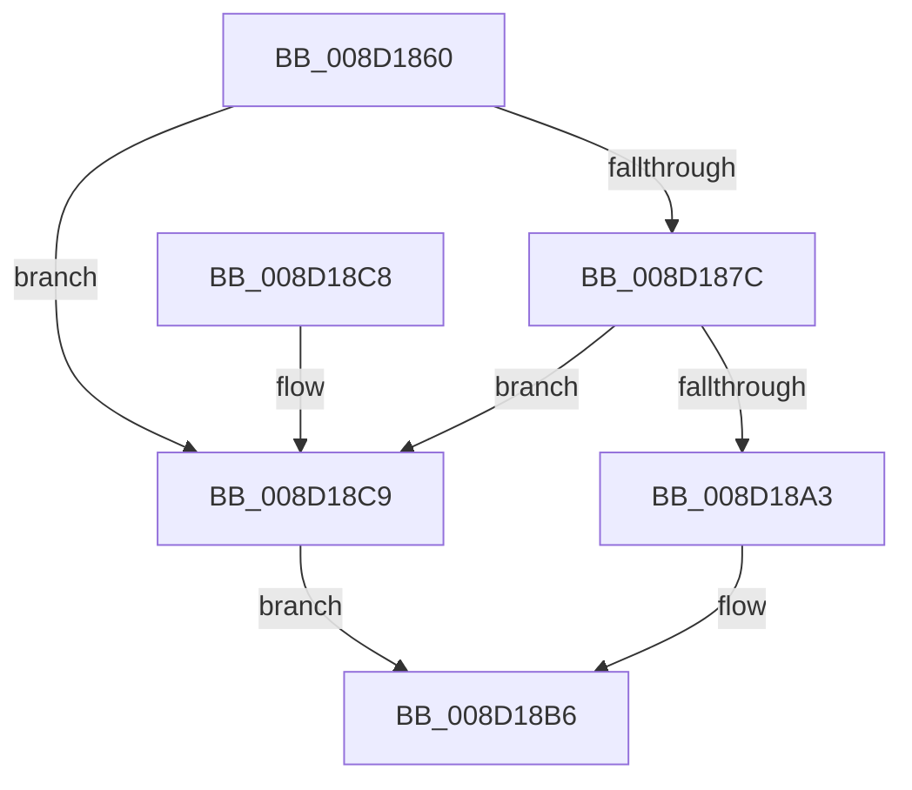

# MiImageCfgEnumNextImageExtensionRva

- RVA: `0x008D1860`–`0x008D18CD` (길이 `109` bytes)
- VA: `0x00000001408D1860`
- 실행 섹션: `PAGE`
- PDB 이름 있음: `예`; PDB Function 태그: `아니요`
- unwind 정보 RVA: `0x00084BE4`
- 디코드: `27`개 명령, `109/109` bytes 표시
- 미해석 바이트: `0` (있으면 어셈블리에 `.byte`로 보존)

> 이 문서는 커널 이미지의 기계어와 PDB 기호를 분석해 생성했습니다. 4번과 5번은 함수 원형과 자료형을 바이너리 사용 방식에서 추정한 C 해석이며 원본 소스 복구 결과는 아닙니다.

## 1. Dependencies

- 직접 호출 지점: **1**; 고유 호출 대상: **1**
- 직접 호출자로 확인된 함수: **3**
- RIP 상대 이미지 참조: **1**

### Outgoing calls
- `0x008D18BE` → [_security_check_cookie](../../text/6A/_security_check_cookie_function_006AC640.md) (function, `0x006AC640`)

### Direct callers
- [MiUpdateCfgSystemWideBitmapWorker](../8C/MiUpdateCfgSystemWideBitmapWorker_function_008CE650.md) at `0x008CE9A7`
- [MiImageCfgEnumRvaListFirst](../8C/MiImageCfgEnumRvaListFirst_function_008CF598.md) at `0x008CF601`
- [sub_008D17E4](Unknown_function_008D17E4.md) at `0x008D1827`

### Static image references
- `0x008D1864` → RVA `0x00E0A740` (`.data`; read)

## 2. Other-region calls and transfers

- 다른 실행 섹션으로 향하는 call: **1**
  - `0x008D18BE` → [_security_check_cookie](../../text/6A/_security_check_cookie_function_006AC640.md) (`PAGE` → `.text`)
- 별도 외부 분기/꼬리 이동을 확인하지 못했습니다.

## 3. Assembly (complete function range)

```asm
008D1860  48 83 EC 28                     sub rsp, 0x28
008D1864  48 8B 05 D5 8E 53 00            mov rax, qword ptr [rip + 0x538ed5]
008D186B  48 33 C4                        xor rax, rsp
008D186E  48 89 44 24 10                  mov qword ptr [rsp + 0x10], rax
008D1873  44 8B 41 14                     mov r8d, dword ptr [rcx + 0x14]
008D1877  45 85 C0                        test r8d, r8d
008D187A  74 4D                           je 0x1408d18c9
008D187C  8B 51 18                        mov edx, dword ptr [rcx + 0x18]
008D187F  C7 04 24 40 00 00 00            mov dword ptr [rsp], 0x40
008D1886  C7 44 24 04 C0 00 00 00         mov dword ptr [rsp + 4], 0xc0
008D188E  C7 44 24 08 40 01 00 00         mov dword ptr [rsp + 8], 0x140
008D1896  C7 44 24 0C C0 01 00 00         mov dword ptr [rsp + 0xc], 0x1c0
008D189E  83 FA 04                        cmp edx, 4
008D18A1  73 26                           jae 0x1408d18c9
008D18A3  8D 42 01                        lea eax, [rdx + 1]
008D18A6  C7 41 04 01 00 00 00            mov dword ptr [rcx + 4], 1
008D18AD  89 41 18                        mov dword ptr [rcx + 0x18], eax
008D18B0  8B 04 94                        mov eax, dword ptr [rsp + rdx*4]
008D18B3  41 03 C0                        add eax, r8d
008D18B6  48 8B 4C 24 10                  mov rcx, qword ptr [rsp + 0x10]
008D18BB  48 33 CC                        xor rcx, rsp
008D18BE  E8 7D AD DD FF                  call 0x1406ac640
008D18C3  48 83 C4 28                     add rsp, 0x28
008D18C7  C3                              ret
008D18C8  CC                              int3
008D18C9  33 C0                           xor eax, eax
008D18CB  EB E9                           jmp 0x1408d18b6
```

## 4. C-style interpretation (structured pseudocode)

```c
__int64 __fastcall MiImageCfgEnumNextImageExtensionRva(__int64 a1)
{
    __int64 result;
    __int64 v_rsp;
    unsigned __int64 v_stack_m18;
    unsigned int v_stack_m1C;
    unsigned int v_stack_m20;
    unsigned int v_stack_m24;
    unsigned int v_stack_m28;

    v_rsp = (v_rsp) - (40);
    result = (*(unsigned __int64 *)(v_rip + 5476053)) ^ (v_rsp);
    v_stack_m18 = result;
    if ((unsigned int)((unsigned int)(*(unsigned int *)(a1 + 20))) == 0) goto loc_008D18C9;
    v_stack_m28 = 64;
    v_stack_m24 = 192;
    v_stack_m20 = 320;
    v_stack_m1C = 448;
    if (((unsigned int)((unsigned int)(*(unsigned int *)(a1 + 24)))) >= 4) goto loc_008D18C9;
    *(unsigned int *)(a1 + 4) = 1;
    *(unsigned int *)(a1 + 24) = (unsigned int)((unsigned int)(*(unsigned int *)(a1 + 24)) + 1);
    result = (unsigned int)(((unsigned int)(*(unsigned int *)(v_rsp + (unsigned int)(*(unsigned int *)(a1 + 24)) * 4))) + ((unsigned int)((unsigned int)(*(unsigned int *)(a1 + 20)))));
loc_008D18B6:
    a1 = (v_stack_m18) ^ (v_rsp);
    result = _security_check_cookie(a1, (unsigned int)(*(unsigned int *)(a1 + 24)), (unsigned int)(*(unsigned int *)(a1 + 20)), a4);
    v_rsp = (v_rsp) + (40);
    return result;
loc_008D18C9:
    result = 0;
    goto loc_008D18B6;
}
```

## 5. (Beta) C Style

```c
int64_t MiImageCfgEnumNextImageExtensionRva(void *Arg1)
{
    uint8_t *arg1 = (uint8_t *)Arg1;

    int64_t result;
    int64_t local_rsp;
    uint64_t v_stack_m18;
    uint32_t v_stack_m1C;
    uint32_t v_stack_m20;
    uint32_t v_stack_m24;
    uint32_t v_stack_m28;

    local_rsp = (local_rsp) - (40);
    result = (*(uint64_t *)(v_rip + 0x538ED5)) ^ (local_rsp);
    v_stack_m18 = result;
    if ((uint32_t)((uint32_t)(*(uint32_t *)(arg1 + 0x14))) == 0) goto loc_008D18C9;
    v_stack_m28 = 64;
    v_stack_m24 = 192;
    v_stack_m20 = 320;
    v_stack_m1C = 448;
    if (((uint32_t)((uint32_t)(*(uint32_t *)(arg1 + 0x18)))) >= 4) goto loc_008D18C9;
    *(uint32_t *)(arg1 + 0x4) = 1;
    *(uint32_t *)(arg1 + 0x18) = (uint32_t)((uint32_t)(*(uint32_t *)(arg1 + 0x18)) + 1);
    result = (uint32_t)(((uint32_t)(*(uint32_t *)(local_rsp + (uint32_t)(*(uint32_t *)(arg1 + 0x18)) * 4))) + ((uint32_t)((uint32_t)(*(uint32_t *)(arg1 + 0x14)))));
loc_008D18B6:
    Arg1 = (v_stack_m18) ^ (local_rsp);
    result = _security_check_cookie(Arg1, (uint32_t)(*(uint32_t *)(arg1 + 0x18)), (uint32_t)(*(uint32_t *)(arg1 + 0x14)), a4);
    local_rsp = (local_rsp) + (40);
    return result;
loc_008D18C9:
    result = 0;
    goto loc_008D18B6;
}
```

### 관측된 메모리 오프셋

구조체 형식이 확인되지 않은 접근은 인자 기준의 오프셋으로만 기록했습니다.

| 기준 인자 | 오프셋 표현 | 폭 (bit) | 접근 |
|---|---:|---:|---|
| `Arg1` | `+ 0x4` | `32` | `W` |
| `Arg1` | `+ 0x14` | `32` | `R` |
| `Arg1` | `+ 0x18` | `32` | `R` |
| `Arg1` | `+ 0x18` | `32` | `W` |

## 6. Execution-region graph

[열기: 2D/3D 그래프와 함수 탐색 컨트롤 패널](../../../control-panel.html?section=page&rva=0x008D1860&view=graph)

- 2D 그래프는 위에서 아래로 흐르고, 3D 그래프는 빈 공간을 드래그해 회전합니다. Shift+드래그는 이동, 휠은 확대·축소, 함수 노드 선택은 대상 보고서 이동입니다.

### Static fallback


