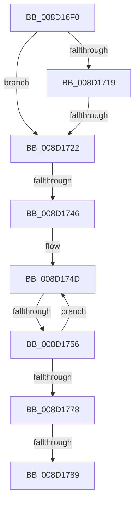

# MiImageCfgEnumRvaListNext

- RVA: `0x008D16F0`–`0x008D1794` (길이 `164` bytes)
- VA: `0x00000001408D16F0`
- 실행 섹션: `PAGE`
- PDB 이름 있음: `예`; PDB Function 태그: `아니요`
- unwind 정보 RVA: `0x00084B80`
- 디코드: `48`개 명령, `164/164` bytes 표시
- 미해석 바이트: `0` (있으면 어셈블리에 `.byte`로 보존)

> 이 문서는 커널 이미지의 기계어와 PDB 기호를 분석해 생성했습니다. 4번과 5번은 함수 원형과 자료형을 바이너리 사용 방식에서 추정한 C 해석이며 원본 소스 복구 결과는 아닙니다.

## 1. Dependencies

- 직접 호출 지점: **0**; 고유 호출 대상: **0**
- 직접 호출자로 확인된 함수: **1**
- RIP 상대 이미지 참조: **1**

### Outgoing calls
- 직접 디코드된 call 명령이 없습니다.

### Direct callers
- [MiCopyToCfgBitMap](MiCopyToCfgBitMap_function_008D1140.md) at `0x008D13EE`

### Static image references
- `0x008D1746` → RVA `0x00012D10` (`.rdata`; read)

## 2. Other-region calls and transfers

- 다른 실행 섹션으로 향하는 call: **0**
- call이 아닌 외부 분기/꼬리 이동: **5**
  - `0x008D171C` → [sub_008D17E4 + 0x15](Unknown_function_008D17E4.md) (`tail-transfer`)
  - `0x008D1740` → [sub_008D17E4 + 0x40](Unknown_function_008D17E4.md) (`tail-transfer`)
  - `0x008D1750` → [sub_008D183B](Unknown_function_008D183B.md) (`tail-transfer`)
  - `0x008D1787` → [sub_008D17E4 + 0x15](Unknown_function_008D17E4.md) (`tail-transfer`)
  - `0x008D1792` → [sub_008D17E4](Unknown_function_008D17E4.md) (`tail-transfer`)

## 3. Assembly (complete function range)

```asm
008D16F0  48 89 5C 24 10                  mov qword ptr [rsp + 0x10], rbx
008D16F5  48 89 6C 24 18                  mov qword ptr [rsp + 0x18], rbp
008D16FA  48 89 74 24 20                  mov qword ptr [rsp + 0x20], rsi
008D16FF  57                              push rdi
008D1700  41 54                           push r12
008D1702  41 56                           push r14
008D1704  48 83 EC 30                     sub rsp, 0x30
008D1708  8B 02                           mov eax, dword ptr [rdx]
008D170A  4C 8B CA                        mov r9, rdx
008D170D  44 8B 52 14                     mov r10d, dword ptr [rdx + 0x14]
008D1711  4C 8B D9                        mov r11, rcx
008D1714  41 3B C2                        cmp eax, r10d
008D1717  72 09                           jb 0x1408d1722
008D1719  45 85 D2                        test r10d, r10d
008D171C  0F 85 D7 00 00 00               jne 0x1408d17f9
008D1722  FF 42 0C                        inc dword ptr [rdx + 0xc]
008D1725  4C 8D 62 04                     lea r12, [rdx + 4]
008D1729  8B 6A 0C                        mov ebp, dword ptr [rdx + 0xc]
008D172C  8B 42 08                        mov eax, dword ptr [rdx + 8]
008D172F  8B 52 10                        mov edx, dword ptr [rdx + 0x10]
008D1732  48 8B 79 10                     mov rdi, qword ptr [rcx + 0x10]
008D1736  48 8B 59 18                     mov rbx, qword ptr [rcx + 0x18]
008D173A  48 03 FA                        add rdi, rdx
008D173D  48 2B DA                        sub rbx, rdx
008D1740  0F 84 DE 00 00 00               je 0x1408d1824
008D1746  4C 8D 35 C3 15 74 FF            lea r14, [rip - 0x8bea3d]
008D174D  48 85 DB                        test rbx, rbx
008D1750  0F 84 E5 00 00 00               je 0x1408d183b
008D1756  0F B6 0F                        movzx ecx, byte ptr [rdi]
008D1759  48 FF CB                        dec rbx
008D175C  44 8B C1                        mov r8d, ecx
008D175F  8B D1                           mov edx, ecx
008D1761  41 C1 E8 06                     shr r8d, 6
008D1765  83 E2 3F                        and edx, 0x3f
008D1768  48 FF C7                        inc rdi
008D176B  43 0F AF 14 86                  imul edx, dword ptr [r14 + r8*4]
008D1770  03 C2                           add eax, edx
008D1772  41 83 F8 03                     cmp r8d, 3
008D1776  75 D5                           jne 0x1408d174d
008D1778  41 89 41 08                     mov dword ptr [r9 + 8], eax
008D177C  41 2B 7B 10                     sub edi, dword ptr [r11 + 0x10]
008D1780  41 89 79 10                     mov dword ptr [r9 + 0x10], edi
008D1784  4D 85 E4                        test r12, r12
008D1787  74 70                           je 0x1408d17f9
008D1789  41 8B 5B 08                     mov ebx, dword ptr [r11 + 8]
008D178D  33 D2                           xor edx, edx
008D178F  83 FB 01                        cmp ebx, 1
008D1792  76 50                           jbe 0x1408d17e4
```

## 4. C-style interpretation (structured pseudocode)

```c
__int64 __fastcall MiImageCfgEnumRvaListNext(__int64 a1, __int64 a2)
{
    __int64 result;
    __int64 v_rbx;
    __int64 v_rdi;
    __int64 v_rsp;
    unsigned __int64 v_stack_p10;
    unsigned __int64 v_stack_p18;
    unsigned __int64 v_stack_p20;

    v_stack_p10 = v_rbx;
    v_stack_p18 = v_rbp;
    v_stack_p20 = v_rsi;
    v_rsp = (v_rsp) - (48);
    if (((unsigned int)((unsigned int)(*(unsigned int *)(a2)))) < ((unsigned int)((unsigned int)(*(unsigned int *)(a2 + 20))))) goto loc_008D1722;
loc_008D1722:
    v_rdi = (*(unsigned __int64 *)(a1 + 16)) + ((unsigned int)(*(unsigned int *)(a2 + 16)));
    v_rbx = (*(unsigned __int64 *)(a1 + 24)) - ((unsigned int)(*(unsigned int *)(a2 + 16)));
loc_008D174D:
    v_rbx = (v_rbx) - 1;
    a3 = (unsigned int)(((unsigned int)((unsigned int)(*(unsigned __int8 *)(v_rdi)))) >> (6));
    a2 = (unsigned int)(((unsigned int)((unsigned int)(*(unsigned __int8 *)(v_rdi)))) & (63));
    v_rdi = (v_rdi) + 1;
    a2 = (unsigned int)((a2) * (*(unsigned int *)(v_rip - 9169469 + a3 * 4)));
    result = (unsigned int)(((unsigned int)(*(unsigned int *)(a2 + 8))) + ((unsigned int)(a2)));
    if (((unsigned int)(a3)) != 3) goto loc_008D174D;
    *(unsigned int *)(a2 + 8) = (unsigned int)(result);
    v_rdi = (unsigned int)((v_rdi) - (*(unsigned int *)(a1 + 16)));
    *(unsigned int *)(a2 + 16) = (unsigned int)(v_rdi);
    a2 = 0;
}
```

## 5. (Beta) C Style

```c
int64_t MiImageCfgEnumRvaListNext(void *Arg1, void *Arg2)
{
    uint8_t *arg1 = (uint8_t *)Arg1;
    uint8_t *arg2 = (uint8_t *)Arg2;

    int64_t result;
    int64_t local_rbx;
    int64_t local_rdi;
    int64_t local_rsp;
    uint64_t v_stack_p10;
    uint64_t v_stack_p18;
    uint64_t v_stack_p20;

    v_stack_p10 = local_rbx;
    v_stack_p18 = local_rbp;
    v_stack_p20 = local_rsi;
    local_rsp = (local_rsp) - (48);
    if (((uint32_t)((uint32_t)(*(uint32_t *)(arg2)))) < ((uint32_t)((uint32_t)(*(uint32_t *)(arg2 + 0x14))))) goto loc_008D1722;
loc_008D1722:
    local_rdi = (*(uint64_t *)(arg1 + 0x10)) + ((uint32_t)(*(uint32_t *)(arg2 + 0x10)));
    local_rbx = (*(uint64_t *)(arg1 + 0x18)) - ((uint32_t)(*(uint32_t *)(arg2 + 0x10)));
loc_008D174D:
    local_rbx = (local_rbx) - 1;
    a3 = (uint32_t)(((uint32_t)((uint32_t)(*(uint8_t *)(local_rdi)))) >> (6));
    Arg2 = (uint32_t)(((uint32_t)((uint32_t)(*(uint8_t *)(local_rdi)))) & (63));
    local_rdi = (local_rdi) + 1;
    Arg2 = (uint32_t)((Arg2) * (*(uint32_t *)(v_rip - 0x8BEA3D + a3 * 4)));
    result = (uint32_t)(((uint32_t)(*(uint32_t *)(arg2 + 0x8))) + ((uint32_t)(Arg2)));
    if (((uint32_t)(a3)) != 3) goto loc_008D174D;
    *(uint32_t *)(arg2 + 0x8) = (uint32_t)(result);
    local_rdi = (uint32_t)((local_rdi) - (*(uint32_t *)(arg1 + 0x10)));
    *(uint32_t *)(arg2 + 0x10) = (uint32_t)(local_rdi);
    Arg2 = 0;
}
```

### 관측된 메모리 오프셋

구조체 형식이 확인되지 않은 접근은 인자 기준의 오프셋으로만 기록했습니다.

| 기준 인자 | 오프셋 표현 | 폭 (bit) | 접근 |
|---|---:|---:|---|
| `Arg1` | `+ 0x8` | `32` | `R` |
| `Arg1` | `+ 0x10` | `32` | `R` |
| `Arg1` | `+ 0x10` | `64` | `R` |
| `Arg1` | `+ 0x18` | `64` | `R` |
| `Arg2` | `+ 0x0` | `32` | `R` |
| `Arg2` | `+ 0x4` | `64` | `R` |
| `Arg2` | `+ 0x8` | `32` | `R` |
| `Arg2` | `+ 0x8` | `32` | `W` |
| `Arg2` | `+ 0xC` | `32` | `R` |
| `Arg2` | `+ 0xC` | `32` | `R/W` |
| `Arg2` | `+ 0x10` | `32` | `R` |
| `Arg2` | `+ 0x10` | `32` | `W` |
| `Arg2` | `+ 0x14` | `32` | `R` |

## 6. Execution-region graph

[열기: 2D/3D 그래프와 함수 탐색 컨트롤 패널](../../../control-panel.html?section=page&rva=0x008D16F0&view=graph)

- 2D 그래프는 위에서 아래로 흐르고, 3D 그래프는 빈 공간을 드래그해 회전합니다. Shift+드래그는 이동, 휠은 확대·축소, 함수 노드 선택은 대상 보고서 이동입니다.

### Static fallback


