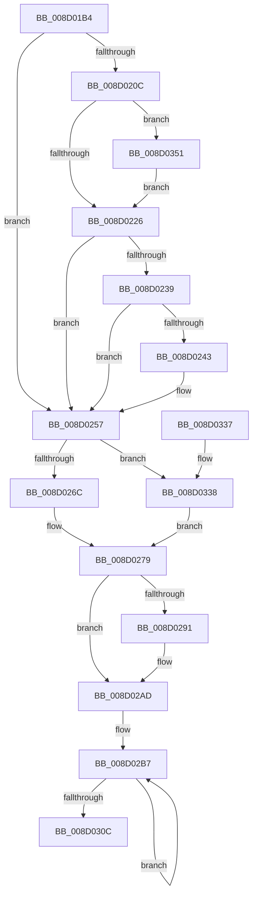

# MiInitializeProcessBottomUpEntropy

- RVA: `0x008D01B4`–`0x008D035D` (길이 `425` bytes)
- VA: `0x00000001408D01B4`
- 실행 섹션: `PAGE`
- PDB 이름 있음: `예`; PDB Function 태그: `아니요`
- unwind 정보 RVA: `0x00084A44`
- 디코드: `103`개 명령, `425/425` bytes 표시
- 미해석 바이트: `0` (있으면 어셈블리에 `.byte`로 보존)

> 이 문서는 커널 이미지의 기계어와 PDB 기호를 분석해 생성했습니다. 4번과 5번은 함수 원형과 자료형을 바이너리 사용 방식에서 추정한 C 해석이며 원본 소스 복구 결과는 아닙니다.

## 1. Dependencies

- 직접 호출 지점: **4**; 고유 호출 대상: **2**
- 직접 호출자로 확인된 함수: **1**
- RIP 상대 이미지 참조: **2**

### Outgoing calls
- `0x008D020F` → [ExGenRandom](../../text/41/ExGenRandom_function_0041B010.md) (function, `0x0041B010`)
- `0x008D0294` → [ExGenRandom](../../text/41/ExGenRandom_function_0041B010.md) (function, `0x0041B010`)
- `0x008D0314` → [_security_check_cookie](../../text/6A/_security_check_cookie_function_006AC640.md) (function, `0x006AC640`)
- `0x008D033B` → [ExGenRandom](../../text/41/ExGenRandom_function_0041B010.md) (function, `0x0041B010`)

### Direct callers
- [MmInitializeProcessAddressSpace](../8C/MmInitializeProcessAddressSpace_function_008CF6B0.md) at `0x008CF831`

### Static image references
- `0x008D01D0` → RVA `0x00E0A740` (`.data`; read)
- `0x008D0214` → RVA `0x00FC6A88` (`ALMOSTRO`; read)

## 2. Other-region calls and transfers

- 다른 실행 섹션으로 향하는 call: **4**
  - `0x008D020F` → [ExGenRandom](../../text/41/ExGenRandom_function_0041B010.md) (`PAGE` → `.text`)
  - `0x008D0294` → [ExGenRandom](../../text/41/ExGenRandom_function_0041B010.md) (`PAGE` → `.text`)
  - `0x008D0314` → [_security_check_cookie](../../text/6A/_security_check_cookie_function_006AC640.md) (`PAGE` → `.text`)
  - `0x008D033B` → [ExGenRandom](../../text/41/ExGenRandom_function_0041B010.md) (`PAGE` → `.text`)
- 별도 외부 분기/꼬리 이동을 확인하지 못했습니다.

## 3. Assembly (complete function range)

```asm
008D01B4  4C 8B DC                        mov r11, rsp
008D01B7  49 89 5B 10                     mov qword ptr [r11 + 0x10], rbx
008D01BB  49 89 6B 18                     mov qword ptr [r11 + 0x18], rbp
008D01BF  49 89 73 20                     mov qword ptr [r11 + 0x20], rsi
008D01C3  57                              push rdi
008D01C4  41 54                           push r12
008D01C6  41 55                           push r13
008D01C8  41 56                           push r14
008D01CA  41 57                           push r15
008D01CC  48 83 EC 40                     sub rsp, 0x40
008D01D0  48 8B 05 69 A5 53 00            mov rax, qword ptr [rip + 0x53a569]
008D01D7  48 33 C4                        xor rax, rsp
008D01DA  48 89 44 24 38                  mov qword ptr [rsp + 0x38], rax
008D01DF  8B 81 50 07 00 00               mov eax, dword ptr [rcx + 0x750]
008D01E5  33 F6                           xor esi, esi
008D01E7  48 8B A9 10 04 00 00            mov rbp, qword ptr [rcx + 0x410]
008D01EE  48 8B D9                        mov rbx, rcx
008D01F1  49 89 73 C8                     mov qword ptr [r11 - 0x38], rsi
008D01F5  8B FE                           mov edi, esi
008D01F7  44 8A FE                        mov r15b, sil
008D01FA  41 BD FF FF FF 00               mov r13d, 0xffffff
008D0200  44 8D 76 02                     lea r14d, [rsi + 2]
008D0204  44 8D 66 01                     lea r12d, [rsi + 1]
008D0208  A8 40                           test al, 0x40
008D020A  75 4B                           jne 0x1408d0257
008D020C  41 8B CC                        mov ecx, r12d
008D020F  E8 FC AD B4 FF                  call 0x14041b010
008D0214  F6 05 6D 68 6F 00 30            test byte ptr [rip + 0x6f686d], 0x30
008D021B  8B C8                           mov ecx, eax
008D021D  0F B6 F8                        movzx edi, al
008D0220  0F 84 2B 01 00 00               je 0x1408d0351
008D0226  48 B8 00 00 00 00 01 00 00 00   movabs rax, 0x100000000
008D0230  48 39 83 68 03 00 00            cmp qword ptr [rbx + 0x368], rax
008D0237  76 1E                           jbe 0x1408d0257
008D0239  8B 83 50 07 00 00               mov eax, dword ptr [rbx + 0x750]
008D023F  A8 20                           test al, 0x20
008D0241  74 14                           je 0x1408d0257
008D0243  49 23 CD                        and rcx, r13
008D0246  BA 00 00 01 00                  mov edx, 0x10000
008D024B  48 3B CA                        cmp rcx, rdx
008D024E  8B FA                           mov edi, edx
008D0250  45 8A FC                        mov r15b, r12b
008D0253  48 0F 47 F9                     cmova rdi, rcx
008D0257  48 85 FF                        test rdi, rdi
008D025A  49 0F 44 FC                     cmove rdi, r12
008D025E  48 89 7C 24 28                  mov qword ptr [rsp + 0x28], rdi
008D0263  45 84 FF                        test r15b, r15b
008D0266  0F 85 CC 00 00 00               jne 0x1408d0338
008D026C  F0 83 A3 50 07 00 00 DF         lock and dword ptr [rbx + 0x750], 0xffffffdf
008D0274  48 8B 44 24 28                  mov rax, qword ptr [rsp + 0x28]
008D0279  48 89 44 24 20                  mov qword ptr [rsp + 0x20], rax
008D027E  48 B8 00 00 00 00 01 00 00 00   movabs rax, 0x100000000
008D0288  48 39 83 68 03 00 00            cmp qword ptr [rbx + 0x368], rax
008D028F  77 1C                           ja 0x1408d02ad
008D0291  41 8B CC                        mov ecx, r12d
008D0294  E8 77 AD B4 FF                  call 0x14041b010
008D0299  49 23 C5                        and rax, r13
008D029C  41 BE 03 00 00 00               mov r14d, 3
008D02A2  48 05 00 00 01 00               add rax, 0x10000
008D02A8  48 89 44 24 30                  mov qword ptr [rsp + 0x30], rax
008D02AD  4C 89 B5 D8 03 00 00            mov qword ptr [rbp + 0x3d8], r14
008D02B4  48 8B CE                        mov rcx, rsi
008D02B7  48 8B 83 68 03 00 00            mov rax, qword ptr [rbx + 0x368]
008D02BE  48 8D 14 C9                     lea rdx, [rcx + rcx*8]
008D02C2  48 8B 4C CC 20                  mov rcx, qword ptr [rsp + rcx*8 + 0x20]
008D02C7  49 2B C4                        sub rax, r12
008D02CA  83 FE 02                        cmp esi, 2
008D02CD  49 B8 FF FF FE FF FF 7F 00 00   movabs r8, 0x7ffffffeffff
008D02D7  49 0F 44 C0                     cmove rax, r8
008D02DB  48 C1 E1 10                     shl rcx, 0x10
008D02DF  48 C1 E8 10                     shr rax, 0x10
008D02E3  41 03 F4                        add esi, r12d
008D02E6  48 89 84 D5 28 03 00 00         mov qword ptr [rbp + rdx*8 + 0x328], rax
008D02EE  48 8B C1                        mov rax, rcx
008D02F1  48 C1 E8 10                     shr rax, 0x10
008D02F5  48 89 8C D5 38 03 00 00         mov qword ptr [rbp + rdx*8 + 0x338], rcx
008D02FD  8B CE                           mov ecx, esi
008D02FF  48 89 84 D5 40 03 00 00         mov qword ptr [rbp + rdx*8 + 0x340], rax
008D0307  49 3B CE                        cmp rcx, r14
008D030A  72 AB                           jb 0x1408d02b7
008D030C  48 8B 4C 24 38                  mov rcx, qword ptr [rsp + 0x38]
008D0311  48 33 CC                        xor rcx, rsp
008D0314  E8 27 C3 DD FF                  call 0x1406ac640
008D0319  4C 8D 5C 24 40                  lea r11, [rsp + 0x40]
008D031E  49 8B 5B 38                     mov rbx, qword ptr [r11 + 0x38]
008D0322  49 8B 6B 40                     mov rbp, qword ptr [r11 + 0x40]
008D0326  49 8B 73 48                     mov rsi, qword ptr [r11 + 0x48]
008D032A  49 8B E3                        mov rsp, r11
008D032D  41 5F                           pop r15
008D032F  41 5E                           pop r14
008D0331  41 5D                           pop r13
008D0333  41 5C                           pop r12
008D0335  5F                              pop rdi
008D0336  C3                              ret
008D0337  CC                              int3
008D0338  41 8B CC                        mov ecx, r12d
008D033B  E8 D0 AC B4 FF                  call 0x14041b010
008D0340  49 23 C5                        and rax, r13
008D0343  48 05 00 00 00 01               add rax, 0x1000000
008D0349  48 03 C7                        add rax, rdi
008D034C  E9 28 FF FF FF                  jmp 0x1408d0279
008D0351  83 8B 50 07 00 00 20            or dword ptr [rbx + 0x750], 0x20
008D0358  E9 C9 FE FF FF                  jmp 0x1408d0226
```

## 4. C-style interpretation (structured pseudocode)

```c
__int64 __fastcall MiInitializeProcessBottomUpEntropy(__int64 a1)
{
    __int64 result;
    __int64 v_r14;
    __int64 v_r15;
    __int64 v_rdi;
    __int64 v_rsi;
    __int64 v_rsp;
    unsigned __int64 v_stack_m28;
    unsigned __int64 v_stack_m30;
    unsigned __int64 v_stack_m38;
    unsigned __int64 v_stack_m40;
    unsigned __int64 v_stack_m48;

    *(unsigned __int64 *)(v_rsp + 16) = v_rbx;
    *(unsigned __int64 *)(v_rsp + 24) = v_rbp;
    *(unsigned __int64 *)(v_rsp + 32) = v_rsi;
    v_rsp = (v_rsp) - (64);
    result = (*(unsigned __int64 *)(v_rip + 5481833)) ^ (v_rsp);
    v_stack_m30 = result;
    v_rsi = 0;
    *(unsigned __int64 *)(v_rsp - 56) = 0;
    if ((((unsigned __int8)((unsigned int)(*(unsigned int *)(a1 + 1872)))) & (64)) != 0) goto loc_008D0257;
    result = ExGenRandom((unsigned int)((unsigned int)(v_rsi + 1)), a2, a3, a4);
    if (((*(unsigned __int8 *)(v_rip + 7301229)) & (48)) == 0) goto loc_008D0351;
loc_008D0226:
    if ((*(unsigned __int64 *)(a1 + 872)) <= result) goto loc_008D0257;
    v_rdi = (unsigned __int8)(result);
    v_r15 = 0;
    if ((((unsigned __int8)((unsigned int)(*(unsigned int *)(a1 + 1872)))) & (32)) != 0) {
        a1 = ((unsigned int)((unsigned int)(result))) & ((unsigned int)(0xFFFFFFULL));
        a2 = 0x10000ULL;
        v_rdi = (unsigned int)(a2);
        v_r15 = (unsigned __int8)(v_rsi + 1);
        if (a1 > a2) { v_rdi = a1; }
    }
    if (v_rdi == 0) { v_rdi = v_rsi + 1; }
    v_stack_m40 = v_rdi;
    if ((unsigned __int8)(v_r15) != 0) goto loc_008D0338;
loc_008D0279:
    v_stack_m48 = v_stack_m40;
    result = v_stack_m40;
    v_r14 = v_rsi + 2;
    if ((*(unsigned __int64 *)(a1 + 872)) <= v_stack_m40) {
        a1 = (unsigned int)(v_rsi + 1);
        result = ExGenRandom(a1, a2, a3, a4);
        result = (result) & ((unsigned int)(0xFFFFFFULL));
        v_r14 = 3;
        result = (result) + (0x10000ULL);
        v_stack_m38 = result;
    }
    *(unsigned __int64 *)(*(unsigned __int64 *)(a1 + 1040) + 984) = v_r14;
loc_008D02B7:
    result = (*(unsigned __int64 *)(a1 + 872)) - (v_rsi + 1);
    if (0 == 2) { result = a3; }
    a1 = (*(unsigned __int64 *)(v_rsp + 0 * 8 + 32)) << (16);
    result = (result) >> (16);
    v_rsi = (unsigned int)((v_rsi) + ((unsigned int)(v_rsi + 1)));
    *(unsigned __int64 *)(*(unsigned __int64 *)(a1 + 1040) + 0 + 0 * 8 * 8 + 808) = result;
    result = (a1) >> (16);
    *(unsigned __int64 *)(*(unsigned __int64 *)(a1 + 1040) + 0 + 0 * 8 * 8 + 824) = a1;
    *(unsigned __int64 *)(*(unsigned __int64 *)(a1 + 1040) + 0 + 0 * 8 * 8 + 832) = result;
    if (((unsigned int)((unsigned int)(v_rsi))) < v_r14) goto loc_008D02B7;
    a1 = (v_stack_m30) ^ (v_rsp);
    result = _security_check_cookie(a1, 0 + 0 * 8, a3, a4);
    return result;
loc_008D0338:
    result = ExGenRandom((unsigned int)((unsigned int)(v_rsi + 1)), 0 + 0 * 8, a3, a4);
    result = (result) & ((unsigned int)(0xFFFFFFULL));
    result = (result) + (0x1000000ULL);
    result = (result) + (v_rdi);
    goto loc_008D0279;
loc_008D0351:
    goto loc_008D0226;
}
```

## 5. (Beta) C Style

```c
int64_t MiInitializeProcessBottomUpEntropy(void *Arg1)
{
    uint8_t *arg1 = (uint8_t *)Arg1;

    int64_t result;
    int64_t local_r14;
    int64_t local_r15;
    int64_t local_rdi;
    int64_t local_rsi;
    int64_t local_rsp;
    uint64_t v_stack_m28;
    uint64_t v_stack_m30;
    uint64_t v_stack_m38;
    uint64_t v_stack_m40;
    uint64_t v_stack_m48;

    *(uint64_t *)(local_rsp + 0x10) = local_rbx;
    *(uint64_t *)(local_rsp + 0x18) = local_rbp;
    *(uint64_t *)(local_rsp + 0x20) = local_rsi;
    local_rsp = (local_rsp) - (64);
    result = (*(uint64_t *)(v_rip + 0x53A569)) ^ (local_rsp);
    v_stack_m30 = result;
    local_rsi = 0;
    *(uint64_t *)(local_rsp - 0x38) = 0;
    if ((((uint8_t)((uint32_t)(*(uint32_t *)(arg1 + 0x750)))) & (64)) != 0) goto loc_008D0257;
    result = ExGenRandom((uint32_t)((uint32_t)(local_rsi + 1)), a2, a3, a4);
    if (((*(uint8_t *)(v_rip + 0x6F686D)) & (48)) == 0) goto loc_008D0351;
loc_008D0226:
    if ((*(uint64_t *)(arg1 + 0x368)) <= result) goto loc_008D0257;
    local_rdi = (uint8_t)(result);
    local_r15 = 0;
    if ((((uint8_t)((uint32_t)(*(uint32_t *)(arg1 + 0x750)))) & (32)) != 0) {
        Arg1 = ((uint32_t)((uint32_t)(result))) & ((uint32_t)(0xFFFFFFULL));
        a2 = 0x10000ULL;
        local_rdi = (uint32_t)(a2);
        local_r15 = (uint8_t)(local_rsi + 1);
        if (Arg1 > a2) { local_rdi = Arg1; }
    }
    if (local_rdi == 0) { local_rdi = local_rsi + 1; }
    v_stack_m40 = local_rdi;
    if ((uint8_t)(local_r15) != 0) goto loc_008D0338;
loc_008D0279:
    v_stack_m48 = v_stack_m40;
    result = v_stack_m40;
    local_r14 = local_rsi + 2;
    if ((*(uint64_t *)(arg1 + 0x368)) <= v_stack_m40) {
        Arg1 = (uint32_t)(local_rsi + 1);
        result = ExGenRandom(Arg1, a2, a3, a4);
        result = (result) & ((uint32_t)(0xFFFFFFULL));
        local_r14 = 3;
        result = (result) + (0x10000ULL);
        v_stack_m38 = result;
    }
    *(uint64_t *)(*(uint64_t *)(arg1 + 0x410) + 0x3D8) = local_r14;
loc_008D02B7:
    result = (*(uint64_t *)(arg1 + 0x368)) - (local_rsi + 1);
    if (0 == 2) { result = a3; }
    Arg1 = (*(uint64_t *)(local_rsp + 0x0 * 8 + 0x20)) << (16);
    result = (result) >> (16);
    local_rsi = (uint32_t)((local_rsi) + ((uint32_t)(local_rsi + 1)));
    *(uint64_t *)(*(uint64_t *)(arg1 + 0x410) + 0x0 + 0x0 * 8 * 8 + 0x328) = result;
    result = (Arg1) >> (16);
    *(void **)(*(uint64_t *)(arg1 + 0x410) + 0x0 + 0x0 * 8 * 8 + 0x338) = Arg1;
    *(uint64_t *)(*(uint64_t *)(arg1 + 0x410) + 0x0 + 0x0 * 8 * 8 + 0x340) = result;
    if (((uint32_t)((uint32_t)(local_rsi))) < local_r14) goto loc_008D02B7;
    Arg1 = (v_stack_m30) ^ (local_rsp);
    result = _security_check_cookie(Arg1, 0 + 0 * 8, a3, a4);
    return result;
loc_008D0338:
    result = ExGenRandom((uint32_t)((uint32_t)(local_rsi + 1)), 0 + 0 * 8, a3, a4);
    result = (result) & ((uint32_t)(0xFFFFFFULL));
    result = (result) + (0x1000000ULL);
    result = (result) + (local_rdi);
    goto loc_008D0279;
loc_008D0351:
    goto loc_008D0226;
}
```

### 관측된 메모리 오프셋

구조체 형식이 확인되지 않은 접근은 인자 기준의 오프셋으로만 기록했습니다.

| 기준 인자 | 오프셋 표현 | 폭 (bit) | 접근 |
|---|---:|---:|---|
| `Arg1` | `+ 0x368` | `64` | `R` |
| `Arg1` | `+ 0x410` | `64` | `R` |
| `Arg1` | `+ 0x750` | `32` | `R` |
| `Arg1` | `+ 0x750` | `32` | `R/W` |

## 6. Execution-region graph

[열기: 2D/3D 그래프와 함수 탐색 컨트롤 패널](../../../control-panel.html?section=page&rva=0x008D01B4&view=graph)

- 2D 그래프는 위에서 아래로 흐르고, 3D 그래프는 빈 공간을 드래그해 회전합니다. Shift+드래그는 이동, 휠은 확대·축소, 함수 노드 선택은 대상 보고서 이동입니다.

### Static fallback


