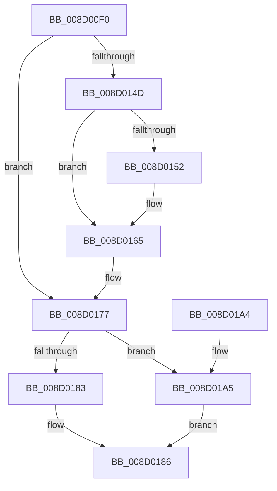

# MiInitializeProcessTopDownEntropy

- RVA: `0x008D00F0`–`0x008D01AE` (길이 `190` bytes)
- VA: `0x00000001408D00F0`
- 실행 섹션: `PAGE`
- PDB 이름 있음: `예`; PDB Function 태그: `아니요`
- unwind 정보 RVA: `0x00068908`
- 디코드: `47`개 명령, `190/190` bytes 표시
- 미해석 바이트: `0` (있으면 어셈블리에 `.byte`로 보존)

> 이 문서는 커널 이미지의 기계어와 PDB 기호를 분석해 생성했습니다. 4번과 5번은 함수 원형과 자료형을 바이너리 사용 방식에서 추정한 C 해석이며 원본 소스 복구 결과는 아닙니다.

## 1. Dependencies

- 직접 호출 지점: **2**; 고유 호출 대상: **1**
- 직접 호출자로 확인된 함수: **1**
- RIP 상대 이미지 참조: **0**

### Outgoing calls
- `0x008D0157` → [ExGenRandom](../../text/41/ExGenRandom_function_0041B010.md) (function, `0x0041B010`)
- `0x008D016A` → [ExGenRandom](../../text/41/ExGenRandom_function_0041B010.md) (function, `0x0041B010`)

### Direct callers
- [MmInitializeProcessAddressSpace](../8C/MmInitializeProcessAddressSpace_function_008CF6B0.md) at `0x008CF839`

### Static image references
- 디코드된 RIP-relative 메모리 참조가 없습니다.

## 2. Other-region calls and transfers

- 다른 실행 섹션으로 향하는 call: **2**
  - `0x008D0157` → [ExGenRandom](../../text/41/ExGenRandom_function_0041B010.md) (`PAGE` → `.text`)
  - `0x008D016A` → [ExGenRandom](../../text/41/ExGenRandom_function_0041B010.md) (`PAGE` → `.text`)
- 별도 외부 분기/꼬리 이동을 확인하지 못했습니다.

## 3. Assembly (complete function range)

```asm
008D00F0  48 89 5C 24 08                  mov qword ptr [rsp + 8], rbx
008D00F5  48 89 74 24 10                  mov qword ptr [rsp + 0x10], rsi
008D00FA  57                              push rdi
008D00FB  48 83 EC 20                     sub rsp, 0x20
008D00FF  48 8B 81 68 03 00 00            mov rax, qword ptr [rcx + 0x368]
008D0106  33 DB                           xor ebx, ebx
008D0108  48 8B F1                        mov rsi, rcx
008D010B  48 B9 00 00 00 00 01 00 00 00   movabs rcx, 0x100000000
008D0115  48 3B C1                        cmp rax, rcx
008D0118  48 0F 46 D8                     cmovbe rbx, rax
008D011C  8B 86 FC 05 00 00               mov eax, dword ptr [rsi + 0x5fc]
008D0122  24 01                           and al, 1
008D0124  F6 D8                           neg al
008D0126  48 B8 00 00 FF FF 09 00 00 00   movabs rax, 0x9ffff0000
008D0130  48 1B FF                        sbb rdi, rdi
008D0133  48 23 F8                        and rdi, rax
008D0136  48 B8 00 00 00 00 F6 7F 00 00   movabs rax, 0x7ff600000000
008D0140  48 03 F8                        add rdi, rax
008D0143  8B 86 50 07 00 00               mov eax, dword ptr [rsi + 0x750]
008D0149  A8 40                           test al, 0x40
008D014B  75 2A                           jne 0x1408d0177
008D014D  48 85 DB                        test rbx, rbx
008D0150  74 13                           je 0x1408d0165
008D0152  B9 01 00 00 00                  mov ecx, 1
008D0157  E8 B4 AE B4 FF                  call 0x14041b010
008D015C  0F B6 C0                        movzx eax, al
008D015F  C1 E0 10                        shl eax, 0x10
008D0162  48 2B D8                        sub rbx, rax
008D0165  B9 01 00 00 00                  mov ecx, 1
008D016A  E8 A1 AE B4 FF                  call 0x14041b010
008D016F  C1 E0 10                        shl eax, 0x10
008D0172  8B C8                           mov ecx, eax
008D0174  48 2B F9                        sub rdi, rcx
008D0177  48 8B 86 10 04 00 00            mov rax, qword ptr [rsi + 0x410]
008D017E  48 85 DB                        test rbx, rbx
008D0181  75 22                           jne 0x1408d01a5
008D0183  48 8B DF                        mov rbx, rdi
008D0186  48 89 98 30 03 00 00            mov qword ptr [rax + 0x330], rbx
008D018D  48 8B 74 24 38                  mov rsi, qword ptr [rsp + 0x38]
008D0192  48 89 98 78 03 00 00            mov qword ptr [rax + 0x378], rbx
008D0199  48 8B 5C 24 30                  mov rbx, qword ptr [rsp + 0x30]
008D019E  48 83 C4 20                     add rsp, 0x20
008D01A2  5F                              pop rdi
008D01A3  C3                              ret
008D01A4  CC                              int3
008D01A5  48 89 B8 C0 03 00 00            mov qword ptr [rax + 0x3c0], rdi
008D01AC  EB D8                           jmp 0x1408d0186
```

## 4. C-style interpretation (structured pseudocode)

```c
__int64 __fastcall MiInitializeProcessTopDownEntropy(__int64 a1)
{
    __int64 result;
    __int64 v_rbx;
    __int64 v_rdi;
    __int64 v_rsp;
    unsigned __int64 v_stack_p10;
    unsigned __int64 v_stack_p8;

    v_stack_p8 = v_rbx;
    v_stack_p10 = v_rsi;
    v_rsp = (v_rsp) - (32);
    v_rbx = 0;
    if ((*(unsigned __int64 *)(a1 + 872)) <= a1) { v_rbx = *(unsigned __int64 *)(a1 + 872); }
    result = (unsigned __int8)(((unsigned int)(*(unsigned int *)(a1 + 1532))) & (1));
    result = (unsigned __int8)(-(result));
    v_rdi = (v_rdi) & (result);
    v_rdi = (v_rdi) + (result);
    if ((((unsigned __int8)((unsigned int)(*(unsigned int *)(a1 + 1872)))) & (64)) != 0) goto loc_008D0177;
    result = (unsigned int)(*(unsigned int *)(a1 + 1872));
    if (v_rbx != 0) {
        a1 = 1;
        result = ExGenRandom(a1, a2, a3, a4);
        result = (unsigned __int8)(result);
        result = (unsigned int)((result) << (16));
        v_rbx = (v_rbx) - (result);
    }
    result = ExGenRandom(1, a2, a3, a4);
    result = (unsigned int)((result) << (16));
    v_rdi = (v_rdi) - ((unsigned int)((unsigned int)(result)));
loc_008D0177:
    if (v_rbx != 0) goto loc_008D01A5;
loc_008D0186:
    *(unsigned __int64 *)(*(unsigned __int64 *)(a1 + 1040) + 816) = v_rdi;
    *(unsigned __int64 *)(*(unsigned __int64 *)(a1 + 1040) + 888) = v_rdi;
    v_rsp = (v_rsp) + (32);
    return *(unsigned __int64 *)(a1 + 1040);
loc_008D01A5:
    *(unsigned __int64 *)(*(unsigned __int64 *)(a1 + 1040) + 960) = v_rdi;
    goto loc_008D0186;
}
```

## 5. (Beta) C Style

```c
int64_t MiInitializeProcessTopDownEntropy(void *Arg1)
{
    uint8_t *arg1 = (uint8_t *)Arg1;

    int64_t result;
    int64_t local_rbx;
    int64_t local_rdi;
    int64_t local_rsp;
    uint64_t v_stack_p10;
    uint64_t v_stack_p8;

    v_stack_p8 = local_rbx;
    v_stack_p10 = local_rsi;
    local_rsp = (local_rsp) - (32);
    local_rbx = 0;
    if ((*(uint64_t *)(arg1 + 0x368)) <= Arg1) { local_rbx = *(uint64_t *)(arg1 + 0x368); }
    result = (uint8_t)(((uint32_t)(*(uint32_t *)(arg1 + 0x5FC))) & (1));
    result = (uint8_t)(-(result));
    local_rdi = (local_rdi) & (result);
    local_rdi = (local_rdi) + (result);
    if ((((uint8_t)((uint32_t)(*(uint32_t *)(arg1 + 0x750)))) & (64)) != 0) goto loc_008D0177;
    result = (uint32_t)(*(uint32_t *)(arg1 + 0x750));
    if (local_rbx != 0) {
        Arg1 = 1;
        result = ExGenRandom(Arg1, a2, a3, a4);
        result = (uint8_t)(result);
        result = (uint32_t)((result) << (16));
        local_rbx = (local_rbx) - (result);
    }
    result = ExGenRandom(1, a2, a3, a4);
    result = (uint32_t)((result) << (16));
    local_rdi = (local_rdi) - ((uint32_t)((uint32_t)(result)));
loc_008D0177:
    if (local_rbx != 0) goto loc_008D01A5;
loc_008D0186:
    *(uint64_t *)(*(uint64_t *)(arg1 + 0x410) + 0x330) = local_rdi;
    *(uint64_t *)(*(uint64_t *)(arg1 + 0x410) + 0x378) = local_rdi;
    local_rsp = (local_rsp) + (32);
    return *(uint64_t *)(arg1 + 0x410);
loc_008D01A5:
    *(uint64_t *)(*(uint64_t *)(arg1 + 0x410) + 0x3C0) = local_rdi;
    goto loc_008D0186;
}
```

### 관측된 메모리 오프셋

구조체 형식이 확인되지 않은 접근은 인자 기준의 오프셋으로만 기록했습니다.

| 기준 인자 | 오프셋 표현 | 폭 (bit) | 접근 |
|---|---:|---:|---|
| `Arg1` | `+ 0x368` | `64` | `R` |
| `Arg1` | `+ 0x410` | `64` | `R` |
| `Arg1` | `+ 0x5FC` | `32` | `R` |
| `Arg1` | `+ 0x750` | `32` | `R` |

## 6. Execution-region graph

[열기: 2D/3D 그래프와 함수 탐색 컨트롤 패널](../../../control-panel.html?section=page&rva=0x008D00F0&view=graph)

- 2D 그래프는 위에서 아래로 흐르고, 3D 그래프는 빈 공간을 드래그해 회전합니다. Shift+드래그는 이동, 휠은 확대·축소, 함수 노드 선택은 대상 보고서 이동입니다.

### Static fallback


