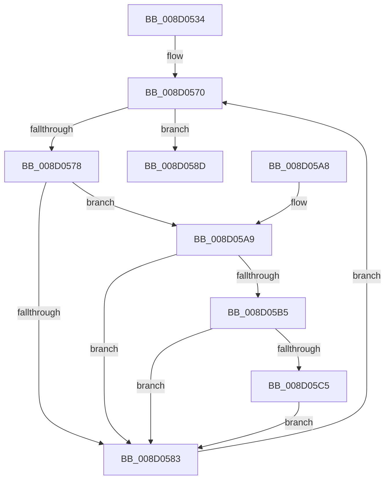

# MiMapAllImageScpPages

- RVA: `0x008D0534`–`0x008D05D2` (길이 `158` bytes)
- VA: `0x00000001408D0534`
- 실행 섹션: `PAGE`
- PDB 이름 있음: `예`; PDB Function 태그: `아니요`
- unwind 정보 RVA: `0x000704BC`
- 디코드: `45`개 명령, `158/158` bytes 표시
- 미해석 바이트: `0` (있으면 어셈블리에 `.byte`로 보존)

> 이 문서는 커널 이미지의 기계어와 PDB 기호를 분석해 생성했습니다. 4번과 5번은 함수 원형과 자료형을 바이너리 사용 방식에서 추정한 C 해석이며 원본 소스 복구 결과는 아닙니다.

## 1. Dependencies

- 직접 호출 지점: **7**; 고유 호출 대상: **7**
- 직접 호출자로 확인된 함수: **1**
- RIP 상대 이미지 참조: **0**

### Outgoing calls
- `0x008D0563` → [LOCK_ADDRESS_SPACE_SHARED](../../text/2A/LOCK_ADDRESS_SPACE_SHARED_function_002A8B3C.md) (function, `0x002A8B3C`)
- `0x008D056B` → [MiGetFirstVad](../../text/2A/MiGetFirstVad_function_002A8BBC.md) (function, `0x002A8BBC`)
- `0x008D0586` → [MiGetNextVad](../../text/29/MiGetNextVad_function_00297224.md) (function, `0x00297224`)
- `0x008D0593` → [UNLOCK_ADDRESS_SPACE_SHARED](../../text/2A/UNLOCK_ADDRESS_SPACE_SHARED_function_002A8ACC.md) (function, `0x002A8ACC`)
- `0x008D05AC` → [MiReadVadFlags2](../../text/45/MiReadVadFlags2_function_00452C1C.md) (function, `0x00452C1C`)
- `0x008D05BC` → [MiDoesImageContainFunctionOverrideFixups](MiDoesImageContainFunctionOverrideFixups_function_008D05D8.md) (function, `0x008D05D8`)
- `0x008D05CB` → [MiMapImageScpCfgPages](../../text/29/MiMapImageScpCfgPages_function_00294FA4.md) (function, `0x00294FA4`)

### Direct callers
- [MiMapProcessExecutable](../8C/MiMapProcessExecutable_function_008CFDB4.md) at `0x008CFEAC`

### Static image references
- 디코드된 RIP-relative 메모리 참조가 없습니다.

## 2. Other-region calls and transfers

- 다른 실행 섹션으로 향하는 call: **6**
  - `0x008D0563` → [LOCK_ADDRESS_SPACE_SHARED](../../text/2A/LOCK_ADDRESS_SPACE_SHARED_function_002A8B3C.md) (`PAGE` → `.text`)
  - `0x008D056B` → [MiGetFirstVad](../../text/2A/MiGetFirstVad_function_002A8BBC.md) (`PAGE` → `.text`)
  - `0x008D0586` → [MiGetNextVad](../../text/29/MiGetNextVad_function_00297224.md) (`PAGE` → `.text`)
  - `0x008D0593` → [UNLOCK_ADDRESS_SPACE_SHARED](../../text/2A/UNLOCK_ADDRESS_SPACE_SHARED_function_002A8ACC.md) (`PAGE` → `.text`)
  - `0x008D05AC` → [MiReadVadFlags2](../../text/45/MiReadVadFlags2_function_00452C1C.md) (`PAGE` → `.text`)
  - `0x008D05CB` → [MiMapImageScpCfgPages](../../text/29/MiMapImageScpCfgPages_function_00294FA4.md) (`PAGE` → `.text`)
- 별도 외부 분기/꼬리 이동을 확인하지 못했습니다.

## 3. Assembly (complete function range)

```asm
008D0534  48 89 5C 24 08                  mov qword ptr [rsp + 8], rbx
008D0539  48 89 74 24 10                  mov qword ptr [rsp + 0x10], rsi
008D053E  57                              push rdi
008D053F  48 83 EC 20                     sub rsp, 0x20
008D0543  48 8B 81 10 04 00 00            mov rax, qword ptr [rcx + 0x410]
008D054A  48 8B F9                        mov rdi, rcx
008D054D  48 8B D1                        mov rdx, rcx
008D0550  80 88 25 04 00 00 04            or byte ptr [rax + 0x425], 4
008D0557  65 48 8B 34 25 88 01 00 00      mov rsi, qword ptr gs:[0x188]
008D0560  48 8B CE                        mov rcx, rsi
008D0563  E8 D4 85 9D FF                  call 0x1402a8b3c
008D0568  48 8B CF                        mov rcx, rdi
008D056B  E8 4C 86 9D FF                  call 0x1402a8bbc
008D0570  48 8B D8                        mov rbx, rax
008D0573  48 85 C0                        test rax, rax
008D0576  74 15                           je 0x1408d058d
008D0578  8B 48 30                        mov ecx, dword ptr [rax + 0x30]
008D057B  80 E1 70                        and cl, 0x70
008D057E  80 F9 20                        cmp cl, 0x20
008D0581  74 26                           je 0x1408d05a9
008D0583  48 8B CB                        mov rcx, rbx
008D0586  E8 99 6C 9C FF                  call 0x140297224
008D058B  EB E3                           jmp 0x1408d0570
008D058D  48 8B D7                        mov rdx, rdi
008D0590  48 8B CE                        mov rcx, rsi
008D0593  E8 34 85 9D FF                  call 0x1402a8acc
008D0598  48 8B 5C 24 30                  mov rbx, qword ptr [rsp + 0x30]
008D059D  48 8B 74 24 38                  mov rsi, qword ptr [rsp + 0x38]
008D05A2  48 83 C4 20                     add rsp, 0x20
008D05A6  5F                              pop rdi
008D05A7  C3                              ret
008D05A8  CC                              int3
008D05A9  48 8B CB                        mov rcx, rbx
008D05AC  E8 6B 26 B8 FF                  call 0x140452c1c
008D05B1  A8 20                           test al, 0x20
008D05B3  74 CE                           je 0x1408d0583
008D05B5  48 8B 4B 48                     mov rcx, qword ptr [rbx + 0x48]
008D05B9  48 8B 09                        mov rcx, qword ptr [rcx]
008D05BC  E8 17 00 00 00                  call 0x1408d05d8
008D05C1  85 C0                           test eax, eax
008D05C3  74 BE                           je 0x1408d0583
008D05C5  48 8B D3                        mov rdx, rbx
008D05C8  48 8B CF                        mov rcx, rdi
008D05CB  E8 D4 49 9C FF                  call 0x140294fa4
008D05D0  EB B1                           jmp 0x1408d0583
```

## 4. C-style interpretation (structured pseudocode)

```c
__int64 __fastcall MiMapAllImageScpPages(__int64 a1)
{
    __int64 result;
    __int64 v_rsp;
    unsigned __int64 v_stack_p10;
    unsigned __int64 v_stack_p8;

    v_stack_p8 = v_rbx;
    v_stack_p10 = v_rsi;
    v_rsp = (v_rsp) - (32);
    result = LOCK_ADDRESS_SPACE_SHARED(*(unsigned __int64 *)(gs_base + (0 + 392)), a1, a3, a4);
    result = MiGetFirstVad(a1, a1, a3, a4);
loc_008D0570:
    if (result == 0) goto loc_008D058D;
    a1 = (unsigned __int8)(((unsigned int)(*(unsigned int *)(result + 48))) & (112));
    if (((unsigned __int8)(a1)) == 32) goto loc_008D05A9;
loc_008D0583:
    result = MiGetNextVad(result, a1, a3, a4);
    goto loc_008D0570;
loc_008D058D:
    result = UNLOCK_ADDRESS_SPACE_SHARED(*(unsigned __int64 *)(gs_base + (0 + 392)), a1, a3, a4);
    v_rsp = (v_rsp) + (32);
    return result;
loc_008D05A9:
    result = MiReadVadFlags2(v_stack_p8, a1, a3, a4);
    if ((((unsigned __int8)(result)) & (32)) == 0) goto loc_008D0583;
    result = MiDoesImageContainFunctionOverrideFixups(*(unsigned __int64 *)(*(unsigned __int64 *)(v_stack_p8 + 72)), a1, a3, a4);
    if ((unsigned int)(result) == 0) goto loc_008D0583;
    result = MiMapImageScpCfgPages(a1, v_stack_p8, a3, a4);
    goto loc_008D0583;
}
```

## 5. (Beta) C Style

```c
int64_t MiMapAllImageScpPages(void *Arg1)
{
    uint8_t *arg1 = (uint8_t *)Arg1;

    int64_t result;
    int64_t local_rsp;
    uint64_t v_stack_p10;
    uint64_t v_stack_p8;

    v_stack_p8 = local_rbx;
    v_stack_p10 = local_rsi;
    local_rsp = (local_rsp) - (32);
    result = LOCK_ADDRESS_SPACE_SHARED(*(uint64_t *)(gs_base + (0 + 0x188)), Arg1, a3, a4);
    result = MiGetFirstVad(Arg1, Arg1, a3, a4);
loc_008D0570:
    if (result == 0) goto loc_008D058D;
    Arg1 = (uint8_t)(((uint32_t)(*(uint32_t *)(result + 0x30))) & (112));
    if (((uint8_t)(Arg1)) == 32) goto loc_008D05A9;
loc_008D0583:
    result = MiGetNextVad(result, Arg1, a3, a4);
    goto loc_008D0570;
loc_008D058D:
    result = UNLOCK_ADDRESS_SPACE_SHARED(*(uint64_t *)(gs_base + (0 + 0x188)), Arg1, a3, a4);
    local_rsp = (local_rsp) + (32);
    return result;
loc_008D05A9:
    result = MiReadVadFlags2(v_stack_p8, Arg1, a3, a4);
    if ((((uint8_t)(result)) & (32)) == 0) goto loc_008D0583;
    result = MiDoesImageContainFunctionOverrideFixups(*(uint64_t *)(*(uint64_t *)(v_stack_p8 + 0x48)), Arg1, a3, a4);
    if ((uint32_t)(result) == 0) goto loc_008D0583;
    result = MiMapImageScpCfgPages(Arg1, v_stack_p8, a3, a4);
    goto loc_008D0583;
}
```

### 관측된 메모리 오프셋

구조체 형식이 확인되지 않은 접근은 인자 기준의 오프셋으로만 기록했습니다.

| 기준 인자 | 오프셋 표현 | 폭 (bit) | 접근 |
|---|---:|---:|---|
| `Arg1` | `+ 0x410` | `64` | `R` |

## 6. Execution-region graph

[열기: 2D/3D 그래프와 함수 탐색 컨트롤 패널](../../../control-panel.html?section=page&rva=0x008D0534&view=graph)

- 2D 그래프는 위에서 아래로 흐르고, 3D 그래프는 빈 공간을 드래그해 회전합니다. Shift+드래그는 이동, 휠은 확대·축소, 함수 노드 선택은 대상 보고서 이동입니다.

### Static fallback


