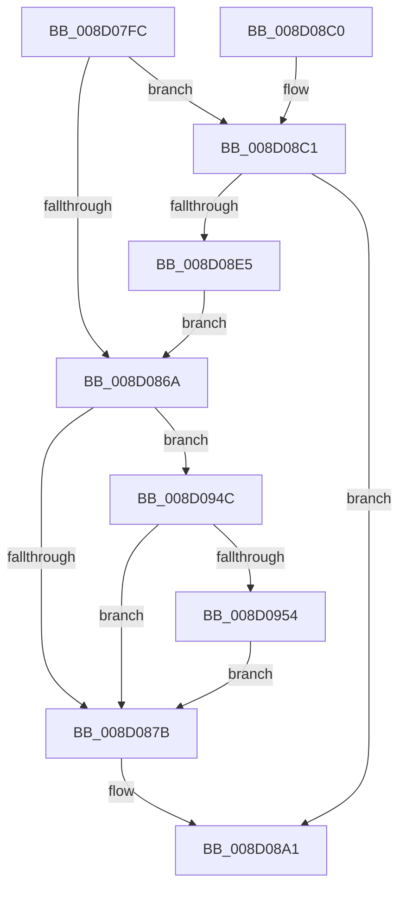

# MiMarkPrivateImageCfgBits

- RVA: `0x008D07FC`–`0x008D096A` (길이 `366` bytes)
- VA: `0x00000001408D07FC`
- 실행 섹션: `PAGE`
- PDB 이름 있음: `예`; PDB Function 태그: `아니요`
- unwind 정보 RVA: `0x00084AA0`
- 디코드: `99`개 명령, `366/366` bytes 표시
- 미해석 바이트: `0` (있으면 어셈블리에 `.byte`로 보존)

> 이 문서는 커널 이미지의 기계어와 PDB 기호를 분석해 생성했습니다. 4번과 5번은 함수 원형과 자료형을 바이너리 사용 방식에서 추정한 C 해석이며 원본 소스 복구 결과는 아닙니다.

## 1. Dependencies

- 직접 호출 지점: **5**; 고유 호출 대상: **4**
- 직접 호출자로 확인된 함수: **1**
- RIP 상대 이미지 참조: **0**

### Outgoing calls
- `0x008D0861` → [MiVadMapsLargeImage](../../text/2A/MiVadMapsLargeImage_function_002A70F0.md) (function, `0x002A70F0`)
- `0x008D087E` → [MiGetControlAreaLoadConfig](../../text/46/MiGetControlAreaLoadConfig_function_0046E9D4.md) (function, `0x0046E9D4`)
- `0x008D089C` → [MiPopulateCfgBitMap](MiPopulateCfgBitMap_function_008D0FA4.md) (function, `0x008D0FA4`)
- `0x008D08DC` → [MiPopulateCfgBitMap](MiPopulateCfgBitMap_function_008D0FA4.md) (function, `0x008D0FA4`)
- `0x008D08EB` → [MiLocateLockedVadEvent](../../text/2A/MiLocateLockedVadEvent_function_002A7A0C.md) (function, `0x002A7A0C`)

### Direct callers
- [MiCommitVadCfgBits](MiCommitVadCfgBits_function_008D0AD0.md) at `0x008D0C59`

### Static image references
- 디코드된 RIP-relative 메모리 참조가 없습니다.

## 2. Other-region calls and transfers

- 다른 실행 섹션으로 향하는 call: **3**
  - `0x008D0861` → [MiVadMapsLargeImage](../../text/2A/MiVadMapsLargeImage_function_002A70F0.md) (`PAGE` → `.text`)
  - `0x008D087E` → [MiGetControlAreaLoadConfig](../../text/46/MiGetControlAreaLoadConfig_function_0046E9D4.md) (`PAGE` → `.text`)
  - `0x008D08EB` → [MiLocateLockedVadEvent](../../text/2A/MiLocateLockedVadEvent_function_002A7A0C.md) (`PAGE` → `.text`)
- 별도 외부 분기/꼬리 이동을 확인하지 못했습니다.

## 3. Assembly (complete function range)

```asm
008D07FC  48 8B C4                        mov rax, rsp
008D07FF  48 89 58 08                     mov qword ptr [rax + 8], rbx
008D0803  48 89 68 10                     mov qword ptr [rax + 0x10], rbp
008D0807  48 89 70 18                     mov qword ptr [rax + 0x18], rsi
008D080B  48 89 78 20                     mov qword ptr [rax + 0x20], rdi
008D080F  41 54                           push r12
008D0811  41 56                           push r14
008D0813  41 57                           push r15
008D0815  48 83 EC 40                     sub rsp, 0x40
008D0819  49 8B 40 48                     mov rax, qword ptr [r8 + 0x48]
008D081D  4C 8B F1                        mov r14, rcx
008D0820  41 0F B6 58 20                  movzx ebx, byte ptr [r8 + 0x20]
008D0825  49 8B C8                        mov rcx, r8
008D0828  41 0F B6 70 21                  movzx esi, byte ptr [r8 + 0x21]
008D082D  49 8B F8                        mov rdi, r8
008D0830  48 C1 E6 20                     shl rsi, 0x20
008D0834  33 ED                           xor ebp, ebp
008D0836  4C 8B 20                        mov r12, qword ptr [rax]
008D0839  41 8B 40 18                     mov eax, dword ptr [r8 + 0x18]
008D083D  48 C1 E3 20                     shl rbx, 0x20
008D0841  48 0B D8                        or rbx, rax
008D0844  41 8B 40 1C                     mov eax, dword ptr [r8 + 0x1c]
008D0848  4D 8B 3C 24                     mov r15, qword ptr [r12]
008D084C  48 0B F0                        or rsi, rax
008D084F  48 C1 E6 0C                     shl rsi, 0xc
008D0853  48 81 CE FF 0F 00 00            or rsi, 0xfff
008D085A  48 C1 E3 0C                     shl rbx, 0xc
008D085E  48 FF C6                        inc rsi
008D0861  E8 8A 68 9D FF                  call 0x1402a70f0
008D0866  85 C0                           test eax, eax
008D0868  75 57                           jne 0x1408d08c1
008D086A  48 8B 47 50                     mov rax, qword ptr [rdi + 0x50]
008D086E  49 8B 57 40                     mov rdx, qword ptr [r15 + 0x40]
008D0872  48 3B C2                        cmp rax, rdx
008D0875  0F 85 D1 00 00 00               jne 0x1408d094c
008D087B  49 8B CC                        mov rcx, r12
008D087E  E8 51 E1 B9 FF                  call 0x14046e9d4
008D0883  48 89 7C 24 30                  mov qword ptr [rsp + 0x30], rdi
008D0888  45 33 C9                        xor r9d, r9d
008D088B  48 89 74 24 28                  mov qword ptr [rsp + 0x28], rsi
008D0890  49 8B CE                        mov rcx, r14
008D0893  48 89 5C 24 20                  mov qword ptr [rsp + 0x20], rbx
008D0898  48 8B 50 08                     mov rdx, qword ptr [rax + 8]
008D089C  E8 03 07 00 00                  call 0x1408d0fa4
008D08A1  48 8B 5C 24 60                  mov rbx, qword ptr [rsp + 0x60]
008D08A6  48 8B 6C 24 68                  mov rbp, qword ptr [rsp + 0x68]
008D08AB  48 8B 74 24 70                  mov rsi, qword ptr [rsp + 0x70]
008D08B0  48 8B 7C 24 78                  mov rdi, qword ptr [rsp + 0x78]
008D08B5  48 83 C4 40                     add rsp, 0x40
008D08B9  41 5F                           pop r15
008D08BB  41 5E                           pop r14
008D08BD  41 5C                           pop r12
008D08BF  C3                              ret
008D08C0  CC                              int3
008D08C1  48 21 6C 24 30                  and qword ptr [rsp + 0x30], rbp
008D08C6  45 33 C9                        xor r9d, r9d
008D08C9  48 89 74 24 28                  mov qword ptr [rsp + 0x28], rsi
008D08CE  49 8B CE                        mov rcx, r14
008D08D1  48 89 5C 24 20                  mov qword ptr [rsp + 0x20], rbx
008D08D6  41 8D 69 01                     lea ebp, [r9 + 1]
008D08DA  8B D5                           mov edx, ebp
008D08DC  E8 C3 06 00 00                  call 0x1408d0fa4
008D08E1  85 C0                           test eax, eax
008D08E3  78 BC                           js 0x1408d08a1
008D08E5  8D 55 0F                        lea edx, [rbp + 0xf]
008D08E8  48 8B CF                        mov rcx, rdi
008D08EB  E8 1C 71 9D FF                  call 0x1402a7a0c
008D08F0  0F B6 48 08                     movzx ecx, byte ptr [rax + 8]
008D08F4  48 C1 E1 10                     shl rcx, 0x10
008D08F8  48 03 D9                        add rbx, rcx
008D08FB  48 83 CA FF                     or rdx, 0xffffffffffffffff
008D08FF  48 8B C2                        mov rax, rdx
008D0902  F0 49 0F B1 57 18               lock cmpxchg qword ptr [r15 + 0x18], rdx
008D0908  48 8B C8                        mov rcx, rax
008D090B  48 8B C2                        mov rax, rdx
008D090E  81 E1 FF 0F 00 00               and ecx, 0xfff
008D0914  F0 49 0F B1 57 18               lock cmpxchg qword ptr [r15 + 0x18], rdx
008D091A  33 D2                           xor edx, edx
008D091C  48 85 C9                        test rcx, rcx
008D091F  0F 95 C2                        setne dl
008D0922  48 C1 E8 0C                     shr rax, 0xc
008D0926  48 03 D0                        add rdx, rax
008D0929  48 C1 E2 03                     shl rdx, 3
008D092D  48 2B 57 50                     sub rdx, qword ptr [rdi + 0x50]
008D0931  49 03 57 40                     add rdx, qword ptr [r15 + 0x40]
008D0935  48 C1 FA 03                     sar rdx, 3
008D0939  48 C1 E2 0C                     shl rdx, 0xc
008D093D  48 03 D3                        add rdx, rbx
008D0940  48 3B F2                        cmp rsi, rdx
008D0943  48 0F 47 F2                     cmova rsi, rdx
008D0947  E9 1E FF FF FF                  jmp 0x1408d086a
008D094C  85 ED                           test ebp, ebp
008D094E  0F 85 27 FF FF FF               jne 0x1408d087b
008D0954  48 2B C2                        sub rax, rdx
008D0957  48 C1 F8 03                     sar rax, 3
008D095B  48 C1 E0 0C                     shl rax, 0xc
008D095F  48 03 D8                        add rbx, rax
008D0962  48 03 F0                        add rsi, rax
008D0965  E9 11 FF FF FF                  jmp 0x1408d087b
```

## 4. C-style interpretation (structured pseudocode)

```c
__int64 __fastcall MiMarkPrivateImageCfgBits(__int64 a1, __int64 a2, __int64 a3, int a4)
{
    __int64 result;
    __int64 v_rbp;
    __int64 v_rbx;
    __int64 v_rsi;
    __int64 v_rsp;
    unsigned __int64 v_stack_m28;
    unsigned __int64 v_stack_m30;
    unsigned __int64 v_stack_m38;
    unsigned __int64 v_stack_p10;
    unsigned __int64 v_stack_p18;
    unsigned __int64 v_stack_p20;
    unsigned __int64 v_stack_p28;
    unsigned __int64 v_stack_p30;
    unsigned __int64 v_stack_p8;

    *(unsigned __int64 *)(v_rsp + 8) = v_rbx;
    *(unsigned __int64 *)(v_rsp + 16) = v_rbp;
    *(unsigned __int64 *)(v_rsp + 24) = v_rsi;
    *(unsigned __int64 *)(v_rsp + 32) = v_rdi;
    v_rsp = (v_rsp) - (64);
    v_rsi = (*(unsigned __int8 *)(a3 + 33)) << (32);
    v_rbp = 0;
    v_rbx = (*(unsigned __int8 *)(a3 + 32)) << (32);
    v_rbx = (v_rbx) | ((unsigned int)(*(unsigned int *)(a3 + 24)));
    v_rsi = (v_rsi) | ((unsigned int)(*(unsigned int *)(a3 + 28)));
    v_rsi = (v_rsi) << (12);
    v_rsi = (v_rsi) | (0xFFFULL);
    v_rbx = (v_rbx) << (12);
    v_rsi = (v_rsi) + 1;
    result = MiVadMapsLargeImage(a3, a2, a3, a4);
    if ((unsigned int)(result) != 0) goto loc_008D08C1;
loc_008D086A:
    if ((*(unsigned __int64 *)(a3 + 80)) != (*(unsigned __int64 *)(*(unsigned __int64 *)(*(unsigned __int64 *)(*(unsigned __int64 *)(a3 + 72))) + 64))) goto loc_008D094C;
loc_008D087B:
    result = MiGetControlAreaLoadConfig(*(unsigned __int64 *)(*(unsigned __int64 *)(a3 + 72)), *(unsigned __int64 *)(*(unsigned __int64 *)(*(unsigned __int64 *)(*(unsigned __int64 *)(a3 + 72))) + 64), a3, a4);
    v_stack_m28 = a3;
    a4 = 0;
    v_stack_m30 = v_rsi;
    v_stack_m38 = v_rbx;
    result = MiPopulateCfgBitMap(a1, *(unsigned __int64 *)(result + 8), a3, a4);
loc_008D08A1:
    v_rsp = (v_rsp) + (64);
    return result;
loc_008D08C1:
    a4 = 0;
    v_stack_p28 = v_stack_p18;
    v_stack_p20 = v_stack_p8;
    result = MiPopulateCfgBitMap(a1, (unsigned int)((unsigned int)(a4 + 1)), a3, a4);
    if (sign_flag) goto loc_008D08A1;
    result = MiLocateLockedVadEvent(v_stack_p20, a4 + 1 + 15, a3, a4);
    a1 = (*(unsigned __int8 *)(result + 8)) << (16);
    v_rbx = (v_stack_p8) + (a1);
    a2 = (a4 + 1 + 15) | (-1);
    a1 = (unsigned int)((a2) & (0xFFFULL));
    a2 = 0;
    a2 = (a1 != 0) ? 1 : 0;
    result = (a2) >> (12);
    a2 = (a2) + (result);
    a2 = (a2) << (3);
    a2 = (a2) - (*(unsigned __int64 *)(v_stack_p20 + 80));
    a2 = (a2) + (*(unsigned __int64 *)(*(unsigned __int64 *)(*(unsigned __int64 *)(*(unsigned __int64 *)(a3 + 72))) + 64));
    a2 = (a2) >> (3);
    a2 = (a2) << (12);
    a2 = (a2) + (v_rbx);
    v_rsi = v_stack_p18;
    if (v_stack_p18 > a2) { v_rsi = a2; }
    goto loc_008D086A;
loc_008D094C:
    if ((unsigned int)(a4 + 1) != 0) goto loc_008D087B;
    result = (result) - (a2);
    result = (result) >> (3);
    result = (result) << (12);
    v_rbx = (v_rbx) + (result);
    v_rsi = (v_rsi) + (result);
    goto loc_008D087B;
}
```

## 5. (Beta) C Style

```c
int64_t MiMarkPrivateImageCfgBits(int64_t Arg1, int64_t Arg2, void *Arg3, int32_t Arg4)
{
    uint8_t *arg3 = (uint8_t *)Arg3;

    int64_t result;
    int64_t local_rbp;
    int64_t local_rbx;
    int64_t local_rsi;
    int64_t local_rsp;
    uint64_t v_stack_m28;
    uint64_t v_stack_m30;
    uint64_t v_stack_m38;
    uint64_t v_stack_p10;
    uint64_t v_stack_p18;
    uint64_t v_stack_p20;
    uint64_t v_stack_p28;
    uint64_t v_stack_p30;
    uint64_t v_stack_p8;

    *(uint64_t *)(local_rsp + 0x8) = local_rbx;
    *(uint64_t *)(local_rsp + 0x10) = local_rbp;
    *(uint64_t *)(local_rsp + 0x18) = local_rsi;
    *(uint64_t *)(local_rsp + 0x20) = local_rdi;
    local_rsp = (local_rsp) - (64);
    local_rsi = (*(uint8_t *)(arg3 + 0x21)) << (32);
    local_rbp = 0;
    local_rbx = (*(uint8_t *)(arg3 + 0x20)) << (32);
    local_rbx = (local_rbx) | ((uint32_t)(*(uint32_t *)(arg3 + 0x18)));
    local_rsi = (local_rsi) | ((uint32_t)(*(uint32_t *)(arg3 + 0x1C)));
    local_rsi = (local_rsi) << (12);
    local_rsi = (local_rsi) | (0xFFFULL);
    local_rbx = (local_rbx) << (12);
    local_rsi = (local_rsi) + 1;
    result = MiVadMapsLargeImage(Arg3, Arg2, Arg3, Arg4);
    if ((uint32_t)(result) != 0) goto loc_008D08C1;
loc_008D086A:
    if ((*(uint64_t *)(arg3 + 0x50)) != (*(uint64_t *)(*(uint64_t *)(*(uint64_t *)(*(uint64_t *)(arg3 + 0x48))) + 0x40))) goto loc_008D094C;
loc_008D087B:
    result = MiGetControlAreaLoadConfig(*(uint64_t *)(*(uint64_t *)(arg3 + 0x48)), *(uint64_t *)(*(uint64_t *)(*(uint64_t *)(*(uint64_t *)(arg3 + 0x48))) + 0x40), Arg3, Arg4);
    v_stack_m28 = Arg3;
    Arg4 = 0;
    v_stack_m30 = local_rsi;
    v_stack_m38 = local_rbx;
    result = MiPopulateCfgBitMap(Arg1, *(uint64_t *)(result + 0x8), Arg3, Arg4);
loc_008D08A1:
    local_rsp = (local_rsp) + (64);
    return result;
loc_008D08C1:
    Arg4 = 0;
    v_stack_p28 = v_stack_p18;
    v_stack_p20 = v_stack_p8;
    result = MiPopulateCfgBitMap(Arg1, (uint32_t)((uint32_t)(Arg4 + 1)), Arg3, Arg4);
    if (sign_flag) goto loc_008D08A1;
    result = MiLocateLockedVadEvent(v_stack_p20, Arg4 + 1 + 15, Arg3, Arg4);
    Arg1 = (*(uint8_t *)(result + 0x8)) << (16);
    local_rbx = (v_stack_p8) + (Arg1);
    Arg2 = (Arg4 + 1 + 15) | (-1);
    Arg1 = (uint32_t)((Arg2) & (0xFFFULL));
    Arg2 = 0;
    Arg2 = (Arg1 != 0) ? 1 : 0;
    result = (Arg2) >> (12);
    Arg2 = (Arg2) + (result);
    Arg2 = (Arg2) << (3);
    Arg2 = (Arg2) - (*(uint64_t *)(v_stack_p20 + 0x50));
    Arg2 = (Arg2) + (*(uint64_t *)(*(uint64_t *)(*(uint64_t *)(*(uint64_t *)(arg3 + 0x48))) + 0x40));
    Arg2 = (Arg2) >> (3);
    Arg2 = (Arg2) << (12);
    Arg2 = (Arg2) + (local_rbx);
    local_rsi = v_stack_p18;
    if (v_stack_p18 > Arg2) { local_rsi = Arg2; }
    goto loc_008D086A;
loc_008D094C:
    if ((uint32_t)(Arg4 + 1) != 0) goto loc_008D087B;
    result = (result) - (Arg2);
    result = (result) >> (3);
    result = (result) << (12);
    local_rbx = (local_rbx) + (result);
    local_rsi = (local_rsi) + (result);
    goto loc_008D087B;
}
```

### 관측된 메모리 오프셋

구조체 형식이 확인되지 않은 접근은 인자 기준의 오프셋으로만 기록했습니다.

| 기준 인자 | 오프셋 표현 | 폭 (bit) | 접근 |
|---|---:|---:|---|
| `Arg3` | `+ 0x18` | `32` | `R` |
| `Arg3` | `+ 0x1C` | `32` | `R` |
| `Arg3` | `+ 0x20` | `8` | `R` |
| `Arg3` | `+ 0x21` | `8` | `R` |
| `Arg3` | `+ 0x48` | `64` | `R` |
| `Arg3` | `+ 0x50` | `64` | `R` |

## 6. Execution-region graph

[열기: 2D/3D 그래프와 함수 탐색 컨트롤 패널](../../../control-panel.html?section=page&rva=0x008D07FC&view=graph)

- 2D 그래프는 위에서 아래로 흐르고, 3D 그래프는 빈 공간을 드래그해 회전합니다. Shift+드래그는 이동, 휠은 확대·축소, 함수 노드 선택은 대상 보고서 이동입니다.

### Static fallback


