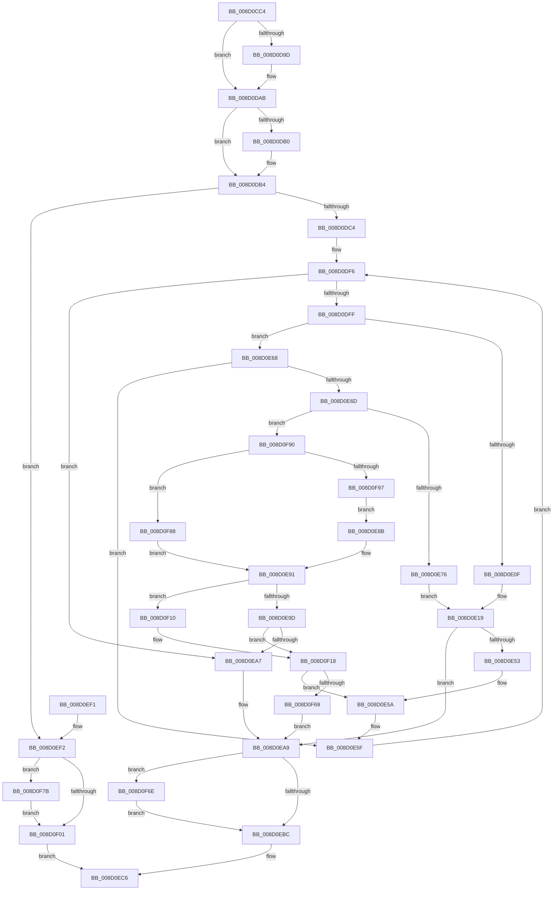

# MiMarkSharedImageCfgBits

- RVA: `0x008D0CC4`–`0x008D0F9C` (길이 `728` bytes)
- VA: `0x00000001408D0CC4`
- 실행 섹션: `PAGE`
- PDB 이름 있음: `예`; PDB Function 태그: `아니요`
- unwind 정보 RVA: `0x00084AF0`
- 디코드: `190`개 명령, `728/728` bytes 표시
- 미해석 바이트: `0` (있으면 어셈블리에 `.byte`로 보존)

> 이 문서는 커널 이미지의 기계어와 PDB 기호를 분석해 생성했습니다. 4번과 5번은 함수 원형과 자료형을 바이너리 사용 방식에서 추정한 C 해석이며 원본 소스 복구 결과는 아닙니다.

## 1. Dependencies

- 직접 호출 지점: **12**; 고유 호출 대상: **10**
- 직접 호출자로 확인된 함수: **1**
- RIP 상대 이미지 참조: **1**

### Outgoing calls
- `0x008D0D23` → [MiGetControlAreaLoadConfig](../../text/46/MiGetControlAreaLoadConfig_function_0046E9D4.md) (function, `0x0046E9D4`)
- `0x008D0D8D` → [KeAbPreAcquire](../../text/21/KeAbPreAcquire_function_00210230.md) (function, `0x00210230`)
- `0x008D0DA6` → [ExfAcquirePushLockExclusiveEx](../../text/20/ExfAcquirePushLockExclusiveEx_function_0020FC90.md) (function, `0x0020FC90`)
- `0x008D0DB7` → [MiVadDeleted](../../text/43/MiVadDeleted_function_00431350.md) (function, `0x00431350`)
- `0x008D0E05` → [MiIsCfgBitMapPageShared](../../text/2C/MiIsCfgBitMapPageShared_function_002C1200.md) (function, `0x002C1200`)
- `0x008D0E48` → [MiSetProtectionOnSection](../../text/2C/MiSetProtectionOnSection_function_002C3770.md) (function, `0x002C3770`)
- `0x008D0EBF` → [KeAbPostRelease](../../text/2E/KeAbPostRelease_function_002E1600.md) (function, `0x002E1600`)
- `0x008D0ED1` → [_security_check_cookie](../../text/6A/_security_check_cookie_function_006AC640.md) (function, `0x006AC640`)
- `0x008D0F04` → [KeAbPostRelease](../../text/2E/KeAbPostRelease_function_002E1600.md) (function, `0x002E1600`)
- `0x008D0F5A` → [MiCopyToCfgBitMap](MiCopyToCfgBitMap_function_008D1140.md) (function, `0x008D1140`)
- `0x008D0F71` → [ExfTryToWakePushLock](../../text/26/ExfTryToWakePushLock_function_00265DD0.md) (function, `0x00265DD0`)
- `0x008D0F7E` → [ExfTryToWakePushLock](../../text/26/ExfTryToWakePushLock_function_00265DD0.md) (function, `0x00265DD0`)

### Direct callers
- [MiCommitVadCfgBits](MiCommitVadCfgBits_function_008D0AD0.md) at `0x008D0B4E`

### Static image references
- `0x008D0CDB` → RVA `0x00E0A740` (`.data`; read)

## 2. Other-region calls and transfers

- 다른 실행 섹션으로 향하는 call: **11**
  - `0x008D0D23` → [MiGetControlAreaLoadConfig](../../text/46/MiGetControlAreaLoadConfig_function_0046E9D4.md) (`PAGE` → `.text`)
  - `0x008D0D8D` → [KeAbPreAcquire](../../text/21/KeAbPreAcquire_function_00210230.md) (`PAGE` → `.text`)
  - `0x008D0DA6` → [ExfAcquirePushLockExclusiveEx](../../text/20/ExfAcquirePushLockExclusiveEx_function_0020FC90.md) (`PAGE` → `.text`)
  - `0x008D0DB7` → [MiVadDeleted](../../text/43/MiVadDeleted_function_00431350.md) (`PAGE` → `.text`)
  - `0x008D0E05` → [MiIsCfgBitMapPageShared](../../text/2C/MiIsCfgBitMapPageShared_function_002C1200.md) (`PAGE` → `.text`)
  - `0x008D0E48` → [MiSetProtectionOnSection](../../text/2C/MiSetProtectionOnSection_function_002C3770.md) (`PAGE` → `.text`)
  - `0x008D0EBF` → [KeAbPostRelease](../../text/2E/KeAbPostRelease_function_002E1600.md) (`PAGE` → `.text`)
  - `0x008D0ED1` → [_security_check_cookie](../../text/6A/_security_check_cookie_function_006AC640.md) (`PAGE` → `.text`)
  - `0x008D0F04` → [KeAbPostRelease](../../text/2E/KeAbPostRelease_function_002E1600.md) (`PAGE` → `.text`)
  - `0x008D0F71` → [ExfTryToWakePushLock](../../text/26/ExfTryToWakePushLock_function_00265DD0.md) (`PAGE` → `.text`)
  - `0x008D0F7E` → [ExfTryToWakePushLock](../../text/26/ExfTryToWakePushLock_function_00265DD0.md) (`PAGE` → `.text`)
- 별도 외부 분기/꼬리 이동을 확인하지 못했습니다.

## 3. Assembly (complete function range)

```asm
008D0CC4  48 89 5C 24 10                  mov qword ptr [rsp + 0x10], rbx
008D0CC9  55                              push rbp
008D0CCA  56                              push rsi
008D0CCB  57                              push rdi
008D0CCC  41 54                           push r12
008D0CCE  41 55                           push r13
008D0CD0  41 56                           push r14
008D0CD2  41 57                           push r15
008D0CD4  48 81 EC A0 00 00 00            sub rsp, 0xa0
008D0CDB  48 8B 05 5E 9A 53 00            mov rax, qword ptr [rip + 0x539a5e]
008D0CE2  48 33 C4                        xor rax, rsp
008D0CE5  48 89 84 24 98 00 00 00         mov qword ptr [rsp + 0x98], rax
008D0CED  83 64 24 54 00                  and dword ptr [rsp + 0x54], 0
008D0CF2  49 8B E8                        mov rbp, r8
008D0CF5  65 48 8B 04 25 88 01 00 00      mov rax, qword ptr gs:[0x188]
008D0CFE  48 89 4C 24 68                  mov qword ptr [rsp + 0x68], rcx
008D0D03  4C 89 44 24 58                  mov qword ptr [rsp + 0x58], r8
008D0D08  4C 8B C1                        mov r8, rcx
008D0D0B  48 8B 4D 48                     mov rcx, qword ptr [rbp + 0x48]
008D0D0F  48 8B 80 B8 00 00 00            mov rax, qword ptr [rax + 0xb8]
008D0D16  83 64 24 50 00                  and dword ptr [rsp + 0x50], 0
008D0D1B  48 89 44 24 70                  mov qword ptr [rsp + 0x70], rax
008D0D20  48 8B 09                        mov rcx, qword ptr [rcx]
008D0D23  E8 AC DC B9 FF                  call 0x14046e9d4
008D0D28  4D 8B 60 10                     mov r12, qword ptr [r8 + 0x10]
008D0D2C  33 D2                           xor edx, edx
008D0D2E  44 0F B6 75 20                  movzx r14d, byte ptr [rbp + 0x20]
008D0D33  0F B6 75 21                     movzx esi, byte ptr [rbp + 0x21]
008D0D37  48 8B 40 08                     mov rax, qword ptr [rax + 8]
008D0D3B  48 C1 E6 20                     shl rsi, 0x20
008D0D3F  49 8D 7C 24 28                  lea rdi, [r12 + 0x28]
008D0D44  49 C1 E6 20                     shl r14, 0x20
008D0D48  48 8B CF                        mov rcx, rdi
008D0D4B  48 89 44 24 60                  mov qword ptr [rsp + 0x60], rax
008D0D50  8B 45 18                        mov eax, dword ptr [rbp + 0x18]
008D0D53  4C 0B F0                        or r14, rax
008D0D56  8B 45 1C                        mov eax, dword ptr [rbp + 0x1c]
008D0D59  48 0B F0                        or rsi, rax
008D0D5C  49 C1 E6 0C                     shl r14, 0xc
008D0D60  48 C1 E6 0C                     shl rsi, 0xc
008D0D64  48 81 CE FF 0F 00 00            or rsi, 0xfff
008D0D6B  49 2B F6                        sub rsi, r14
008D0D6E  49 C1 EE 04                     shr r14, 4
008D0D72  48 FF C6                        inc rsi
008D0D75  4D 03 F6                        add r14, r14
008D0D78  48 C1 EE 04                     shr rsi, 4
008D0D7C  49 C1 EE 03                     shr r14, 3
008D0D80  48 03 F6                        add rsi, rsi
008D0D83  4D 03 30                        add r14, qword ptr [r8]
008D0D86  45 33 C0                        xor r8d, r8d
008D0D89  48 C1 EE 03                     shr rsi, 3
008D0D8D  E8 9E F4 93 FF                  call 0x140210230
008D0D92  F0 48 0F BA 2F 00               lock bts qword ptr [rdi], 0
008D0D98  48 8B D8                        mov rbx, rax
008D0D9B  73 0E                           jae 0x1408d0dab
008D0D9D  4C 8B C7                        mov r8, rdi
008D0DA0  48 8B D0                        mov rdx, rax
008D0DA3  48 8B CF                        mov rcx, rdi
008D0DA6  E8 E5 EE 93 FF                  call 0x14020fc90
008D0DAB  48 85 DB                        test rbx, rbx
008D0DAE  74 04                           je 0x1408d0db4
008D0DB0  C6 43 0A 01                     mov byte ptr [rbx + 0xa], 1
008D0DB4  49 8B CC                        mov rcx, r12
008D0DB7  E8 94 05 B6 FF                  call 0x140431350
008D0DBC  85 C0                           test eax, eax
008D0DBE  0F 85 2E 01 00 00               jne 0x1408d0ef2
008D0DC4  33 C0                           xor eax, eax
008D0DC6  4E 8D 2C 36                     lea r13, [rsi + r14]
008D0DCA  4D 8D 7D FF                     lea r15, [r13 - 1]
008D0DCE  48 89 84 24 88 00 00 00         mov qword ptr [rsp + 0x88], rax
008D0DD6  49 81 CF FF 0F 00 00            or r15, 0xfff
008D0DDD  89 84 24 90 00 00 00            mov dword ptr [rsp + 0x90], eax
008D0DE4  0F 57 C0                        xorps xmm0, xmm0
008D0DE7  49 8B DE                        mov rbx, r14
008D0DEA  48 81 E3 00 F0 FF FF            and rbx, 0xfffffffffffff000
008D0DF1  0F 11 44 24 78                  movups xmmword ptr [rsp + 0x78], xmm0
008D0DF6  49 3B DF                        cmp rbx, r15
008D0DF9  0F 87 A8 00 00 00               ja 0x1408d0ea7
008D0DFF  49 8B D4                        mov rdx, r12
008D0E02  48 8B CB                        mov rcx, rbx
008D0E05  E8 F6 03 9F FF                  call 0x1402c1200
008D0E0A  83 F8 02                        cmp eax, 2
008D0E0D  75 59                           jne 0x1408d0e68
008D0E0F  48 8B F3                        mov rsi, rbx
008D0E12  48 81 CE FF 0F 00 00            or rsi, 0xfff
008D0E19  48 8B 4C 24 70                  mov rcx, qword ptr [rsp + 0x70]
008D0E1E  48 8D 44 24 50                  lea rax, [rsp + 0x50]
008D0E23  48 89 44 24 38                  mov qword ptr [rsp + 0x38], rax
008D0E28  4C 8B CE                        mov r9, rsi
008D0E2B  48 8D 44 24 54                  lea rax, [rsp + 0x54]
008D0E30  4C 8B C3                        mov r8, rbx
008D0E33  48 89 44 24 30                  mov qword ptr [rsp + 0x30], rax
008D0E38  49 8B D4                        mov rdx, r12
008D0E3B  83 64 24 28 00                  and dword ptr [rsp + 0x28], 0
008D0E40  C7 44 24 20 02 00 00 00         mov dword ptr [rsp + 0x20], 2
008D0E48  E8 23 29 9F FF                  call 0x1402c3770
008D0E4D  8B E8                           mov ebp, eax
008D0E4F  85 C0                           test eax, eax
008D0E51  78 56                           js 0x1408d0ea9
008D0E53  48 8D 9E 01 F0 FF FF            lea rbx, [rsi - 0xfff]
008D0E5A  48 8B 6C 24 58                  mov rbp, qword ptr [rsp + 0x58]
008D0E5F  48 81 C3 00 10 00 00            add rbx, 0x1000
008D0E66  EB 8E                           jmp 0x1408d0df6
008D0E68  83 F8 01                        cmp eax, 1
008D0E6B  74 F2                           je 0x1408d0e5f
008D0E6D  83 F8 03                        cmp eax, 3
008D0E70  0F 85 1A 01 00 00               jne 0x1408d0f90
008D0E76  48 8B C3                        mov rax, rbx
008D0E79  49 8B F7                        mov rsi, r15
008D0E7C  48 0D FF FF 1F 00               or rax, 0x1fffff
008D0E82  49 3B C7                        cmp rax, r15
008D0E85  48 0F 46 F0                     cmovbe rsi, rax
008D0E89  EB 8E                           jmp 0x1408d0e19
008D0E8B  45 8B C6                        mov r8d, r14d
008D0E8E  44 2B C3                        sub r8d, ebx
008D0E91  48 8D 83 00 10 00 00            lea rax, [rbx + 0x1000]
008D0E98  49 3B C5                        cmp rax, r13
008D0E9B  76 73                           jbe 0x1408d0f10
008D0E9D  41 8B C5                        mov eax, r13d
008D0EA0  2B C2                           sub eax, edx
008D0EA2  41 2B C0                        sub eax, r8d
008D0EA5  75 71                           jne 0x1408d0f18
008D0EA7  33 ED                           xor ebp, ebp
008D0EA9  48 83 C8 FF                     or rax, 0xffffffffffffffff
008D0EAD  F0 48 0F C1 07                  lock xadd qword ptr [rdi], rax
008D0EB2  24 06                           and al, 6
008D0EB4  3C 02                           cmp al, 2
008D0EB6  0F 84 B2 00 00 00               je 0x1408d0f6e
008D0EBC  48 8B CF                        mov rcx, rdi
008D0EBF  E8 3C 07 A1 FF                  call 0x1402e1600
008D0EC4  8B C5                           mov eax, ebp
008D0EC6  48 8B 8C 24 98 00 00 00         mov rcx, qword ptr [rsp + 0x98]
008D0ECE  48 33 CC                        xor rcx, rsp
008D0ED1  E8 6A B7 DD FF                  call 0x1406ac640
008D0ED6  48 8B 9C 24 E8 00 00 00         mov rbx, qword ptr [rsp + 0xe8]
008D0EDE  48 81 C4 A0 00 00 00            add rsp, 0xa0
008D0EE5  41 5F                           pop r15
008D0EE7  41 5E                           pop r14
008D0EE9  41 5D                           pop r13
008D0EEB  41 5C                           pop r12
008D0EED  5F                              pop rdi
008D0EEE  5E                              pop rsi
008D0EEF  5D                              pop rbp
008D0EF0  C3                              ret
008D0EF1  CC                              int3
008D0EF2  48 83 C8 FF                     or rax, 0xffffffffffffffff
008D0EF6  F0 48 0F C1 07                  lock xadd qword ptr [rdi], rax
008D0EFB  24 06                           and al, 6
008D0EFD  3C 02                           cmp al, 2
008D0EFF  74 7A                           je 0x1408d0f7b
008D0F01  48 8B CF                        mov rcx, rdi
008D0F04  E8 F7 06 A1 FF                  call 0x1402e1600
008D0F09  B8 0A 01 00 C0                  mov eax, 0xc000010a
008D0F0E  EB B6                           jmp 0x1408d0ec6
008D0F10  B8 00 10 00 00                  mov eax, 0x1000
008D0F15  41 2B C0                        sub eax, r8d
008D0F18  41 2B D6                        sub edx, r14d
008D0F1B  8B C8                           mov ecx, eax
008D0F1D  48 89 6C 24 48                  mov qword ptr [rsp + 0x48], rbp
008D0F22  41 03 D0                        add edx, r8d
008D0F25  48 89 4C 24 40                  mov qword ptr [rsp + 0x40], rcx
008D0F2A  45 33 C9                        xor r9d, r9d
008D0F2D  D1 EA                           shr edx, 1
008D0F2F  48 8D 4C 24 78                  lea rcx, [rsp + 0x78]
008D0F34  48 89 4C 24 38                  mov qword ptr [rsp + 0x38], rcx
008D0F39  48 8B 4C 24 68                  mov rcx, qword ptr [rsp + 0x68]
008D0F3E  C1 E2 07                        shl edx, 7
008D0F41  89 54 24 30                     mov dword ptr [rsp + 0x30], edx
008D0F45  48 8B 54 24 60                  mov rdx, qword ptr [rsp + 0x60]
008D0F4A  41 8B C0                        mov eax, r8d
008D0F4D  48 03 C3                        add rax, rbx
008D0F50  4C 89 64 24 28                  mov qword ptr [rsp + 0x28], r12
008D0F55  48 89 44 24 20                  mov qword ptr [rsp + 0x20], rax
008D0F5A  E8 E1 01 00 00                  call 0x1408d1140
008D0F5F  8B E8                           mov ebp, eax
008D0F61  85 C0                           test eax, eax
008D0F63  0F 89 F1 FE FF FF               jns 0x1408d0e5a
008D0F69  E9 3B FF FF FF                  jmp 0x1408d0ea9
008D0F6E  48 8B CF                        mov rcx, rdi
008D0F71  E8 5A 4E 99 FF                  call 0x140265dd0
008D0F76  E9 41 FF FF FF                  jmp 0x1408d0ebc
008D0F7B  48 8B CF                        mov rcx, rdi
008D0F7E  E8 4D 4E 99 FF                  call 0x140265dd0
008D0F83  E9 79 FF FF FF                  jmp 0x1408d0f01
008D0F88  45 33 C0                        xor r8d, r8d
008D0F8B  E9 01 FF FF FF                  jmp 0x1408d0e91
008D0F90  8B D3                           mov edx, ebx
008D0F92  49 3B DE                        cmp rbx, r14
008D0F95  73 F1                           jae 0x1408d0f88
008D0F97  E9 EF FE FF FF                  jmp 0x1408d0e8b
```

## 4. C-style interpretation (structured pseudocode)

```c
__int64 __fastcall MiMarkSharedImageCfgBits(__int64 a1, int a2, __int64 a3)
{
    __int64 result;
    __int64 v_r14;
    __int64 v_r15;
    __int64 v_rbp;
    __int64 v_rbx;
    __int64 v_rsi;
    __int64 v_rsp;
    unsigned __int64 v_stack_m40;
    unsigned int v_stack_m48;
    unsigned __int64 v_stack_m50;
    unsigned __int64 v_stack_m60;
    unsigned __int64 v_stack_m68;
    unsigned __int64 v_stack_m70;
    unsigned __int64 v_stack_m78;
    unsigned __int64 v_stack_m80;
    unsigned int v_stack_m84;
    unsigned int v_stack_m88;
    unsigned __int64 v_stack_mA0;
    unsigned __int64 v_stack_mA8;
    unsigned int v_stack_mB0;
    unsigned int v_stack_mB8;
    unsigned __int64 v_stack_p10;
    unsigned __int64 v_stack_p20;
    unsigned __int64 v_stack_p28;
    unsigned int v_stack_p30;
    unsigned __int64 v_stack_p38;
    unsigned __int64 v_stack_p40;
    unsigned __int64 v_stack_p48;
    unsigned __int64 v_stack_p60;
    unsigned __int64 v_stack_p68;
    unsigned __int64 v_stack_p78;

    v_stack_p10 = v_rbx;
    v_rsp = (v_rsp) - (160);
    result = (*(unsigned __int64 *)(v_rip + 5479006)) ^ (v_rsp);
    v_stack_m40 = result;
    v_stack_m70 = a1;
    v_stack_m80 = a3;
    v_stack_m68 = *(unsigned __int64 *)(*(unsigned __int64 *)(gs_base + (0 + 392)) + 184);
    result = MiGetControlAreaLoadConfig(*(unsigned __int64 *)(*(unsigned __int64 *)(a3 + 72)), a2, a1, a4);
    a2 = 0;
    v_rsi = (*(unsigned __int8 *)(a3 + 33)) << (32);
    v_r14 = (*(unsigned __int8 *)(a3 + 32)) << (32);
    v_stack_m78 = *(unsigned __int64 *)(result + 8);
    v_r14 = (v_r14) | ((unsigned int)(*(unsigned int *)(a3 + 24)));
    v_rsi = (v_rsi) | ((unsigned int)(*(unsigned int *)(a3 + 28)));
    v_r14 = (v_r14) << (12);
    v_rsi = (v_rsi) << (12);
    v_rsi = (v_rsi) | (0xFFFULL);
    v_rsi = (v_rsi) - (v_r14);
    v_r14 = (v_r14) >> (4);
    v_rsi = (v_rsi) + 1;
    v_r14 = (v_r14) + (v_r14);
    v_rsi = (v_rsi) >> (4);
    v_r14 = (v_r14) >> (3);
    v_rsi = (v_rsi) + (v_rsi);
    v_r14 = (v_r14) + (*(unsigned __int64 *)(a1));
    a3 = 0;
    v_rsi = (v_rsi) >> (3);
    result = KeAbPreAcquire(*(unsigned __int64 *)(a1 + 16) + 40, a2, a3, a4);
    if (!(condition_is_above_or_equal)) {
        a3 = *(unsigned __int64 *)(a1 + 16) + 40;
        a2 = result;
        a1 = *(unsigned __int64 *)(a1 + 16) + 40;
        result = ExfAcquirePushLockExclusiveEx(a1, a2, a3, a4);
    }
    if (result != 0) {
        *(unsigned __int8 *)(result + 10) = 1;
    }
    result = MiVadDeleted(*(unsigned __int64 *)(a1 + 16), a2, a3, a4);
    if ((unsigned int)(result) != 0) goto loc_008D0EF2;
    result = 0;
    v_stack_m50 = 0;
    v_r15 = (v_rsi + v_r14 * 1 - 1) | (0xFFFULL);
    v_stack_m48 = 0;
    v_rbx = (v_r14) & (0xFFFFFFFFFFFFF000ULL);
    v_stack_m60 = v_xmm0;
loc_008D0DF6:
    if (v_rbx > v_r15) goto loc_008D0EA7;
    result = MiIsCfgBitMapPageShared(v_rbx, *(unsigned __int64 *)(a1 + 16), a3, a4);
    if (((unsigned int)(result)) != 2) goto loc_008D0E68;
    v_rsi = (v_rbx) | (0xFFFULL);
loc_008D0E19:
    v_stack_mA0 = v_stack_m88;
    v_stack_mA8 = v_stack_m84;
    v_stack_mB8 = 2;
    result = MiSetProtectionOnSection(v_stack_m68, *(unsigned __int64 *)(a1 + 16), v_rbx, v_rsi);
    if (sign_flag) goto loc_008D0EA9;
loc_008D0E5A:
loc_008D0E5F:
    v_rbx = (v_rsi - 4095) + (0x1000ULL);
    goto loc_008D0DF6;
loc_008D0E68:
    if (((unsigned int)(result)) == 1) goto loc_008D0E5F;
    if (((unsigned int)(result)) != 3) goto loc_008D0F90;
    result = (v_rbx) | (0x1FFFFFULL);
    v_rsi = v_r15;
    if (result <= v_r15) { v_rsi = result; }
    goto loc_008D0E19;
loc_008D0E8B:
    a3 = (unsigned int)(((unsigned int)((unsigned int)(v_r14))) - ((unsigned int)(v_rbx)));
loc_008D0E91:
    if ((v_rbx + 4096) <= (v_rsi + v_r14 * 1)) goto loc_008D0F10;
    result = (unsigned int)(((unsigned int)((unsigned int)(v_rsi + v_r14 * 1))) - ((unsigned int)(*(unsigned __int64 *)(a1 + 16))));
    result = (unsigned int)((result) - ((unsigned int)(a3)));
    if (condition_is_not_equal) goto loc_008D0F18;
loc_008D0EA7:
    v_rbp = 0;
loc_008D0EA9:
    result = (result) | (-1);
    result = (unsigned __int8)((result) & (6));
    if (((unsigned __int8)(result)) == 2) goto loc_008D0F6E;
loc_008D0EBC:
    result = KeAbPostRelease(*(unsigned __int64 *)(a1 + 16) + 40, *(unsigned __int64 *)(a1 + 16), a3, v_rsi);
loc_008D0EC6:
    a1 = (v_stack_m40) ^ (v_rsp);
    result = _security_check_cookie(a1, *(unsigned __int64 *)(a1 + 16), a3, v_rsi);
    v_rsp = (v_rsp) + (160);
    return result;
loc_008D0EF2:
    result = (result) | (-1);
    result = (unsigned __int8)((result) & (6));
    if (((unsigned __int8)(result)) == 2) goto loc_008D0F7B;
loc_008D0F01:
    result = KeAbPostRelease(*(unsigned __int64 *)(a1 + 16) + 40, *(unsigned __int64 *)(a1 + 16), a3, v_rsi);
    goto loc_008D0EC6;
loc_008D0F10:
    result = (unsigned int)(((unsigned int)(0x1000ULL)) - ((unsigned int)(a3)));
loc_008D0F18:
    a2 = (unsigned int)((*(unsigned __int64 *)(a1 + 16)) - ((unsigned int)(v_r14)));
    v_stack_p48 = 0;
    a2 = (unsigned int)((a2) + ((unsigned int)(a3)));
    v_stack_p40 = (unsigned int)((unsigned int)(result));
    a4 = 0;
    a2 = (unsigned int)((a2) >> (1));
    v_stack_p38 = v_stack_p78;
    a2 = (unsigned int)((a2) << (7));
    v_stack_p30 = a2;
    result = ((unsigned int)((unsigned int)(a3))) + (v_stack_p10);
    v_stack_p28 = *(unsigned __int64 *)(a1 + 16);
    v_stack_p20 = result;
    result = MiCopyToCfgBitMap(v_stack_p68, v_stack_p60, a3, a4);
    if (!sign_flag) goto loc_008D0E5A;
    goto loc_008D0EA9;
loc_008D0F6E:
    result = ExfTryToWakePushLock(*(unsigned __int64 *)(a1 + 16) + 40, v_stack_p60, a3, a4);
    goto loc_008D0EBC;
loc_008D0F7B:
    result = ExfTryToWakePushLock(*(unsigned __int64 *)(a1 + 16) + 40, v_stack_p60, a3, a4);
    goto loc_008D0F01;
loc_008D0F88:
    a3 = 0;
    goto loc_008D0E91;
loc_008D0F90:
    if (v_stack_p10 >= v_r14) goto loc_008D0F88;
    goto loc_008D0E8B;
}
```

## 5. (Beta) C Style

```c
int64_t MiMarkSharedImageCfgBits(int64_t Arg1, int32_t Arg2, void *Arg3)
{
    uint8_t *arg3 = (uint8_t *)Arg3;

    int64_t result;
    int64_t local_r14;
    int64_t local_r15;
    int64_t local_rbp;
    int64_t local_rbx;
    int64_t local_rsi;
    int64_t local_rsp;
    uint64_t v_stack_m40;
    uint32_t v_stack_m48;
    uint64_t v_stack_m50;
    uint64_t v_stack_m60;
    uint64_t v_stack_m68;
    uint64_t v_stack_m70;
    uint64_t v_stack_m78;
    uint64_t v_stack_m80;
    uint32_t v_stack_m84;
    uint32_t v_stack_m88;
    uint64_t v_stack_mA0;
    uint64_t v_stack_mA8;
    uint32_t v_stack_mB0;
    uint32_t v_stack_mB8;
    uint64_t v_stack_p10;
    uint64_t v_stack_p20;
    uint64_t v_stack_p28;
    uint32_t v_stack_p30;
    uint64_t v_stack_p38;
    uint64_t v_stack_p40;
    uint64_t v_stack_p48;
    uint64_t v_stack_p60;
    uint64_t v_stack_p68;
    uint64_t v_stack_p78;

    v_stack_p10 = local_rbx;
    local_rsp = (local_rsp) - (160);
    result = (*(uint64_t *)(v_rip + 0x539A5E)) ^ (local_rsp);
    v_stack_m40 = result;
    v_stack_m70 = Arg1;
    v_stack_m80 = Arg3;
    v_stack_m68 = *(uint64_t *)(*(uint64_t *)(gs_base + (0 + 0x188)) + 0xB8);
    result = MiGetControlAreaLoadConfig(*(uint64_t *)(*(uint64_t *)(arg3 + 0x48)), Arg2, Arg1, a4);
    Arg2 = 0;
    local_rsi = (*(uint8_t *)(arg3 + 0x21)) << (32);
    local_r14 = (*(uint8_t *)(arg3 + 0x20)) << (32);
    v_stack_m78 = *(uint64_t *)(result + 0x8);
    local_r14 = (local_r14) | ((uint32_t)(*(uint32_t *)(arg3 + 0x18)));
    local_rsi = (local_rsi) | ((uint32_t)(*(uint32_t *)(arg3 + 0x1C)));
    local_r14 = (local_r14) << (12);
    local_rsi = (local_rsi) << (12);
    local_rsi = (local_rsi) | (0xFFFULL);
    local_rsi = (local_rsi) - (local_r14);
    local_r14 = (local_r14) >> (4);
    local_rsi = (local_rsi) + 1;
    local_r14 = (local_r14) + (local_r14);
    local_rsi = (local_rsi) >> (4);
    local_r14 = (local_r14) >> (3);
    local_rsi = (local_rsi) + (local_rsi);
    local_r14 = (local_r14) + (*(uint64_t *)(Arg1));
    Arg3 = 0;
    local_rsi = (local_rsi) >> (3);
    result = KeAbPreAcquire(*(uint64_t *)(Arg1 + 0x10) + 40, Arg2, Arg3, a4);
    if (!(condition_is_above_or_equal)) {
        Arg3 = *(uint64_t *)(Arg1 + 0x10) + 40;
        Arg2 = result;
        Arg1 = *(uint64_t *)(Arg1 + 0x10) + 40;
        result = ExfAcquirePushLockExclusiveEx(Arg1, Arg2, Arg3, a4);
    }
    if (result != 0) {
        *(uint8_t *)(result + 0xA) = 1;
    }
    result = MiVadDeleted(*(uint64_t *)(Arg1 + 0x10), Arg2, Arg3, a4);
    if ((uint32_t)(result) != 0) goto loc_008D0EF2;
    result = 0;
    v_stack_m50 = 0;
    local_r15 = (local_rsi + local_r14 * 1 - 1) | (0xFFFULL);
    v_stack_m48 = 0;
    local_rbx = (local_r14) & (0xFFFFFFFFFFFFF000ULL);
    v_stack_m60 = v_xmm0;
loc_008D0DF6:
    if (local_rbx > local_r15) goto loc_008D0EA7;
    result = MiIsCfgBitMapPageShared(local_rbx, *(uint64_t *)(Arg1 + 0x10), Arg3, a4);
    if (((uint32_t)(result)) != 2) goto loc_008D0E68;
    local_rsi = (local_rbx) | (0xFFFULL);
loc_008D0E19:
    v_stack_mA0 = v_stack_m88;
    v_stack_mA8 = v_stack_m84;
    v_stack_mB8 = 2;
    result = MiSetProtectionOnSection(v_stack_m68, *(uint64_t *)(Arg1 + 0x10), local_rbx, local_rsi);
    if (sign_flag) goto loc_008D0EA9;
loc_008D0E5A:
loc_008D0E5F:
    local_rbx = (local_rsi - 4095) + (0x1000ULL);
    goto loc_008D0DF6;
loc_008D0E68:
    if (((uint32_t)(result)) == 1) goto loc_008D0E5F;
    if (((uint32_t)(result)) != 3) goto loc_008D0F90;
    result = (local_rbx) | (0x1FFFFFULL);
    local_rsi = local_r15;
    if (result <= local_r15) { local_rsi = result; }
    goto loc_008D0E19;
loc_008D0E8B:
    Arg3 = (uint32_t)(((uint32_t)((uint32_t)(local_r14))) - ((uint32_t)(local_rbx)));
loc_008D0E91:
    if ((local_rbx + 4096) <= (local_rsi + local_r14 * 1)) goto loc_008D0F10;
    result = (uint32_t)(((uint32_t)((uint32_t)(local_rsi + local_r14 * 1))) - ((uint32_t)(*(uint64_t *)(Arg1 + 0x10))));
    result = (uint32_t)((result) - ((uint32_t)(Arg3)));
    if (condition_is_not_equal) goto loc_008D0F18;
loc_008D0EA7:
    local_rbp = 0;
loc_008D0EA9:
    result = (result) | (-1);
    result = (uint8_t)((result) & (6));
    if (((uint8_t)(result)) == 2) goto loc_008D0F6E;
loc_008D0EBC:
    result = KeAbPostRelease(*(uint64_t *)(Arg1 + 0x10) + 40, *(uint64_t *)(Arg1 + 0x10), Arg3, local_rsi);
loc_008D0EC6:
    Arg1 = (v_stack_m40) ^ (local_rsp);
    result = _security_check_cookie(Arg1, *(uint64_t *)(Arg1 + 0x10), Arg3, local_rsi);
    local_rsp = (local_rsp) + (160);
    return result;
loc_008D0EF2:
    result = (result) | (-1);
    result = (uint8_t)((result) & (6));
    if (((uint8_t)(result)) == 2) goto loc_008D0F7B;
loc_008D0F01:
    result = KeAbPostRelease(*(uint64_t *)(Arg1 + 0x10) + 40, *(uint64_t *)(Arg1 + 0x10), Arg3, local_rsi);
    goto loc_008D0EC6;
loc_008D0F10:
    result = (uint32_t)(((uint32_t)(0x1000ULL)) - ((uint32_t)(Arg3)));
loc_008D0F18:
    Arg2 = (uint32_t)((*(uint64_t *)(Arg1 + 0x10)) - ((uint32_t)(local_r14)));
    v_stack_p48 = 0;
    Arg2 = (uint32_t)((Arg2) + ((uint32_t)(Arg3)));
    v_stack_p40 = (uint32_t)((uint32_t)(result));
    a4 = 0;
    Arg2 = (uint32_t)((Arg2) >> (1));
    v_stack_p38 = v_stack_p78;
    Arg2 = (uint32_t)((Arg2) << (7));
    v_stack_p30 = Arg2;
    result = ((uint32_t)((uint32_t)(Arg3))) + (v_stack_p10);
    v_stack_p28 = *(uint64_t *)(Arg1 + 0x10);
    v_stack_p20 = result;
    result = MiCopyToCfgBitMap(v_stack_p68, v_stack_p60, Arg3, a4);
    if (!sign_flag) goto loc_008D0E5A;
    goto loc_008D0EA9;
loc_008D0F6E:
    result = ExfTryToWakePushLock(*(uint64_t *)(Arg1 + 0x10) + 40, v_stack_p60, Arg3, a4);
    goto loc_008D0EBC;
loc_008D0F7B:
    result = ExfTryToWakePushLock(*(uint64_t *)(Arg1 + 0x10) + 40, v_stack_p60, Arg3, a4);
    goto loc_008D0F01;
loc_008D0F88:
    Arg3 = 0;
    goto loc_008D0E91;
loc_008D0F90:
    if (v_stack_p10 >= local_r14) goto loc_008D0F88;
    goto loc_008D0E8B;
}
```

### 관측된 메모리 오프셋

구조체 형식이 확인되지 않은 접근은 인자 기준의 오프셋으로만 기록했습니다.

| 기준 인자 | 오프셋 표현 | 폭 (bit) | 접근 |
|---|---:|---:|---|
| `Arg3` | `+ 0x18` | `32` | `R` |
| `Arg3` | `+ 0x1C` | `32` | `R` |
| `Arg3` | `+ 0x20` | `8` | `R` |
| `Arg3` | `+ 0x21` | `8` | `R` |
| `Arg3` | `+ 0x48` | `64` | `R` |

## 6. Execution-region graph

[열기: 2D/3D 그래프와 함수 탐색 컨트롤 패널](../../../control-panel.html?section=page&rva=0x008D0CC4&view=graph)

- 2D 그래프는 위에서 아래로 흐르고, 3D 그래프는 빈 공간을 드래그해 회전합니다. Shift+드래그는 이동, 휠은 확대·축소, 함수 노드 선택은 대상 보고서 이동입니다.

### Static fallback


