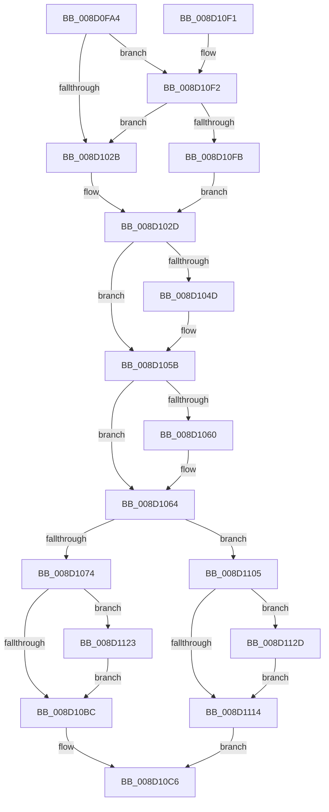

# MiPopulateCfgBitMap

- RVA: `0x008D0FA4`–`0x008D1137` (길이 `403` bytes)
- VA: `0x00000001408D0FA4`
- 실행 섹션: `PAGE`
- PDB 이름 있음: `예`; PDB Function 태그: `아니요`
- unwind 정보 RVA: `0x00084B18`
- 디코드: `108`개 명령, `403/403` bytes 표시
- 미해석 바이트: `0` (있으면 어셈블리에 `.byte`로 보존)

> 이 문서는 커널 이미지의 기계어와 PDB 기호를 분석해 생성했습니다. 4번과 5번은 함수 원형과 자료형을 바이너리 사용 방식에서 추정한 C 해석이며 원본 소스 복구 결과는 아닙니다.

## 1. Dependencies

- 직접 호출 지점: **9**; 고유 호출 대상: **7**
- 직접 호출자로 확인된 함수: **4**
- RIP 상대 이미지 참조: **1**

### Outgoing calls
- `0x008D103D` → [KeAbPreAcquire](../../text/21/KeAbPreAcquire_function_00210230.md) (function, `0x00210230`)
- `0x008D1056` → [ExfAcquirePushLockExclusiveEx](../../text/20/ExfAcquirePushLockExclusiveEx_function_0020FC90.md) (function, `0x0020FC90`)
- `0x008D1067` → [MiVadDeleted](../../text/43/MiVadDeleted_function_00431350.md) (function, `0x00431350`)
- `0x008D10A6` → [MiCopyToCfgBitMap](MiCopyToCfgBitMap_function_008D1140.md) (function, `0x008D1140`)
- `0x008D10BF` → [KeAbPostRelease](../../text/2E/KeAbPostRelease_function_002E1600.md) (function, `0x002E1600`)
- `0x008D10D1` → [_security_check_cookie](../../text/6A/_security_check_cookie_function_006AC640.md) (function, `0x006AC640`)
- `0x008D1117` → [KeAbPostRelease](../../text/2E/KeAbPostRelease_function_002E1600.md) (function, `0x002E1600`)
- `0x008D1126` → [ExfTryToWakePushLock](../../text/26/ExfTryToWakePushLock_function_00265DD0.md) (function, `0x00265DD0`)
- `0x008D1130` → [ExfTryToWakePushLock](../../text/26/ExfTryToWakePushLock_function_00265DD0.md) (function, `0x00265DD0`)

### Direct callers
- [MiProcessPatchImageCfg](../80/MiProcessPatchImageCfg_function_00806F9C.md) at `0x00807154`
- [MiProcessPatchImageCfg](../80/MiProcessPatchImageCfg_function_00806F9C.md) at `0x008071BC`
- [MiMarkPrivateImageCfgBits](MiMarkPrivateImageCfgBits_function_008D07FC.md) at `0x008D089C`
- [MiMarkPrivateImageCfgBits](MiMarkPrivateImageCfgBits_function_008D07FC.md) at `0x008D08DC`
- [MiCommitVadCfgBits](MiCommitVadCfgBits_function_008D0AD0.md) at `0x008D0BBC`
- [MiCommitVadCfgBits](MiCommitVadCfgBits_function_008D0AD0.md) at `0x008D0C4C`
- [MiCfgMarkValidEntries](../9F/MiCfgMarkValidEntries_function_009F4FE8.md) at `0x009F519A`

### Static image references
- `0x008D0FBB` → RVA `0x00E0A740` (`.data`; read)

## 2. Other-region calls and transfers

- 다른 실행 섹션으로 향하는 call: **8**
  - `0x008D103D` → [KeAbPreAcquire](../../text/21/KeAbPreAcquire_function_00210230.md) (`PAGE` → `.text`)
  - `0x008D1056` → [ExfAcquirePushLockExclusiveEx](../../text/20/ExfAcquirePushLockExclusiveEx_function_0020FC90.md) (`PAGE` → `.text`)
  - `0x008D1067` → [MiVadDeleted](../../text/43/MiVadDeleted_function_00431350.md) (`PAGE` → `.text`)
  - `0x008D10BF` → [KeAbPostRelease](../../text/2E/KeAbPostRelease_function_002E1600.md) (`PAGE` → `.text`)
  - `0x008D10D1` → [_security_check_cookie](../../text/6A/_security_check_cookie_function_006AC640.md) (`PAGE` → `.text`)
  - `0x008D1117` → [KeAbPostRelease](../../text/2E/KeAbPostRelease_function_002E1600.md) (`PAGE` → `.text`)
  - `0x008D1126` → [ExfTryToWakePushLock](../../text/26/ExfTryToWakePushLock_function_00265DD0.md) (`PAGE` → `.text`)
  - `0x008D1130` → [ExfTryToWakePushLock](../../text/26/ExfTryToWakePushLock_function_00265DD0.md) (`PAGE` → `.text`)
- 별도 외부 분기/꼬리 이동을 확인하지 못했습니다.

## 3. Assembly (complete function range)

```asm
008D0FA4  48 89 5C 24 18                  mov qword ptr [rsp + 0x18], rbx
008D0FA9  55                              push rbp
008D0FAA  56                              push rsi
008D0FAB  57                              push rdi
008D0FAC  41 54                           push r12
008D0FAE  41 55                           push r13
008D0FB0  41 56                           push r14
008D0FB2  41 57                           push r15
008D0FB4  48 81 EC 90 00 00 00            sub rsp, 0x90
008D0FBB  48 8B 05 7E 97 53 00            mov rax, qword ptr [rip + 0x53977e]
008D0FC2  48 33 C4                        xor rax, rsp
008D0FC5  48 89 84 24 80 00 00 00         mov qword ptr [rsp + 0x80], rax
008D0FCD  4C 8B B4 24 F0 00 00 00         mov r14, qword ptr [rsp + 0xf0]
008D0FD5  4C 8B E9                        mov r13, rcx
008D0FD8  48 8B 8C 24 00 01 00 00         mov rcx, qword ptr [rsp + 0x100]
008D0FE0  0F 57 C0                        xorps xmm0, xmm0
008D0FE3  4C 8B BC 24 F8 00 00 00         mov r15, qword ptr [rsp + 0xf8]
008D0FEB  45 8B E1                        mov r12d, r9d
008D0FEE  4D 2B FE                        sub r15, r14
008D0FF1  48 89 4C 24 50                  mov qword ptr [rsp + 0x50], rcx
008D0FF6  49 C1 EE 04                     shr r14, 4
008D0FFA  33 C9                           xor ecx, ecx
008D0FFC  4D 03 F6                        add r14, r14
008D0FFF  49 C1 EF 04                     shr r15, 4
008D1003  49 C1 EE 03                     shr r14, 3
008D1007  4D 03 FF                        add r15, r15
008D100A  4D 03 75 00                     add r14, qword ptr [r13]
008D100E  48 89 54 24 58                  mov qword ptr [rsp + 0x58], rdx
008D1013  48 89 4C 24 70                  mov qword ptr [rsp + 0x70], rcx
008D1018  89 4C 24 78                     mov dword ptr [rsp + 0x78], ecx
008D101C  0F 11 44 24 60                  movups xmmword ptr [rsp + 0x60], xmm0
008D1021  48 83 FA 01                     cmp rdx, 1
008D1025  0F 87 C7 00 00 00               ja 0x1408d10f2
008D102B  33 F6                           xor esi, esi
008D102D  49 8B 6D 10                     mov rbp, qword ptr [r13 + 0x10]
008D1031  45 33 C0                        xor r8d, r8d
008D1034  33 D2                           xor edx, edx
008D1036  48 8D 5D 28                     lea rbx, [rbp + 0x28]
008D103A  48 8B CB                        mov rcx, rbx
008D103D  E8 EE F1 93 FF                  call 0x140210230
008D1042  F0 48 0F BA 2B 00               lock bts qword ptr [rbx], 0
008D1048  48 8B F8                        mov rdi, rax
008D104B  73 0E                           jae 0x1408d105b
008D104D  4C 8B C3                        mov r8, rbx
008D1050  48 8B D0                        mov rdx, rax
008D1053  48 8B CB                        mov rcx, rbx
008D1056  E8 35 EC 93 FF                  call 0x14020fc90
008D105B  48 85 FF                        test rdi, rdi
008D105E  74 04                           je 0x1408d1064
008D1060  C6 47 0A 01                     mov byte ptr [rdi + 0xa], 1
008D1064  48 8B CD                        mov rcx, rbp
008D1067  E8 E4 02 B6 FF                  call 0x140431350
008D106C  85 C0                           test eax, eax
008D106E  0F 85 91 00 00 00               jne 0x1408d1105
008D1074  48 8B 44 24 50                  mov rax, qword ptr [rsp + 0x50]
008D1079  45 8B CC                        mov r9d, r12d
008D107C  48 8B 54 24 58                  mov rdx, qword ptr [rsp + 0x58]
008D1081  49 8B CD                        mov rcx, r13
008D1084  48 89 44 24 48                  mov qword ptr [rsp + 0x48], rax
008D1089  49 C1 EF 03                     shr r15, 3
008D108D  4C 89 7C 24 40                  mov qword ptr [rsp + 0x40], r15
008D1092  48 89 74 24 38                  mov qword ptr [rsp + 0x38], rsi
008D1097  83 64 24 30 00                  and dword ptr [rsp + 0x30], 0
008D109C  48 89 6C 24 28                  mov qword ptr [rsp + 0x28], rbp
008D10A1  4C 89 74 24 20                  mov qword ptr [rsp + 0x20], r14
008D10A6  E8 95 00 00 00                  call 0x1408d1140
008D10AB  8B F8                           mov edi, eax
008D10AD  48 83 C8 FF                     or rax, 0xffffffffffffffff
008D10B1  F0 48 0F C1 03                  lock xadd qword ptr [rbx], rax
008D10B6  24 06                           and al, 6
008D10B8  3C 02                           cmp al, 2
008D10BA  74 67                           je 0x1408d1123
008D10BC  48 8B CB                        mov rcx, rbx
008D10BF  E8 3C 05 A1 FF                  call 0x1402e1600
008D10C4  8B C7                           mov eax, edi
008D10C6  48 8B 8C 24 80 00 00 00         mov rcx, qword ptr [rsp + 0x80]
008D10CE  48 33 CC                        xor rcx, rsp
008D10D1  E8 6A B5 DD FF                  call 0x1406ac640
008D10D6  48 8B 9C 24 E0 00 00 00         mov rbx, qword ptr [rsp + 0xe0]
008D10DE  48 81 C4 90 00 00 00            add rsp, 0x90
008D10E5  41 5F                           pop r15
008D10E7  41 5E                           pop r14
008D10E9  41 5D                           pop r13
008D10EB  41 5C                           pop r12
008D10ED  5F                              pop rdi
008D10EE  5E                              pop rsi
008D10EF  5D                              pop rbp
008D10F0  C3                              ret
008D10F1  CC                              int3
008D10F2  45 85 E4                        test r12d, r12d
008D10F5  0F 85 30 FF FF FF               jne 0x1408d102b
008D10FB  48 8D 74 24 60                  lea rsi, [rsp + 0x60]
008D1100  E9 28 FF FF FF                  jmp 0x1408d102d
008D1105  48 83 C8 FF                     or rax, 0xffffffffffffffff
008D1109  F0 48 0F C1 03                  lock xadd qword ptr [rbx], rax
008D110E  24 06                           and al, 6
008D1110  3C 02                           cmp al, 2
008D1112  74 19                           je 0x1408d112d
008D1114  48 8B CB                        mov rcx, rbx
008D1117  E8 E4 04 A1 FF                  call 0x1402e1600
008D111C  B8 0A 01 00 C0                  mov eax, 0xc000010a
008D1121  EB A3                           jmp 0x1408d10c6
008D1123  48 8B CB                        mov rcx, rbx
008D1126  E8 A5 4C 99 FF                  call 0x140265dd0
008D112B  EB 8F                           jmp 0x1408d10bc
008D112D  48 8B CB                        mov rcx, rbx
008D1130  E8 9B 4C 99 FF                  call 0x140265dd0
008D1135  EB DD                           jmp 0x1408d1114
```

## 4. C-style interpretation (structured pseudocode)

```c
__int64 __fastcall MiPopulateCfgBitMap(__int64 a1, __int64 a2, int a3, int a4, __int64 a5, __int64 a6, __int64 a7)
{
    __int64 result;
    __int64 v_r14;
    __int64 v_r15;
    __int64 v_rsi;
    __int64 v_rsp;
    unsigned __int64 v_stack_m48;
    unsigned int v_stack_m50;
    unsigned __int64 v_stack_m58;
    unsigned __int64 v_stack_m68;
    unsigned __int64 v_stack_m70;
    unsigned __int64 v_stack_m78;
    unsigned __int64 v_stack_m80;
    unsigned __int64 v_stack_m88;
    unsigned __int64 v_stack_m90;
    unsigned int v_stack_m98;
    unsigned __int64 v_stack_mA0;
    unsigned __int64 v_stack_mA8;
    unsigned __int64 v_stack_p18;
    unsigned __int64 v_stack_p60;

    v_stack_p18 = v_rbx;
    v_rsp = (v_rsp) - (144);
    result = (*(unsigned __int64 *)(v_rip + 5478270)) ^ (v_rsp);
    v_stack_m48 = result;
    v_r15 = (a6) - (a5);
    v_stack_m78 = a7;
    v_r14 = (a5) >> (4);
    a1 = 0;
    v_r14 = (v_r14) + (v_r14);
    v_r15 = (v_r15) >> (4);
    v_r14 = (v_r14) >> (3);
    v_r15 = (v_r15) + (v_r15);
    v_r14 = (v_r14) + (*(unsigned __int64 *)(a1));
    v_stack_m70 = a2;
    v_stack_m58 = 0;
    v_stack_m50 = 0;
    v_stack_m68 = v_xmm0;
    if (a2 > 1) goto loc_008D10F2;
loc_008D102B:
    v_rsi = 0;
loc_008D102D:
    a3 = 0;
    a2 = 0;
    result = KeAbPreAcquire(*(unsigned __int64 *)(a1 + 16) + 40, a2, a3, a4);
    if (!(condition_is_above_or_equal)) {
        a3 = *(unsigned __int64 *)(a1 + 16) + 40;
        a2 = result;
        a1 = *(unsigned __int64 *)(a1 + 16) + 40;
        result = ExfAcquirePushLockExclusiveEx(a1, a2, a3, a4);
    }
    if (result != 0) {
        *(unsigned __int8 *)(result + 10) = 1;
    }
    result = MiVadDeleted(*(unsigned __int64 *)(a1 + 16), a2, a3, a4);
    if ((unsigned int)(result) != 0) goto loc_008D1105;
    v_stack_m80 = v_stack_m78;
    v_r15 = (v_r15) >> (3);
    v_stack_m88 = v_r15;
    v_stack_m90 = 0;
    v_stack_mA0 = *(unsigned __int64 *)(a1 + 16);
    v_stack_mA8 = v_r14;
    result = MiCopyToCfgBitMap(a1, v_stack_m70, a3, (unsigned int)((unsigned int)((unsigned int)(a4))));
    result = (result) | (-1);
    result = (unsigned __int8)((result) & (6));
    if (((unsigned __int8)(result)) == 2) goto loc_008D1123;
loc_008D10BC:
    result = KeAbPostRelease(*(unsigned __int64 *)(a1 + 16) + 40, v_stack_m70, a3, (unsigned int)((unsigned int)((unsigned int)(a4))));
loc_008D10C6:
    a1 = (v_stack_m48) ^ (v_rsp);
    result = _security_check_cookie(a1, v_stack_m70, a3, (unsigned int)((unsigned int)((unsigned int)(a4))));
    v_rsp = (v_rsp) + (144);
    return result;
loc_008D10F2:
    if ((unsigned int)((unsigned int)(a4)) != 0) goto loc_008D102B;
    goto loc_008D102D;
loc_008D1105:
    result = (result) | (-1);
    result = (unsigned __int8)((result) & (6));
    if (((unsigned __int8)(result)) == 2) goto loc_008D112D;
loc_008D1114:
    result = KeAbPostRelease(v_stack_p18, v_stack_m70, a3, (unsigned int)((unsigned int)((unsigned int)(a4))));
    goto loc_008D10C6;
loc_008D1123:
    result = ExfTryToWakePushLock(v_stack_p18, v_stack_m70, a3, (unsigned int)((unsigned int)((unsigned int)(a4))));
    goto loc_008D10BC;
loc_008D112D:
    result = ExfTryToWakePushLock(v_stack_p18, v_stack_m70, a3, (unsigned int)((unsigned int)((unsigned int)(a4))));
    goto loc_008D1114;
}
```

## 5. (Beta) C Style

```c
int64_t MiPopulateCfgBitMap(void *Arg1, int64_t Arg2, int32_t Arg3, int32_t Arg4, int64_t Arg5, int64_t Arg6, int64_t Arg7)
{
    uint8_t *arg1 = (uint8_t *)Arg1;

    int64_t result;
    int64_t local_r14;
    int64_t local_r15;
    int64_t local_rsi;
    int64_t local_rsp;
    uint64_t v_stack_m48;
    uint32_t v_stack_m50;
    uint64_t v_stack_m58;
    uint64_t v_stack_m68;
    uint64_t v_stack_m70;
    uint64_t v_stack_m78;
    uint64_t v_stack_m80;
    uint64_t v_stack_m88;
    uint64_t v_stack_m90;
    uint32_t v_stack_m98;
    uint64_t v_stack_mA0;
    uint64_t v_stack_mA8;
    uint64_t v_stack_p18;
    uint64_t v_stack_p60;

    v_stack_p18 = local_rbx;
    local_rsp = (local_rsp) - (144);
    result = (*(uint64_t *)(v_rip + 0x53977E)) ^ (local_rsp);
    v_stack_m48 = result;
    local_r15 = (Arg6) - (Arg5);
    v_stack_m78 = Arg7;
    local_r14 = (Arg5) >> (4);
    Arg1 = 0;
    local_r14 = (local_r14) + (local_r14);
    local_r15 = (local_r15) >> (4);
    local_r14 = (local_r14) >> (3);
    local_r15 = (local_r15) + (local_r15);
    local_r14 = (local_r14) + (*(uint64_t *)(arg1));
    v_stack_m70 = Arg2;
    v_stack_m58 = 0;
    v_stack_m50 = 0;
    v_stack_m68 = v_xmm0;
    if (Arg2 > 1) goto loc_008D10F2;
loc_008D102B:
    local_rsi = 0;
loc_008D102D:
    Arg3 = 0;
    Arg2 = 0;
    result = KeAbPreAcquire(*(uint64_t *)(arg1 + 0x10) + 40, Arg2, Arg3, Arg4);
    if (!(condition_is_above_or_equal)) {
        Arg3 = *(uint64_t *)(arg1 + 0x10) + 40;
        Arg2 = result;
        Arg1 = *(uint64_t *)(arg1 + 0x10) + 40;
        result = ExfAcquirePushLockExclusiveEx(Arg1, Arg2, Arg3, Arg4);
    }
    if (result != 0) {
        *(uint8_t *)(result + 0xA) = 1;
    }
    result = MiVadDeleted(*(uint64_t *)(arg1 + 0x10), Arg2, Arg3, Arg4);
    if ((uint32_t)(result) != 0) goto loc_008D1105;
    v_stack_m80 = v_stack_m78;
    local_r15 = (local_r15) >> (3);
    v_stack_m88 = local_r15;
    v_stack_m90 = 0;
    v_stack_mA0 = *(uint64_t *)(arg1 + 0x10);
    v_stack_mA8 = local_r14;
    result = MiCopyToCfgBitMap(Arg1, v_stack_m70, Arg3, (uint32_t)((uint32_t)((uint32_t)(Arg4))));
    result = (result) | (-1);
    result = (uint8_t)((result) & (6));
    if (((uint8_t)(result)) == 2) goto loc_008D1123;
loc_008D10BC:
    result = KeAbPostRelease(*(uint64_t *)(arg1 + 0x10) + 40, v_stack_m70, Arg3, (uint32_t)((uint32_t)((uint32_t)(Arg4))));
loc_008D10C6:
    Arg1 = (v_stack_m48) ^ (local_rsp);
    result = _security_check_cookie(Arg1, v_stack_m70, Arg3, (uint32_t)((uint32_t)((uint32_t)(Arg4))));
    local_rsp = (local_rsp) + (144);
    return result;
loc_008D10F2:
    if ((uint32_t)((uint32_t)(Arg4)) != 0) goto loc_008D102B;
    goto loc_008D102D;
loc_008D1105:
    result = (result) | (-1);
    result = (uint8_t)((result) & (6));
    if (((uint8_t)(result)) == 2) goto loc_008D112D;
loc_008D1114:
    result = KeAbPostRelease(v_stack_p18, v_stack_m70, Arg3, (uint32_t)((uint32_t)((uint32_t)(Arg4))));
    goto loc_008D10C6;
loc_008D1123:
    result = ExfTryToWakePushLock(v_stack_p18, v_stack_m70, Arg3, (uint32_t)((uint32_t)((uint32_t)(Arg4))));
    goto loc_008D10BC;
loc_008D112D:
    result = ExfTryToWakePushLock(v_stack_p18, v_stack_m70, Arg3, (uint32_t)((uint32_t)((uint32_t)(Arg4))));
    goto loc_008D1114;
}
```

### 관측된 메모리 오프셋

구조체 형식이 확인되지 않은 접근은 인자 기준의 오프셋으로만 기록했습니다.

| 기준 인자 | 오프셋 표현 | 폭 (bit) | 접근 |
|---|---:|---:|---|
| `Arg1` | `+ 0x0` | `64` | `R` |
| `Arg1` | `+ 0x10` | `64` | `R` |

## 6. Execution-region graph

[열기: 2D/3D 그래프와 함수 탐색 컨트롤 패널](../../../control-panel.html?section=page&rva=0x008D0FA4&view=graph)

- 2D 그래프는 위에서 아래로 흐르고, 3D 그래프는 빈 공간을 드래그해 회전합니다. Shift+드래그는 이동, 휠은 확대·축소, 함수 노드 선택은 대상 보고서 이동입니다.

### Static fallback


