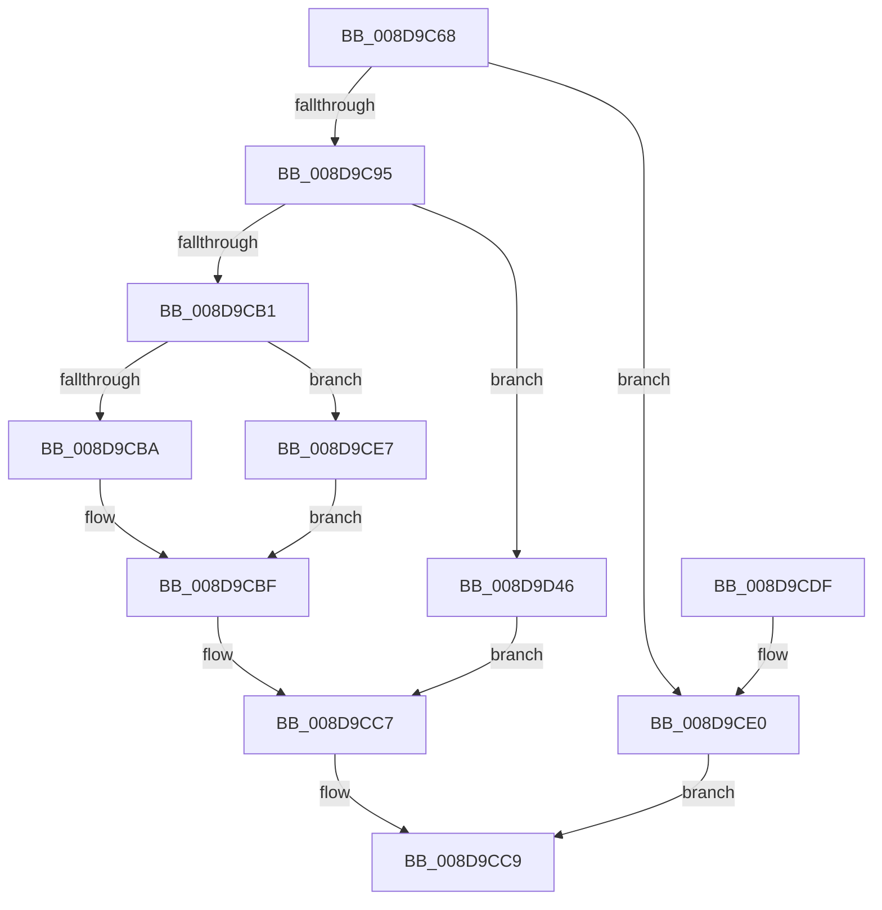

# MmGetImageInformation

- RVA: `0x008D9C68`–`0x008D9D50` (길이 `232` bytes)
- VA: `0x00000001408D9C68`
- 실행 섹션: `PAGE`
- PDB 이름 있음: `예`; PDB Function 태그: `아니요`
- unwind 정보 RVA: `0x000856C0`
- 디코드: `64`개 명령, `232/232` bytes 표시
- 미해석 바이트: `0` (있으면 어셈블리에 `.byte`로 보존)

> 이 문서는 커널 이미지의 기계어와 PDB 기호를 분석해 생성했습니다. 4번과 5번은 함수 원형과 자료형을 바이너리 사용 방식에서 추정한 C 해석이며 원본 소스 복구 결과는 아닙니다.

## 1. Dependencies

- 직접 호출 지점: **2**; 고유 호출 대상: **2**
- 직접 호출자로 확인된 함수: **5**
- RIP 상대 이미지 참조: **0**

### Outgoing calls
- `0x008D9C9E` → [MiObtainReferencedVadEx](../../text/31/MiObtainReferencedVadEx_function_00316690.md) (function, `0x00316690`)
- `0x008D9CC2` → [MiUnlockAndDereferenceVadShared](../../text/2A/MiUnlockAndDereferenceVadShared_function_002AEF10.md) (function, `0x002AEF10`)

### Direct callers
- [RtlpLookupUserFunctionTable](../../text/2F/RtlpLookupUserFunctionTable_function_002F3CD0.md) at `0x002F3D2B`
- [RtlGetImageBaseAndLoadConfig](../../text/46/RtlGetImageBaseAndLoadConfig_function_0046C3A4.md) at `0x0046C454`
- [EtwTimLogControlProtectionUserModeReturnMismatch](../7B/EtwTimLogControlProtectionUserModeReturnMismatch_function_007BA9D4.md) at `0x007BADFC`
- [EtwTimLogControlProtectionUserModeReturnMismatch](../7B/EtwTimLogControlProtectionUserModeReturnMismatch_function_007BA9D4.md) at `0x007BAE8B`
- [EtwpLocateDbgIdForRegEntry](EtwpLocateDbgIdForRegEntry_function_008D99A4.md) at `0x008D9A0F`
- [KiCheckUserAddressCetCompat](KiCheckUserAddressCetCompat_function_008D9AF8.md) at `0x008D9B28`

### Static image references
- 디코드된 RIP-relative 메모리 참조가 없습니다.

## 2. Other-region calls and transfers

- 다른 실행 섹션으로 향하는 call: **2**
  - `0x008D9C9E` → [MiObtainReferencedVadEx](../../text/31/MiObtainReferencedVadEx_function_00316690.md) (`PAGE` → `.text`)
  - `0x008D9CC2` → [MiUnlockAndDereferenceVadShared](../../text/2A/MiUnlockAndDereferenceVadShared_function_002AEF10.md) (`PAGE` → `.text`)
- 별도 외부 분기/꼬리 이동을 확인하지 못했습니다.

## 3. Assembly (complete function range)

```asm
008D9C68  4C 8B DC                        mov r11, rsp
008D9C6B  49 89 5B 10                     mov qword ptr [r11 + 0x10], rbx
008D9C6F  49 89 73 18                     mov qword ptr [r11 + 0x18], rsi
008D9C73  49 89 7B 20                     mov qword ptr [r11 + 0x20], rdi
008D9C77  41 56                           push r14
008D9C79  48 83 EC 20                     sub rsp, 0x20
008D9C7D  48 B8 FF FF FE FF FF 7F 00 00   movabs rax, 0x7ffffffeffff
008D9C87  49 8B F9                        mov rdi, r9
008D9C8A  49 8B F0                        mov rsi, r8
008D9C8D  4C 8B F2                        mov r14, rdx
008D9C90  48 3B C8                        cmp rcx, rax
008D9C93  77 4B                           ja 0x1408d9ce0
008D9C95  4D 8D 43 08                     lea r8, [r11 + 8]
008D9C99  BA 06 00 00 00                  mov edx, 6
008D9C9E  E8 ED C9 A3 FF                  call 0x140316690
008D9CA3  33 DB                           xor ebx, ebx
008D9CA5  4C 8B C0                        mov r8, rax
008D9CA8  48 85 C0                        test rax, rax
008D9CAB  0F 84 95 00 00 00               je 0x1408d9d46
008D9CB1  8B 40 30                        mov eax, dword ptr [rax + 0x30]
008D9CB4  24 70                           and al, 0x70
008D9CB6  3C 20                           cmp al, 0x20
008D9CB8  74 2D                           je 0x1408d9ce7
008D9CBA  BB 49 00 00 C0                  mov ebx, 0xc0000049
008D9CBF  49 8B C8                        mov rcx, r8
008D9CC2  E8 49 52 9D FF                  call 0x1402aef10
008D9CC7  8B C3                           mov eax, ebx
008D9CC9  48 8B 5C 24 38                  mov rbx, qword ptr [rsp + 0x38]
008D9CCE  48 8B 74 24 40                  mov rsi, qword ptr [rsp + 0x40]
008D9CD3  48 8B 7C 24 48                  mov rdi, qword ptr [rsp + 0x48]
008D9CD8  48 83 C4 20                     add rsp, 0x20
008D9CDC  41 5E                           pop r14
008D9CDE  C3                              ret
008D9CDF  CC                              int3
008D9CE0  B8 0D 00 00 C0                  mov eax, 0xc000000d
008D9CE5  EB E2                           jmp 0x1408d9cc9
008D9CE7  41 8B 40 18                     mov eax, dword ptr [r8 + 0x18]
008D9CEB  41 0F B6 48 20                  movzx ecx, byte ptr [r8 + 0x20]
008D9CF0  48 C1 E1 20                     shl rcx, 0x20
008D9CF4  48 0B C8                        or rcx, rax
008D9CF7  48 C1 E1 0C                     shl rcx, 0xc
008D9CFB  49 89 0E                        mov qword ptr [r14], rcx
008D9CFE  41 8B 40 1C                     mov eax, dword ptr [r8 + 0x1c]
008D9D02  41 0F B6 50 21                  movzx edx, byte ptr [r8 + 0x21]
008D9D07  41 0F B6 48 20                  movzx ecx, byte ptr [r8 + 0x20]
008D9D0C  48 C1 E2 20                     shl rdx, 0x20
008D9D10  48 0B D0                        or rdx, rax
008D9D13  48 C1 E1 20                     shl rcx, 0x20
008D9D17  41 8B 40 18                     mov eax, dword ptr [r8 + 0x18]
008D9D1B  48 0B C8                        or rcx, rax
008D9D1E  48 2B D1                        sub rdx, rcx
008D9D21  48 FF C2                        inc rdx
008D9D24  48 C1 E2 0C                     shl rdx, 0xc
008D9D28  48 89 16                        mov qword ptr [rsi], rdx
008D9D2B  49 8B 40 48                     mov rax, qword ptr [r8 + 0x48]
008D9D2F  48 8B 08                        mov rcx, qword ptr [rax]
008D9D32  48 8B 11                        mov rdx, qword ptr [rcx]
008D9D35  48 8B 4A 38                     mov rcx, qword ptr [rdx + 0x38]
008D9D39  8B 51 4C                        mov edx, dword ptr [rcx + 0x4c]
008D9D3C  83 E2 01                        and edx, 1
008D9D3F  89 17                           mov dword ptr [rdi], edx
008D9D41  E9 79 FF FF FF                  jmp 0x1408d9cbf
008D9D46  BB 18 00 00 C0                  mov ebx, 0xc0000018
008D9D4B  E9 77 FF FF FF                  jmp 0x1408d9cc7
```

## 4. C-style interpretation (structured pseudocode)

```c
__int64 __fastcall MmGetImageInformation(__int64 a1, __int64 a2, __int64 a3, __int64 a4)
{
    __int64 result;
    __int64 v_rbx;
    __int64 v_rsp;
    unsigned __int64 v_stack_p10;
    unsigned __int64 v_stack_p18;
    unsigned __int64 v_stack_p20;

    *(unsigned __int64 *)(v_rsp + 16) = v_rbx;
    *(unsigned __int64 *)(v_rsp + 24) = v_rsi;
    *(unsigned __int64 *)(v_rsp + 32) = v_rdi;
    v_rsp = (v_rsp) - (32);
    if (a1 > result) goto loc_008D9CE0;
    result = MiObtainReferencedVadEx(a1, 6, v_rsp + 8, a4);
    v_rbx = 0;
    if (result == 0) goto loc_008D9D46;
    result = (unsigned __int8)(((unsigned int)(*(unsigned int *)(result + 48))) & (112));
    if (((unsigned __int8)(result)) == 32) goto loc_008D9CE7;
loc_008D9CBF:
    result = MiUnlockAndDereferenceVadShared(result, 6, result, a4);
loc_008D9CC7:
loc_008D9CC9:
    v_rsp = (v_rsp) + (32);
    return (unsigned int)((unsigned int)((unsigned int)(0xC0000049ULL)));
loc_008D9CE0:
    goto loc_008D9CC9;
loc_008D9CE7:
    a1 = (*(unsigned __int8 *)(result + 32)) << (32);
    a1 = (a1) | ((unsigned int)(*(unsigned int *)(result + 24)));
    a1 = (a1) << (12);
    *(unsigned __int64 *)(a2) = a1;
    a2 = (*(unsigned __int8 *)(result + 33)) << (32);
    a2 = (a2) | ((unsigned int)(*(unsigned int *)(result + 28)));
    a1 = (*(unsigned __int8 *)(result + 32)) << (32);
    a1 = (a1) | ((unsigned int)(*(unsigned int *)(result + 24)));
    a2 = (a2) - (a1);
    a2 = (a2) + 1;
    a2 = (a2) << (12);
    *(unsigned __int64 *)(v_stack_p18) = a2;
    a2 = (unsigned int)(((unsigned int)(*(unsigned int *)(*(unsigned __int64 *)(*(unsigned __int64 *)(*(unsigned __int64 *)(*(unsigned __int64 *)(result + 72))) + 56) + 76))) & (1));
    *(unsigned int *)(v_stack_p20) = (unsigned int)(a2);
    goto loc_008D9CBF;
loc_008D9D46:
    goto loc_008D9CC7;
}
```

## 5. (Beta) C Style

```c
int64_t MmGetImageInformation(int64_t Arg1, void *Arg2, void *Arg3, void *Arg4)
{
    uint8_t *arg2 = (uint8_t *)Arg2;
    uint8_t *arg3 = (uint8_t *)Arg3;
    uint8_t *arg4 = (uint8_t *)Arg4;

    int64_t result;
    int64_t local_rbx;
    int64_t local_rsp;
    uint64_t v_stack_p10;
    uint64_t v_stack_p18;
    uint64_t v_stack_p20;

    *(uint64_t *)(local_rsp + 0x10) = local_rbx;
    *(uint64_t *)(local_rsp + 0x18) = local_rsi;
    *(uint64_t *)(local_rsp + 0x20) = local_rdi;
    local_rsp = (local_rsp) - (32);
    if (Arg1 > result) goto loc_008D9CE0;
    result = MiObtainReferencedVadEx(Arg1, 6, local_rsp + 8, Arg4);
    local_rbx = 0;
    if (result == 0) goto loc_008D9D46;
    result = (uint8_t)(((uint32_t)(*(uint32_t *)(result + 0x30))) & (112));
    if (((uint8_t)(result)) == 32) goto loc_008D9CE7;
loc_008D9CBF:
    result = MiUnlockAndDereferenceVadShared(result, 6, result, Arg4);
loc_008D9CC7:
loc_008D9CC9:
    local_rsp = (local_rsp) + (32);
    return (uint32_t)((uint32_t)((uint32_t)(0xC0000049ULL)));
loc_008D9CE0:
    goto loc_008D9CC9;
loc_008D9CE7:
    Arg1 = (*(uint8_t *)(result + 0x20)) << (32);
    Arg1 = (Arg1) | ((uint32_t)(*(uint32_t *)(result + 0x18)));
    Arg1 = (Arg1) << (12);
    *(uint64_t *)(arg2) = Arg1;
    Arg2 = (*(uint8_t *)(result + 0x21)) << (32);
    Arg2 = (Arg2) | ((uint32_t)(*(uint32_t *)(result + 0x1C)));
    Arg1 = (*(uint8_t *)(result + 0x20)) << (32);
    Arg1 = (Arg1) | ((uint32_t)(*(uint32_t *)(result + 0x18)));
    Arg2 = (Arg2) - (Arg1);
    Arg2 = (Arg2) + 1;
    Arg2 = (Arg2) << (12);
    *(void **)(v_stack_p18) = Arg2;
    Arg2 = (uint32_t)(((uint32_t)(*(uint32_t *)(*(uint64_t *)(*(uint64_t *)(*(uint64_t *)(*(uint64_t *)(result + 0x48))) + 0x38) + 0x4C))) & (1));
    *(uint32_t *)(v_stack_p20) = (uint32_t)(Arg2);
    goto loc_008D9CBF;
loc_008D9D46:
    goto loc_008D9CC7;
}
```

### 관측된 메모리 오프셋

구조체 형식이 확인되지 않은 접근은 인자 기준의 오프셋으로만 기록했습니다.

| 기준 인자 | 오프셋 표현 | 폭 (bit) | 접근 |
|---|---:|---:|---|
| `Arg2` | `+ 0x0` | `64` | `W` |
| `Arg3` | `+ 0x0` | `64` | `W` |
| `Arg4` | `+ 0x0` | `32` | `W` |

## 6. Execution-region graph

[열기: 2D/3D 그래프와 함수 탐색 컨트롤 패널](../../../control-panel.html?section=page&rva=0x008D9C68&view=graph)

- 2D 그래프는 위에서 아래로 흐르고, 3D 그래프는 빈 공간을 드래그해 회전합니다. Shift+드래그는 이동, 휠은 확대·축소, 함수 노드 선택은 대상 보고서 이동입니다.

### Static fallback


