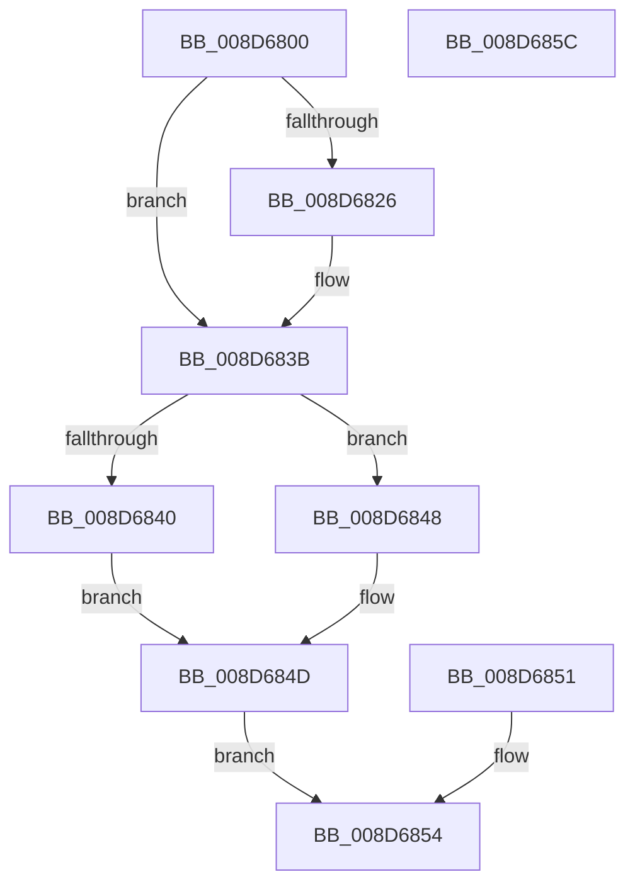

# NtQueryDefaultLocale

- RVA: `0x008D6800`–`0x008D685D` (길이 `93` bytes)
- VA: `0x00000001408D6800`
- 실행 섹션: `PAGE`
- PDB 이름 있음: `예`; PDB Function 태그: `아니요`
- unwind 정보 RVA: `0x000852E4`
- 디코드: `26`개 명령, `93/93` bytes 표시
- 미해석 바이트: `0` (있으면 어셈블리에 `.byte`로 보존)

> 이 문서는 커널 이미지의 기계어와 PDB 기호를 분석해 생성했습니다. 4번과 5번은 함수 원형과 자료형을 바이너리 사용 방식에서 추정한 C 해석이며 원본 소스 복구 결과는 아닙니다.

## 1. Dependencies

- 직접 호출 지점: **1**; 고유 호출 대상: **1**
- 직접 호출자로 확인된 함수: **0**
- RIP 상대 이미지 참조: **1**

### Outgoing calls
- `0x008D6848` → [PsGetSessionLocaleId](PsGetSessionLocaleId_function_008D6194.md) (function, `0x008D6194`)

### Direct callers
- 이 함수 시작 RVA로 연결되는 직접 call은 확인되지 않았습니다. 간접 호출은 완전히 역산할 수 없습니다.

### Static image references
- `0x008D6840` → RVA `0x00FD9A98` (`PAGEDATA`; read)

## 2. Other-region calls and transfers

- 다른 실행 섹션으로 향하는 call: **0**
- 별도 외부 분기/꼬리 이동을 확인하지 못했습니다.

## 3. Assembly (complete function range)

```asm
008D6800  48 83 EC 38                     sub rsp, 0x38
008D6804  44 8A C9                        mov r9b, cl
008D6807  45 33 C0                        xor r8d, r8d
008D680A  65 48 8B 04 25 88 01 00 00      mov rax, qword ptr gs:[0x188]
008D6813  48 89 44 24 58                  mov qword ptr [rsp + 0x58], rax
008D6818  8A 80 32 02 00 00               mov al, byte ptr [rax + 0x232]
008D681E  88 44 24 50                     mov byte ptr [rsp + 0x50], al
008D6822  84 C0                           test al, al
008D6824  74 15                           je 0x1408d683b
008D6826  48 B9 00 00 FF FF FF 7F 00 00   movabs rcx, 0x7fffffff0000
008D6830  48 3B D1                        cmp rdx, rcx
008D6833  48 0F 42 CA                     cmovb rcx, rdx
008D6837  8B 01                           mov eax, dword ptr [rcx]
008D6839  89 01                           mov dword ptr [rcx], eax
008D683B  45 84 C9                        test r9b, r9b
008D683E  75 08                           jne 0x1408d6848
008D6840  8B 05 52 32 70 00               mov eax, dword ptr [rip + 0x703252]
008D6846  EB 05                           jmp 0x1408d684d
008D6848  E8 47 F9 FF FF                  call 0x1408d6194
008D684D  89 02                           mov dword ptr [rdx], eax
008D684F  EB 03                           jmp 0x1408d6854
008D6851  44 8B C0                        mov r8d, eax
008D6854  41 8B C0                        mov eax, r8d
008D6857  48 83 C4 38                     add rsp, 0x38
008D685B  C3                              ret
008D685C  CC                              int3
```

## 4. C-style interpretation (structured pseudocode)

```c
__int64 __fastcall NtQueryDefaultLocale(unsigned __int8 a1, __int64 a2, int a3)
{
    __int64 result;
    __int64 v_rsp;
    unsigned __int8 v_stack_p18;
    unsigned __int64 v_stack_p20;

    v_rsp = (v_rsp) - (56);
    a3 = 0;
    v_stack_p20 = *(unsigned __int64 *)(gs_base + (0 + 392));
    v_stack_p18 = (unsigned __int8)(*(unsigned __int8 *)(*(unsigned __int64 *)(gs_base + (0 + 392)) + 562));
    result = *(unsigned __int8 *)(*(unsigned __int64 *)(gs_base + (0 + 392)) + 562);
    if ((unsigned __int8)(*(unsigned __int8 *)(*(unsigned __int64 *)(gs_base + (0 + 392)) + 562)) != 0) {
        if (a2 < a1) { a1 = a2; }
        result = *(unsigned int *)(a1);
        *(unsigned int *)(a1) = (unsigned int)(result);
    }
    if (a1 != 0) goto loc_008D6848;
    goto loc_008D684D;
loc_008D6848:
    result = PsGetSessionLocaleId(a1, a2, a3, a1);
loc_008D684D:
    *(unsigned int *)(a2) = (unsigned int)(result);
    goto loc_008D6854;
loc_008D6854:
    v_rsp = (v_rsp) + (56);
    return 0;
}
```

## 5. (Beta) C Style

```c
int64_t NtQueryDefaultLocale(uint8_t Arg1, int64_t Arg2, int32_t Arg3)
{
    int64_t result;
    int64_t local_rsp;
    uint8_t v_stack_p18;
    uint64_t v_stack_p20;

    local_rsp = (local_rsp) - (56);
    Arg3 = 0;
    v_stack_p20 = *(uint64_t *)(gs_base + (0 + 0x188));
    v_stack_p18 = (uint8_t)(*(uint8_t *)(*(uint64_t *)(gs_base + (0 + 0x188)) + 0x232));
    result = *(uint8_t *)(*(uint64_t *)(gs_base + (0 + 0x188)) + 0x232);
    if ((uint8_t)(*(uint8_t *)(*(uint64_t *)(gs_base + (0 + 0x188)) + 0x232)) != 0) {
        if (Arg2 < Arg1) { Arg1 = Arg2; }
        result = *(uint32_t *)(Arg1);
        *(uint32_t *)(Arg1) = (uint32_t)(result);
    }
    if (Arg1 != 0) goto loc_008D6848;
    goto loc_008D684D;
loc_008D6848:
    result = PsGetSessionLocaleId(Arg1, Arg2, Arg3, Arg1);
loc_008D684D:
    *(uint32_t *)(Arg2) = (uint32_t)(result);
    goto loc_008D6854;
loc_008D6854:
    local_rsp = (local_rsp) + (56);
    return 0;
}
```

## 6. Execution-region graph

[열기: 2D/3D 그래프와 함수 탐색 컨트롤 패널](../../../control-panel.html?section=page&rva=0x008D6800&view=graph)

- 2D 그래프는 위에서 아래로 흐르고, 3D 그래프는 빈 공간을 드래그해 회전합니다. Shift+드래그는 이동, 휠은 확대·축소, 함수 노드 선택은 대상 보고서 이동입니다.

### Static fallback


