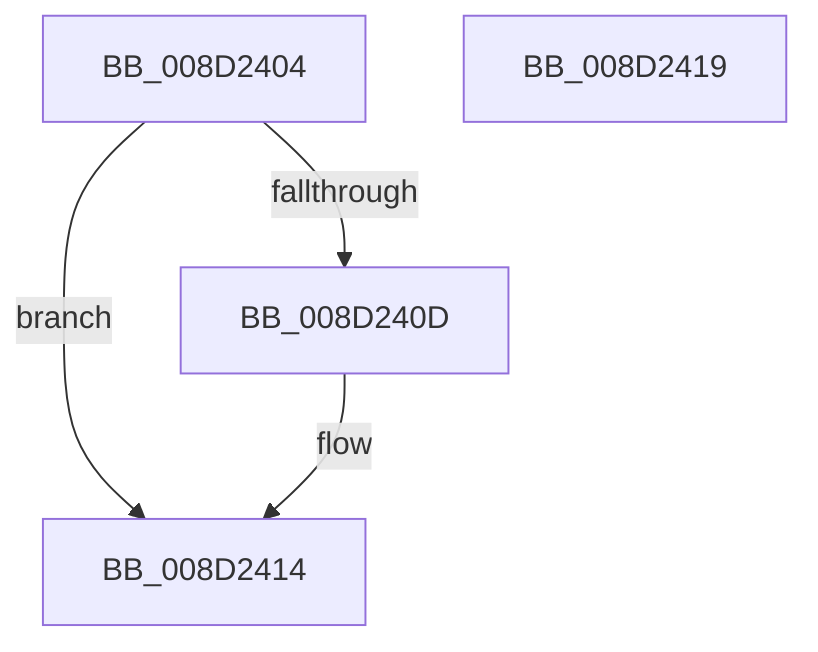

# PdcCloseEvent

- RVA: `0x008D2404`–`0x008D241A` (길이 `22` bytes)
- VA: `0x00000001408D2404`
- 실행 섹션: `PAGE`
- PDB 이름 있음: `예`; PDB Function 태그: `아니요`
- unwind 정보 RVA: `0x0005C788`
- 디코드: `8`개 명령, `22/22` bytes 표시
- 미해석 바이트: `0` (있으면 어셈블리에 `.byte`로 보존)

> 이 문서는 커널 이미지의 기계어와 PDB 기호를 분석해 생성했습니다. 4번과 5번은 함수 원형과 자료형을 바이너리 사용 방식에서 추정한 C 해석이며 원본 소스 복구 결과는 아닙니다.

## 1. Dependencies

- 직접 호출 지점: **1**; 고유 호출 대상: **1**
- 직접 호출자로 확인된 함수: **46**
- RIP 상대 이미지 참조: **0**

### Outgoing calls
- `0x008D240F` → [ExFreePoolWithTag](../../poolcode/B8/ExFreePoolWithTag_function_00B82870.md) (function, `0x00B82870`)

### Direct callers
- [SeConvertStringSidToSid](../../text/4C/SeConvertStringSidToSid_function_004C6710.md) at `0x004C6780`
- [SeConvertStringSidToSid](../../text/4C/SeConvertStringSidToSid_function_004C6710.md) at `0x004C67E8`
- [SeConvertStringSidToSid](../../text/4C/SeConvertStringSidToSid_function_004C6710.md) at `0x004C6827`
- [RtlApplyFunctionOverrideFixupsToImage](../79/RtlApplyFunctionOverrideFixupsToImage_function_007954E0.md) at `0x007955F1`
- [Pdcv2ActivationClientRegister](../79/Pdcv2ActivationClientRegister_function_0079AF28.md) at `0x0079B0A2`
- [sub_008D1C2C](Unknown_function_008D1C2C.md) at `0x008D1C93`
- [sub_008D1E14](Unknown_function_008D1E14.md) at `0x008D1EFA`
- [sub_008D1E14](Unknown_function_008D1E14.md) at `0x008D1F45`
- [sub_008D215C](Unknown_function_008D215C.md) at `0x008D21B7`
- [sub_008D2220](Unknown_function_008D2220.md) at `0x008D22D6`
- [sub_008D23A4](Unknown_function_008D23A4.md) at `0x008D23F7`
- [sub_008D2508](Unknown_function_008D2508.md) at `0x008D26CD`
- [sub_008D2508](Unknown_function_008D2508.md) at `0x008D2740`
- [sub_008D2508](Unknown_function_008D2508.md) at `0x008D2748`
- [sub_008D2F2C](Unknown_function_008D2F2C.md) at `0x008D3202`
- [sub_008D2F2C](Unknown_function_008D2F2C.md) at `0x008D3243`
- [sub_008D379C](Unknown_function_008D379C.md) at `0x008D3A63`
- [sub_008D379C](Unknown_function_008D379C.md) at `0x008D3A6B`
- [sub_008D4104](Unknown_function_008D4104.md) at `0x008D4207`
- [WbCreateHeapExecutedBlock](WbCreateHeapExecutedBlock_function_008D4BE8.md) at `0x008D4C98`
- [WbCreateHeapExecutedBlock](WbCreateHeapExecutedBlock_function_008D4BE8.md) at `0x008D4DBF`
- [WbCreateHeapExecutedBlock](WbCreateHeapExecutedBlock_function_008D4BE8.md) at `0x008D5332`
- [LocalConvertSDToStringSD_Rev1](../92/LocalConvertSDToStringSD_Rev1_function_00924428.md) at `0x00924521`
- [LocalConvertSDToStringSD_Rev1](../92/LocalConvertSDToStringSD_Rev1_function_00924428.md) at `0x009245E3`
- [LocalConvertSDToStringSD_Rev1](../92/LocalConvertSDToStringSD_Rev1_function_00924428.md) at `0x009245EC`
- [LocalConvertSDToStringSD_Rev1](../92/LocalConvertSDToStringSD_Rev1_function_00924428.md) at `0x009245F5`
- [LocalConvertSDToStringSD_Rev1](../92/LocalConvertSDToStringSD_Rev1_function_00924428.md) at `0x009245FE`
- [LocalConvertSDToStringSD_Rev1](../92/LocalConvertSDToStringSD_Rev1_function_00924428.md) at `0x00924607`
- [LocalConvertSDToStringSD_Rev1](../92/LocalConvertSDToStringSD_Rev1_function_00924428.md) at `0x00924610`
- [LocalConvertSDToStringSD_Rev1](../92/LocalConvertSDToStringSD_Rev1_function_00924428.md) at `0x00924619`
- [LocalConvertSDToStringSD_Rev1](../92/LocalConvertSDToStringSD_Rev1_function_00924428.md) at `0x00924620`
- [LocalConvertStringSDToSD_Rev1](../92/LocalConvertStringSDToSD_Rev1_function_0092656C.md) at `0x00926805`
- [LocalConvertStringSDToSD_Rev1](../92/LocalConvertStringSDToSD_Rev1_function_0092656C.md) at `0x00926813`
- [LocalConvertStringSDToSD_Rev1](../92/LocalConvertStringSDToSD_Rev1_function_0092656C.md) at `0x0092681C`
- [LocalConvertStringSDToSD_Rev1](../92/LocalConvertStringSDToSD_Rev1_function_0092656C.md) at `0x00926825`
- [LocalConvertStringSDToSD_Rev1](../92/LocalConvertStringSDToSD_Rev1_function_0092656C.md) at `0x00926B17`
- [MiFreeImageLoadConfig](../93/MiFreeImageLoadConfig_function_0093F144.md) at `0x0093F181`
- [RtlpCreateFunctionOverrideFixupInfo](../94/RtlpCreateFunctionOverrideFixupInfo_function_009433D8.md) at `0x009439AB`
- [sub_009A051C](../9A/Unknown_function_009A051C.md) at `0x009A05BB`
- [WbValidateEncryptionSegmentArguments](../9A/WbValidateEncryptionSegmentArguments_function_009A06CC.md) at `0x009A072B`
- [WbValidateEncryptionSegmentArguments](../9A/WbValidateEncryptionSegmentArguments_function_009A06CC.md) at `0x009A0857`
- [WbValidateEncryptionSegmentArguments](../9A/WbValidateEncryptionSegmentArguments_function_009A06CC.md) at `0x009A0881`
- [WbValidateEncryptionSegmentArguments](../9A/WbValidateEncryptionSegmentArguments_function_009A06CC.md) at `0x009A08AC`
- [sub_009A0908](../9A/Unknown_function_009A0908.md) at `0x009A095A`
- [sub_009A0BF0](../9A/Unknown_function_009A0BF0.md) at `0x009A0C4D`
- [sub_009A0C94](../9A/Unknown_function_009A0C94.md) at `0x009A0CD7`
- [LocalConvertAclToString](../A0/LocalConvertAclToString_function_00A00408.md) at `0x00A006DB`
- [LocalConvertAclToString](../A0/LocalConvertAclToString_function_00A00408.md) at `0x00A00771`
- [LocalConvertAclToString](../A0/LocalConvertAclToString_function_00A00408.md) at `0x00A0078A`
- [LocalConvertAclToString](../A0/LocalConvertAclToString_function_00A00408.md) at `0x00A00793`
- [LocalConvertAclToString](../A0/LocalConvertAclToString_function_00A00408.md) at `0x00A0079C`
- [LocalConvertAclToString](../A0/LocalConvertAclToString_function_00A00408.md) at `0x00A007A5`
- [LocalConvertAclToString](../A0/LocalConvertAclToString_function_00A00408.md) at `0x00A00997`
- [LocalConvertAclToString](../A0/LocalConvertAclToString_function_00A00408.md) at `0x00A00CFB`
- [LocalConvertAclToString](../A0/LocalConvertAclToString_function_00A00408.md) at `0x00A00D47`
- [LocalConvertAclToString](../A0/LocalConvertAclToString_function_00A00408.md) at `0x00A00D8C`
- [LocalpGetStringForCondition](../A0/LocalpGetStringForCondition_function_00A0122C.md) at `0x00A015FA`
- [LocalpGetStringForCondition](../A0/LocalpGetStringForCondition_function_00A0122C.md) at `0x00A0160F`
- [GetPrintableOperandValue](../A0/GetPrintableOperandValue_function_00A01764.md) at `0x00A01909`
- [GetPrintableAttributeName](../A0/GetPrintableAttributeName_function_00A019D0.md) at `0x00A01A62`
- [LocalGetConditionForString](../A0/LocalGetConditionForString_function_00A01C20.md) at `0x00A02240`
- [LocalGetConditionForString](../A0/LocalGetConditionForString_function_00A01C20.md) at `0x00A022FE`
- [GetOperandValue](../A0/GetOperandValue_function_00A024C0.md) at `0x00A0261A`
- [FreeOperandValue](../A0/FreeOperandValue_function_00A0262C.md) at `0x00A02647`
- [FreeOperandValue](../A0/FreeOperandValue_function_00A0262C.md) at `0x00A0264F`
- [GetOperatorIndexByName](../A0/GetOperatorIndexByName_function_00A029E0.md) at `0x00A02B62`
- [LocalGetStringForRelativeAttribute](../A0/LocalGetStringForRelativeAttribute_function_00A02C38.md) at `0x00A02F1D`
- [LocalGetStringForRelativeAttribute](../A0/LocalGetStringForRelativeAttribute_function_00A02C38.md) at `0x00A030F8`
- [LocalGetStringForRelativeAttribute](../A0/LocalGetStringForRelativeAttribute_function_00A02C38.md) at `0x00A0329A`
- [LocalGetStringForRelativeAttribute](../A0/LocalGetStringForRelativeAttribute_function_00A02C38.md) at `0x00A0341D`
- [LocalGetStringForRelativeAttribute](../A0/LocalGetStringForRelativeAttribute_function_00A02C38.md) at `0x00A0342A`
- [DecodeAttributeName](../A0/DecodeAttributeName_function_00A03460.md) at `0x00A0361E`
- [sub_00A0FA98](../A0/Unknown_function_00A0FA98.md) at `0x00A0FADA`
- [sub_00A0FA98](../A0/Unknown_function_00A0FA98.md) at `0x00A0FAE2`
- [LocalpConvertStringSidToSid](../A1/LocalpConvertStringSidToSid_function_00A17490.md) at `0x00A17791`
- [LocalpConvertStringSidToSid](../A1/LocalpConvertStringSidToSid_function_00A17490.md) at `0x00A179A0`
- [sub_00A67C68](../A6/Unknown_function_00A67C68.md) at `0x00A67CC4`
- [sub_00A67C68](../A6/Unknown_function_00A67C68.md) at `0x00A67D3F`
- [sub_00A7AE48](../A7/Unknown_function_00A7AE48.md) at `0x00A7AEA5`
- [sub_00A7AE48](../A7/Unknown_function_00A7AE48.md) at `0x00A7AF29`
- [sub_00A7C49C](../A7/Unknown_function_00A7C49C.md) at `0x00A7C4E7`
- [sub_00A7C49C](../A7/Unknown_function_00A7C49C.md) at `0x00A7C4F8`
- [sub_00A7C49C](../A7/Unknown_function_00A7C49C.md) at `0x00A7C50A`
- [sub_00A8F270](../A8/Unknown_function_00A8F270.md) at `0x00A8F2B3`
- [sub_00A8FC34](../A8/Unknown_function_00A8FC34.md) at `0x00A8FC45`
- [sub_00AAB8F8](../AA/Unknown_function_00AAB8F8.md) at `0x00AAB90A`
- [sub_00AAB8F8](../AA/Unknown_function_00AAB8F8.md) at `0x00AAB913`
- [sub_00AAB8F8](../AA/Unknown_function_00AAB8F8.md) at `0x00AAB91B`
- [LocalGetRelativeAttributeForString](../AC/LocalGetRelativeAttributeForString_function_00AC74E4.md) at `0x00AC7639`
- [LocalGetRelativeAttributeForString](../AC/LocalGetRelativeAttributeForString_function_00AC74E4.md) at `0x00AC764A`
- [LocalGetRelativeAttributeForString](../AC/LocalGetRelativeAttributeForString_function_00AC74E4.md) at `0x00AC78DA`
- [LocalGetRelativeAttributeForString](../AC/LocalGetRelativeAttributeForString_function_00AC74E4.md) at `0x00AC7DB6`
- [sub_00B32900](../B3/Unknown_function_00B32900.md) at `0x00B32A6F`
- [sub_00B32900](../B3/Unknown_function_00B32900.md) at `0x00B32A8E`
- [sub_00B32AA2](../B3/Unknown_function_00B32AA2.md) at `0x00B32D0D`
- [sub_00B32F2A](../B3/Unknown_function_00B32F2A.md) at `0x00B32F7F`
- [sub_00B32F2A](../B3/Unknown_function_00B32F2A.md) at `0x00B32F91`
- [sub_00B32FA8](../B3/Unknown_function_00B32FA8.md) at `0x00B32FD4`
- [sub_00B3347A](../B3/Unknown_function_00B3347A.md) at `0x00B3348F`

### Static image references
- 디코드된 RIP-relative 메모리 참조가 없습니다.

## 2. Other-region calls and transfers

- 다른 실행 섹션으로 향하는 call: **1**
  - `0x008D240F` → [ExFreePoolWithTag](../../poolcode/B8/ExFreePoolWithTag_function_00B82870.md) (`PAGE` → `POOLCODE`)
- 별도 외부 분기/꼬리 이동을 확인하지 못했습니다.

## 3. Assembly (complete function range)

```asm
008D2404  48 83 EC 28                     sub rsp, 0x28
008D2408  48 85 C9                        test rcx, rcx
008D240B  74 07                           je 0x1408d2414
008D240D  33 D2                           xor edx, edx
008D240F  E8 5C 04 2B 00                  call 0x140b82870
008D2414  48 83 C4 28                     add rsp, 0x28
008D2418  C3                              ret
008D2419  CC                              int3
```

## 4. C-style interpretation (structured pseudocode)

```c
__int64 __fastcall PdcCloseEvent(__int64 a1, int a2)
{
    __int64 result;
    __int64 v_rsp;

    v_rsp = (v_rsp) - (40);
    if (a1 != 0) {
        a2 = 0;
        result = ExFreePoolWithTag(a1, a2, a3, a4);
    }
    v_rsp = (v_rsp) + (40);
    return result;
}
```

## 5. (Beta) C Style

```c
int64_t PdcCloseEvent(int64_t Arg1, int32_t Arg2)
{
    int64_t result;
    int64_t local_rsp;

    local_rsp = (local_rsp) - (40);
    if (Arg1 != 0) {
        Arg2 = 0;
        result = ExFreePoolWithTag(Arg1, Arg2, a3, a4);
    }
    local_rsp = (local_rsp) + (40);
    return result;
}
```

## 6. Execution-region graph

[열기: 2D/3D 그래프와 함수 탐색 컨트롤 패널](../../../control-panel.html?section=page&rva=0x008D2404&view=graph)

- 2D 그래프는 위에서 아래로 흐르고, 3D 그래프는 빈 공간을 드래그해 회전합니다. Shift+드래그는 이동, 휠은 확대·축소, 함수 노드 선택은 대상 보고서 이동입니다.

### Static fallback


