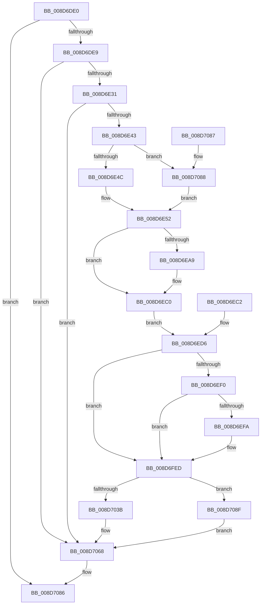

# PerfLogImageLoad

- RVA: `0x008D6DE0`–`0x008D70B5` (길이 `725` bytes)
- VA: `0x00000001408D6DE0`
- 실행 섹션: `PAGE`
- PDB 이름 있음: `예`; PDB Function 태그: `아니요`
- unwind 정보 RVA: `0x00085430`
- 디코드: `142`개 명령, `725/725` bytes 표시
- 미해석 바이트: `0` (있으면 어셈블리에 `.byte`로 보존)

> 이 문서는 커널 이미지의 기계어와 PDB 기호를 분석해 생성했습니다. 4번과 5번은 함수 원형과 자료형을 바이너리 사용 방식에서 추정한 C 해석이며 원본 소스 복구 결과는 아닙니다.

## 1. Dependencies

- 직접 호출 지점: **5**; 고유 호출 대상: **5**
- 직접 호출자로 확인된 함수: **1**
- RIP 상대 이미지 참조: **5**

### Outgoing calls
- `0x008D6E9F` → [RtlImageNtHeader](../../text/44/RtlImageNtHeader_function_00443B60.md) (function, `0x00443B60`)
- `0x008D6FE8` → [EtwWriteEx](../../text/25/EtwWriteEx_function_0025F0D0.md) (function, `0x0025F0D0`)
- `0x008D7063` → [EtwTraceSiloKernelEvent](../../text/22/EtwTraceSiloKernelEvent_function_002242A0.md) (function, `0x002242A0`)
- `0x008D7073` → [_security_check_cookie](../../text/6A/_security_check_cookie_function_006AC640.md) (function, `0x006AC640`)
- `0x008D70AE` → [EtwTraceKernelEvent](../../text/23/EtwTraceKernelEvent_function_00235350.md) (function, `0x00235350`)

### Direct callers
- [sub_008D6C29](Unknown_function_008D6C29.md) at `0x008D6CD6`

### Static image references
- `0x008D6DFC` → RVA `0x00E0A740` (`.data`; read)
- `0x008D6ED6` → RVA `0x00FC6AA8` (`ALMOSTRO`; read)
- `0x008D6EE3` → RVA `0x000105E0` (`.rdata`; read)
- `0x008D6FDA` → RVA `0x00011410` (`.rdata`; read)
- `0x008D6FE1` → RVA `0x00EFF9E8` (`.data`; read)

## 2. Other-region calls and transfers

- 다른 실행 섹션으로 향하는 call: **5**
  - `0x008D6E9F` → [RtlImageNtHeader](../../text/44/RtlImageNtHeader_function_00443B60.md) (`PAGE` → `.text`)
  - `0x008D6FE8` → [EtwWriteEx](../../text/25/EtwWriteEx_function_0025F0D0.md) (`PAGE` → `.text`)
  - `0x008D7063` → [EtwTraceSiloKernelEvent](../../text/22/EtwTraceSiloKernelEvent_function_002242A0.md) (`PAGE` → `.text`)
  - `0x008D7073` → [_security_check_cookie](../../text/6A/_security_check_cookie_function_006AC640.md) (`PAGE` → `.text`)
  - `0x008D70AE` → [EtwTraceKernelEvent](../../text/23/EtwTraceKernelEvent_function_00235350.md) (`PAGE` → `.text`)
- 별도 외부 분기/꼬리 이동을 확인하지 못했습니다.

## 3. Assembly (complete function range)

```asm
008D6DE0  48 85 C9                        test rcx, rcx
008D6DE3  0F 84 9D 02 00 00               je 0x1408d7086
008D6DE9  48 89 4C 24 08                  mov qword ptr [rsp + 8], rcx
008D6DEE  53                              push rbx
008D6DEF  56                              push rsi
008D6DF0  57                              push rdi
008D6DF1  41 54                           push r12
008D6DF3  41 57                           push r15
008D6DF5  48 81 EC 50 01 00 00            sub rsp, 0x150
008D6DFC  48 8B 05 3D 39 53 00            mov rax, qword ptr [rip + 0x53393d]
008D6E03  48 33 C4                        xor rax, rsp
008D6E06  48 89 84 24 40 01 00 00         mov qword ptr [rsp + 0x140], rax
008D6E0E  48 8B F2                        mov rsi, rdx
008D6E11  48 8B F9                        mov rdi, rcx
008D6E14  48 89 54 24 40                  mov qword ptr [rsp + 0x40], rdx
008D6E19  33 DB                           xor ebx, ebx
008D6E1B  48 89 5C 24 50                  mov qword ptr [rsp + 0x50], rbx
008D6E20  48 89 9C 24 88 00 00 00         mov qword ptr [rsp + 0x88], rbx
008D6E28  66 39 19                        cmp word ptr [rcx], bx
008D6E2B  0F 84 37 02 00 00               je 0x1408d7068
008D6E31  4C 8D 79 08                     lea r15, [rcx + 8]
008D6E35  4C 89 7C 24 48                  mov qword ptr [rsp + 0x48], r15
008D6E3A  49 39 1F                        cmp qword ptr [r15], rbx
008D6E3D  0F 84 25 02 00 00               je 0x1408d7068
008D6E43  48 85 D2                        test rdx, rdx
008D6E46  0F 84 3C 02 00 00               je 0x1408d7088
008D6E4C  8B 8A D0 01 00 00               mov ecx, dword ptr [rdx + 0x1d0]
008D6E52  4D 8B 48 08                     mov r9, qword ptr [r8 + 8]
008D6E56  4C 89 4C 24 50                  mov qword ptr [rsp + 0x50], r9
008D6E5B  49 8B 40 18                     mov rax, qword ptr [r8 + 0x18]
008D6E5F  48 89 44 24 58                  mov qword ptr [rsp + 0x58], rax
008D6E64  89 4C 24 60                     mov dword ptr [rsp + 0x60], ecx
008D6E68  66 89 5C 24 6E                  mov word ptr [rsp + 0x6e], bx
008D6E6D  48 89 5C 24 78                  mov qword ptr [rsp + 0x78], rbx
008D6E72  48 89 9C 24 80 00 00 00         mov qword ptr [rsp + 0x80], rbx
008D6E7A  48 89 5C 24 64                  mov qword ptr [rsp + 0x64], rbx
008D6E7F  48 89 5C 24 70                  mov qword ptr [rsp + 0x70], rbx
008D6E84  41 8B 10                        mov edx, dword ptr [r8]
008D6E87  8B C2                           mov eax, edx
008D6E89  C1 E8 0C                        shr eax, 0xc
008D6E8C  24 0F                           and al, 0xf
008D6E8E  88 44 24 6C                     mov byte ptr [rsp + 0x6c], al
008D6E92  C1 EA 10                        shr edx, 0x10
008D6E95  80 E2 07                        and dl, 7
008D6E98  88 54 24 6D                     mov byte ptr [rsp + 0x6d], dl
008D6E9C  49 8B C9                        mov rcx, r9
008D6E9F  E8 BC CC B6 FF                  call 0x140443b60
008D6EA4  48 85 C0                        test rax, rax
008D6EA7  74 17                           je 0x1408d6ec0
008D6EA9  8B 48 58                        mov ecx, dword ptr [rax + 0x58]
008D6EAC  89 4C 24 64                     mov dword ptr [rsp + 0x64], ecx
008D6EB0  8B 48 08                        mov ecx, dword ptr [rax + 8]
008D6EB3  89 4C 24 68                     mov dword ptr [rsp + 0x68], ecx
008D6EB7  48 8B 40 30                     mov rax, qword ptr [rax + 0x30]
008D6EBB  48 89 44 24 70                  mov qword ptr [rsp + 0x70], rax
008D6EC0  EB 14                           jmp 0x1408d6ed6
008D6EC2  33 DB                           xor ebx, ebx
008D6EC4  48 8B BC 24 80 01 00 00         mov rdi, qword ptr [rsp + 0x180]
008D6ECC  48 8B 74 24 40                  mov rsi, qword ptr [rsp + 0x40]
008D6ED1  4C 8B 7C 24 48                  mov r15, qword ptr [rsp + 0x48]
008D6ED6  48 8B 05 CB FB 6E 00            mov rax, qword ptr [rip + 0x6efbcb]
008D6EDD  48 05 CC 12 00 00               add rax, 0x12cc
008D6EE3  4C 8D 25 F6 96 73 FF            lea r12, [rip - 0x8c690a]
008D6EEA  0F 84 FD 00 00 00               je 0x1408d6fed
008D6EF0  8B 00                           mov eax, dword ptr [rax]
008D6EF2  A8 04                           test al, 4
008D6EF4  0F 84 F3 00 00 00               je 0x1408d6fed
008D6EFA  48 8D 44 24 50                  lea rax, [rsp + 0x50]
008D6EFF  48 89 84 24 C0 00 00 00         mov qword ptr [rsp + 0xc0], rax
008D6F07  B9 08 00 00 00                  mov ecx, 8
008D6F0C  48 89 8C 24 C8 00 00 00         mov qword ptr [rsp + 0xc8], rcx
008D6F14  48 8D 44 24 58                  lea rax, [rsp + 0x58]
008D6F19  48 89 84 24 D0 00 00 00         mov qword ptr [rsp + 0xd0], rax
008D6F21  48 89 8C 24 D8 00 00 00         mov qword ptr [rsp + 0xd8], rcx
008D6F29  48 8D 44 24 60                  lea rax, [rsp + 0x60]
008D6F2E  48 89 84 24 E0 00 00 00         mov qword ptr [rsp + 0xe0], rax
008D6F36  48 C7 84 24 E8 00 00 00 04 00 00 00  mov qword ptr [rsp + 0xe8], 4
008D6F42  48 8D 44 24 64                  lea rax, [rsp + 0x64]
008D6F47  48 89 84 24 F0 00 00 00         mov qword ptr [rsp + 0xf0], rax
008D6F4F  48 C7 84 24 F8 00 00 00 04 00 00 00  mov qword ptr [rsp + 0xf8], 4
008D6F5B  48 8D 44 24 68                  lea rax, [rsp + 0x68]
008D6F60  48 89 84 24 00 01 00 00         mov qword ptr [rsp + 0x100], rax
008D6F68  48 C7 84 24 08 01 00 00 04 00 00 00  mov qword ptr [rsp + 0x108], 4
008D6F74  48 8D 44 24 70                  lea rax, [rsp + 0x70]
008D6F79  48 89 84 24 10 01 00 00         mov qword ptr [rsp + 0x110], rax
008D6F81  48 89 8C 24 18 01 00 00         mov qword ptr [rsp + 0x118], rcx
008D6F89  49 8B 07                        mov rax, qword ptr [r15]
008D6F8C  48 89 84 24 20 01 00 00         mov qword ptr [rsp + 0x120], rax
008D6F94  0F B7 07                        movzx eax, word ptr [rdi]
008D6F97  89 84 24 28 01 00 00            mov dword ptr [rsp + 0x128], eax
008D6F9E  89 9C 24 2C 01 00 00            mov dword ptr [rsp + 0x12c], ebx
008D6FA5  4C 89 A4 24 30 01 00 00         mov qword ptr [rsp + 0x130], r12
008D6FAD  48 C7 84 24 38 01 00 00 02 00 00 00  mov qword ptr [rsp + 0x138], 2
008D6FB9  48 8D 84 24 C0 00 00 00         lea rax, [rsp + 0xc0]
008D6FC1  48 89 44 24 38                  mov qword ptr [rsp + 0x38], rax
008D6FC6  89 4C 24 30                     mov dword ptr [rsp + 0x30], ecx
008D6FCA  48 89 5C 24 28                  mov qword ptr [rsp + 0x28], rbx
008D6FCF  48 89 5C 24 20                  mov qword ptr [rsp + 0x20], rbx
008D6FD4  45 33 C9                        xor r9d, r9d
008D6FD7  45 33 C0                        xor r8d, r8d
008D6FDA  48 8D 15 2F A4 73 FF            lea rdx, [rip - 0x8c5bd1]
008D6FE1  48 8B 0D 00 8A 62 00            mov rcx, qword ptr [rip + 0x628a00]
008D6FE8  E8 E3 80 98 FF                  call 0x14025f0d0
008D6FED  48 8D 44 24 50                  lea rax, [rsp + 0x50]
008D6FF2  48 89 84 24 90 00 00 00         mov qword ptr [rsp + 0x90], rax
008D6FFA  48 C7 84 24 98 00 00 00 38 00 00 00  mov qword ptr [rsp + 0x98], 0x38
008D7006  49 8B 07                        mov rax, qword ptr [r15]
008D7009  48 89 84 24 A0 00 00 00         mov qword ptr [rsp + 0xa0], rax
008D7011  0F B7 07                        movzx eax, word ptr [rdi]
008D7014  89 84 24 A8 00 00 00            mov dword ptr [rsp + 0xa8], eax
008D701B  89 9C 24 AC 00 00 00            mov dword ptr [rsp + 0xac], ebx
008D7022  4C 89 A4 24 B0 00 00 00         mov qword ptr [rsp + 0xb0], r12
008D702A  48 C7 84 24 B8 00 00 00 02 00 00 00  mov qword ptr [rsp + 0xb8], 2
008D7036  48 85 F6                        test rsi, rsi
008D7039  74 54                           je 0x1408d708f
008D703B  C7 44 24 28 03 19 60 00         mov dword ptr [rsp + 0x28], 0x601903
008D7043  66 C7 44 24 20 0A 03            mov word ptr [rsp + 0x20], 0x30a
008D704A  41 B9 04 00 00 00               mov r9d, 4
008D7050  45 8D 41 FF                     lea r8d, [r9 - 1]
008D7054  48 8D 94 24 90 00 00 00         lea rdx, [rsp + 0x90]
008D705C  48 8B 8E F0 05 00 00            mov rcx, qword ptr [rsi + 0x5f0]
008D7063  E8 38 D2 94 FF                  call 0x1402242a0
008D7068  48 8B 8C 24 40 01 00 00         mov rcx, qword ptr [rsp + 0x140]
008D7070  48 33 CC                        xor rcx, rsp
008D7073  E8 C8 55 DD FF                  call 0x1406ac640
008D7078  48 81 C4 50 01 00 00            add rsp, 0x150
008D707F  41 5F                           pop r15
008D7081  41 5C                           pop r12
008D7083  5F                              pop rdi
008D7084  5E                              pop rsi
008D7085  5B                              pop rbx
008D7086  C3                              ret
008D7087  CC                              int3
008D7088  8B CB                           mov ecx, ebx
008D708A  E9 C3 FD FF FF                  jmp 0x1408d6e52
008D708F  41 B9 0A 03 00 00               mov r9d, 0x30a
008D7095  C7 44 24 20 03 19 60 00         mov dword ptr [rsp + 0x20], 0x601903
008D709D  BA 03 00 00 00                  mov edx, 3
008D70A2  44 8D 42 01                     lea r8d, [rdx + 1]
008D70A6  48 8D 8C 24 90 00 00 00         lea rcx, [rsp + 0x90]
008D70AE  E8 9D E2 95 FF                  call 0x140235350
008D70B3  EB B3                           jmp 0x1408d7068
```

## 4. C-style interpretation (structured pseudocode)

```c
__int64 __fastcall PerfLogImageLoad(__int64 a1, __int64 a2, __int64 a3)
{
    __int64 result;
    __int64 v_rbx;
    __int64 v_rsp;
    unsigned __int64 v_stack_m100;
    unsigned __int64 v_stack_m108;
    unsigned __int16 v_stack_m10A;
    unsigned __int8 v_stack_m10B;
    unsigned __int8 v_stack_m10C;
    unsigned int v_stack_m110;
    unsigned __int64 v_stack_m114;
    unsigned int v_stack_m118;
    unsigned __int64 v_stack_m120;
    unsigned __int64 v_stack_m128;
    unsigned __int64 v_stack_m130;
    unsigned __int64 v_stack_m138;
    unsigned __int64 v_stack_m140;
    unsigned int v_stack_m148;
    unsigned __int64 v_stack_m150;
    unsigned __int64 v_stack_m158;
    unsigned __int64 v_stack_m38;
    unsigned __int64 v_stack_m40;
    unsigned __int64 v_stack_m48;
    unsigned int v_stack_m4C;
    unsigned int v_stack_m50;
    unsigned __int64 v_stack_m58;
    unsigned __int64 v_stack_m60;
    unsigned __int64 v_stack_m68;
    unsigned __int64 v_stack_m70;
    unsigned __int64 v_stack_m78;
    unsigned __int64 v_stack_m80;
    unsigned __int64 v_stack_m88;
    unsigned __int64 v_stack_m90;
    unsigned __int64 v_stack_m98;
    unsigned __int64 v_stack_mA0;
    unsigned __int64 v_stack_mA8;
    unsigned __int64 v_stack_mB0;
    unsigned __int64 v_stack_mB8;
    unsigned __int64 v_stack_mC0;
    unsigned __int64 v_stack_mC8;
    unsigned int v_stack_mCC;
    unsigned int v_stack_mD0;
    unsigned __int64 v_stack_mD8;
    unsigned __int64 v_stack_mE0;
    unsigned __int64 v_stack_mE8;
    unsigned __int64 v_stack_mF0;
    unsigned __int64 v_stack_mF8;
    unsigned int v_stack_p20;
    unsigned __int64 v_stack_p8;
    unsigned __int64 v_stack_p90;

    if (a1 == 0) goto loc_008D7086;
    v_stack_p8 = a1;
    v_rsp = (v_rsp) - (336);
    result = (*(unsigned __int64 *)(v_rip + 5454141)) ^ (v_rsp);
    v_stack_m38 = result;
    v_stack_m138 = a2;
    v_rbx = 0;
    v_stack_m128 = 0;
    v_stack_mF0 = 0;
    if ((*(unsigned __int16 *)(a1)) == 0) goto loc_008D7068;
    v_stack_m130 = a1 + 8;
    if ((*(unsigned __int64 *)(a1 + 8)) == 0) goto loc_008D7068;
    if (a2 == 0) goto loc_008D7088;
loc_008D6E52:
    v_stack_m128 = *(unsigned __int64 *)(a3 + 8);
    v_stack_m120 = *(unsigned __int64 *)(a3 + 24);
    v_stack_m118 = (unsigned int)((unsigned int)(*(unsigned int *)(a2 + 464)));
    v_stack_m10A = 0;
    v_stack_m100 = 0;
    v_stack_mF8 = 0;
    v_stack_m114 = 0;
    v_stack_m108 = 0;
    result = (unsigned int)(((unsigned int)((unsigned int)((unsigned int)(*(unsigned int *)(a3))))) >> (12));
    result = (unsigned __int8)((result) & (15));
    v_stack_m10C = (unsigned __int8)(result);
    a2 = (unsigned int)(((unsigned int)(*(unsigned int *)(a3))) >> (16));
    a2 = (unsigned __int8)((a2) & (7));
    v_stack_m10B = (unsigned __int8)(a2);
    result = RtlImageNtHeader(*(unsigned __int64 *)(a3 + 8), a2, a3, *(unsigned __int64 *)(a3 + 8));
    if (result != 0) {
        a1 = *(unsigned int *)(result + 88);
        v_stack_m114 = (unsigned int)(a1);
        a1 = *(unsigned int *)(result + 8);
        v_stack_m110 = (unsigned int)(a1);
        result = *(unsigned __int64 *)(result + 48);
        v_stack_m108 = result;
    }
    goto loc_008D6ED6;
loc_008D6ED6:
    result = (*(unsigned __int64 *)(v_rip + 7273419)) + (0x12CCULL);
    if (condition_is_equal) goto loc_008D6FED;
    result = (unsigned int)(*(unsigned int *)(result));
    if ((((unsigned __int8)((unsigned int)(*(unsigned int *)(result)))) & (4)) != 0) {
        result = v_stack_m128;
        v_stack_mB8 = result;
        a1 = 8;
        v_stack_mB0 = a1;
        result = v_stack_m120;
        v_stack_mA8 = result;
        v_stack_mA0 = a1;
        result = v_stack_m118;
        v_stack_m98 = result;
        v_stack_m90 = 4;
        result = v_stack_m114;
        v_stack_m88 = result;
        v_stack_m80 = 4;
        result = v_stack_m110;
        v_stack_m78 = result;
        v_stack_m70 = 4;
        result = v_stack_m108;
        v_stack_m68 = result;
        v_stack_m60 = a1;
        result = *(unsigned __int64 *)(a1 + 8);
        v_stack_m58 = result;
        result = *(unsigned __int16 *)(a1);
        v_stack_m50 = (unsigned int)(result);
        v_stack_m4C = 0;
        v_stack_m48 = v_rip - 9201930;
        v_stack_m40 = 2;
        result = v_stack_mB8;
        v_stack_m140 = result;
        v_stack_m148 = (unsigned int)(a1);
        v_stack_m150 = 0;
        v_stack_m158 = 0;
        a4 = 0;
        a3 = 0;
        a2 = v_rip - 9198545;
        a1 = *(unsigned __int64 *)(v_rip + 6457856);
        result = EtwWriteEx(a1, a2, a3, a4);
    }
    v_stack_mE8 = v_stack_m128;
    v_stack_mE0 = 56;
    v_stack_mD8 = *(unsigned __int64 *)(a1 + 8);
    v_stack_mD0 = (unsigned int)(*(unsigned __int16 *)(a1));
    v_stack_mCC = 0;
    v_stack_mC8 = v_rip - 9201930;
    v_stack_mC0 = 2;
    if (a2 == 0) goto loc_008D708F;
    v_stack_m150 = 0x601903ULL;
    v_stack_m158 = 778;
    result = EtwTraceSiloKernelEvent(*(unsigned __int64 *)(a2 + 1520), v_stack_mE8, 4 - 1, 4);
loc_008D7068:
    a1 = (v_stack_m38) ^ (v_rsp);
    result = _security_check_cookie(a1, v_stack_mE8, 4 - 1, 4);
    v_rsp = (v_rsp) + (336);
loc_008D7086:
    return result;
loc_008D7088:
    goto loc_008D6E52;
loc_008D708F:
    v_stack_p20 = 0x601903ULL;
    result = EtwTraceKernelEvent(v_stack_p90, 3, 3 + 1, 778);
    goto loc_008D7068;
}
```

## 5. (Beta) C Style

```c
int64_t PerfLogImageLoad(int64_t Arg1, int64_t Arg2, void *Arg3)
{
    uint8_t *arg3 = (uint8_t *)Arg3;

    int64_t result;
    int64_t local_rbx;
    int64_t local_rsp;
    uint64_t v_stack_m100;
    uint64_t v_stack_m108;
    uint16_t v_stack_m10A;
    uint8_t v_stack_m10B;
    uint8_t v_stack_m10C;
    uint32_t v_stack_m110;
    uint64_t v_stack_m114;
    uint32_t v_stack_m118;
    uint64_t v_stack_m120;
    uint64_t v_stack_m128;
    uint64_t v_stack_m130;
    uint64_t v_stack_m138;
    uint64_t v_stack_m140;
    uint32_t v_stack_m148;
    uint64_t v_stack_m150;
    uint64_t v_stack_m158;
    uint64_t v_stack_m38;
    uint64_t v_stack_m40;
    uint64_t v_stack_m48;
    uint32_t v_stack_m4C;
    uint32_t v_stack_m50;
    uint64_t v_stack_m58;
    uint64_t v_stack_m60;
    uint64_t v_stack_m68;
    uint64_t v_stack_m70;
    uint64_t v_stack_m78;
    uint64_t v_stack_m80;
    uint64_t v_stack_m88;
    uint64_t v_stack_m90;
    uint64_t v_stack_m98;
    uint64_t v_stack_mA0;
    uint64_t v_stack_mA8;
    uint64_t v_stack_mB0;
    uint64_t v_stack_mB8;
    uint64_t v_stack_mC0;
    uint64_t v_stack_mC8;
    uint32_t v_stack_mCC;
    uint32_t v_stack_mD0;
    uint64_t v_stack_mD8;
    uint64_t v_stack_mE0;
    uint64_t v_stack_mE8;
    uint64_t v_stack_mF0;
    uint64_t v_stack_mF8;
    uint32_t v_stack_p20;
    uint64_t v_stack_p8;
    uint64_t v_stack_p90;

    if (Arg1 == 0) goto loc_008D7086;
    v_stack_p8 = Arg1;
    local_rsp = (local_rsp) - (336);
    result = (*(uint64_t *)(v_rip + 0x53393D)) ^ (local_rsp);
    v_stack_m38 = result;
    v_stack_m138 = Arg2;
    local_rbx = 0;
    v_stack_m128 = 0;
    v_stack_mF0 = 0;
    if ((*(uint16_t *)(Arg1)) == 0) goto loc_008D7068;
    v_stack_m130 = Arg1 + 8;
    if ((*(uint64_t *)(Arg1 + 0x8)) == 0) goto loc_008D7068;
    if (Arg2 == 0) goto loc_008D7088;
loc_008D6E52:
    v_stack_m128 = *(uint64_t *)(arg3 + 0x8);
    v_stack_m120 = *(uint64_t *)(arg3 + 0x18);
    v_stack_m118 = (uint32_t)((uint32_t)(*(uint32_t *)(Arg2 + 0x1D0)));
    v_stack_m10A = 0;
    v_stack_m100 = 0;
    v_stack_mF8 = 0;
    v_stack_m114 = 0;
    v_stack_m108 = 0;
    result = (uint32_t)(((uint32_t)((uint32_t)((uint32_t)(*(uint32_t *)(arg3))))) >> (12));
    result = (uint8_t)((result) & (15));
    v_stack_m10C = (uint8_t)(result);
    Arg2 = (uint32_t)(((uint32_t)(*(uint32_t *)(arg3))) >> (16));
    Arg2 = (uint8_t)((Arg2) & (7));
    v_stack_m10B = (uint8_t)(Arg2);
    result = RtlImageNtHeader(*(uint64_t *)(arg3 + 0x8), Arg2, Arg3, *(uint64_t *)(arg3 + 0x8));
    if (result != 0) {
        Arg1 = *(uint32_t *)(result + 0x58);
        v_stack_m114 = (uint32_t)(Arg1);
        Arg1 = *(uint32_t *)(result + 0x8);
        v_stack_m110 = (uint32_t)(Arg1);
        result = *(uint64_t *)(result + 0x30);
        v_stack_m108 = result;
    }
    goto loc_008D6ED6;
loc_008D6ED6:
    result = (*(uint64_t *)(v_rip + 0x6EFBCB)) + (0x12CCULL);
    if (condition_is_equal) goto loc_008D6FED;
    result = (uint32_t)(*(uint32_t *)(result));
    if ((((uint8_t)((uint32_t)(*(uint32_t *)(result)))) & (4)) != 0) {
        result = v_stack_m128;
        v_stack_mB8 = result;
        Arg1 = 8;
        v_stack_mB0 = Arg1;
        result = v_stack_m120;
        v_stack_mA8 = result;
        v_stack_mA0 = Arg1;
        result = v_stack_m118;
        v_stack_m98 = result;
        v_stack_m90 = 4;
        result = v_stack_m114;
        v_stack_m88 = result;
        v_stack_m80 = 4;
        result = v_stack_m110;
        v_stack_m78 = result;
        v_stack_m70 = 4;
        result = v_stack_m108;
        v_stack_m68 = result;
        v_stack_m60 = Arg1;
        result = *(uint64_t *)(Arg1 + 0x8);
        v_stack_m58 = result;
        result = *(uint16_t *)(Arg1);
        v_stack_m50 = (uint32_t)(result);
        v_stack_m4C = 0;
        v_stack_m48 = v_rip - 9201930;
        v_stack_m40 = 2;
        result = v_stack_mB8;
        v_stack_m140 = result;
        v_stack_m148 = (uint32_t)(Arg1);
        v_stack_m150 = 0;
        v_stack_m158 = 0;
        a4 = 0;
        Arg3 = 0;
        Arg2 = v_rip - 9198545;
        Arg1 = *(uint64_t *)(v_rip + 0x628A00);
        result = EtwWriteEx(Arg1, Arg2, Arg3, a4);
    }
    v_stack_mE8 = v_stack_m128;
    v_stack_mE0 = 56;
    v_stack_mD8 = *(uint64_t *)(Arg1 + 0x8);
    v_stack_mD0 = (uint32_t)(*(uint16_t *)(Arg1));
    v_stack_mCC = 0;
    v_stack_mC8 = v_rip - 9201930;
    v_stack_mC0 = 2;
    if (Arg2 == 0) goto loc_008D708F;
    v_stack_m150 = 0x601903ULL;
    v_stack_m158 = 778;
    result = EtwTraceSiloKernelEvent(*(uint64_t *)(Arg2 + 0x5F0), v_stack_mE8, 4 - 1, 4);
loc_008D7068:
    Arg1 = (v_stack_m38) ^ (local_rsp);
    result = _security_check_cookie(Arg1, v_stack_mE8, 4 - 1, 4);
    local_rsp = (local_rsp) + (336);
loc_008D7086:
    return result;
loc_008D7088:
    goto loc_008D6E52;
loc_008D708F:
    v_stack_p20 = 0x601903ULL;
    result = EtwTraceKernelEvent(v_stack_p90, 3, 3 + 1, 778);
    goto loc_008D7068;
}
```

### 관측된 메모리 오프셋

구조체 형식이 확인되지 않은 접근은 인자 기준의 오프셋으로만 기록했습니다.

| 기준 인자 | 오프셋 표현 | 폭 (bit) | 접근 |
|---|---:|---:|---|
| `Arg3` | `+ 0x0` | `32` | `R` |
| `Arg3` | `+ 0x8` | `64` | `R` |
| `Arg3` | `+ 0x18` | `64` | `R` |

## 6. Execution-region graph

[열기: 2D/3D 그래프와 함수 탐색 컨트롤 패널](../../../control-panel.html?section=page&rva=0x008D6DE0&view=graph)

- 2D 그래프는 위에서 아래로 흐르고, 3D 그래프는 빈 공간을 드래그해 회전합니다. Shift+드래그는 이동, 휠은 확대·축소, 함수 노드 선택은 대상 보고서 이동입니다.

### Static fallback


