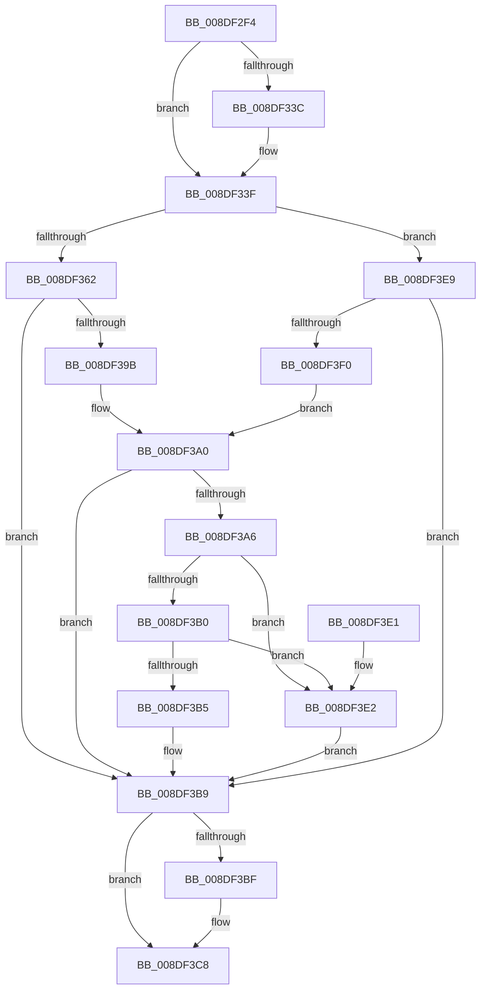

# PiDmGetObjectConstraintList

- RVA: `0x008DF2F4`–`0x008DF3F4` (길이 `256` bytes)
- VA: `0x00000001408DF2F4`
- 실행 섹션: `PAGE`
- PDB 이름 있음: `예`; PDB Function 태그: `아니요`
- unwind 정보 RVA: `0x00085BA8`
- 디코드: `81`개 명령, `256/256` bytes 표시
- 미해석 바이트: `0` (있으면 어셈블리에 `.byte`로 보존)

> 이 문서는 커널 이미지의 기계어와 PDB 기호를 분석해 생성했습니다. 4번과 5번은 함수 원형과 자료형을 바이너리 사용 방식에서 추정한 C 해석이며 원본 소스 복구 결과는 아닙니다.

## 1. Dependencies

- 직접 호출 지점: **3**; 고유 호출 대상: **3**
- 직접 호출자로 확인된 함수: **2**
- RIP 상대 이미지 참조: **3**

### Outgoing calls
- `0x008DF351` → [PiDmGetObject](PiDmGetObject_function_008DFAE0.md) (function, `0x008DFAE0`)
- `0x008DF38E` → [PiDmListEnumObjectsWithCallback](../8E/PiDmListEnumObjectsWithCallback_function_008E3B60.md) (function, `0x008E3B60`)
- `0x008DF3C3` → [PiDmObjectRelease](../8E/PiDmObjectRelease_function_008E4F70.md) (function, `0x008E4F70`)

### Direct callers
- [PiPnpRtlGetFilteredDeviceInterfaceList](PiPnpRtlGetFilteredDeviceInterfaceList_function_008DE9D0.md) at `0x008DEA84`
- [PiPnpRtlGetFilteredDeviceList](../8F/PiPnpRtlGetFilteredDeviceList_function_008FE9F8.md) at `0x008FEAD3`

### Static image references
- `0x008DF343` → RVA `0x000018A0` (`.rdata`; read)
- `0x008DF362` → RVA `0x008E3E80` (`PiDmCmObjectMatchCallback`; read)
- `0x008DF374` → RVA `0x008E3D30` (`PiDmGetObjectListCallback`; read)

## 2. Other-region calls and transfers

- 다른 실행 섹션으로 향하는 call: **0**
- 별도 외부 분기/꼬리 이동을 확인하지 못했습니다.

## 3. Assembly (complete function range)

```asm
008DF2F4  48 89 5C 24 08                  mov qword ptr [rsp + 8], rbx
008DF2F9  48 89 74 24 10                  mov qword ptr [rsp + 0x10], rsi
008DF2FE  4C 89 44 24 18                  mov qword ptr [rsp + 0x18], r8
008DF303  55                              push rbp
008DF304  57                              push rdi
008DF305  41 54                           push r12
008DF307  41 55                           push r13
008DF309  41 57                           push r15
008DF30B  48 8B EC                        mov rbp, rsp
008DF30E  48 83 EC 40                     sub rsp, 0x40
008DF312  48 8B 7D 60                     mov rdi, qword ptr [rbp + 0x60]
008DF316  33 C0                           xor eax, eax
008DF318  44 8B 7D 58                     mov r15d, dword ptr [rbp + 0x58]
008DF31C  0F 57 C0                        xorps xmm0, xmm0
008DF31F  48 8B 75 50                     mov rsi, qword ptr [rbp + 0x50]
008DF323  4D 8B E9                        mov r13, r9
008DF326  4C 63 E1                        movsxd r12, ecx
008DF329  89 07                           mov dword ptr [rdi], eax
008DF32B  48 89 45 40                     mov qword ptr [rbp + 0x40], rax
008DF32F  0F 11 45 E0                     movups xmmword ptr [rbp - 0x20], xmm0
008DF333  0F 11 45 F0                     movups xmmword ptr [rbp - 0x10], xmm0
008DF337  45 85 FF                        test r15d, r15d
008DF33A  74 03                           je 0x1408df33f
008DF33C  66 89 06                        mov word ptr [rsi], ax
008DF33F  4B 8D 0C A4                     lea rcx, [r12 + r12*4]
008DF343  48 8D 05 56 25 72 FF            lea rax, [rip - 0x8ddaaa]
008DF34A  8B 0C C8                        mov ecx, dword ptr [rax + rcx*8]
008DF34D  4C 8D 45 40                     lea r8, [rbp + 0x40]
008DF351  E8 8A 07 00 00                  call 0x1408dfae0
008DF356  33 D2                           xor edx, edx
008DF358  8B D8                           mov ebx, eax
008DF35A  85 C0                           test eax, eax
008DF35C  0F 88 87 00 00 00               js 0x1408df3e9
008DF362  48 8D 05 17 4B 00 00            lea rax, [rip + 0x4b17]
008DF369  89 55 FC                        mov dword ptr [rbp - 4], edx
008DF36C  48 8B 55 40                     mov rdx, qword ptr [rbp + 0x40]
008DF370  4C 8D 4D E0                     lea r9, [rbp - 0x20]
008DF374  4C 8D 05 B5 49 00 00            lea r8, [rip + 0x49b5]
008DF37B  48 89 45 E0                     mov qword ptr [rbp - 0x20], rax
008DF37F  41 8B CC                        mov ecx, r12d
008DF382  4C 89 6D E8                     mov qword ptr [rbp - 0x18], r13
008DF386  48 89 75 F0                     mov qword ptr [rbp - 0x10], rsi
008DF38A  44 89 7D F8                     mov dword ptr [rbp - 8], r15d
008DF38E  E8 CD 47 00 00                  call 0x1408e3b60
008DF393  33 D2                           xor edx, edx
008DF395  8B D8                           mov ebx, eax
008DF397  85 C0                           test eax, eax
008DF399  78 1E                           js 0x1408df3b9
008DF39B  8B 45 FC                        mov eax, dword ptr [rbp - 4]
008DF39E  89 07                           mov dword ptr [rdi], eax
008DF3A0  8B 07                           mov eax, dword ptr [rdi]
008DF3A2  85 C0                           test eax, eax
008DF3A4  74 13                           je 0x1408df3b9
008DF3A6  8D 48 01                        lea ecx, [rax + 1]
008DF3A9  89 0F                           mov dword ptr [rdi], ecx
008DF3AB  48 85 F6                        test rsi, rsi
008DF3AE  74 32                           je 0x1408df3e2
008DF3B0  44 3B F9                        cmp r15d, ecx
008DF3B3  72 2D                           jb 0x1408df3e2
008DF3B5  66 89 14 46                     mov word ptr [rsi + rax*2], dx
008DF3B9  48 39 55 40                     cmp qword ptr [rbp + 0x40], rdx
008DF3BD  74 09                           je 0x1408df3c8
008DF3BF  48 8B 4D 40                     mov rcx, qword ptr [rbp + 0x40]
008DF3C3  E8 A8 5B 00 00                  call 0x1408e4f70
008DF3C8  48 8B 74 24 78                  mov rsi, qword ptr [rsp + 0x78]
008DF3CD  8B C3                           mov eax, ebx
008DF3CF  48 8B 5C 24 70                  mov rbx, qword ptr [rsp + 0x70]
008DF3D4  48 83 C4 40                     add rsp, 0x40
008DF3D8  41 5F                           pop r15
008DF3DA  41 5D                           pop r13
008DF3DC  41 5C                           pop r12
008DF3DE  5F                              pop rdi
008DF3DF  5D                              pop rbp
008DF3E0  C3                              ret
008DF3E1  CC                              int3
008DF3E2  BB 23 00 00 C0                  mov ebx, 0xc0000023
008DF3E7  EB D0                           jmp 0x1408df3b9
008DF3E9  3D 34 00 00 C0                  cmp eax, 0xc0000034
008DF3EE  75 C9                           jne 0x1408df3b9
008DF3F0  8B DA                           mov ebx, edx
008DF3F2  EB AC                           jmp 0x1408df3a0
```

## 4. C-style interpretation (structured pseudocode)

```c
__int64 __fastcall PiDmGetObjectConstraintList(int a1, int a2, __int64 a3, __int64 a4, __int64 a5, unsigned int a6, __int64 a7)
{
    __int64 result;
    __int64 v_rsp;
    unsigned int v_stack_m2C;
    unsigned int v_stack_m30;
    unsigned __int64 v_stack_m38;
    unsigned __int64 v_stack_m40;
    unsigned __int64 v_stack_m48;
    unsigned __int64 v_stack_p10;
    unsigned __int64 v_stack_p18;
    unsigned __int64 v_stack_p8;

    v_stack_p8 = v_rbx;
    v_stack_p10 = v_rsi;
    v_stack_p18 = a3;
    v_rsp = (v_rsp) - (64);
    result = 0;
    *(unsigned int *)(a7) = 0;
    v_stack_p18 = 0;
    v_stack_m48 = v_xmm0;
    v_stack_m38 = v_xmm0;
    if ((unsigned int)((unsigned int)(a6)) != 0) {
        *(unsigned __int16 *)(a5) = 0;
    }
    result = PiDmGetObject((unsigned int)(*(unsigned int *)(v_rip - 9296554 + (int)(a1) + (int)(a1) * 4 * 8)), a2, v_stack_p18, a4);
    a2 = 0;
    if (sign_flag) goto loc_008DF3E9;
    v_stack_m2C = 0;
    v_stack_m48 = v_rip + 19223;
    v_stack_m40 = a4;
    v_stack_m38 = a5;
    v_stack_m30 = (unsigned int)((unsigned int)(a6));
    result = PiDmListEnumObjectsWithCallback((unsigned int)((unsigned int)((int)(a1))), v_stack_p18, v_rip + 18869, v_stack_m48);
    a2 = 0;
    if (sign_flag) goto loc_008DF3B9;
    *(unsigned int *)(a7) = (unsigned int)((unsigned int)(v_stack_m2C));
loc_008DF3A0:
    if ((unsigned int)((unsigned int)(*(unsigned int *)(a7))) == 0) goto loc_008DF3B9;
    *(unsigned int *)(a7) = (unsigned int)((unsigned int)(*(unsigned int *)(a7)) + 1);
    if (a5 == 0) goto loc_008DF3E2;
    if (((unsigned int)((unsigned int)(a6))) < ((unsigned int)((unsigned int)(*(unsigned int *)(a7)) + 1))) goto loc_008DF3E2;
    *(unsigned __int16 *)(a5 + (unsigned int)(*(unsigned int *)(a7)) * 2) = 0;
loc_008DF3B9:
    result = (unsigned int)(*(unsigned int *)(a7));
    if (v_stack_p18 != 0) {
        a1 = v_stack_p18;
        result = PiDmObjectRelease(a1, a2, v_rip + 18869, v_stack_m48);
    }
    v_rsp = (v_rsp) + (64);
    return (unsigned int)((unsigned int)((unsigned int)((unsigned int)(result))));
loc_008DF3E2:
    goto loc_008DF3B9;
loc_008DF3E9:
    if (((unsigned int)((unsigned int)((unsigned int)((unsigned int)((unsigned int)(result)))))) != 0xC0000034ULL) goto loc_008DF3B9;
    goto loc_008DF3A0;
}
```

## 5. (Beta) C Style

```c
int64_t PiDmGetObjectConstraintList(void *Arg1, int32_t Arg2, int64_t Arg3, int64_t Arg4, void *Arg5, uint32_t Arg6, void *Arg7)
{
    uint8_t *arg1 = (uint8_t *)Arg1;
    uint8_t *arg5 = (uint8_t *)Arg5;
    uint8_t *arg7 = (uint8_t *)Arg7;

    int64_t result;
    int64_t local_rsp;
    uint32_t v_stack_m2C;
    uint32_t v_stack_m30;
    uint64_t v_stack_m38;
    uint64_t v_stack_m40;
    uint64_t v_stack_m48;
    uint64_t v_stack_p10;
    uint64_t v_stack_p18;
    uint64_t v_stack_p8;

    v_stack_p8 = local_rbx;
    v_stack_p10 = local_rsi;
    v_stack_p18 = Arg3;
    local_rsp = (local_rsp) - (64);
    result = 0;
    *(uint32_t *)(arg7) = 0;
    v_stack_p18 = 0;
    v_stack_m48 = v_xmm0;
    v_stack_m38 = v_xmm0;
    if ((uint32_t)((uint32_t)(Arg6)) != 0) {
        *(uint16_t *)(arg5) = 0;
    }
    result = PiDmGetObject((uint32_t)(*(uint32_t *)(v_rip - 0x8DDAAA + (int32_t)(arg1) + (int32_t)(arg1) * 4 * 8)), Arg2, v_stack_p18, Arg4);
    Arg2 = 0;
    if (sign_flag) goto loc_008DF3E9;
    v_stack_m2C = 0;
    v_stack_m48 = v_rip + 19223;
    v_stack_m40 = Arg4;
    v_stack_m38 = Arg5;
    v_stack_m30 = (uint32_t)((uint32_t)(Arg6));
    result = PiDmListEnumObjectsWithCallback((uint32_t)((uint32_t)((int32_t)(Arg1))), v_stack_p18, v_rip + 18869, v_stack_m48);
    Arg2 = 0;
    if (sign_flag) goto loc_008DF3B9;
    *(uint32_t *)(arg7) = (uint32_t)((uint32_t)(v_stack_m2C));
loc_008DF3A0:
    if ((uint32_t)((uint32_t)(*(uint32_t *)(arg7))) == 0) goto loc_008DF3B9;
    *(uint32_t *)(arg7) = (uint32_t)((uint32_t)(*(uint32_t *)(arg7)) + 1);
    if (Arg5 == NULL) goto loc_008DF3E2;
    if (((uint32_t)((uint32_t)(Arg6))) < ((uint32_t)((uint32_t)(*(uint32_t *)(arg7)) + 1))) goto loc_008DF3E2;
    *(uint16_t *)(arg5 + (uint32_t)(*(uint32_t *)(arg7)) * 2) = 0;
loc_008DF3B9:
    result = (uint32_t)(*(uint32_t *)(arg7));
    if (v_stack_p18 != 0) {
        Arg1 = v_stack_p18;
        result = PiDmObjectRelease(Arg1, Arg2, v_rip + 18869, v_stack_m48);
    }
    local_rsp = (local_rsp) + (64);
    return (uint32_t)((uint32_t)((uint32_t)((uint32_t)(result))));
loc_008DF3E2:
    goto loc_008DF3B9;
loc_008DF3E9:
    if (((uint32_t)((uint32_t)((uint32_t)((uint32_t)((uint32_t)(result)))))) != 0xC0000034ULL) goto loc_008DF3B9;
    goto loc_008DF3A0;
}
```

### 관측된 메모리 오프셋

구조체 형식이 확인되지 않은 접근은 인자 기준의 오프셋으로만 기록했습니다.

| 기준 인자 | 오프셋 표현 | 폭 (bit) | 접근 |
|---|---:|---:|---|
| `Arg1` | `+ 0x0 + r12*4` | `64` | `R` |
| `Arg5` | `+ 0x0` | `16` | `W` |
| `Arg7` | `+ 0x0` | `32` | `R` |
| `Arg7` | `+ 0x0` | `32` | `W` |

## 6. Execution-region graph

[열기: 2D/3D 그래프와 함수 탐색 컨트롤 패널](../../../control-panel.html?section=page&rva=0x008DF2F4&view=graph)

- 2D 그래프는 위에서 아래로 흐르고, 3D 그래프는 빈 공간을 드래그해 회전합니다. Shift+드래그는 이동, 휠은 확대·축소, 함수 노드 선택은 대상 보고서 이동입니다.

### Static fallback


