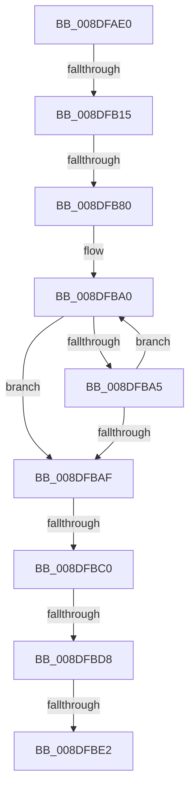

# PiDmGetObject

- RVA: `0x008DFAE0`–`0x008DFBFE` (길이 `286` bytes)
- VA: `0x00000001408DFAE0`
- 실행 섹션: `PAGE`
- PDB 이름 있음: `예`; PDB Function 태그: `아니요`
- unwind 정보 RVA: `0x00085C30`
- 디코드: `66`개 명령, `286/286` bytes 표시
- 미해석 바이트: `0` (있으면 어셈블리에 `.byte`로 보존)

> 이 문서는 커널 이미지의 기계어와 PDB 기호를 분석해 생성했습니다. 4번과 5번은 함수 원형과 자료형을 바이너리 사용 방식에서 추정한 C 해석이며 원본 소스 복구 결과는 아닙니다.

## 1. Dependencies

- 직접 호출 지점: **2**; 고유 호출 대상: **2**
- 직접 호출자로 확인된 함수: **24**
- RIP 상대 이미지 참조: **2**

### Outgoing calls
- `0x008DFB32` → [ExAcquireResourceSharedLite](../../text/21/ExAcquireResourceSharedLite_function_00211BC0.md) (function, `0x00211BC0`)
- `0x008DFBE5` → [PsGetCurrentServerSiloGlobals](../../text/2F/PsGetCurrentServerSiloGlobals_function_002FE1F0.md) (function, `0x002FE1F0`)

### Direct callers
- [PiUEventGetDmObjectFromUserHandle](../72/PiUEventGetDmObjectFromUserHandle_function_0072DF88.md) at `0x0072E01F`
- [PiPnpRtlEnsureObjectCached](../72/PiPnpRtlEnsureObjectCached_function_0072F928.md) at `0x0072F952`
- [PiPnpRtlGatherContainerRemoveInfo](../72/PiPnpRtlGatherContainerRemoveInfo_function_0072FB58.md) at `0x0072FB9F`
- [PiPnpRtlGatherContainerRemoveInfo](../72/PiPnpRtlGatherContainerRemoveInfo_function_0072FB58.md) at `0x0072FBC9`
- [PiPnpRtlGatherInterfaceDeleteInfo](../72/PiPnpRtlGatherInterfaceDeleteInfo_function_0072FD48.md) at `0x0072FDBF`
- [PiPnpRtlGatherInterfaceDeleteInfo](../72/PiPnpRtlGatherInterfaceDeleteInfo_function_0072FD48.md) at `0x0072FE69`
- [PiPnpRtlGatherInterfaceDeleteInfo](../72/PiPnpRtlGatherInterfaceDeleteInfo_function_0072FD48.md) at `0x0072FEF7`
- [PiPnpRtlGatherInterfaceDeleteInfo](../72/PiPnpRtlGatherInterfaceDeleteInfo_function_0072FD48.md) at `0x0072FF94`
- [PiPnpRtlGatherPanelRemoveInfo](../72/PiPnpRtlGatherPanelRemoveInfo_function_0072FFF8.md) at `0x0073003F`
- [PiPnpRtlGatherPanelRemoveInfo](../72/PiPnpRtlGatherPanelRemoveInfo_function_0072FFF8.md) at `0x00730069`
- [PiDqObjectManagerEnumerateAndRegisterQuery](PiDqObjectManagerEnumerateAndRegisterQuery_function_008DCF74.md) at `0x008DD01D`
- [PiDqObjectManagerEnumerateAndRegisterQuery](PiDqObjectManagerEnumerateAndRegisterQuery_function_008DCF74.md) at `0x008DD1A2`
- [PiDmGetObjectConstraintList](PiDmGetObjectConstraintList_function_008DF2F4.md) at `0x008DF351`
- [PiPnpRtlObjectEventCreate](PiPnpRtlObjectEventCreate_function_008DF7E0.md) at `0x008DF9B2`
- [sub_008E078C](../8E/Unknown_function_008E078C.md) at `0x008E08D3`
- [sub_008E28A3](../8E/Unknown_function_008E28A3.md) at `0x008E29A8`
- [sub_008E314B](../8E/Unknown_function_008E314B.md) at `0x008E316F`
- [sub_008E314B](../8E/Unknown_function_008E314B.md) at `0x008E32D2`
- [sub_008E359C](../8E/Unknown_function_008E359C.md) at `0x008E35DF`
- [sub_008E4C9A](../8E/Unknown_function_008E4C9A.md) at `0x008E4E5A`
- [PiPnpRtlCmActionCallback](../8E/PiPnpRtlCmActionCallback_function_008EF110.md) at `0x008EF73F`
- [sub_008F36E5](../8F/Unknown_function_008F36E5.md) at `0x008F3745`
- [PiDmObjectGetCachedObjectReference](../8F/PiDmObjectGetCachedObjectReference_function_008F7FB0.md) at `0x008F809F`
- [PiDmObjectProcessPropertyChange](../8F/PiDmObjectProcessPropertyChange_function_008F8A48.md) at `0x008F8E51`
- [PiDmObjectUpdateCachedObjectProperty](../8F/PiDmObjectUpdateCachedObjectProperty_function_008F9C94.md) at `0x008F9D50`
- [PiDmCacheDataEncode](../8F/PiDmCacheDataEncode_function_008FB79C.md) at `0x008FB877`
- [PiUEventHandleRegistration](../9C/PiUEventHandleRegistration_function_009C3304.md) at `0x009C348E`
- [PiUEventHandleRegistration](../9C/PiUEventHandleRegistration_function_009C3304.md) at `0x009C34C0`
- [PiUEventHandleRegistration](../9C/PiUEventHandleRegistration_function_009C3304.md) at `0x009C3511`
- [PiPnpRtlGatherInstallerClassChangeInfo](../AD/PiPnpRtlGatherInstallerClassChangeInfo_function_00AD26FC.md) at `0x00AD2786`
- [PiPnpRtlGatherInstallerClassChangeInfo](../AD/PiPnpRtlGatherInstallerClassChangeInfo_function_00AD26FC.md) at `0x00AD2837`
- [sub_00B1CD26](../B1/Unknown_function_00B1CD26.md) at `0x00B1CD81`
- [sub_00B1DC0E](../B1/Unknown_function_00B1DC0E.md) at `0x00B1DE88`
- [sub_00B1DC0E](../B1/Unknown_function_00B1DC0E.md) at `0x00B1DEEA`
- [sub_00B1DC0E](../B1/Unknown_function_00B1DC0E.md) at `0x00B1DF06`
- [sub_00B1DC0E](../B1/Unknown_function_00B1DC0E.md) at `0x00B1DF70`
- [sub_00B1DC0E](../B1/Unknown_function_00B1DC0E.md) at `0x00B1E001`
- [sub_00B41876](../B4/Unknown_function_00B41876.md) at `0x00B4190E`

### Static image references
- `0x008DFAF0` → RVA `0x00E0A740` (`.data`; read)
- `0x008DFB15` → RVA `0x00F8B7A0` (`.data`; read)

## 2. Other-region calls and transfers

- 다른 실행 섹션으로 향하는 call: **2**
  - `0x008DFB32` → [ExAcquireResourceSharedLite](../../text/21/ExAcquireResourceSharedLite_function_00211BC0.md) (`PAGE` → `.text`)
  - `0x008DFBE5` → [PsGetCurrentServerSiloGlobals](../../text/2F/PsGetCurrentServerSiloGlobals_function_002FE1F0.md) (`PAGE` → `.text`)
- call이 아닌 외부 분기/꼬리 이동: **6**
  - `0x008DFB0F` → [sub_008DFCF3 + 0x2E](Unknown_function_008DFCF3.md) (`tail-transfer`)
  - `0x008DFB7A` → [sub_008DFCF3](Unknown_function_008DFCF3.md) (`tail-transfer`)
  - `0x008DFBBA` → [sub_008DFCF3 + 0x55](Unknown_function_008DFCF3.md) (`tail-transfer`)
  - `0x008DFBD2` → [sub_008DFCF3](Unknown_function_008DFCF3.md) (`tail-transfer`)
  - `0x008DFBDC` → [sub_008DFCF3 + 0xD](Unknown_function_008DFCF3.md) (`tail-transfer`)
  - `0x008DFBFC` → [sub_008DFC46](Unknown_function_008DFC46.md) (`tail-transfer`)

## 3. Assembly (complete function range)

```asm
008DFAE0  48 89 5C 24 10                  mov qword ptr [rsp + 0x10], rbx
008DFAE5  56                              push rsi
008DFAE6  57                              push rdi
008DFAE7  41 56                           push r14
008DFAE9  48 81 EC C0 00 00 00            sub rsp, 0xc0
008DFAF0  48 8B 05 49 AC 52 00            mov rax, qword ptr [rip + 0x52ac49]
008DFAF7  48 33 C4                        xor rax, rsp
008DFAFA  48 89 84 24 B0 00 00 00         mov qword ptr [rsp + 0xb0], rax
008DFB02  33 FF                           xor edi, edi
008DFB04  4D 8B F0                        mov r14, r8
008DFB07  48 8B DA                        mov rbx, rdx
008DFB0A  8B F7                           mov esi, edi
008DFB0C  83 F9 03                        cmp ecx, 3
008DFB0F  0F 85 0C 02 00 00               jne 0x1408dfd21
008DFB15  48 8D 35 84 BC 6A 00            lea rsi, [rip + 0x6abc84]
008DFB1C  65 48 8B 04 25 88 01 00 00      mov rax, qword ptr gs:[0x188]
008DFB25  B2 01                           mov dl, 1
008DFB27  48 8B CE                        mov rcx, rsi
008DFB2A  66 FF 88 E4 01 00 00            dec word ptr [rax + 0x1e4]
008DFB31  90                              nop
008DFB32  E8 89 20 93 FF                  call 0x140211bc0
008DFB37  0F 57 C0                        xorps xmm0, xmm0
008DFB3A  48 89 7C 24 40                  mov qword ptr [rsp + 0x40], rdi
008DFB3F  33 C0                           xor eax, eax
008DFB41  48 89 84 24 A8 00 00 00         mov qword ptr [rsp + 0xa8], rax
008DFB49  48 8D 44 24 40                  lea rax, [rsp + 0x40]
008DFB4E  48 89 44 24 30                  mov qword ptr [rsp + 0x30], rax
008DFB53  0F 11 44 24 48                  movups xmmword ptr [rsp + 0x48], xmm0
008DFB58  0F 11 44 24 58                  movups xmmword ptr [rsp + 0x58], xmm0
008DFB5D  0F 11 44 24 68                  movups xmmword ptr [rsp + 0x68], xmm0
008DFB62  0F 11 44 24 78                  movups xmmword ptr [rsp + 0x78], xmm0
008DFB67  0F 11 84 24 88 00 00 00         movups xmmword ptr [rsp + 0x88], xmm0
008DFB6F  0F 11 84 24 98 00 00 00         movups xmmword ptr [rsp + 0x98], xmm0
008DFB77  48 85 DB                        test rbx, rbx
008DFB7A  0F 84 73 01 00 00               je 0x1408dfcf3
008DFB80  44 8B 86 D0 00 00 00            mov r8d, dword ptr [rsi + 0xd0]
008DFB87  BA FF 7F 00 00                  mov edx, 0x7fff
008DFB8C  8B CA                           mov ecx, edx
008DFB8E  48 89 5C 24 50                  mov qword ptr [rsp + 0x50], rbx
008DFB93  44 89 44 24 5C                  mov dword ptr [rsp + 0x5c], r8d
008DFB98  48 8B C3                        mov rax, rbx
008DFB9B  0F 11 44 24 20                  movups xmmword ptr [rsp + 0x20], xmm0
008DFBA0  66 39 38                        cmp word ptr [rax], di
008DFBA3  74 0A                           je 0x1408dfbaf
008DFBA5  48 83 C0 02                     add rax, 2
008DFBA9  48 83 E9 01                     sub rcx, 1
008DFBAD  75 F1                           jne 0x1408dfba0
008DFBAF  48 85 C9                        test rcx, rcx
008DFBB2  B8 0D 00 00 C0                  mov eax, 0xc000000d
008DFBB7  0F 45 C7                        cmovne eax, edi
008DFBBA  0F 84 88 01 00 00               je 0x1408dfd48
008DFBC0  48 2B D1                        sub rdx, rcx
008DFBC3  48 89 5C 24 28                  mov qword ptr [rsp + 0x28], rbx
008DFBC8  66 03 D2                        add dx, dx
008DFBCB  66 89 54 24 20                  mov word ptr [rsp + 0x20], dx
008DFBD0  85 C0                           test eax, eax
008DFBD2  0F 88 1B 01 00 00               js 0x1408dfcf3
008DFBD8  41 83 F8 03                     cmp r8d, 3
008DFBDC  0F 84 1E 01 00 00               je 0x1408dfd00
008DFBE2  44 8B CF                        mov r9d, edi
008DFBE5  E8 06 E6 A1 FF                  call 0x1402fe1f0
008DFBEA  44 0F B7 D2                     movzx r10d, dx
008DFBEE  41 D1 EA                        shr r10d, 1
008DFBF1  4C 8B 98 B0 04 00 00            mov r11, qword ptr [rax + 0x4b0]
008DFBF8  89 7C 24 58                     mov dword ptr [rsp + 0x58], edi
008DFBFC  74 48                           je 0x1408dfc46
```

## 4. C-style interpretation (structured pseudocode)

```c
__int64 __fastcall PiDmGetObject(int a1, __int64 a2, __int64 a3)
{
    __int64 result;
    __int64 v_r10;
    __int64 v_rdi;
    __int64 v_rsp;
    unsigned __int64 v_stack_m28;
    unsigned __int64 v_stack_m30;
    unsigned __int64 v_stack_m40;
    unsigned __int64 v_stack_m50;
    unsigned __int64 v_stack_m60;
    unsigned __int64 v_stack_m70;
    unsigned int v_stack_m7C;
    unsigned __int64 v_stack_m80;
    unsigned __int64 v_stack_m88;
    unsigned __int64 v_stack_m90;
    unsigned __int64 v_stack_m98;
    unsigned __int64 v_stack_mA8;
    unsigned __int64 v_stack_mB0;
    unsigned __int64 v_stack_mB8;
    unsigned __int64 v_stack_p10;

    v_stack_p10 = v_rbx;
    v_rsp = (v_rsp) - (192);
    result = (*(unsigned __int64 *)(v_rip + 5418057)) ^ (v_rsp);
    v_stack_m28 = result;
    v_rdi = 0;
    result = ExAcquireResourceSharedLite(v_rip + 6995076, 1, a3, a4);
    v_stack_m98 = 0;
    result = 0;
    v_stack_m30 = 0;
    v_stack_mA8 = v_stack_m98;
    v_stack_m90 = v_xmm0;
    v_stack_m80 = v_xmm0;
    v_stack_m70 = v_xmm0;
    v_stack_m60 = v_xmm0;
    v_stack_m50 = v_xmm0;
    v_stack_m40 = v_xmm0;
    v_stack_m88 = a2;
    v_stack_m7C = (unsigned int)((unsigned int)(*(unsigned int *)(v_rip + 6995076 + 208)));
    v_stack_mB8 = v_xmm0;
loc_008DFBA0:
    if ((*(unsigned __int16 *)(a2)) == 0) goto loc_008DFBAF;
    result = (a2) + (2);
    a1 = ((unsigned int)((unsigned int)((unsigned int)(0x7FFFULL)))) - (1);
    if (condition_is_not_equal) goto loc_008DFBA0;
loc_008DFBAF:
    result = (unsigned int)(0xC000000DULL);
    if (a1 != 0) { result = 0; }
    a2 = ((unsigned int)(0x7FFFULL)) - (a1);
    v_stack_mB0 = a2;
    a2 = (unsigned __int16)((a2) + ((unsigned __int16)(a2)));
    v_stack_mB8 = (unsigned __int16)(a2);
    result = PsGetCurrentServerSiloGlobals(a1, a2, (unsigned int)(*(unsigned int *)(v_rip + 6995076 + 208)), 0);
    v_r10 = (unsigned int)(((unsigned __int16)(a2)) >> (1));
    v_stack_m80 = 0;
}
```

## 5. (Beta) C Style

```c
int64_t PiDmGetObject(int32_t Arg1, int64_t Arg2, int64_t Arg3)
{
    int64_t result;
    int64_t local_r10;
    int64_t local_rdi;
    int64_t local_rsp;
    uint64_t v_stack_m28;
    uint64_t v_stack_m30;
    uint64_t v_stack_m40;
    uint64_t v_stack_m50;
    uint64_t v_stack_m60;
    uint64_t v_stack_m70;
    uint32_t v_stack_m7C;
    uint64_t v_stack_m80;
    uint64_t v_stack_m88;
    uint64_t v_stack_m90;
    uint64_t v_stack_m98;
    uint64_t v_stack_mA8;
    uint64_t v_stack_mB0;
    uint64_t v_stack_mB8;
    uint64_t v_stack_p10;

    v_stack_p10 = local_rbx;
    local_rsp = (local_rsp) - (192);
    result = (*(uint64_t *)(v_rip + 0x52AC49)) ^ (local_rsp);
    v_stack_m28 = result;
    local_rdi = 0;
    result = ExAcquireResourceSharedLite(v_rip + 6995076, 1, Arg3, a4);
    v_stack_m98 = 0;
    result = 0;
    v_stack_m30 = 0;
    v_stack_mA8 = v_stack_m98;
    v_stack_m90 = v_xmm0;
    v_stack_m80 = v_xmm0;
    v_stack_m70 = v_xmm0;
    v_stack_m60 = v_xmm0;
    v_stack_m50 = v_xmm0;
    v_stack_m40 = v_xmm0;
    v_stack_m88 = Arg2;
    v_stack_m7C = (uint32_t)((uint32_t)(*(uint32_t *)(v_rip + 0x6ABC84 + 0xD0)));
    v_stack_mB8 = v_xmm0;
loc_008DFBA0:
    if ((*(uint16_t *)(Arg2)) == 0) goto loc_008DFBAF;
    result = (Arg2) + (2);
    Arg1 = ((uint32_t)((uint32_t)((uint32_t)(0x7FFFULL)))) - (1);
    if (condition_is_not_equal) goto loc_008DFBA0;
loc_008DFBAF:
    result = (uint32_t)(0xC000000DULL);
    if (Arg1 != 0) { result = 0; }
    Arg2 = ((uint32_t)(0x7FFFULL)) - (Arg1);
    v_stack_mB0 = Arg2;
    Arg2 = (uint16_t)((Arg2) + ((uint16_t)(Arg2)));
    v_stack_mB8 = (uint16_t)(Arg2);
    result = PsGetCurrentServerSiloGlobals(Arg1, Arg2, (uint32_t)(*(uint32_t *)(v_rip + 0x6ABC84 + 0xD0)), 0);
    local_r10 = (uint32_t)(((uint16_t)(Arg2)) >> (1));
    v_stack_m80 = 0;
}
```

## 6. Execution-region graph

[열기: 2D/3D 그래프와 함수 탐색 컨트롤 패널](../../../control-panel.html?section=page&rva=0x008DFAE0&view=graph)

- 2D 그래프는 위에서 아래로 흐르고, 3D 그래프는 빈 공간을 드래그해 회전합니다. Shift+드래그는 이동, 휠은 확대·축소, 함수 노드 선택은 대상 보고서 이동입니다.

### Static fallback


