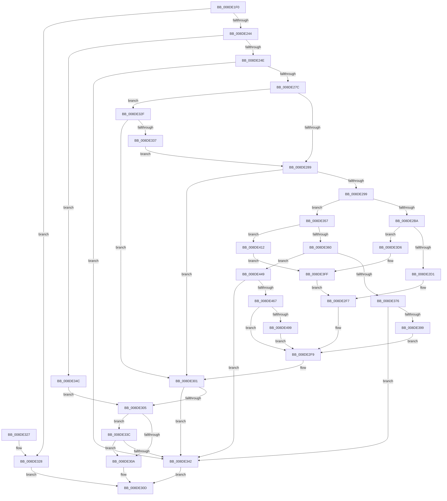

# PiDqActionDataCreate

- RVA: `0x008DE1F0`–`0x008DE4A0` (길이 `688` bytes)
- VA: `0x00000001408DE1F0`
- 실행 섹션: `PAGE`
- PDB 이름 있음: `예`; PDB Function 태그: `아니요`
- unwind 정보 RVA: `0x00085AD0`
- 디코드: `183`개 명령, `688/688` bytes 표시
- 미해석 바이트: `0` (있으면 어셈블리에 `.byte`로 보존)

> 이 문서는 커널 이미지의 기계어와 PDB 기호를 분석해 생성했습니다. 4번과 5번은 함수 원형과 자료형을 바이너리 사용 방식에서 추정한 C 해석이며 원본 소스 복구 결과는 아닙니다.

## 1. Dependencies

- 직접 호출 지점: **10**; 고유 호출 대상: **8**
- 직접 호출자로 확인된 함수: **1**
- RIP 상대 이미지 참조: **0**

### Outgoing calls
- `0x008DE233` → [ExAllocatePool2](../../poolcode/B8/ExAllocatePool2_function_00B820F0.md) (function, `0x00B820F0`)
- `0x008DE26D` → [PnpAllocatePWSTR](PnpAllocatePWSTR_function_008DE620.md) (function, `0x008DE620`)
- `0x008DE29C` → [PiDqGetPnpObjectType](PiDqGetPnpObjectType_function_008DF790.md) (function, `0x008DF790`)
- `0x008DE2F2` → [PiDqActionDataGetRequestedProperties](PiDqActionDataGetRequestedProperties_function_008DEBE4.md) (function, `0x008DEBE4`)
- `0x008DE345` → [PiDqActionDataFree](PiDqActionDataFree_function_008DE4A8.md) (function, `0x008DE4A8`)
- `0x008DE38E` → [PiDqActionDataGetAllPropertiesInBestLanguage](../98/PiDqActionDataGetAllPropertiesInBestLanguage_function_0098FB7C.md) (function, `0x0098FB7C`)
- `0x008DE3C2` → [PiDqActionDataGetAllPropertiesInBestLanguage](../98/PiDqActionDataGetAllPropertiesInBestLanguage_function_0098FB7C.md) (function, `0x0098FB7C`)
- `0x008DE408` → [PiDqActionDataGetChangedProperties](../A6/PiDqActionDataGetChangedProperties_function_00A61F10.md) (function, `0x00A61F10`)
- `0x008DE458` → [PiDqActionDataGetAllPropertiesInAllLanguages](../99/PiDqActionDataGetAllPropertiesInAllLanguages_function_0099569C.md) (function, `0x0099569C`)
- `0x008DE487` → [PiDqActionDataGetAllPropertiesInAllLanguages](../99/PiDqActionDataGetAllPropertiesInAllLanguages_function_0099569C.md) (function, `0x0099569C`)

### Direct callers
- [PiDqQuerySerializeActionQueue](PiDqQuerySerializeActionQueue_function_008DD340.md) at `0x008DD554`

### Static image references
- 디코드된 RIP-relative 메모리 참조가 없습니다.

## 2. Other-region calls and transfers

- 다른 실행 섹션으로 향하는 call: **1**
  - `0x008DE233` → [ExAllocatePool2](../../poolcode/B8/ExAllocatePool2_function_00B820F0.md) (`PAGE` → `POOLCODE`)
- 별도 외부 분기/꼬리 이동을 확인하지 못했습니다.

## 3. Assembly (complete function range)

```asm
008DE1F0  48 8B C4                        mov rax, rsp
008DE1F3  48 89 58 08                     mov qword ptr [rax + 8], rbx
008DE1F7  4C 89 48 20                     mov qword ptr [rax + 0x20], r9
008DE1FB  4C 89 40 18                     mov qword ptr [rax + 0x18], r8
008DE1FF  55                              push rbp
008DE200  56                              push rsi
008DE201  57                              push rdi
008DE202  41 54                           push r12
008DE204  41 55                           push r13
008DE206  41 56                           push r14
008DE208  41 57                           push r15
008DE20A  48 83 EC 60                     sub rsp, 0x60
008DE20E  33 DB                           xor ebx, ebx
008DE210  49 8B E8                        mov rbp, r8
008DE213  21 58 B8                        and dword ptr [rax - 0x48], ebx
008DE216  4C 8B EA                        mov r13, rdx
008DE219  49 21 19                        and qword ptr [r9], rbx
008DE21C  48 8B F1                        mov rsi, rcx
008DE21F  41 BF 50 6E 70 58               mov r15d, 0x58706e50
008DE225  B9 00 01 00 00                  mov ecx, 0x100
008DE22A  8D 53 28                        lea edx, [rbx + 0x28]
008DE22D  45 8B C7                        mov r8d, r15d
008DE230  4D 8B F1                        mov r14, r9
008DE233  E8 B8 3E 2A 00                  call 0x140b820f0
008DE238  48 8B F8                        mov rdi, rax
008DE23B  48 85 C0                        test rax, rax
008DE23E  0F 84 E4 00 00 00               je 0x1408de328
008DE244  48 39 5D 10                     cmp qword ptr [rbp + 0x10], rbx
008DE248  0F 84 FE 00 00 00               je 0x1408de34c
008DE24E  8B 45 20                        mov eax, dword ptr [rbp + 0x20]
008DE251  4C 8D 4F 10                     lea r9, [rdi + 0x10]
008DE255  89 07                           mov dword ptr [rdi], eax
008DE257  45 8B C7                        mov r8d, r15d
008DE25A  8B 46 10                        mov eax, dword ptr [rsi + 0x10]
008DE25D  BA FF FF FF 7F                  mov edx, 0x7fffffff
008DE262  89 47 08                        mov dword ptr [rdi + 8], eax
008DE265  48 8B 4D 10                     mov rcx, qword ptr [rbp + 0x10]
008DE269  48 8B 49 10                     mov rcx, qword ptr [rcx + 0x10]
008DE26D  E8 AE 03 00 00                  call 0x1408de620
008DE272  8B D8                           mov ebx, eax
008DE274  85 C0                           test eax, eax
008DE276  0F 88 C6 00 00 00               js 0x1408de342
008DE27C  44 8B 56 40                     mov r10d, dword ptr [rsi + 0x40]
008DE280  45 85 D2                        test r10d, r10d
008DE283  0F 84 A6 00 00 00               je 0x1408de32f
008DE289  44 8B 07                        mov r8d, dword ptr [rdi]
008DE28C  BD 01 00 00 00                  mov ebp, 1
008DE291  41 8D 40 FF                     lea eax, [r8 - 1]
008DE295  3B C5                           cmp eax, ebp
008DE297  77 68                           ja 0x1408de301
008DE299  8B 4E 10                        mov ecx, dword ptr [rsi + 0x10]
008DE29C  E8 EF 14 00 00                  call 0x1408df790
008DE2A1  44 8B F0                        mov r14d, eax
008DE2A4  4C 8D 7F 18                     lea r15, [rdi + 0x18]
008DE2A8  8B 46 28                        mov eax, dword ptr [rsi + 0x28]
008DE2AB  4C 8D 67 20                     lea r12, [rdi + 0x20]
008DE2AF  49 8B CD                        mov rcx, r13
008DE2B2  A8 02                           test al, 2
008DE2B4  0F 85 9D 00 00 00               jne 0x1408de357
008DE2BA  44 8A C8                        mov r9b, al
008DE2BD  41 8B D6                        mov edx, r14d
008DE2C0  41 80 E1 04                     and r9b, 4
008DE2C4  44 3B C5                        cmp r8d, ebp
008DE2C7  4C 8B 47 10                     mov r8, qword ptr [rdi + 0x10]
008DE2CB  0F 85 05 01 00 00               jne 0x1408de3d6
008DE2D1  48 8B 46 48                     mov rax, qword ptr [rsi + 0x48]
008DE2D5  4C 89 7C 24 40                  mov qword ptr [rsp + 0x40], r15
008DE2DA  4C 89 64 24 38                  mov qword ptr [rsp + 0x38], r12
008DE2DF  44 89 54 24 30                  mov dword ptr [rsp + 0x30], r10d
008DE2E4  48 89 44 24 28                  mov qword ptr [rsp + 0x28], rax
008DE2E9  48 8B 46 38                     mov rax, qword ptr [rsi + 0x38]
008DE2ED  48 89 44 24 20                  mov qword ptr [rsp + 0x20], rax
008DE2F2  E8 ED 08 00 00                  call 0x1408debe4
008DE2F7  8B D8                           mov ebx, eax
008DE2F9  4C 8B B4 24 B8 00 00 00         mov r14, qword ptr [rsp + 0xb8]
008DE301  85 DB                           test ebx, ebx
008DE303  78 3D                           js 0x1408de342
008DE305  83 3F 02                        cmp dword ptr [rdi], 2
008DE308  74 32                           je 0x1408de33c
008DE30A  49 89 3E                        mov qword ptr [r14], rdi
008DE30D  8B C3                           mov eax, ebx
008DE30F  48 8B 9C 24 A0 00 00 00         mov rbx, qword ptr [rsp + 0xa0]
008DE317  48 83 C4 60                     add rsp, 0x60
008DE31B  41 5F                           pop r15
008DE31D  41 5E                           pop r14
008DE31F  41 5D                           pop r13
008DE321  41 5C                           pop r12
008DE323  5F                              pop rdi
008DE324  5E                              pop rsi
008DE325  5D                              pop rbp
008DE326  C3                              ret
008DE327  CC                              int3
008DE328  BB 9A 00 00 C0                  mov ebx, 0xc000009a
008DE32D  EB DE                           jmp 0x1408de30d
008DE32F  8B 4E 28                        mov ecx, dword ptr [rsi + 0x28]
008DE332  F6 C1 02                        test cl, 2
008DE335  74 CA                           je 0x1408de301
008DE337  E9 4D FF FF FF                  jmp 0x1408de289
008DE33C  83 7F 18 00                     cmp dword ptr [rdi + 0x18], 0
008DE340  77 C8                           ja 0x1408de30a
008DE342  48 8B CF                        mov rcx, rdi
008DE345  E8 5E 01 00 00                  call 0x1408de4a8
008DE34A  EB C1                           jmp 0x1408de30d
008DE34C  21 18                           and dword ptr [rax], ebx
008DE34E  C7 40 08 01 00 00 00            mov dword ptr [rax + 8], 1
008DE355  EB AE                           jmp 0x1408de305
008DE357  44 3B C5                        cmp r8d, ebp
008DE35A  0F 85 B2 00 00 00               jne 0x1408de412
008DE360  4C 8B 4F 10                     mov r9, qword ptr [rdi + 0x10]
008DE364  33 D2                           xor edx, edx
008DE366  A8 04                           test al, 4
008DE368  45 8B C6                        mov r8d, r14d
008DE36B  48 8D 44 24 50                  lea rax, [rsp + 0x50]
008DE370  0F 84 D3 00 00 00               je 0x1408de449
008DE376  48 89 44 24 38                  mov qword ptr [rsp + 0x38], rax
008DE37B  48 8B 46 38                     mov rax, qword ptr [rsi + 0x38]
008DE37F  4C 89 7C 24 30                  mov qword ptr [rsp + 0x30], r15
008DE384  4C 89 64 24 28                  mov qword ptr [rsp + 0x28], r12
008DE389  48 89 44 24 20                  mov qword ptr [rsp + 0x20], rax
008DE38E  E8 E9 17 0B 00                  call 0x14098fb7c
008DE393  8B D8                           mov ebx, eax
008DE395  85 C0                           test eax, eax
008DE397  78 A9                           js 0x1408de342
008DE399  4C 8B 4F 10                     mov r9, qword ptr [rdi + 0x10]
008DE39D  48 8D 44 24 50                  lea rax, [rsp + 0x50]
008DE3A2  48 89 44 24 38                  mov qword ptr [rsp + 0x38], rax
008DE3A7  45 8B C6                        mov r8d, r14d
008DE3AA  48 8B 46 38                     mov rax, qword ptr [rsi + 0x38]
008DE3AE  8B D5                           mov edx, ebp
008DE3B0  4C 89 7C 24 30                  mov qword ptr [rsp + 0x30], r15
008DE3B5  49 8B CD                        mov rcx, r13
008DE3B8  4C 89 64 24 28                  mov qword ptr [rsp + 0x28], r12
008DE3BD  48 89 44 24 20                  mov qword ptr [rsp + 0x20], rax
008DE3C2  E8 B5 17 0B 00                  call 0x14098fb7c
008DE3C7  33 DB                           xor ebx, ebx
008DE3C9  3D 34 00 00 C0                  cmp eax, 0xc0000034
008DE3CE  0F 45 D8                        cmovne ebx, eax
008DE3D1  E9 23 FF FF FF                  jmp 0x1408de2f9
008DE3D6  48 8B 84 24 B0 00 00 00         mov rax, qword ptr [rsp + 0xb0]
008DE3DE  4C 89 7C 24 48                  mov qword ptr [rsp + 0x48], r15
008DE3E3  4C 89 64 24 40                  mov qword ptr [rsp + 0x40], r12
008DE3E8  48 8B 40 18                     mov rax, qword ptr [rax + 0x18]
008DE3EC  48 89 44 24 38                  mov qword ptr [rsp + 0x38], rax
008DE3F1  48 8B 46 48                     mov rax, qword ptr [rsi + 0x48]
008DE3F5  44 89 54 24 30                  mov dword ptr [rsp + 0x30], r10d
008DE3FA  48 89 44 24 28                  mov qword ptr [rsp + 0x28], rax
008DE3FF  48 8B 46 38                     mov rax, qword ptr [rsi + 0x38]
008DE403  48 89 44 24 20                  mov qword ptr [rsp + 0x20], rax
008DE408  E8 03 3B 18 00                  call 0x140a61f10
008DE40D  E9 E5 FE FF FF                  jmp 0x1408de2f7
008DE412  48 8B 84 24 B0 00 00 00         mov rax, qword ptr [rsp + 0xb0]
008DE41A  41 8B D6                        mov edx, r14d
008DE41D  44 8A 4E 28                     mov r9b, byte ptr [rsi + 0x28]
008DE421  4C 8B 47 10                     mov r8, qword ptr [rdi + 0x10]
008DE425  41 80 E1 04                     and r9b, 4
008DE429  4C 89 7C 24 48                  mov qword ptr [rsp + 0x48], r15
008DE42E  48 8B 40 18                     mov rax, qword ptr [rax + 0x18]
008DE432  4C 89 64 24 40                  mov qword ptr [rsp + 0x40], r12
008DE437  48 89 44 24 38                  mov qword ptr [rsp + 0x38], rax
008DE43C  83 64 24 30 00                  and dword ptr [rsp + 0x30], 0
008DE441  48 83 64 24 28 00               and qword ptr [rsp + 0x28], 0
008DE447  EB B6                           jmp 0x1408de3ff
008DE449  48 89 44 24 30                  mov qword ptr [rsp + 0x30], rax
008DE44E  4C 89 7C 24 28                  mov qword ptr [rsp + 0x28], r15
008DE453  4C 89 64 24 20                  mov qword ptr [rsp + 0x20], r12
008DE458  E8 3F 72 0B 00                  call 0x14099569c
008DE45D  8B D8                           mov ebx, eax
008DE45F  85 C0                           test eax, eax
008DE461  0F 88 DB FE FF FF               js 0x1408de342
008DE467  4C 8B 4F 10                     mov r9, qword ptr [rdi + 0x10]
008DE46B  48 8D 44 24 50                  lea rax, [rsp + 0x50]
008DE470  48 89 44 24 30                  mov qword ptr [rsp + 0x30], rax
008DE475  45 8B C6                        mov r8d, r14d
008DE478  4C 89 7C 24 28                  mov qword ptr [rsp + 0x28], r15
008DE47D  8B D5                           mov edx, ebp
008DE47F  49 8B CD                        mov rcx, r13
008DE482  4C 89 64 24 20                  mov qword ptr [rsp + 0x20], r12
008DE487  E8 10 72 0B 00                  call 0x14099569c
008DE48C  8B D8                           mov ebx, eax
008DE48E  3D 34 00 00 C0                  cmp eax, 0xc0000034
008DE493  0F 85 60 FE FF FF               jne 0x1408de2f9
008DE499  33 DB                           xor ebx, ebx
008DE49B  E9 59 FE FF FF                  jmp 0x1408de2f9
```

## 4. C-style interpretation (structured pseudocode)

```c
__int64 __fastcall PiDqActionDataCreate(__int64 a1, __int64 a2, __int64 a3, __int64 a4)
{
    __int64 result;
    __int64 v_rbx;
    __int64 v_rsp;
    unsigned __int64 v_stack_m58;
    unsigned __int64 v_stack_m60;
    unsigned int v_stack_m68;
    unsigned __int64 v_stack_m70;
    unsigned __int64 v_stack_m78;
    unsigned __int64 v_stack_p20;
    unsigned __int64 v_stack_p28;
    unsigned __int64 v_stack_p30;
    unsigned __int64 v_stack_p38;
    unsigned __int64 v_stack_p40;
    unsigned __int64 v_stack_p48;
    unsigned __int64 v_stack_p50;
    unsigned __int64 v_stack_p8;
    unsigned __int64 v_stack_pB0;

    *(unsigned __int64 *)(v_rsp + 8) = v_rbx;
    *(unsigned __int64 *)(v_rsp + 32) = a4;
    *(unsigned __int64 *)(v_rsp + 24) = a3;
    v_rsp = (v_rsp) - (96);
    v_rbx = 0;
    result = ExAllocatePool2(256, v_rbx + 40, (unsigned int)((unsigned int)((unsigned int)(0x58706E50ULL))), a4);
    if (result == 0) goto loc_008DE328;
    if ((*(unsigned __int64 *)(a3 + 16)) == 0) goto loc_008DE34C;
    *(unsigned int *)(result) = (unsigned int)((unsigned int)(*(unsigned int *)(a3 + 32)));
    *(unsigned int *)(result + 8) = (unsigned int)((unsigned int)(*(unsigned int *)(a1 + 16)));
    result = PnpAllocatePWSTR(*(unsigned __int64 *)(*(unsigned __int64 *)(a3 + 16) + 16), (unsigned int)(0x7FFFFFFFULL), (unsigned int)((unsigned int)((unsigned int)(0x58706E50ULL))), result + 16);
    if (sign_flag) goto loc_008DE342;
    if ((unsigned int)((unsigned int)(*(unsigned int *)(a1 + 64))) == 0) goto loc_008DE32F;
loc_008DE289:
    if (((unsigned int)((unsigned int)(*(unsigned int *)(result)) - 1)) > 1) goto loc_008DE301;
    result = PiDqGetPnpObjectType((unsigned int)(*(unsigned int *)(a1 + 16)), (unsigned int)(0x7FFFFFFFULL), (unsigned int)(*(unsigned int *)(result)), result + 16);
    if ((((unsigned __int8)((unsigned int)(*(unsigned int *)(a1 + 40)))) & (2)) != 0) goto loc_008DE357;
    a4 = (unsigned __int8)(((unsigned __int8)((unsigned int)(*(unsigned int *)(a1 + 40)))) & (4));
    if (((unsigned int)((unsigned int)(*(unsigned int *)(result)))) != 1) goto loc_008DE3D6;
    v_stack_m58 = result + 24;
    v_stack_m60 = result + 32;
    v_stack_m68 = (unsigned int)((unsigned int)(*(unsigned int *)(a1 + 64)));
    v_stack_m70 = *(unsigned __int64 *)(a1 + 72);
    v_stack_m78 = *(unsigned __int64 *)(a1 + 56);
    result = PiDqActionDataGetRequestedProperties(a2, (unsigned int)((unsigned int)((unsigned int)((unsigned int)(result)))), *(unsigned __int64 *)(result + 16), a4);
loc_008DE2F7:
loc_008DE2F9:
loc_008DE301:
    if (sign_flag) goto loc_008DE342;
loc_008DE305:
    if ((*(unsigned int *)(result)) == 2) goto loc_008DE33C;
loc_008DE30A:
    *(unsigned __int64 *)(v_stack_p20) = result;
loc_008DE30D:
    v_rsp = (v_rsp) + (96);
    return (unsigned int)((unsigned int)((unsigned int)((unsigned int)(result))));
loc_008DE328:
    goto loc_008DE30D;
loc_008DE32F:
    if ((((unsigned __int8)((unsigned int)(*(unsigned int *)(a1 + 40)))) & (2)) == 0) goto loc_008DE301;
    goto loc_008DE289;
loc_008DE33C:
    if ((*(unsigned int *)(result + 24)) > 0) goto loc_008DE30A;
loc_008DE342:
    result = PiDqActionDataFree(result, (unsigned int)((unsigned int)((unsigned int)((unsigned int)(result)))), *(unsigned __int64 *)(result + 16), a4);
    goto loc_008DE30D;
loc_008DE34C:
    *(unsigned int *)(result + 8) = 1;
    goto loc_008DE305;
loc_008DE357:
    if (((unsigned int)(*(unsigned __int64 *)(result + 16))) != 1) goto loc_008DE412;
    a2 = 0;
    if ((((unsigned __int8)(result)) & (4)) == 0) goto loc_008DE449;
    v_stack_p38 = v_stack_p50;
    v_stack_p30 = result + 24;
    v_stack_p28 = result + 32;
    v_stack_p20 = *(unsigned __int64 *)(a1 + 56);
    result = PiDqActionDataGetAllPropertiesInBestLanguage(result, a2, (unsigned int)((unsigned int)(v_stack_p20)), *(unsigned __int64 *)(result + 16));
    if (sign_flag) goto loc_008DE342;
    v_stack_p38 = v_stack_p50;
    v_stack_p30 = result + 24;
    v_stack_p28 = result + 32;
    v_stack_p20 = *(unsigned __int64 *)(a1 + 56);
    result = PiDqActionDataGetAllPropertiesInBestLanguage(0, 1, (unsigned int)((unsigned int)(v_stack_p20)), *(unsigned __int64 *)(result + 16));
    v_rbx = 0;
    if (((unsigned int)(result)) != 0xC0000034ULL) { v_rbx = (unsigned int)(result); }
    goto loc_008DE2F9;
loc_008DE3D6:
    v_stack_p48 = result + 24;
    v_stack_p40 = result + 32;
    v_stack_p38 = *(unsigned __int64 *)(v_stack_pB0 + 24);
    v_stack_p30 = (unsigned int)((unsigned int)(*(unsigned int *)(a1 + 64)));
    v_stack_p28 = *(unsigned __int64 *)(a1 + 72);
loc_008DE3FF:
    v_stack_p20 = *(unsigned __int64 *)(a1 + 56);
    result = PiDqActionDataGetChangedProperties(0, 1, (unsigned int)((unsigned int)(v_stack_p20)), *(unsigned __int64 *)(result + 16));
    goto loc_008DE2F7;
loc_008DE412:
    a4 = (unsigned __int8)((*(unsigned __int8 *)(a1 + 40)) & (4));
    v_stack_p48 = result + 24;
    v_stack_p40 = result + 32;
    v_stack_p38 = *(unsigned __int64 *)(v_stack_pB0 + 24);
    goto loc_008DE3FF;
loc_008DE449:
    v_stack_p30 = *(unsigned __int64 *)(v_stack_pB0 + 24);
    v_stack_p28 = result + 24;
    v_stack_p20 = result + 32;
    result = PiDqActionDataGetAllPropertiesInAllLanguages(0, (unsigned int)((unsigned int)(v_stack_p20)), *(unsigned __int64 *)(result + 16), a4);
    if (sign_flag) goto loc_008DE342;
    v_stack_p30 = v_stack_p50;
    v_stack_p28 = result + 24;
    v_stack_p20 = result + 32;
    result = PiDqActionDataGetAllPropertiesInAllLanguages(0, 1, (unsigned int)((unsigned int)(v_stack_p20)), *(unsigned __int64 *)(result + 16));
    if (((unsigned int)(result)) != 0xC0000034ULL) goto loc_008DE2F9;
    v_rbx = 0;
    goto loc_008DE2F9;
}
```

## 5. (Beta) C Style

```c
int64_t PiDqActionDataCreate(void *Arg1, int64_t Arg2, void *Arg3, void *Arg4)
{
    uint8_t *arg1 = (uint8_t *)Arg1;
    uint8_t *arg3 = (uint8_t *)Arg3;
    uint8_t *arg4 = (uint8_t *)Arg4;

    int64_t result;
    int64_t local_rbx;
    int64_t local_rsp;
    uint64_t v_stack_m58;
    uint64_t v_stack_m60;
    uint32_t v_stack_m68;
    uint64_t v_stack_m70;
    uint64_t v_stack_m78;
    uint64_t v_stack_p20;
    uint64_t v_stack_p28;
    uint64_t v_stack_p30;
    uint64_t v_stack_p38;
    uint64_t v_stack_p40;
    uint64_t v_stack_p48;
    uint64_t v_stack_p50;
    uint64_t v_stack_p8;
    uint64_t v_stack_pB0;

    *(uint64_t *)(local_rsp + 0x8) = local_rbx;
    *(void **)(local_rsp + 0x20) = Arg4;
    *(void **)(local_rsp + 0x18) = Arg3;
    local_rsp = (local_rsp) - (96);
    local_rbx = 0;
    result = ExAllocatePool2(256, local_rbx + 40, (uint32_t)((uint32_t)((uint32_t)(0x58706E50ULL))), Arg4);
    if (result == 0) goto loc_008DE328;
    if ((*(uint64_t *)(arg3 + 0x10)) == 0) goto loc_008DE34C;
    *(uint32_t *)(result) = (uint32_t)((uint32_t)(*(uint32_t *)(arg3 + 0x20)));
    *(uint32_t *)(result + 0x8) = (uint32_t)((uint32_t)(*(uint32_t *)(arg1 + 0x10)));
    result = PnpAllocatePWSTR(*(uint64_t *)(*(uint64_t *)(arg3 + 0x10) + 0x10), (uint32_t)(0x7FFFFFFFULL), (uint32_t)((uint32_t)((uint32_t)(0x58706E50ULL))), result + 16);
    if (sign_flag) goto loc_008DE342;
    if ((uint32_t)((uint32_t)(*(uint32_t *)(arg1 + 0x40))) == 0) goto loc_008DE32F;
loc_008DE289:
    if (((uint32_t)((uint32_t)(*(uint32_t *)(result)) - 1)) > 1) goto loc_008DE301;
    result = PiDqGetPnpObjectType((uint32_t)(*(uint32_t *)(arg1 + 0x10)), (uint32_t)(0x7FFFFFFFULL), (uint32_t)(*(uint32_t *)(result)), result + 16);
    if ((((uint8_t)((uint32_t)(*(uint32_t *)(arg1 + 0x28)))) & (2)) != 0) goto loc_008DE357;
    Arg4 = (uint8_t)(((uint8_t)((uint32_t)(*(uint32_t *)(arg1 + 0x28)))) & (4));
    if (((uint32_t)((uint32_t)(*(uint32_t *)(result)))) != 1) goto loc_008DE3D6;
    v_stack_m58 = result + 24;
    v_stack_m60 = result + 32;
    v_stack_m68 = (uint32_t)((uint32_t)(*(uint32_t *)(arg1 + 0x40)));
    v_stack_m70 = *(uint64_t *)(arg1 + 0x48);
    v_stack_m78 = *(uint64_t *)(arg1 + 0x38);
    result = PiDqActionDataGetRequestedProperties(Arg2, (uint32_t)((uint32_t)((uint32_t)((uint32_t)(result)))), *(uint64_t *)(result + 0x10), Arg4);
loc_008DE2F7:
loc_008DE2F9:
loc_008DE301:
    if (sign_flag) goto loc_008DE342;
loc_008DE305:
    if ((*(uint32_t *)(result)) == 2) goto loc_008DE33C;
loc_008DE30A:
    *(uint64_t *)(v_stack_p20) = result;
loc_008DE30D:
    local_rsp = (local_rsp) + (96);
    return (uint32_t)((uint32_t)((uint32_t)((uint32_t)(result))));
loc_008DE328:
    goto loc_008DE30D;
loc_008DE32F:
    if ((((uint8_t)((uint32_t)(*(uint32_t *)(arg1 + 0x28)))) & (2)) == 0) goto loc_008DE301;
    goto loc_008DE289;
loc_008DE33C:
    if ((*(uint32_t *)(result + 0x18)) > 0) goto loc_008DE30A;
loc_008DE342:
    result = PiDqActionDataFree(result, (uint32_t)((uint32_t)((uint32_t)((uint32_t)(result)))), *(uint64_t *)(result + 0x10), Arg4);
    goto loc_008DE30D;
loc_008DE34C:
    *(uint32_t *)(result + 0x8) = 1;
    goto loc_008DE305;
loc_008DE357:
    if (((uint32_t)(*(uint64_t *)(result + 0x10))) != 1) goto loc_008DE412;
    Arg2 = 0;
    if ((((uint8_t)(result)) & (4)) == 0) goto loc_008DE449;
    v_stack_p38 = v_stack_p50;
    v_stack_p30 = result + 24;
    v_stack_p28 = result + 32;
    v_stack_p20 = *(uint64_t *)(arg1 + 0x38);
    result = PiDqActionDataGetAllPropertiesInBestLanguage(result, Arg2, (uint32_t)((uint32_t)(v_stack_p20)), *(uint64_t *)(result + 0x10));
    if (sign_flag) goto loc_008DE342;
    v_stack_p38 = v_stack_p50;
    v_stack_p30 = result + 24;
    v_stack_p28 = result + 32;
    v_stack_p20 = *(uint64_t *)(arg1 + 0x38);
    result = PiDqActionDataGetAllPropertiesInBestLanguage(0, 1, (uint32_t)((uint32_t)(v_stack_p20)), *(uint64_t *)(result + 0x10));
    local_rbx = 0;
    if (((uint32_t)(result)) != 0xC0000034ULL) { local_rbx = (uint32_t)(result); }
    goto loc_008DE2F9;
loc_008DE3D6:
    v_stack_p48 = result + 24;
    v_stack_p40 = result + 32;
    v_stack_p38 = *(uint64_t *)(v_stack_pB0 + 0x18);
    v_stack_p30 = (uint32_t)((uint32_t)(*(uint32_t *)(arg1 + 0x40)));
    v_stack_p28 = *(uint64_t *)(arg1 + 0x48);
loc_008DE3FF:
    v_stack_p20 = *(uint64_t *)(arg1 + 0x38);
    result = PiDqActionDataGetChangedProperties(0, 1, (uint32_t)((uint32_t)(v_stack_p20)), *(uint64_t *)(result + 0x10));
    goto loc_008DE2F7;
loc_008DE412:
    Arg4 = (uint8_t)((*(uint8_t *)(arg1 + 0x28)) & (4));
    v_stack_p48 = result + 24;
    v_stack_p40 = result + 32;
    v_stack_p38 = *(uint64_t *)(v_stack_pB0 + 0x18);
    goto loc_008DE3FF;
loc_008DE449:
    v_stack_p30 = *(uint64_t *)(v_stack_pB0 + 0x18);
    v_stack_p28 = result + 24;
    v_stack_p20 = result + 32;
    result = PiDqActionDataGetAllPropertiesInAllLanguages(0, (uint32_t)((uint32_t)(v_stack_p20)), *(uint64_t *)(result + 0x10), Arg4);
    if (sign_flag) goto loc_008DE342;
    v_stack_p30 = v_stack_p50;
    v_stack_p28 = result + 24;
    v_stack_p20 = result + 32;
    result = PiDqActionDataGetAllPropertiesInAllLanguages(0, 1, (uint32_t)((uint32_t)(v_stack_p20)), *(uint64_t *)(result + 0x10));
    if (((uint32_t)(result)) != 0xC0000034ULL) goto loc_008DE2F9;
    local_rbx = 0;
    goto loc_008DE2F9;
}
```

### 관측된 메모리 오프셋

구조체 형식이 확인되지 않은 접근은 인자 기준의 오프셋으로만 기록했습니다.

| 기준 인자 | 오프셋 표현 | 폭 (bit) | 접근 |
|---|---:|---:|---|
| `Arg1` | `+ 0x10` | `32` | `R` |
| `Arg1` | `+ 0x28` | `8` | `R` |
| `Arg1` | `+ 0x28` | `32` | `R` |
| `Arg1` | `+ 0x38` | `64` | `R` |
| `Arg1` | `+ 0x40` | `32` | `R` |
| `Arg1` | `+ 0x48` | `64` | `R` |
| `Arg3` | `+ 0x10` | `64` | `R` |
| `Arg3` | `+ 0x20` | `32` | `R` |
| `Arg4` | `+ 0x0` | `64` | `R/W` |

## 6. Execution-region graph

[열기: 2D/3D 그래프와 함수 탐색 컨트롤 패널](../../../control-panel.html?section=page&rva=0x008DE1F0&view=graph)

- 2D 그래프는 위에서 아래로 흐르고, 3D 그래프는 빈 공간을 드래그해 회전합니다. Shift+드래그는 이동, 휠은 확대·축소, 함수 노드 선택은 대상 보고서 이동입니다.

### Static fallback


