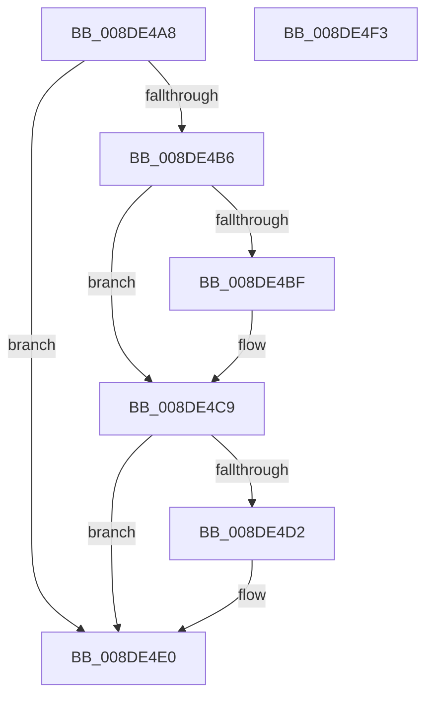

# PiDqActionDataFree

- RVA: `0x008DE4A8`–`0x008DE4F4` (길이 `76` bytes)
- VA: `0x00000001408DE4A8`
- 실행 섹션: `PAGE`
- PDB 이름 있음: `예`; PDB Function 태그: `아니요`
- unwind 정보 RVA: `0x0005CF00`
- 디코드: `23`개 명령, `76/76` bytes 표시
- 미해석 바이트: `0` (있으면 어셈블리에 `.byte`로 보존)

> 이 문서는 커널 이미지의 기계어와 PDB 기호를 분석해 생성했습니다. 4번과 5번은 함수 원형과 자료형을 바이너리 사용 방식에서 추정한 C 해석이며 원본 소스 복구 결과는 아닙니다.

## 1. Dependencies

- 직접 호출 지점: **3**; 고유 호출 대상: **2**
- 직접 호출자로 확인된 함수: **3**
- RIP 상대 이미지 참조: **0**

### Outgoing calls
- `0x008DE4C4` → [ExFreePoolWithTag](../../poolcode/B8/ExFreePoolWithTag_function_00B82870.md) (function, `0x00B82870`)
- `0x008DE4DB` → [PnpFreeDevPropertyArray](PnpFreeDevPropertyArray_function_008DE78C.md) (function, `0x008DE78C`)
- `0x008DE4E8` → [ExFreePoolWithTag](../../poolcode/B8/ExFreePoolWithTag_function_00B82870.md) (function, `0x00B82870`)

### Direct callers
- [PiDqQuerySerializeActionQueue](PiDqQuerySerializeActionQueue_function_008DD340.md) at `0x008DD4F0`
- [PiDqQuerySerializeActionQueue](PiDqQuerySerializeActionQueue_function_008DD340.md) at `0x008DD62B`
- [PiDqActionDataCreate](PiDqActionDataCreate_function_008DE1F0.md) at `0x008DE345`
- [PiDqQueryFreeActiveData](PiDqQueryFreeActiveData_function_008DE4FC.md) at `0x008DE57E`

### Static image references
- 디코드된 RIP-relative 메모리 참조가 없습니다.

## 2. Other-region calls and transfers

- 다른 실행 섹션으로 향하는 call: **2**
  - `0x008DE4C4` → [ExFreePoolWithTag](../../poolcode/B8/ExFreePoolWithTag_function_00B82870.md) (`PAGE` → `POOLCODE`)
  - `0x008DE4E8` → [ExFreePoolWithTag](../../poolcode/B8/ExFreePoolWithTag_function_00B82870.md) (`PAGE` → `POOLCODE`)
- 별도 외부 분기/꼬리 이동을 확인하지 못했습니다.

## 3. Assembly (complete function range)

```asm
008DE4A8  40 53                           push rbx
008DE4AA  48 83 EC 20                     sub rsp, 0x20
008DE4AE  83 39 00                        cmp dword ptr [rcx], 0
008DE4B1  48 8B D9                        mov rbx, rcx
008DE4B4  74 2A                           je 0x1408de4e0
008DE4B6  48 8B 49 10                     mov rcx, qword ptr [rcx + 0x10]
008DE4BA  48 85 C9                        test rcx, rcx
008DE4BD  74 0A                           je 0x1408de4c9
008DE4BF  BA 50 6E 70 58                  mov edx, 0x58706e50
008DE4C4  E8 A7 43 2A 00                  call 0x140b82870
008DE4C9  48 8B 53 20                     mov rdx, qword ptr [rbx + 0x20]
008DE4CD  48 85 D2                        test rdx, rdx
008DE4D0  74 0E                           je 0x1408de4e0
008DE4D2  8B 4B 18                        mov ecx, dword ptr [rbx + 0x18]
008DE4D5  41 B8 50 6E 70 58               mov r8d, 0x58706e50
008DE4DB  E8 AC 02 00 00                  call 0x1408de78c
008DE4E0  BA 50 6E 70 58                  mov edx, 0x58706e50
008DE4E5  48 8B CB                        mov rcx, rbx
008DE4E8  E8 83 43 2A 00                  call 0x140b82870
008DE4ED  48 83 C4 20                     add rsp, 0x20
008DE4F1  5B                              pop rbx
008DE4F2  C3                              ret
008DE4F3  CC                              int3
```

## 4. C-style interpretation (structured pseudocode)

```c
__int64 __fastcall PiDqActionDataFree(__int64 a1)
{
    __int64 result;
    __int64 v_rsp;

    v_rsp = (v_rsp) - (32);
    if ((*(unsigned int *)(a1)) == 0) goto loc_008DE4E0;
    if (*(unsigned __int64 *)(a1 + 16) != 0) {
        a2 = 0x58706E50ULL;
        result = ExFreePoolWithTag(*(unsigned __int64 *)(a1 + 16), a2, a3, a4);
    }
    if (*(unsigned __int64 *)(a1 + 32) != 0) {
        a1 = *(unsigned int *)(a1 + 24);
        a3 = 0x58706E50ULL;
        result = PnpFreeDevPropertyArray(a1, *(unsigned __int64 *)(a1 + 32), a3, a4);
    }
    result = ExFreePoolWithTag(a1, (unsigned int)(0x58706E50ULL), a3, a4);
    v_rsp = (v_rsp) + (32);
    return result;
}
```

## 5. (Beta) C Style

```c
int64_t PiDqActionDataFree(void *Arg1)
{
    uint8_t *arg1 = (uint8_t *)Arg1;

    int64_t result;
    int64_t local_rsp;

    local_rsp = (local_rsp) - (32);
    if ((*(uint32_t *)(arg1)) == 0) goto loc_008DE4E0;
    if (*(uint64_t *)(arg1 + 0x10) != 0) {
        a2 = 0x58706E50ULL;
        result = ExFreePoolWithTag(*(uint64_t *)(arg1 + 0x10), a2, a3, a4);
    }
    if (*(uint64_t *)(arg1 + 0x20) != 0) {
        Arg1 = *(uint32_t *)(arg1 + 0x18);
        a3 = 0x58706E50ULL;
        result = PnpFreeDevPropertyArray(Arg1, *(uint64_t *)(arg1 + 0x20), a3, a4);
    }
    result = ExFreePoolWithTag(Arg1, (uint32_t)(0x58706E50ULL), a3, a4);
    local_rsp = (local_rsp) + (32);
    return result;
}
```

### 관측된 메모리 오프셋

구조체 형식이 확인되지 않은 접근은 인자 기준의 오프셋으로만 기록했습니다.

| 기준 인자 | 오프셋 표현 | 폭 (bit) | 접근 |
|---|---:|---:|---|
| `Arg1` | `+ 0x0` | `32` | `R` |
| `Arg1` | `+ 0x10` | `64` | `R` |
| `Arg1` | `+ 0x18` | `32` | `R` |
| `Arg1` | `+ 0x20` | `64` | `R` |

## 6. Execution-region graph

[열기: 2D/3D 그래프와 함수 탐색 컨트롤 패널](../../../control-panel.html?section=page&rva=0x008DE4A8&view=graph)

- 2D 그래프는 위에서 아래로 흐르고, 3D 그래프는 빈 공간을 드래그해 회전합니다. Shift+드래그는 이동, 휠은 확대·축소, 함수 노드 선택은 대상 보고서 이동입니다.

### Static fallback


