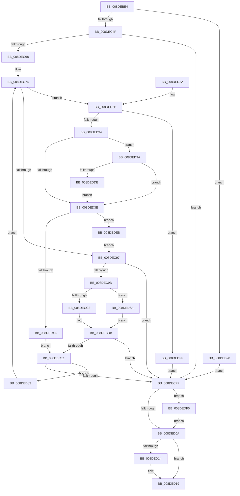

# PiDqActionDataGetRequestedProperties

- RVA: `0x008DEBE4`–`0x008DEE09` (길이 `549` bytes)
- VA: `0x00000001408DEBE4`
- 실행 섹션: `PAGE`
- PDB 이름 있음: `예`; PDB Function 태그: `아니요`
- unwind 정보 RVA: `0x00085B74`
- 디코드: `134`개 명령, `549/549` bytes 표시
- 미해석 바이트: `0` (있으면 어셈블리에 `.byte`로 보존)

> 이 문서는 커널 이미지의 기계어와 PDB 기호를 분석해 생성했습니다. 4번과 5번은 함수 원형과 자료형을 바이너리 사용 방식에서 추정한 C 해석이며 원본 소스 복구 결과는 아닙니다.

## 1. Dependencies

- 직접 호출 지점: **7**; 고유 호출 대상: **7**
- 직접 호출자로 확인된 함수: **1**
- RIP 상대 이미지 참조: **0**

### Outgoing calls
- `0x008DEC36` → [ExAllocatePool2](../../poolcode/B8/ExAllocatePool2_function_00B820F0.md) (function, `0x00B820F0`)
- `0x008DEC54` → [PiPnpRtlBeginOperation](../8E/PiPnpRtlBeginOperation_function_008E033C.md) (function, `0x008E033C`)
- `0x008DECD6` → [PiDqPnPGetObjectPropertyInBestLocale](PiDqPnPGetObjectPropertyInBestLocale_function_008DEE10.md) (function, `0x008DEE10`)
- `0x008DED14` → [PiPnpRtlEndOperation](../8E/PiPnpRtlEndOperation_function_008E0518.md) (function, `0x008E0518`)
- `0x008DED79` → [PiDqPnPGetObjectProperty](PiDqPnPGetObjectProperty_function_008DFD90.md) (function, `0x008DFD90`)
- `0x008DEDCC` → [PiDqOpenUserObjectRegKey](../99/PiDqOpenUserObjectRegKey_function_00990444.md) (function, `0x00990444`)
- `0x008DEDF5` → [ZwClose](../../text/6A/ZwClose_function_006AD2B0.md) (function, `0x006AD2B0`)

### Direct callers
- [PiDqActionDataCreate](PiDqActionDataCreate_function_008DE1F0.md) at `0x008DE2F2`

### Static image references
- 디코드된 RIP-relative 메모리 참조가 없습니다.

## 2. Other-region calls and transfers

- 다른 실행 섹션으로 향하는 call: **2**
  - `0x008DEC36` → [ExAllocatePool2](../../poolcode/B8/ExAllocatePool2_function_00B820F0.md) (`PAGE` → `POOLCODE`)
  - `0x008DEDF5` → [ZwClose](../../text/6A/ZwClose_function_006AD2B0.md) (`PAGE` → `.text`)
- 별도 외부 분기/꼬리 이동을 확인하지 못했습니다.

## 3. Assembly (complete function range)

```asm
008DEBE4  48 8B C4                        mov rax, rsp
008DEBE7  44 88 48 20                     mov byte ptr [rax + 0x20], r9b
008DEBEB  4C 89 40 18                     mov qword ptr [rax + 0x18], r8
008DEBEF  89 50 10                        mov dword ptr [rax + 0x10], edx
008DEBF2  48 89 48 08                     mov qword ptr [rax + 8], rcx
008DEBF6  53                              push rbx
008DEBF7  55                              push rbp
008DEBF8  56                              push rsi
008DEBF9  57                              push rdi
008DEBFA  41 55                           push r13
008DEBFC  41 56                           push r14
008DEBFE  41 57                           push r15
008DEC00  48 83 EC 50                     sub rsp, 0x50
008DEC04  4C 8B B4 24 D0 00 00 00         mov r14, qword ptr [rsp + 0xd0]
008DEC0C  33 DB                           xor ebx, ebx
008DEC0E  48 21 58 B8                     and qword ptr [rax - 0x48], rbx
008DEC12  44 8B FA                        mov r15d, edx
008DEC15  48 21 58 C0                     and qword ptr [rax - 0x40], rbx
008DEC19  B9 00 01 00 00                  mov ecx, 0x100
008DEC1E  8B 84 24 C0 00 00 00            mov eax, dword ptr [rsp + 0xc0]
008DEC25  41 B8 50 6E 70 58               mov r8d, 0x58706e50
008DEC2B  41 21 1E                        and dword ptr [r14], ebx
008DEC2E  48 8D 14 40                     lea rdx, [rax + rax*2]
008DEC32  48 C1 E2 04                     shl rdx, 4
008DEC36  E8 B5 34 2A 00                  call 0x140b820f0
008DEC3B  48 8B 8C 24 C8 00 00 00         mov rcx, qword ptr [rsp + 0xc8]
008DEC43  48 89 01                        mov qword ptr [rcx], rax
008DEC46  48 85 C0                        test rax, rax
008DEC49  0F 84 41 01 00 00               je 0x1408ded90
008DEC4F  48 8D 4C 24 48                  lea rcx, [rsp + 0x48]
008DEC54  E8 E3 16 00 00                  call 0x1408e033c
008DEC59  33 ED                           xor ebp, ebp
008DEC5B  39 9C 24 C0 00 00 00            cmp dword ptr [rsp + 0xc0], ebx
008DEC62  0F 86 8F 00 00 00               jbe 0x1408decf7
008DEC68  4C 8B AC 24 B8 00 00 00         mov r13, qword ptr [rsp + 0xb8]
008DEC70  49 8D 75 14                     lea rsi, [r13 + 0x14]
008DEC74  41 8B 06                        mov eax, dword ptr [r14]
008DEC77  45 33 C0                        xor r8d, r8d
008DEC7A  8B 0E                           mov ecx, dword ptr [rsi]
008DEC7C  48 8D 3C 40                     lea rdi, [rax + rax*2]
008DEC80  48 8B 84 24 C8 00 00 00         mov rax, qword ptr [rsp + 0xc8]
008DEC88  48 C1 E7 04                     shl rdi, 4
008DEC8C  48 03 38                        add rdi, qword ptr [rax]
008DEC8F  85 C9                           test ecx, ecx
008DEC91  0F 85 94 00 00 00               jne 0x1408ded2b
008DEC97  85 DB                           test ebx, ebx
008DEC99  78 5C                           js 0x1408decf7
008DEC9B  48 8B 8C 24 A0 00 00 00         mov rcx, qword ptr [rsp + 0xa0]
008DECA3  41 8B D7                        mov edx, r15d
008DECA6  44 8B CD                        mov r9d, ebp
008DECA9  49 C1 E1 05                     shl r9, 5
008DECAD  4D 03 CD                        add r9, r13
008DECB0  48 89 7C 24 30                  mov qword ptr [rsp + 0x30], rdi
008DECB5  80 BC 24 A8 00 00 00 00         cmp byte ptr [rsp + 0xa8], 0
008DECBD  0F 84 A7 00 00 00               je 0x1408ded6a
008DECC3  48 8B 84 24 B0 00 00 00         mov rax, qword ptr [rsp + 0xb0]
008DECCB  48 89 44 24 28                  mov qword ptr [rsp + 0x28], rax
008DECD0  8B 06                           mov eax, dword ptr [rsi]
008DECD2  89 44 24 20                     mov dword ptr [rsp + 0x20], eax
008DECD6  E8 35 01 00 00                  call 0x1408dee10
008DECDB  8B D8                           mov ebx, eax
008DECDD  85 C0                           test eax, eax
008DECDF  78 16                           js 0x1408decf7
008DECE1  41 FF 06                        inc dword ptr [r14]
008DECE4  FF C5                           inc ebp
008DECE6  48 83 C6 20                     add rsi, 0x20
008DECEA  3B AC 24 C0 00 00 00            cmp ebp, dword ptr [rsp + 0xc0]
008DECF1  0F 82 8C 00 00 00               jb 0x1408ded83
008DECF7  48 8B 4C 24 40                  mov rcx, qword ptr [rsp + 0x40]
008DECFC  48 8D 41 FF                     lea rax, [rcx - 1]
008DED00  48 83 F8 FD                     cmp rax, -3
008DED04  0F 86 EB 00 00 00               jbe 0x1408dedf5
008DED0A  48 8B 4C 24 48                  mov rcx, qword ptr [rsp + 0x48]
008DED0F  48 85 C9                        test rcx, rcx
008DED12  74 05                           je 0x1408ded19
008DED14  E8 FF 17 00 00                  call 0x1408e0518
008DED19  8B C3                           mov eax, ebx
008DED1B  48 83 C4 50                     add rsp, 0x50
008DED1F  41 5F                           pop r15
008DED21  41 5E                           pop r14
008DED23  41 5D                           pop r13
008DED25  5F                              pop rdi
008DED26  5E                              pop rsi
008DED27  5D                              pop rbp
008DED28  5B                              pop rbx
008DED29  C3                              ret
008DED2A  CC                              int3
008DED2B  83 F9 01                        cmp ecx, 1
008DED2E  0F 85 CB 00 00 00               jne 0x1408dedff
008DED34  45 33 FF                        xor r15d, r15d
008DED37  4C 39 44 24 40                  cmp qword ptr [rsp + 0x40], r8
008DED3C  74 5C                           je 0x1408ded9a
008DED3E  48 83 7C 24 40 FF               cmp qword ptr [rsp + 0x40], -1
008DED44  0F 85 A1 00 00 00               jne 0x1408dedeb
008DED4A  0F 10 46 EC                     movups xmm0, xmmword ptr [rsi - 0x14]
008DED4E  0F 11 07                        movups xmmword ptr [rdi], xmm0
008DED51  0F 10 4E FC                     movups xmm1, xmmword ptr [rsi - 4]
008DED55  44 21 7F 20                     and dword ptr [rdi + 0x20], r15d
008DED59  4C 21 7F 28                     and qword ptr [rdi + 0x28], r15
008DED5D  44 21 7F 24                     and dword ptr [rdi + 0x24], r15d
008DED61  0F 11 4F 10                     movups xmmword ptr [rdi + 0x10], xmm1
008DED65  E9 77 FF FF FF                  jmp 0x1408dece1
008DED6A  48 8B 46 04                     mov rax, qword ptr [rsi + 4]
008DED6E  48 89 44 24 28                  mov qword ptr [rsp + 0x28], rax
008DED73  8B 06                           mov eax, dword ptr [rsi]
008DED75  89 44 24 20                     mov dword ptr [rsp + 0x20], eax
008DED79  E8 12 10 00 00                  call 0x1408dfd90
008DED7E  E9 58 FF FF FF                  jmp 0x1408decdb
008DED83  44 8B BC 24 98 00 00 00         mov r15d, dword ptr [rsp + 0x98]
008DED8B  E9 E4 FE FF FF                  jmp 0x1408dec74
008DED90  BB 9A 00 00 C0                  mov ebx, 0xc000009a
008DED95  E9 5D FF FF FF                  jmp 0x1408decf7
008DED9A  4C 21 44 24 40                  and qword ptr [rsp + 0x40], r8
008DED9F  48 8D 44 24 40                  lea rax, [rsp + 0x40]
008DEDA4  8B 94 24 98 00 00 00            mov edx, dword ptr [rsp + 0x98]
008DEDAB  45 33 C9                        xor r9d, r9d
008DEDAE  48 8B 8C 24 A0 00 00 00         mov rcx, qword ptr [rsp + 0xa0]
008DEDB6  48 89 44 24 28                  mov qword ptr [rsp + 0x28], rax
008DEDBB  48 8B 84 24 90 00 00 00         mov rax, qword ptr [rsp + 0x90]
008DEDC3  45 8D 41 01                     lea r8d, [r9 + 1]
008DEDC7  48 89 44 24 20                  mov qword ptr [rsp + 0x20], rax
008DEDCC  E8 73 16 0B 00                  call 0x140990444
008DEDD1  8B D8                           mov ebx, eax
008DEDD3  3D 34 00 00 C0                  cmp eax, 0xc0000034
008DEDD8  0F 85 60 FF FF FF               jne 0x1408ded3e
008DEDDE  33 DB                           xor ebx, ebx
008DEDE0  48 83 4C 24 40 FF               or qword ptr [rsp + 0x40], 0xffffffffffffffff
008DEDE6  E9 53 FF FF FF                  jmp 0x1408ded3e
008DEDEB  4C 8B 44 24 40                  mov r8, qword ptr [rsp + 0x40]
008DEDF0  E9 A2 FE FF FF                  jmp 0x1408dec97
008DEDF5  E8 B6 E4 DC FF                  call 0x1406ad2b0
008DEDFA  E9 0B FF FF FF                  jmp 0x1408ded0a
008DEDFF  BB 0D 00 00 C0                  mov ebx, 0xc000000d
008DEE04  E9 EE FE FF FF                  jmp 0x1408decf7
```

## 4. C-style interpretation (structured pseudocode)

```c
__int64 __fastcall PiDqActionDataGetRequestedProperties(__int64 a1, int a2, __int64 a3, unsigned __int8 a4, __int64 a5, __int64 a6, unsigned int a7, __int64 a8, __int64 a9)
{
    __int64 result;
    __int64 v_r15;
    __int64 v_rbp;
    __int64 v_rbx;
    __int64 v_rdi;
    __int64 v_rsi;
    __int64 v_rsp;
    unsigned __int64 v_stack_m40;
    unsigned __int64 v_stack_m48;
    unsigned __int64 v_stack_m58;
    unsigned __int64 v_stack_m60;
    unsigned int v_stack_m68;
    unsigned __int64 v_stack_p18;
    unsigned __int8 v_stack_p20;
    unsigned __int64 v_stack_p28;
    unsigned __int64 v_stack_p40;
    unsigned __int64 v_stack_p90;
    unsigned int v_stack_p98;
    unsigned __int64 v_stack_pA0;

    *(unsigned __int8 *)(v_rsp + 32) = a4;
    *(unsigned __int64 *)(v_rsp + 24) = a3;
    *(unsigned int *)(v_rsp + 16) = a2;
    *(unsigned __int64 *)(v_rsp + 8) = a1;
    v_rsp = (v_rsp) - (80);
    v_rbx = 0;
    a2 = ((unsigned int)(a7) + (unsigned int)(a7) * 2) << (4);
    result = ExAllocatePool2(256, a2, (unsigned int)(0x58706E50ULL), a4);
    *(unsigned __int64 *)(a8) = result;
    if (result == 0) goto loc_008DED90;
    result = PiPnpRtlBeginOperation(v_stack_m40, a2, (unsigned int)(0x58706E50ULL), a4);
    v_rbp = 0;
    if (a7 <= 0) goto loc_008DECF7;
loc_008DEC74:
    a3 = 0;
    v_rdi = ((unsigned int)(*(unsigned int *)(a9)) + (unsigned int)(*(unsigned int *)(a9)) * 2) << (4);
    v_rdi = (v_rdi) + (*(unsigned __int64 *)(a8));
    if ((unsigned int)((unsigned int)(*(unsigned int *)(a6 + 20))) != 0) goto loc_008DED2B;
loc_008DEC97:
    if (sign_flag) goto loc_008DECF7;
    a4 = (0) << (5);
    a4 = (a4) + (a6);
    v_stack_m58 = v_rdi;
    if (v_stack_p20 == 0) goto loc_008DED6A;
    v_stack_m60 = a5;
    v_stack_m68 = (unsigned int)((unsigned int)(*(unsigned int *)(a6 + 20)));
    result = PiDqPnPGetObjectPropertyInBestLocale(v_stack_p18, (unsigned int)((unsigned int)((unsigned int)(a2))), a3, a4);
loc_008DECDB:
    if (sign_flag) goto loc_008DECF7;
loc_008DECE1:
    v_rbp = (unsigned int)((v_rbp) + 1);
    v_rsi = (a6 + 20) + (32);
    if (((unsigned int)(v_rbp)) < a7) goto loc_008DED83;
loc_008DECF7:
    if ((v_stack_m48 - 1) <= -3) goto loc_008DEDF5;
loc_008DED0A:
    result = v_stack_m48 - 1;
    if (v_stack_m40 != 0) {
        result = PiPnpRtlEndOperation(v_stack_m40, (unsigned int)((unsigned int)((unsigned int)(a2))), a3, a4);
    }
    v_rsp = (v_rsp) + (80);
    return (unsigned int)((unsigned int)((unsigned int)((unsigned int)(result))));
loc_008DED2B:
    if (((unsigned int)(v_stack_m40)) != 1) goto loc_008DEDFF;
    v_r15 = 0;
    if (v_stack_p40 == 0) goto loc_008DED9A;
loc_008DED3E:
    if (v_stack_p40 != -1) goto loc_008DEDEB;
    *(unsigned __int64 *)(v_rdi) = v_xmm0;
    *(unsigned __int64 *)(v_rdi + 16) = v_xmm1;
    goto loc_008DECE1;
loc_008DED6A:
    v_stack_p28 = *(unsigned __int64 *)(v_rsi + 4);
    v_stack_p20 = (unsigned int)((unsigned int)(*(unsigned int *)(v_rsi)));
    result = PiDqPnPGetObjectProperty(v_stack_m40, (unsigned int)((unsigned int)((unsigned int)(a2))), a3, a4);
    goto loc_008DECDB;
loc_008DED83:
    goto loc_008DEC74;
loc_008DED90:
    goto loc_008DECF7;
loc_008DED9A:
    a4 = 0;
    v_stack_p28 = v_stack_p40;
    v_stack_p20 = v_stack_p90;
    result = PiDqOpenUserObjectRegKey(v_stack_pA0, (unsigned int)(v_stack_p98), a4 + 1, a4);
    if (((unsigned int)(result)) != 0xC0000034ULL) goto loc_008DED3E;
    v_rbx = 0;
    goto loc_008DED3E;
loc_008DEDEB:
    goto loc_008DEC97;
loc_008DEDF5:
    result = ZwClose(v_stack_pA0, (unsigned int)(v_stack_p98), v_stack_p40, a4);
    goto loc_008DED0A;
loc_008DEDFF:
    goto loc_008DECF7;
}
```

## 5. (Beta) C Style

```c
int64_t PiDqActionDataGetRequestedProperties(int64_t Arg1, int32_t Arg2, int64_t Arg3, uint8_t Arg4, int64_t Arg5, void *Arg6, void *Arg7, void *Arg8, void *Arg9)
{
    uint8_t *arg6 = (uint8_t *)Arg6;
    uint8_t *arg7 = (uint8_t *)Arg7;
    uint8_t *arg8 = (uint8_t *)Arg8;
    uint8_t *arg9 = (uint8_t *)Arg9;

    int64_t result;
    int64_t local_r15;
    int64_t local_rbp;
    int64_t local_rbx;
    int64_t local_rdi;
    int64_t local_rsi;
    int64_t local_rsp;
    uint64_t v_stack_m40;
    uint64_t v_stack_m48;
    uint64_t v_stack_m58;
    uint64_t v_stack_m60;
    uint32_t v_stack_m68;
    uint64_t v_stack_p18;
    uint8_t v_stack_p20;
    uint64_t v_stack_p28;
    uint64_t v_stack_p40;
    uint64_t v_stack_p90;
    uint32_t v_stack_p98;
    uint64_t v_stack_pA0;

    *(uint8_t *)(local_rsp + 0x20) = Arg4;
    *(uint64_t *)(local_rsp + 0x18) = Arg3;
    *(uint32_t *)(local_rsp + 0x10) = Arg2;
    *(uint64_t *)(local_rsp + 0x8) = Arg1;
    local_rsp = (local_rsp) - (80);
    local_rbx = 0;
    Arg2 = ((uint32_t)(Arg7) + (uint32_t)(Arg7) * 2) << (4);
    result = ExAllocatePool2(256, Arg2, (uint32_t)(0x58706E50ULL), Arg4);
    *(uint64_t *)(arg8) = result;
    if (result == 0) goto loc_008DED90;
    result = PiPnpRtlBeginOperation(v_stack_m40, Arg2, (uint32_t)(0x58706E50ULL), Arg4);
    local_rbp = 0;
    if (Arg7 <= 0) goto loc_008DECF7;
loc_008DEC74:
    Arg3 = 0;
    local_rdi = ((uint32_t)(*(uint32_t *)(arg9)) + (uint32_t)(*(uint32_t *)(arg9)) * 2) << (4);
    local_rdi = (local_rdi) + (*(uint64_t *)(arg8));
    if ((uint32_t)((uint32_t)(*(uint32_t *)(arg6 + 0x14))) != 0) goto loc_008DED2B;
loc_008DEC97:
    if (sign_flag) goto loc_008DECF7;
    Arg4 = (0) << (5);
    Arg4 = (Arg4) + (Arg6);
    v_stack_m58 = local_rdi;
    if (v_stack_p20 == 0) goto loc_008DED6A;
    v_stack_m60 = Arg5;
    v_stack_m68 = (uint32_t)((uint32_t)(*(uint32_t *)(arg6 + 0x14)));
    result = PiDqPnPGetObjectPropertyInBestLocale(v_stack_p18, (uint32_t)((uint32_t)((uint32_t)(Arg2))), Arg3, Arg4);
loc_008DECDB:
    if (sign_flag) goto loc_008DECF7;
loc_008DECE1:
    local_rbp = (uint32_t)((local_rbp) + 1);
    local_rsi = (Arg6 + 20) + (32);
    if (((uint32_t)(local_rbp)) < Arg7) goto loc_008DED83;
loc_008DECF7:
    if ((v_stack_m48 - 1) <= -3) goto loc_008DEDF5;
loc_008DED0A:
    result = v_stack_m48 - 1;
    if (v_stack_m40 != 0) {
        result = PiPnpRtlEndOperation(v_stack_m40, (uint32_t)((uint32_t)((uint32_t)(Arg2))), Arg3, Arg4);
    }
    local_rsp = (local_rsp) + (80);
    return (uint32_t)((uint32_t)((uint32_t)((uint32_t)(result))));
loc_008DED2B:
    if (((uint32_t)(v_stack_m40)) != 1) goto loc_008DEDFF;
    local_r15 = 0;
    if (v_stack_p40 == 0) goto loc_008DED9A;
loc_008DED3E:
    if (v_stack_p40 != -1) goto loc_008DEDEB;
    *(uint64_t *)(local_rdi) = v_xmm0;
    *(uint64_t *)(local_rdi + 0x10) = v_xmm1;
    goto loc_008DECE1;
loc_008DED6A:
    v_stack_p28 = *(uint64_t *)(local_rsi + 0x4);
    v_stack_p20 = (uint32_t)((uint32_t)(*(uint32_t *)(local_rsi)));
    result = PiDqPnPGetObjectProperty(v_stack_m40, (uint32_t)((uint32_t)((uint32_t)(Arg2))), Arg3, Arg4);
    goto loc_008DECDB;
loc_008DED83:
    goto loc_008DEC74;
loc_008DED90:
    goto loc_008DECF7;
loc_008DED9A:
    Arg4 = 0;
    v_stack_p28 = v_stack_p40;
    v_stack_p20 = v_stack_p90;
    result = PiDqOpenUserObjectRegKey(v_stack_pA0, (uint32_t)(v_stack_p98), Arg4 + 1, Arg4);
    if (((uint32_t)(result)) != 0xC0000034ULL) goto loc_008DED3E;
    local_rbx = 0;
    goto loc_008DED3E;
loc_008DEDEB:
    goto loc_008DEC97;
loc_008DEDF5:
    result = ZwClose(v_stack_pA0, (uint32_t)(v_stack_p98), v_stack_p40, Arg4);
    goto loc_008DED0A;
loc_008DEDFF:
    goto loc_008DECF7;
}
```

### 관측된 메모리 오프셋

구조체 형식이 확인되지 않은 접근은 인자 기준의 오프셋으로만 기록했습니다.

| 기준 인자 | 오프셋 표현 | 폭 (bit) | 접근 |
|---|---:|---:|---|
| `Arg6` | `- 0x14` | `128` | `R` |
| `Arg6` | `- 0x4` | `128` | `R` |
| `Arg6` | `+ 0x0` | `32` | `R` |
| `Arg6` | `+ 0x4` | `64` | `R` |
| `Arg6` | `+ 0x14` | `64` | `R` |
| `Arg7` | `+ 0x0 + rax*2` | `64` | `R` |
| `Arg8` | `+ 0x0` | `64` | `R` |
| `Arg8` | `+ 0x0` | `64` | `W` |
| `Arg9` | `+ 0x0` | `32` | `R` |
| `Arg9` | `+ 0x0` | `32` | `R/W` |

## 6. Execution-region graph

[열기: 2D/3D 그래프와 함수 탐색 컨트롤 패널](../../../control-panel.html?section=page&rva=0x008DEBE4&view=graph)

- 2D 그래프는 위에서 아래로 흐르고, 3D 그래프는 빈 공간을 드래그해 회전합니다. Shift+드래그는 이동, 휠은 확대·축소, 함수 노드 선택은 대상 보고서 이동입니다.

### Static fallback


