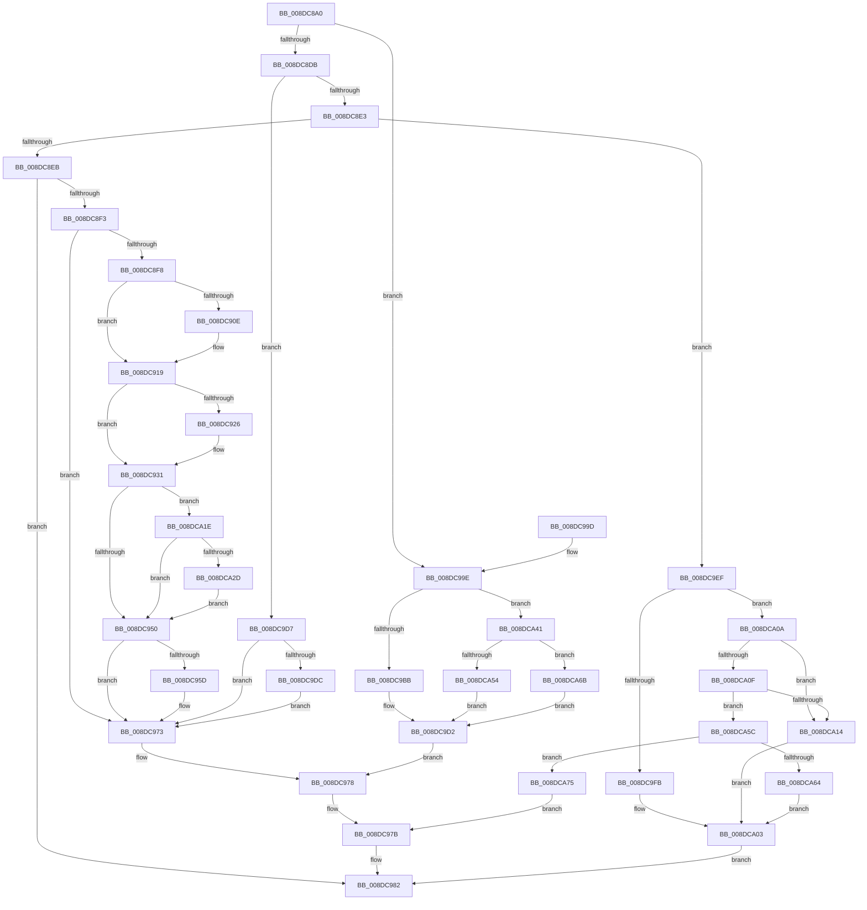

# PiDqDispatch

- RVA: `0x008DC8A0`–`0x008DCA82` (길이 `482` bytes)
- VA: `0x00000001408DC8A0`
- 실행 섹션: `PAGE`
- PDB 이름 있음: `예`; PDB Function 태그: `아니요`
- unwind 정보 RVA: `0x00085964`
- 디코드: `132`개 명령, `482/482` bytes 표시
- 미해석 바이트: `0` (있으면 어셈블리에 `.byte`로 보존)

> 이 문서는 커널 이미지의 기계어와 PDB 기호를 분석해 생성했습니다. 4번과 5번은 함수 원형과 자료형을 바이너리 사용 방식에서 추정한 C 해석이며 원본 소스 복구 결과는 아닙니다.

## 1. Dependencies

- 직접 호출 지점: **16**; 고유 호출 대상: **12**
- 직접 호출자로 확인된 함수: **0**
- RIP 상대 이미지 참조: **2**

### Outgoing calls
- `0x008DC8FF` → [PiDqQueryLock](PiDqQueryLock_function_008DDA0C.md) (function, `0x008DDA0C`)
- `0x008DC911` → [PiDqQueryGetObjectManager](PiDqQueryGetObjectManager_function_008DD2D8.md) (function, `0x008DD2D8`)
- `0x008DC91C` → [PiDqQueryUnlock](PiDqQueryUnlock_function_008DDA6C.md) (function, `0x008DDA6C`)
- `0x008DC92C` → [PiDqObjectManagerUnregisterQuery](PiDqObjectManagerUnregisterQuery_function_008DC820.md) (function, `0x008DC820`)
- `0x008DC934` → [PiDqQueryLock](PiDqQueryLock_function_008DDA0C.md) (function, `0x008DDA0C`)
- `0x008DC953` → [PiDqQueryUnlock](PiDqQueryUnlock_function_008DDA6C.md) (function, `0x008DDA6C`)
- `0x008DC96E` → [IofCompleteRequest](../../text/29/IofCompleteRequest_function_0029B5C0.md) (function, `0x0029B5C0`)
- `0x008DC97D` → [IofCompleteRequest](../../text/29/IofCompleteRequest_function_0029B5C0.md) (function, `0x0029B5C0`)
- `0x008DC9AE` → [wcscmp](../../text/50/wcscmp_function_00501AF0.md) (function, `0x00501AF0`)
- `0x008DC9BE` → [IoIs32bitProcess](../../text/40/IoIs32bitProcess_function_0040DFE0.md) (function, `0x0040DFE0`)
- `0x008DC9CB` → [PiDqQueryCreate](PiDqQueryCreate_function_008DCA88.md) (function, `0x008DCA88`)
- `0x008DC9DF` → [PiDqQueryRelease](PiDqQueryRelease_function_008DE800.md) (function, `0x008DE800`)
- `0x008DC9FE` → [PiDqIrpQueryCreate](PiDqIrpQueryCreate_function_008DCC04.md) (function, `0x008DCC04`)
- `0x008DCA17` → [PiDqIrpQueryGetResult](PiDqIrpQueryGetResult_function_008DBF28.md) (function, `0x008DBF28`)
- `0x008DCA4B` → [wcscmp](../../text/50/wcscmp_function_00501AF0.md) (function, `0x00501AF0`)
- `0x008DCA64` → [PiDqIrpPropertySet](../96/PiDqIrpPropertySet_function_00963770.md) (function, `0x00963770`)

### Direct callers
- 이 함수 시작 RVA로 연결되는 직접 call은 확인되지 않았습니다. 간접 호출은 완전히 역산할 수 없습니다.

### Static image references
- `0x008DC9A7` → RVA `0x00AFE4E0` (` ?? ::NNGAKEGL::`string'`; read)
- `0x008DCA44` → RVA `0x00AFE580` (` ?? ::NNGAKEGL::`string'`; read)

## 2. Other-region calls and transfers

- 다른 실행 섹션으로 향하는 call: **5**
  - `0x008DC96E` → [IofCompleteRequest](../../text/29/IofCompleteRequest_function_0029B5C0.md) (`PAGE` → `.text`)
  - `0x008DC97D` → [IofCompleteRequest](../../text/29/IofCompleteRequest_function_0029B5C0.md) (`PAGE` → `.text`)
  - `0x008DC9AE` → [wcscmp](../../text/50/wcscmp_function_00501AF0.md) (`PAGE` → `.text`)
  - `0x008DC9BE` → [IoIs32bitProcess](../../text/40/IoIs32bitProcess_function_0040DFE0.md) (`PAGE` → `.text`)
  - `0x008DCA4B` → [wcscmp](../../text/50/wcscmp_function_00501AF0.md) (`PAGE` → `.text`)
- 별도 외부 분기/꼬리 이동을 확인하지 못했습니다.

## 3. Assembly (complete function range)

```asm
008DC8A0  48 89 5C 24 08                  mov qword ptr [rsp + 8], rbx
008DC8A5  48 89 6C 24 10                  mov qword ptr [rsp + 0x10], rbp
008DC8AA  48 89 74 24 18                  mov qword ptr [rsp + 0x18], rsi
008DC8AF  57                              push rdi
008DC8B0  41 56                           push r14
008DC8B2  41 57                           push r15
008DC8B4  48 83 EC 20                     sub rsp, 0x20
008DC8B8  4C 8B B2 B8 00 00 00            mov r14, qword ptr [rdx + 0xb8]
008DC8BF  48 8B F2                        mov rsi, rdx
008DC8C2  8B 7A 30                        mov edi, dword ptr [rdx + 0x30]
008DC8C5  49 8B 4E 30                     mov rcx, qword ptr [r14 + 0x30]
008DC8C9  41 8A 06                        mov al, byte ptr [r14]
008DC8CC  4C 8D 79 20                     lea r15, [rcx + 0x20]
008DC8D0  49 8B 1F                        mov rbx, qword ptr [r15]
008DC8D3  84 C0                           test al, al
008DC8D5  0F 84 C3 00 00 00               je 0x1408dc99e
008DC8DB  3C 02                           cmp al, 2
008DC8DD  0F 84 F4 00 00 00               je 0x1408dc9d7
008DC8E3  3C 0E                           cmp al, 0xe
008DC8E5  0F 84 04 01 00 00               je 0x1408dc9ef
008DC8EB  3C 12                           cmp al, 0x12
008DC8ED  0F 85 8F 00 00 00               jne 0x1408dc982
008DC8F3  48 85 DB                        test rbx, rbx
008DC8F6  74 7B                           je 0x1408dc973
008DC8F8  48 8B CB                        mov rcx, rbx
008DC8FB  33 FF                           xor edi, edi
008DC8FD  33 ED                           xor ebp, ebp
008DC8FF  E8 08 11 00 00                  call 0x1408dda0c
008DC904  8B 83 D8 00 00 00               mov eax, dword ptr [rbx + 0xd8]
008DC90A  A8 04                           test al, 4
008DC90C  74 0B                           je 0x1408dc919
008DC90E  48 8B CB                        mov rcx, rbx
008DC911  E8 C2 09 00 00                  call 0x1408dd2d8
008DC916  48 8B E8                        mov rbp, rax
008DC919  48 8B CB                        mov rcx, rbx
008DC91C  E8 4B 11 00 00                  call 0x1408dda6c
008DC921  48 85 ED                        test rbp, rbp
008DC924  74 0B                           je 0x1408dc931
008DC926  48 8B D3                        mov rdx, rbx
008DC929  48 8B CD                        mov rcx, rbp
008DC92C  E8 EF FE FF FF                  call 0x1408dc820
008DC931  48 8B CB                        mov rcx, rbx
008DC934  E8 D3 10 00 00                  call 0x1408dda0c
008DC939  48 8B 8B B0 00 00 00            mov rcx, qword ptr [rbx + 0xb0]
008DC940  83 8B D8 00 00 00 08            or dword ptr [rbx + 0xd8], 8
008DC947  48 85 C9                        test rcx, rcx
008DC94A  0F 85 CE 00 00 00               jne 0x1408dca1e
008DC950  48 8B CB                        mov rcx, rbx
008DC953  E8 14 11 00 00                  call 0x1408dda6c
008DC958  48 85 FF                        test rdi, rdi
008DC95B  74 16                           je 0x1408dc973
008DC95D  48 83 67 38 00                  and qword ptr [rdi + 0x38], 0
008DC962  33 D2                           xor edx, edx
008DC964  48 8B CF                        mov rcx, rdi
008DC967  C7 47 30 20 01 00 C0            mov dword ptr [rdi + 0x30], 0xc0000120
008DC96E  E8 4D EC 9B FF                  call 0x14029b5c0
008DC973  33 FF                           xor edi, edi
008DC975  21 7E 30                        and dword ptr [rsi + 0x30], edi
008DC978  48 8B CE                        mov rcx, rsi
008DC97B  33 D2                           xor edx, edx
008DC97D  E8 3E EC 9B FF                  call 0x14029b5c0
008DC982  48 8B 5C 24 40                  mov rbx, qword ptr [rsp + 0x40]
008DC987  8B C7                           mov eax, edi
008DC989  48 8B 6C 24 48                  mov rbp, qword ptr [rsp + 0x48]
008DC98E  48 8B 74 24 50                  mov rsi, qword ptr [rsp + 0x50]
008DC993  48 83 C4 20                     add rsp, 0x20
008DC997  41 5F                           pop r15
008DC999  41 5E                           pop r14
008DC99B  5F                              pop rdi
008DC99C  C3                              ret
008DC99D  CC                              int3
008DC99E  48 8B 59 60                     mov rbx, qword ptr [rcx + 0x60]
008DC9A2  33 FF                           xor edi, edi
008DC9A4  48 8B D3                        mov rdx, rbx
008DC9A7  48 8D 0D 32 1B 22 00            lea rcx, [rip + 0x221b32]
008DC9AE  E8 3D 51 C2 FF                  call 0x140501af0
008DC9B3  85 C0                           test eax, eax
008DC9B5  0F 85 86 00 00 00               jne 0x1408dca41
008DC9BB  48 8B CE                        mov rcx, rsi
008DC9BE  E8 1D 16 B3 FF                  call 0x14040dfe0
008DC9C3  84 C0                           test al, al
008DC9C5  49 8B D7                        mov rdx, r15
008DC9C8  0F 94 C1                        sete cl
008DC9CB  E8 B8 00 00 00                  call 0x1408dca88
008DC9D0  8B F8                           mov edi, eax
008DC9D2  89 7E 30                        mov dword ptr [rsi + 0x30], edi
008DC9D5  EB A1                           jmp 0x1408dc978
008DC9D7  48 85 DB                        test rbx, rbx
008DC9DA  74 97                           je 0x1408dc973
008DC9DC  48 8B CB                        mov rcx, rbx
008DC9DF  E8 1C 1E 00 00                  call 0x1408de800
008DC9E4  49 8B 46 30                     mov rax, qword ptr [r14 + 0x30]
008DC9E8  48 83 60 20 00                  and qword ptr [rax + 0x20], 0
008DC9ED  EB 84                           jmp 0x1408dc973
008DC9EF  41 8B 4E 18                     mov ecx, dword ptr [r14 + 0x18]
008DC9F3  81 E9 00 00 47 00               sub ecx, 0x470000
008DC9F9  75 0F                           jne 0x1408dca0a
008DC9FB  48 8B CE                        mov rcx, rsi
008DC9FE  E8 01 02 00 00                  call 0x1408dcc04
008DCA03  8B F8                           mov edi, eax
008DCA05  E9 78 FF FF FF                  jmp 0x1408dc982
008DCA0A  83 E9 07                        sub ecx, 7
008DCA0D  74 05                           je 0x1408dca14
008DCA0F  83 E9 01                        sub ecx, 1
008DCA12  75 48                           jne 0x1408dca5c
008DCA14  48 8B CE                        mov rcx, rsi
008DCA17  E8 0C F5 FF FF                  call 0x1408dbf28
008DCA1C  EB E5                           jmp 0x1408dca03
008DCA1E  33 C0                           xor eax, eax
008DCA20  48 87 41 68                     xchg qword ptr [rcx + 0x68], rax
008DCA24  48 85 C0                        test rax, rax
008DCA27  0F 84 23 FF FF FF               je 0x1408dc950
008DCA2D  48 8B BB B0 00 00 00            mov rdi, qword ptr [rbx + 0xb0]
008DCA34  48 83 A3 B0 00 00 00 00         and qword ptr [rbx + 0xb0], 0
008DCA3C  E9 0F FF FF FF                  jmp 0x1408dc950
008DCA41  48 8B D3                        mov rdx, rbx
008DCA44  48 8D 0D 35 1B 22 00            lea rcx, [rip + 0x221b35]
008DCA4B  E8 A0 50 C2 FF                  call 0x140501af0
008DCA50  85 C0                           test eax, eax
008DCA52  75 17                           jne 0x1408dca6b
008DCA54  49 21 3F                        and qword ptr [r15], rdi
008DCA57  E9 76 FF FF FF                  jmp 0x1408dc9d2
008DCA5C  83 F9 04                        cmp ecx, 4
008DCA5F  48 8B CE                        mov rcx, rsi
008DCA62  75 11                           jne 0x1408dca75
008DCA64  E8 07 6D 08 00                  call 0x140963770
008DCA69  EB 98                           jmp 0x1408dca03
008DCA6B  BF 0D 00 00 C0                  mov edi, 0xc000000d
008DCA70  E9 5D FF FF FF                  jmp 0x1408dc9d2
008DCA75  BF BB 00 00 C0                  mov edi, 0xc00000bb
008DCA7A  89 7A 30                        mov dword ptr [rdx + 0x30], edi
008DCA7D  E9 F9 FE FF FF                  jmp 0x1408dc97b
```

## 4. C-style interpretation (structured pseudocode)

```c
__int64 __fastcall PiDqDispatch(__int64 a1, __int64 a2)
{
    __int64 result;
    __int64 v_rbp;
    __int64 v_rdi;
    __int64 v_rsp;
    unsigned __int64 v_stack_p10;
    unsigned __int64 v_stack_p18;
    unsigned __int64 v_stack_p8;

    v_stack_p8 = v_rbx;
    v_stack_p10 = v_rbp;
    v_stack_p18 = v_rsi;
    v_rsp = (v_rsp) - (32);
    if ((unsigned __int8)(*(unsigned __int8 *)(*(unsigned __int64 *)(a2 + 184))) == 0) goto loc_008DC99E;
    if (((unsigned __int8)(*(unsigned __int8 *)(*(unsigned __int64 *)(a2 + 184)))) == 2) goto loc_008DC9D7;
    if (((unsigned __int8)(*(unsigned __int8 *)(*(unsigned __int64 *)(a2 + 184)))) == 14) goto loc_008DC9EF;
    if (((unsigned __int8)(*(unsigned __int8 *)(*(unsigned __int64 *)(a2 + 184)))) != 18) goto loc_008DC982;
    if (*(unsigned __int64 *)(*(unsigned __int64 *)(*(unsigned __int64 *)(a2 + 184) + 48) + 32) == 0) goto loc_008DC973;
    v_rdi = 0;
    v_rbp = 0;
    result = PiDqQueryLock(*(unsigned __int64 *)(*(unsigned __int64 *)(*(unsigned __int64 *)(a2 + 184) + 48) + 32), a2, a3, a4);
    result = (unsigned int)(*(unsigned int *)(*(unsigned __int64 *)(*(unsigned __int64 *)(*(unsigned __int64 *)(a2 + 184) + 48) + 32) + 216));
    if ((((unsigned __int8)((unsigned int)(*(unsigned int *)(*(unsigned __int64 *)(*(unsigned __int64 *)(*(unsigned __int64 *)(a2 + 184) + 48) + 32) + 216)))) & (4)) != 0) {
        a1 = *(unsigned __int64 *)(*(unsigned __int64 *)(*(unsigned __int64 *)(a2 + 184) + 48) + 32);
        result = PiDqQueryGetObjectManager(a1, a2, a3, a4);
        v_rbp = result;
    }
    result = PiDqQueryUnlock(*(unsigned __int64 *)(*(unsigned __int64 *)(*(unsigned __int64 *)(a2 + 184) + 48) + 32), a2, a3, a4);
    if (v_rbp != 0) {
        a2 = *(unsigned __int64 *)(*(unsigned __int64 *)(*(unsigned __int64 *)(a2 + 184) + 48) + 32);
        a1 = v_rbp;
        result = PiDqObjectManagerUnregisterQuery(a1, a2, a3, a4);
    }
    result = PiDqQueryLock(*(unsigned __int64 *)(*(unsigned __int64 *)(*(unsigned __int64 *)(a2 + 184) + 48) + 32), a2, a3, a4);
    if (*(unsigned __int64 *)(*(unsigned __int64 *)(*(unsigned __int64 *)(*(unsigned __int64 *)(a2 + 184) + 48) + 32) + 176) != 0) goto loc_008DCA1E;
loc_008DC950:
    result = PiDqQueryUnlock(*(unsigned __int64 *)(*(unsigned __int64 *)(*(unsigned __int64 *)(a2 + 184) + 48) + 32), a2, a3, a4);
    if (0 != 0) {
        a2 = 0;
        a1 = 0;
        *(unsigned int *)(v_rdi + 48) = 0xC0000120ULL;
        result = IofCompleteRequest(a1, a2, a3, a4);
    }
    v_rdi = 0;
loc_008DC978:
loc_008DC97B:
    a2 = 0;
    result = IofCompleteRequest(0, a2, a3, a4);
loc_008DC982:
    v_rsp = (v_rsp) + (32);
    return 0;
loc_008DC99E:
    v_rdi = 0;
    result = wcscmp(v_rip + 2235186, *(unsigned __int64 *)(0 + 96), a3, a4);
    if ((unsigned int)(result) != 0) goto loc_008DCA41;
    result = IoIs32bitProcess(v_stack_p18, *(unsigned __int64 *)(0 + 96), a3, a4);
    a1 = ((unsigned __int8)(result) == 0) ? 1 : 0;
    result = PiDqQueryCreate(a1, *(unsigned __int64 *)(*(unsigned __int64 *)(a2 + 184) + 48) + 32, a3, a4);
loc_008DC9D2:
    *(unsigned int *)(v_stack_p18 + 48) = (unsigned int)((unsigned int)((unsigned int)(result)));
    goto loc_008DC978;
loc_008DC9D7:
    if (*(unsigned __int64 *)(0 + 96) == 0) goto loc_008DC973;
    result = PiDqQueryRelease(*(unsigned __int64 *)(0 + 96), *(unsigned __int64 *)(*(unsigned __int64 *)(a2 + 184) + 48) + 32, a3, a4);
    goto loc_008DC973;
loc_008DC9EF:
    a1 = (unsigned int)(((unsigned int)(*(unsigned int *)(*(unsigned __int64 *)(a2 + 184) + 24))) - (0x470000ULL));
    if (condition_is_not_equal) goto loc_008DCA0A;
    result = PiDqIrpQueryCreate(v_stack_p18, *(unsigned __int64 *)(*(unsigned __int64 *)(a2 + 184) + 48) + 32, a3, a4);
loc_008DCA03:
    goto loc_008DC982;
loc_008DCA0A:
    a1 = (unsigned int)((v_stack_p18) - (7));
    if (condition_is_equal) goto loc_008DCA14;
    a1 = (unsigned int)((a1) - (1));
    if (condition_is_not_equal) goto loc_008DCA5C;
loc_008DCA14:
    result = PiDqIrpQueryGetResult(v_stack_p18, *(unsigned __int64 *)(*(unsigned __int64 *)(a2 + 184) + 48) + 32, a3, a4);
    goto loc_008DCA03;
loc_008DCA1E:
    result = 0;
    if (0 == 0) goto loc_008DC950;
    goto loc_008DC950;
loc_008DCA41:
    result = wcscmp(v_rip + 2235189, *(unsigned __int64 *)(0 + 96), a3, a4);
    if ((unsigned int)(result) != 0) goto loc_008DCA6B;
    goto loc_008DC9D2;
loc_008DCA5C:
    if (((unsigned int)(v_rip + 2235189)) != 4) goto loc_008DCA75;
    result = PiDqIrpPropertySet(v_stack_p18, *(unsigned __int64 *)(0 + 96), a3, a4);
    goto loc_008DCA03;
loc_008DCA6B:
    goto loc_008DC9D2;
loc_008DCA75:
    *(unsigned int *)(*(unsigned __int64 *)(0 + 96) + 48) = (unsigned int)((unsigned int)(0xC00000BBULL));
    goto loc_008DC97B;
}
```

## 5. (Beta) C Style

```c
int64_t PiDqDispatch(int64_t Arg1, void *Arg2)
{
    uint8_t *arg2 = (uint8_t *)Arg2;

    int64_t result;
    int64_t local_rbp;
    int64_t local_rdi;
    int64_t local_rsp;
    uint64_t v_stack_p10;
    uint64_t v_stack_p18;
    uint64_t v_stack_p8;

    v_stack_p8 = local_rbx;
    v_stack_p10 = local_rbp;
    v_stack_p18 = local_rsi;
    local_rsp = (local_rsp) - (32);
    if ((uint8_t)(*(uint8_t *)(*(uint64_t *)(arg2 + 0xB8))) == 0) goto loc_008DC99E;
    if (((uint8_t)(*(uint8_t *)(*(uint64_t *)(arg2 + 0xB8)))) == 2) goto loc_008DC9D7;
    if (((uint8_t)(*(uint8_t *)(*(uint64_t *)(arg2 + 0xB8)))) == 14) goto loc_008DC9EF;
    if (((uint8_t)(*(uint8_t *)(*(uint64_t *)(arg2 + 0xB8)))) != 18) goto loc_008DC982;
    if (*(uint64_t *)(*(uint64_t *)(*(uint64_t *)(arg2 + 0xB8) + 0x30) + 0x20) == 0) goto loc_008DC973;
    local_rdi = 0;
    local_rbp = 0;
    result = PiDqQueryLock(*(uint64_t *)(*(uint64_t *)(*(uint64_t *)(arg2 + 0xB8) + 0x30) + 0x20), Arg2, a3, a4);
    result = (uint32_t)(*(uint32_t *)(*(uint64_t *)(*(uint64_t *)(*(uint64_t *)(arg2 + 0xB8) + 0x30) + 0x20) + 0xD8));
    if ((((uint8_t)((uint32_t)(*(uint32_t *)(*(uint64_t *)(*(uint64_t *)(*(uint64_t *)(arg2 + 0xB8) + 0x30) + 0x20) + 0xD8)))) & (4)) != 0) {
        Arg1 = *(uint64_t *)(*(uint64_t *)(*(uint64_t *)(arg2 + 0xB8) + 0x30) + 0x20);
        result = PiDqQueryGetObjectManager(Arg1, Arg2, a3, a4);
        local_rbp = result;
    }
    result = PiDqQueryUnlock(*(uint64_t *)(*(uint64_t *)(*(uint64_t *)(arg2 + 0xB8) + 0x30) + 0x20), Arg2, a3, a4);
    if (local_rbp != 0) {
        Arg2 = *(uint64_t *)(*(uint64_t *)(*(uint64_t *)(arg2 + 0xB8) + 0x30) + 0x20);
        Arg1 = local_rbp;
        result = PiDqObjectManagerUnregisterQuery(Arg1, Arg2, a3, a4);
    }
    result = PiDqQueryLock(*(uint64_t *)(*(uint64_t *)(*(uint64_t *)(arg2 + 0xB8) + 0x30) + 0x20), Arg2, a3, a4);
    if (*(uint64_t *)(*(uint64_t *)(*(uint64_t *)(*(uint64_t *)(arg2 + 0xB8) + 0x30) + 0x20) + 0xB0) != 0) goto loc_008DCA1E;
loc_008DC950:
    result = PiDqQueryUnlock(*(uint64_t *)(*(uint64_t *)(*(uint64_t *)(arg2 + 0xB8) + 0x30) + 0x20), Arg2, a3, a4);
    if (0 != 0) {
        Arg2 = 0;
        Arg1 = 0;
        *(uint32_t *)(local_rdi + 0x30) = 0xC0000120ULL;
        result = IofCompleteRequest(Arg1, Arg2, a3, a4);
    }
    local_rdi = 0;
loc_008DC978:
loc_008DC97B:
    Arg2 = 0;
    result = IofCompleteRequest(0, Arg2, a3, a4);
loc_008DC982:
    local_rsp = (local_rsp) + (32);
    return 0;
loc_008DC99E:
    local_rdi = 0;
    result = wcscmp(v_rip + 2235186, *(uint64_t *)(0 + 0x60), a3, a4);
    if ((uint32_t)(result) != 0) goto loc_008DCA41;
    result = IoIs32bitProcess(v_stack_p18, *(uint64_t *)(0 + 0x60), a3, a4);
    Arg1 = ((uint8_t)(result) == 0) ? 1 : 0;
    result = PiDqQueryCreate(Arg1, *(uint64_t *)(*(uint64_t *)(arg2 + 0xB8) + 0x30) + 32, a3, a4);
loc_008DC9D2:
    *(uint32_t *)(v_stack_p18 + 0x30) = (uint32_t)((uint32_t)((uint32_t)(result)));
    goto loc_008DC978;
loc_008DC9D7:
    if (*(uint64_t *)(0 + 0x60) == 0) goto loc_008DC973;
    result = PiDqQueryRelease(*(uint64_t *)(0 + 0x60), *(uint64_t *)(*(uint64_t *)(arg2 + 0xB8) + 0x30) + 32, a3, a4);
    goto loc_008DC973;
loc_008DC9EF:
    Arg1 = (uint32_t)(((uint32_t)(*(uint32_t *)(*(uint64_t *)(arg2 + 0xB8) + 0x18))) - (0x470000ULL));
    if (condition_is_not_equal) goto loc_008DCA0A;
    result = PiDqIrpQueryCreate(v_stack_p18, *(uint64_t *)(*(uint64_t *)(arg2 + 0xB8) + 0x30) + 32, a3, a4);
loc_008DCA03:
    goto loc_008DC982;
loc_008DCA0A:
    Arg1 = (uint32_t)((v_stack_p18) - (7));
    if (condition_is_equal) goto loc_008DCA14;
    Arg1 = (uint32_t)((Arg1) - (1));
    if (condition_is_not_equal) goto loc_008DCA5C;
loc_008DCA14:
    result = PiDqIrpQueryGetResult(v_stack_p18, *(uint64_t *)(*(uint64_t *)(arg2 + 0xB8) + 0x30) + 32, a3, a4);
    goto loc_008DCA03;
loc_008DCA1E:
    result = 0;
    if (0 == 0) goto loc_008DC950;
    goto loc_008DC950;
loc_008DCA41:
    result = wcscmp(v_rip + 2235189, *(uint64_t *)(0 + 0x60), a3, a4);
    if ((uint32_t)(result) != 0) goto loc_008DCA6B;
    goto loc_008DC9D2;
loc_008DCA5C:
    if (((uint32_t)(v_rip + 2235189)) != 4) goto loc_008DCA75;
    result = PiDqIrpPropertySet(v_stack_p18, *(uint64_t *)(0 + 0x60), a3, a4);
    goto loc_008DCA03;
loc_008DCA6B:
    goto loc_008DC9D2;
loc_008DCA75:
    *(uint32_t *)(*(uint64_t *)(0 + 0x60) + 0x30) = (uint32_t)((uint32_t)(0xC00000BBULL));
    goto loc_008DC97B;
}
```

### 관측된 메모리 오프셋

구조체 형식이 확인되지 않은 접근은 인자 기준의 오프셋으로만 기록했습니다.

| 기준 인자 | 오프셋 표현 | 폭 (bit) | 접근 |
|---|---:|---:|---|
| `Arg2` | `+ 0x30` | `32` | `R` |
| `Arg2` | `+ 0x30` | `32` | `R/W` |
| `Arg2` | `+ 0x30` | `32` | `W` |
| `Arg2` | `+ 0xB8` | `64` | `R` |

## 6. Execution-region graph

[열기: 2D/3D 그래프와 함수 탐색 컨트롤 패널](../../../control-panel.html?section=page&rva=0x008DC8A0&view=graph)

- 2D 그래프는 위에서 아래로 흐르고, 3D 그래프는 빈 공간을 드래그해 회전합니다. Shift+드래그는 이동, 휠은 확대·축소, 함수 노드 선택은 대상 보고서 이동입니다.

### Static fallback


