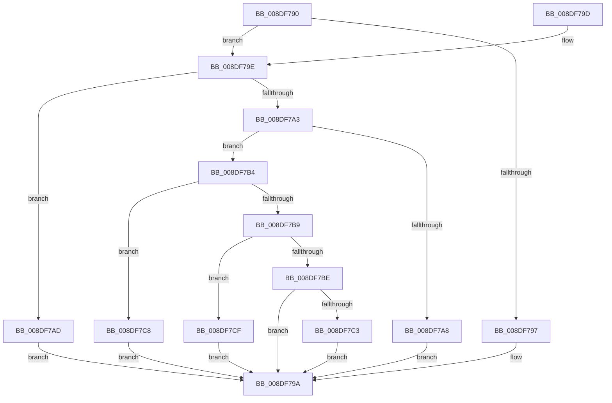

# PiDqGetPnpObjectType

- RVA: `0x008DF790`–`0x008DF7D6` (길이 `70` bytes)
- VA: `0x00000001408DF790`
- 실행 섹션: `PAGE`
- PDB 이름 있음: `예`; PDB Function 태그: `아니요`
- unwind 정보 RVA: `0x000DB714`
- 디코드: `27`개 명령, `70/70` bytes 표시
- 미해석 바이트: `0` (있으면 어셈블리에 `.byte`로 보존)

> 이 문서는 커널 이미지의 기계어와 PDB 기호를 분석해 생성했습니다. 4번과 5번은 함수 원형과 자료형을 바이너리 사용 방식에서 추정한 C 해석이며 원본 소스 복구 결과는 아닙니다.

## 1. Dependencies

- 직접 호출 지점: **0**; 고유 호출 대상: **0**
- 직접 호출자로 확인된 함수: **6**
- RIP 상대 이미지 참조: **0**

### Outgoing calls
- 직접 디코드된 call 명령이 없습니다.

### Direct callers
- [PiDqQueryValidateQueryData](PiDqQueryValidateQueryData_function_008DC67C.md) at `0x008DC6A4`
- [PiDqActionDataCreate](PiDqActionDataCreate_function_008DE1F0.md) at `0x008DE29C`
- [PiDqQueryAppendActionEntry](PiDqQueryAppendActionEntry_function_008DEB34.md) at `0x008DEB98`
- [PiDqPropertyCallback](PiDqPropertyCallback_function_008DF580.md) at `0x008DF68B`
- [PiDqIrpPropertySet](../96/PiDqIrpPropertySet_function_00963770.md) at `0x0096387B`
- [sub_00B1CF0E](../B1/Unknown_function_00B1CF0E.md) at `0x00B1CF22`

### Static image references
- 디코드된 RIP-relative 메모리 참조가 없습니다.

## 2. Other-region calls and transfers

- 다른 실행 섹션으로 향하는 call: **0**
- 별도 외부 분기/꼬리 이동을 확인하지 못했습니다.

## 3. Assembly (complete function range)

```asm
008DF790  33 D2                           xor edx, edx
008DF792  83 E9 01                        sub ecx, 1
008DF795  75 07                           jne 0x1408df79e
008DF797  8D 51 03                        lea edx, [rcx + 3]
008DF79A  8B C2                           mov eax, edx
008DF79C  C3                              ret
008DF79D  CC                              int3
008DF79E  83 E9 01                        sub ecx, 1
008DF7A1  74 0A                           je 0x1408df7ad
008DF7A3  83 E9 01                        sub ecx, 1
008DF7A6  75 0C                           jne 0x1408df7b4
008DF7A8  8D 51 01                        lea edx, [rcx + 1]
008DF7AB  EB ED                           jmp 0x1408df79a
008DF7AD  BA 05 00 00 00                  mov edx, 5
008DF7B2  EB E6                           jmp 0x1408df79a
008DF7B4  83 E9 01                        sub ecx, 1
008DF7B7  74 0F                           je 0x1408df7c8
008DF7B9  83 E9 03                        sub ecx, 3
008DF7BC  74 11                           je 0x1408df7cf
008DF7BE  83 F9 04                        cmp ecx, 4
008DF7C1  75 D7                           jne 0x1408df79a
008DF7C3  8D 51 02                        lea edx, [rcx + 2]
008DF7C6  EB D2                           jmp 0x1408df79a
008DF7C8  BA 04 00 00 00                  mov edx, 4
008DF7CD  EB CB                           jmp 0x1408df79a
008DF7CF  BA 02 00 00 00                  mov edx, 2
008DF7D4  EB C4                           jmp 0x1408df79a
```

## 4. C-style interpretation (structured pseudocode)

```c
__int64 __fastcall PiDqGetPnpObjectType(int a1, int a2)
{
    a2 = 0;
    a1 = (unsigned int)((a1) - (1));
    if (condition_is_not_equal) goto loc_008DF79E;
loc_008DF79A:
    return (unsigned int)((unsigned int)(a1 + 3));
loc_008DF79E:
    a1 = (unsigned int)((a1) - (1));
    if (condition_is_equal) goto loc_008DF7AD;
    a1 = (unsigned int)((a1) - (1));
    if (condition_is_not_equal) goto loc_008DF7B4;
    goto loc_008DF79A;
loc_008DF7AD:
    goto loc_008DF79A;
loc_008DF7B4:
    a1 = (unsigned int)((a1) - (1));
    if (condition_is_equal) goto loc_008DF7C8;
    a1 = (unsigned int)((a1) - (3));
    if (condition_is_equal) goto loc_008DF7CF;
    if (a1 != 4) goto loc_008DF79A;
    goto loc_008DF79A;
loc_008DF7C8:
    goto loc_008DF79A;
loc_008DF7CF:
    goto loc_008DF79A;
}
```

## 5. (Beta) C Style

```c
int64_t PiDqGetPnpObjectType(void *Arg1, int32_t Arg2)
{
    uint8_t *arg1 = (uint8_t *)Arg1;

    Arg2 = 0;
    Arg1 = (uint32_t)((Arg1) - (1));
    if (condition_is_not_equal) goto loc_008DF79E;
loc_008DF79A:
    return (uint32_t)((uint32_t)(Arg1 + 3));
loc_008DF79E:
    Arg1 = (uint32_t)((Arg1) - (1));
    if (condition_is_equal) goto loc_008DF7AD;
    Arg1 = (uint32_t)((Arg1) - (1));
    if (condition_is_not_equal) goto loc_008DF7B4;
    goto loc_008DF79A;
loc_008DF7AD:
    goto loc_008DF79A;
loc_008DF7B4:
    Arg1 = (uint32_t)((Arg1) - (1));
    if (condition_is_equal) goto loc_008DF7C8;
    Arg1 = (uint32_t)((Arg1) - (3));
    if (condition_is_equal) goto loc_008DF7CF;
    if (Arg1 != 4) goto loc_008DF79A;
    goto loc_008DF79A;
loc_008DF7C8:
    goto loc_008DF79A;
loc_008DF7CF:
    goto loc_008DF79A;
}
```

### 관측된 메모리 오프셋

구조체 형식이 확인되지 않은 접근은 인자 기준의 오프셋으로만 기록했습니다.

| 기준 인자 | 오프셋 표현 | 폭 (bit) | 접근 |
|---|---:|---:|---|
| `Arg1` | `+ 0x1` | `32` | `R` |
| `Arg1` | `+ 0x3` | `32` | `R` |

## 6. Execution-region graph

[열기: 2D/3D 그래프와 함수 탐색 컨트롤 패널](../../../control-panel.html?section=page&rva=0x008DF790&view=graph)

- 2D 그래프는 위에서 아래로 흐르고, 3D 그래프는 빈 공간을 드래그해 회전합니다. Shift+드래그는 이동, 휠은 확대·축소, 함수 노드 선택은 대상 보고서 이동입니다.

### Static fallback


