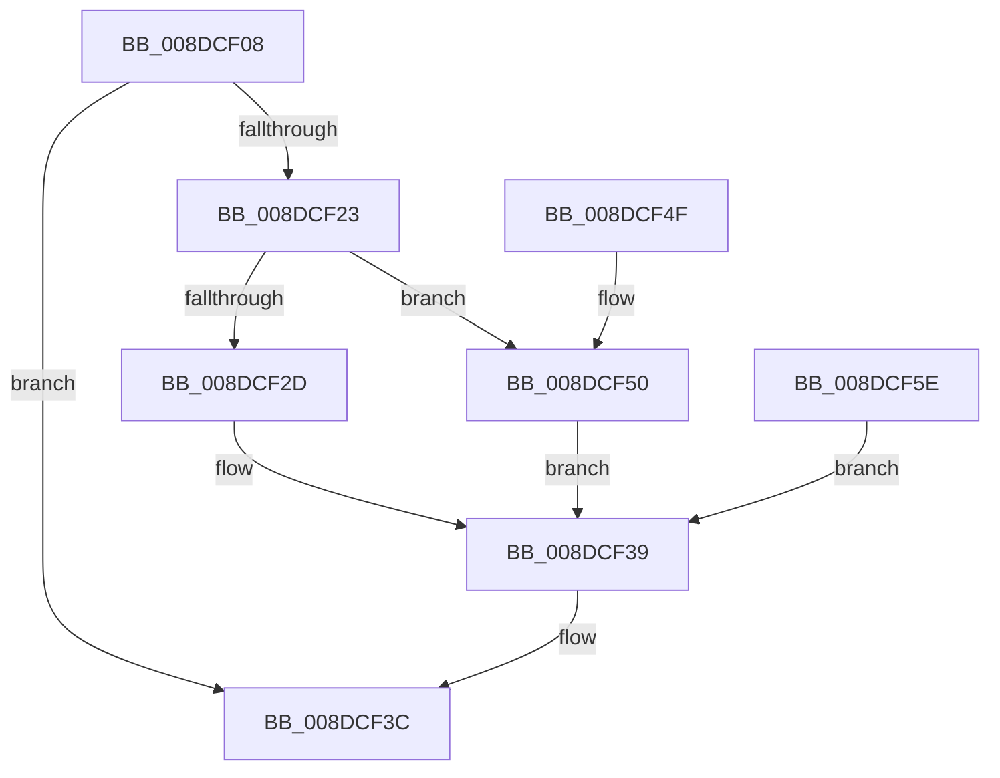

# PiDqIrpComplete

- RVA: `0x008DCF08`–`0x008DCF6C` (길이 `100` bytes)
- VA: `0x00000001408DCF08`
- 실행 섹션: `PAGE`
- PDB 이름 있음: `예`; PDB Function 태그: `아니요`
- unwind 정보 RVA: `0x000859E0`
- 디코드: `28`개 명령, `100/100` bytes 표시
- 미해석 바이트: `0` (있으면 어셈블리에 `.byte`로 보존)

> 이 문서는 커널 이미지의 기계어와 PDB 기호를 분석해 생성했습니다. 4번과 5번은 함수 원형과 자료형을 바이너리 사용 방식에서 추정한 C 해석이며 원본 소스 복구 결과는 아닙니다.

## 1. Dependencies

- 직접 호출 지점: **1**; 고유 호출 대상: **1**
- 직접 호출자로 확인된 함수: **3**
- RIP 상대 이미지 참조: **0**

### Outgoing calls
- `0x008DCF45` → [IofCompleteRequest](../../text/29/IofCompleteRequest_function_0029B5C0.md) (function, `0x0029B5C0`)

### Direct callers
- [PiDqIrpQueryGetResult](PiDqIrpQueryGetResult_function_008DBF28.md) at `0x008DC0D9`
- [PiDqIrpQueryCreate](PiDqIrpQueryCreate_function_008DCC04.md) at `0x008DCE69`
- [PiDqQueryCompletePendedIrp](PiDqQueryCompletePendedIrp_function_008DE594.md) at `0x008DE5F2`

### Static image references
- 디코드된 RIP-relative 메모리 참조가 없습니다.

## 2. Other-region calls and transfers

- 다른 실행 섹션으로 향하는 call: **1**
  - `0x008DCF45` → [IofCompleteRequest](../../text/29/IofCompleteRequest_function_0029B5C0.md) (`PAGE` → `.text`)
- 별도 외부 분기/꼬리 이동을 확인하지 못했습니다.

## 3. Assembly (complete function range)

```asm
008DCF08  44 89 44 24 18                  mov dword ptr [rsp + 0x18], r8d
008DCF0D  48 89 4C 24 08                  mov qword ptr [rsp + 8], rcx
008DCF12  48 83 EC 28                     sub rsp, 0x28
008DCF16  4C 8B 91 B8 00 00 00            mov r10, qword ptr [rcx + 0xb8]
008DCF1D  33 C0                           xor eax, eax
008DCF1F  85 D2                           test edx, edx
008DCF21  78 19                           js 0x1408dcf3c
008DCF23  41 81 7A 18 07 00 47 00         cmp dword ptr [r10 + 0x18], 0x470007
008DCF2B  74 23                           je 0x1408dcf50
008DCF2D  48 8B 41 18                     mov rax, qword ptr [rcx + 0x18]
008DCF31  41 0F 10 01                     movups xmm0, xmmword ptr [r9]
008DCF35  F3 0F 7F 00                     movdqu xmmword ptr [rax], xmm0
008DCF39  41 8B C0                        mov eax, r8d
008DCF3C  48 89 41 38                     mov qword ptr [rcx + 0x38], rax
008DCF40  89 51 30                        mov dword ptr [rcx + 0x30], edx
008DCF43  33 D2                           xor edx, edx
008DCF45  E8 76 E6 9B FF                  call 0x14029b5c0
008DCF4A  48 83 C4 28                     add rsp, 0x28
008DCF4E  C3                              ret
008DCF4F  CC                              int3
008DCF50  48 8B 41 70                     mov rax, qword ptr [rcx + 0x70]
008DCF54  41 0F 10 01                     movups xmm0, xmmword ptr [r9]
008DCF58  F3 0F 7F 00                     movdqu xmmword ptr [rax], xmm0
008DCF5C  EB DB                           jmp 0x1408dcf39
008DCF5E  8B D0                           mov edx, eax
008DCF60  44 8B 44 24 40                  mov r8d, dword ptr [rsp + 0x40]
008DCF65  48 8B 4C 24 30                  mov rcx, qword ptr [rsp + 0x30]
008DCF6A  EB CD                           jmp 0x1408dcf39
```

## 4. C-style interpretation (structured pseudocode)

```c
__int64 __fastcall PiDqIrpComplete(__int64 a1, int a2, int a3, __int64 a4)
{
    __int64 result;
    __int64 v_rsp;
    unsigned int v_stack_p18;
    unsigned __int64 v_stack_p30;
    unsigned int v_stack_p40;
    unsigned __int64 v_stack_p8;

    v_stack_p18 = a3;
    v_stack_p8 = a1;
    v_rsp = (v_rsp) - (40);
    result = 0;
    if (sign_flag) goto loc_008DCF3C;
    if ((*(unsigned int *)(*(unsigned __int64 *)(a1 + 184) + 24)) == 0x470007ULL) goto loc_008DCF50;
    *(unsigned __int64 *)(*(unsigned __int64 *)(a1 + 24)) = v_xmm0;
loc_008DCF39:
loc_008DCF3C:
    *(unsigned __int64 *)(a1 + 56) = (unsigned int)(a3);
    *(unsigned int *)(a1 + 48) = a2;
    a2 = 0;
    result = IofCompleteRequest(a1, a2, a3, a4);
    v_rsp = (v_rsp) + (40);
    return result;
loc_008DCF50:
    *(unsigned __int64 *)(*(unsigned __int64 *)(a1 + 112)) = v_xmm0;
    goto loc_008DCF39;
}
```

## 5. (Beta) C Style

```c
int64_t PiDqIrpComplete(void *Arg1, int32_t Arg2, int32_t Arg3, void *Arg4)
{
    uint8_t *arg1 = (uint8_t *)Arg1;
    uint8_t *arg4 = (uint8_t *)Arg4;

    int64_t result;
    int64_t local_rsp;
    uint32_t v_stack_p18;
    uint64_t v_stack_p30;
    uint32_t v_stack_p40;
    uint64_t v_stack_p8;

    v_stack_p18 = Arg3;
    v_stack_p8 = Arg1;
    local_rsp = (local_rsp) - (40);
    result = 0;
    if (sign_flag) goto loc_008DCF3C;
    if ((*(uint32_t *)(*(uint64_t *)(arg1 + 0xB8) + 0x18)) == 0x470007ULL) goto loc_008DCF50;
    *(uint64_t *)(*(uint64_t *)(arg1 + 0x18)) = v_xmm0;
loc_008DCF39:
loc_008DCF3C:
    *(uint64_t *)(arg1 + 0x38) = (uint32_t)(Arg3);
    *(uint32_t *)(arg1 + 0x30) = Arg2;
    Arg2 = 0;
    result = IofCompleteRequest(Arg1, Arg2, Arg3, Arg4);
    local_rsp = (local_rsp) + (40);
    return result;
loc_008DCF50:
    *(uint64_t *)(*(uint64_t *)(arg1 + 0x70)) = v_xmm0;
    goto loc_008DCF39;
}
```

### 관측된 메모리 오프셋

구조체 형식이 확인되지 않은 접근은 인자 기준의 오프셋으로만 기록했습니다.

| 기준 인자 | 오프셋 표현 | 폭 (bit) | 접근 |
|---|---:|---:|---|
| `Arg1` | `+ 0x18` | `64` | `R` |
| `Arg1` | `+ 0x30` | `32` | `W` |
| `Arg1` | `+ 0x38` | `64` | `W` |
| `Arg1` | `+ 0x70` | `64` | `R` |
| `Arg1` | `+ 0xB8` | `64` | `R` |
| `Arg4` | `+ 0x0` | `128` | `R` |

## 6. Execution-region graph

[열기: 2D/3D 그래프와 함수 탐색 컨트롤 패널](../../../control-panel.html?section=page&rva=0x008DCF08&view=graph)

- 2D 그래프는 위에서 아래로 흐르고, 3D 그래프는 빈 공간을 드래그해 회전합니다. Shift+드래그는 이동, 휠은 확대·축소, 함수 노드 선택은 대상 보고서 이동입니다.

### Static fallback


