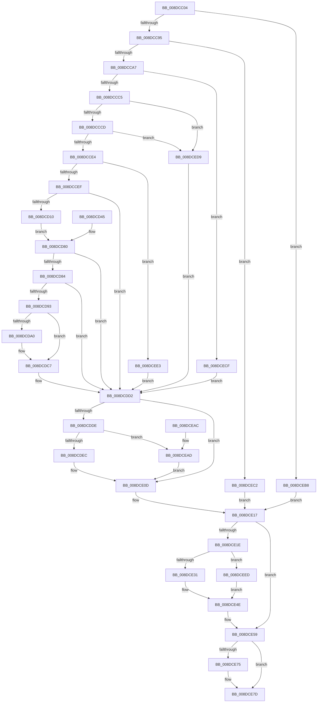

# PiDqIrpQueryCreate

- RVA: `0x008DCC04`–`0x008DCF01` (길이 `765` bytes)
- VA: `0x00000001408DCC04`
- 실행 섹션: `PAGE`
- PDB 이름 있음: `예`; PDB Function 태그: `아니요`
- unwind 정보 RVA: `0x00085998`
- 디코드: `182`개 명령, `765/765` bytes 표시
- 미해석 바이트: `0` (있으면 어셈블리에 `.byte`로 보존)

> 이 문서는 커널 이미지의 기계어와 PDB 기호를 분석해 생성했습니다. 4번과 5번은 함수 원형과 자료형을 바이너리 사용 방식에서 추정한 C 해석이며 원본 소스 복구 결과는 아닙니다.

## 1. Dependencies

- 직접 호출 지점: **16**; 고유 호출 대상: **14**
- 직접 호출자로 확인된 함수: **1**
- RIP 상대 이미지 참조: **6**

### Outgoing calls
- `0x008DCCAA` → [PiDqQueryLock](PiDqQueryLock_function_008DDA0C.md) (function, `0x008DDA0C`)
- `0x008DCCFA` → `msrpc.sys!MesDecodeBufferHandleCreate` (import, 간접 대상; import `msrpc.sys!MesDecodeBufferHandleCreate`)
- `0x008DCD37` → `msrpc.sys!NdrMesTypeDecode3` (import, 간접 대상; import `msrpc.sys!NdrMesTypeDecode3`)
- `0x008DCD88` → [PiDqQueryValidateQueryData](PiDqQueryValidateQueryData_function_008DC67C.md) (function, `0x008DC67C`)
- `0x008DCD97` → [PnpIsNullGuid](PnpIsNullGuid_function_008DD9E0.md) (function, `0x008DD9E0`)
- `0x008DCDB8` → [IoSetActivityIdThread](../../text/46/IoSetActivityIdThread_function_00466340.md) (function, `0x00466340`)
- `0x008DCDCA` → [PiDqTraceQueryCreate](PiDqTraceQueryCreate_function_008DC634.md) (function, `0x008DC634`)
- `0x008DCDD5` → [PiDqQueryUnlock](PiDqQueryUnlock_function_008DDA6C.md) (function, `0x008DDA6C`)
- `0x008DCE01` → [PiDqQuerySerializeActionQueue](PiDqQuerySerializeActionQueue_function_008DD340.md) (function, `0x008DD340`)
- `0x008DCE21` → [PiDqQueryLock](PiDqQueryLock_function_008DDA0C.md) (function, `0x008DDA0C`)
- `0x008DCE42` → [PiDqQueryGetNextIoctlInfo](PiDqQueryGetNextIoctlInfo_function_008DCB54.md) (function, `0x008DCB54`)
- `0x008DCE54` → [PiDqQueryUnlock](PiDqQueryUnlock_function_008DDA6C.md) (function, `0x008DDA6C`)
- `0x008DCE69` → [PiDqIrpComplete](PiDqIrpComplete_function_008DCF08.md) (function, `0x008DCF08`)
- `0x008DCE78` → [IoClearActivityIdThread](../../text/46/IoClearActivityIdThread_function_0046BFF0.md) (function, `0x0046BFF0`)
- `0x008DCE8A` → [_security_check_cookie](../../text/6A/_security_check_cookie_function_006AC640.md) (function, `0x006AC640`)
- `0x008DCEF7` → [PiDqQueryFreeActiveData](PiDqQueryFreeActiveData_function_008DE4FC.md) (function, `0x008DE4FC`)

### Direct callers
- [PiDqDispatch](PiDqDispatch_function_008DC8A0.md) at `0x008DC9FE`

### Static image references
- `0x008DCC1F` → RVA `0x00E0A740` (`.data`; read)
- `0x008DCCFA` → RVA `0x00151700` (`msrpc.sys!MesDecodeBufferHandleCreate (IAT)`; read)
- `0x008DCD22` → RVA `0x00E07000` (`.data`; read)
- `0x008DCD29` → RVA `0x00001610` (`.rdata`; read)
- `0x008DCD30` → RVA `0x00011440` (`.rdata`; read)
- `0x008DCD37` → RVA `0x001516F8` (`msrpc.sys!NdrMesTypeDecode3 (IAT)`; read)

## 2. Other-region calls and transfers

- 다른 실행 섹션으로 향하는 call: **3**
  - `0x008DCDB8` → [IoSetActivityIdThread](../../text/46/IoSetActivityIdThread_function_00466340.md) (`PAGE` → `.text`)
  - `0x008DCE78` → [IoClearActivityIdThread](../../text/46/IoClearActivityIdThread_function_0046BFF0.md) (`PAGE` → `.text`)
  - `0x008DCE8A` → [_security_check_cookie](../../text/6A/_security_check_cookie_function_006AC640.md) (`PAGE` → `.text`)
- 별도 외부 분기/꼬리 이동을 확인하지 못했습니다.

## 3. Assembly (complete function range)

```asm
008DCC04  4C 8B DC                        mov r11, rsp
008DCC07  49 89 5B 10                     mov qword ptr [r11 + 0x10], rbx
008DCC0B  49 89 73 18                     mov qword ptr [r11 + 0x18], rsi
008DCC0F  57                              push rdi
008DCC10  41 54                           push r12
008DCC12  41 55                           push r13
008DCC14  41 56                           push r14
008DCC16  41 57                           push r15
008DCC18  48 81 EC B0 00 00 00            sub rsp, 0xb0
008DCC1F  48 8B 05 1A DB 52 00            mov rax, qword ptr [rip + 0x52db1a]
008DCC26  48 33 C4                        xor rax, rsp
008DCC29  48 89 84 24 A0 00 00 00         mov qword ptr [rsp + 0xa0], rax
008DCC31  4C 8B E9                        mov r13, rcx
008DCC34  48 89 4C 24 68                  mov qword ptr [rsp + 0x68], rcx
008DCC39  4C 8B B1 B8 00 00 00            mov r14, qword ptr [rcx + 0xb8]
008DCC40  4C 89 74 24 58                  mov qword ptr [rsp + 0x58], r14
008DCC45  49 8B 46 30                     mov rax, qword ptr [r14 + 0x30]
008DCC49  48 8B 78 20                     mov rdi, qword ptr [rax + 0x20]
008DCC4D  48 89 7C 24 50                  mov qword ptr [rsp + 0x50], rdi
008DCC52  48 8B F7                        mov rsi, rdi
008DCC55  48 89 7C 24 48                  mov qword ptr [rsp + 0x48], rdi
008DCC5A  C6 44 24 30 00                  mov byte ptr [rsp + 0x30], 0
008DCC5F  45 33 FF                        xor r15d, r15d
008DCC62  4C 89 7C 24 40                  mov qword ptr [rsp + 0x40], r15
008DCC67  4C 89 7C 24 60                  mov qword ptr [rsp + 0x60], r15
008DCC6C  0F 57 C0                        xorps xmm0, xmm0
008DCC6F  41 0F 11 43 B8                  movups xmmword ptr [r11 - 0x48], xmm0
008DCC74  32 C0                           xor al, al
008DCC76  88 44 24 31                     mov byte ptr [rsp + 0x31], al
008DCC7A  45 33 E4                        xor r12d, r12d
008DCC7D  44 89 64 24 34                  mov dword ptr [rsp + 0x34], r12d
008DCC82  44 21 64 24 38                  and dword ptr [rsp + 0x38], r12d
008DCC87  41 0F 11 43 A8                  movups xmmword ptr [r11 - 0x58], xmm0
008DCC8C  48 85 FF                        test rdi, rdi
008DCC8F  0F 84 23 02 00 00               je 0x1408dceb8
008DCC95  4C 8D 79 18                     lea r15, [rcx + 0x18]
008DCC99  4C 89 7C 24 78                  mov qword ptr [rsp + 0x78], r15
008DCC9E  4D 39 27                        cmp qword ptr [r15], r12
008DCCA1  0F 84 1B 02 00 00               je 0x1408dcec2
008DCCA7  48 8B CF                        mov rcx, rdi
008DCCAA  E8 5D 0D 00 00                  call 0x1408dda0c
008DCCAF  48 8D B7 D8 00 00 00            lea rsi, [rdi + 0xd8]
008DCCB6  48 89 74 24 70                  mov qword ptr [rsp + 0x70], rsi
008DCCBB  8B 06                           mov eax, dword ptr [rsi]
008DCCBD  A8 08                           test al, 8
008DCCBF  0F 85 0A 02 00 00               jne 0x1408dcecf
008DCCC5  A8 10                           test al, 0x10
008DCCC7  0F 85 0C 02 00 00               jne 0x1408dced9
008DCCCD  83 C8 10                        or eax, 0x10
008DCCD0  89 06                           mov dword ptr [rsi], eax
008DCCD2  B1 01                           mov cl, 1
008DCCD4  88 4C 24 30                     mov byte ptr [rsp + 0x30], cl
008DCCD8  88 4C 24 32                     mov byte ptr [rsp + 0x32], cl
008DCCDC  A8 04                           test al, 4
008DCCDE  0F 85 F5 01 00 00               jne 0x1408dced9
008DCCE4  41 83 7E 08 10                  cmp dword ptr [r14 + 8], 0x10
008DCCE9  0F 82 F4 01 00 00               jb 0x1408dcee3
008DCCEF  4C 8D 47 10                     lea r8, [rdi + 0x10]
008DCCF3  41 8B 56 10                     mov edx, dword ptr [r14 + 0x10]
008DCCF7  49 8B 0F                        mov rcx, qword ptr [r15]
008DCCFA  48 FF 15 FF 49 87 FF            call qword ptr [rip - 0x78b601]
008DCD01  0F 1F 44 00 00                  nop dword ptr [rax + rax]
008DCD06  8B D8                           mov ebx, eax
008DCD08  85 C0                           test eax, eax
008DCD0A  0F 88 C2 00 00 00               js 0x1408dcdd2
008DCD10  48 8B 4F 10                     mov rcx, qword ptr [rdi + 0x10]
008DCD14  48 8D 47 18                     lea rax, [rdi + 0x18]
008DCD18  48 89 44 24 28                  mov qword ptr [rsp + 0x28], rax
008DCD1D  44 21 64 24 20                  and dword ptr [rsp + 0x20], r12d
008DCD22  4C 8D 0D D7 A2 52 00            lea r9, [rip + 0x52a2d7]
008DCD29  4C 8D 05 E0 48 72 FF            lea r8, [rip - 0x8db720]
008DCD30  48 8D 15 09 47 73 FF            lea rdx, [rip - 0x8cb8f7]
008DCD37  48 FF 15 BA 49 87 FF            call qword ptr [rip - 0x78b646]
008DCD3E  0F 1F 44 00 00                  nop dword ptr [rax + rax]
008DCD43  EB 3B                           jmp 0x1408dcd80
008DCD45  8B D8                           mov ebx, eax
008DCD47  48 8B 7C 24 50                  mov rdi, qword ptr [rsp + 0x50]
008DCD4C  48 83 67 18 00                  and qword ptr [rdi + 0x18], 0
008DCD51  4C 8B 74 24 58                  mov r14, qword ptr [rsp + 0x58]
008DCD56  8A 44 24 32                     mov al, byte ptr [rsp + 0x32]
008DCD5A  88 44 24 30                     mov byte ptr [rsp + 0x30], al
008DCD5E  48 8B 44 24 60                  mov rax, qword ptr [rsp + 0x60]
008DCD63  48 89 44 24 40                  mov qword ptr [rsp + 0x40], rax
008DCD68  88 44 24 31                     mov byte ptr [rsp + 0x31], al
008DCD6C  44 8B 64 24 34                  mov r12d, dword ptr [rsp + 0x34]
008DCD71  4C 8B 6C 24 68                  mov r13, qword ptr [rsp + 0x68]
008DCD76  48 8B 74 24 70                  mov rsi, qword ptr [rsp + 0x70]
008DCD7B  4C 8B 7C 24 78                  mov r15, qword ptr [rsp + 0x78]
008DCD80  85 DB                           test ebx, ebx
008DCD82  78 4E                           js 0x1408dcdd2
008DCD84  48 8B 4F 18                     mov rcx, qword ptr [rdi + 0x18]
008DCD88  E8 EF F8 FF FF                  call 0x1408dc67c
008DCD8D  8B D8                           mov ebx, eax
008DCD8F  85 C0                           test eax, eax
008DCD91  78 3F                           js 0x1408dcdd2
008DCD93  48 8B 4F 18                     mov rcx, qword ptr [rdi + 0x18]
008DCD97  E8 44 0C 00 00                  call 0x1408dd9e0
008DCD9C  84 C0                           test al, al
008DCD9E  75 27                           jne 0x1408dcdc7
008DCDA0  48 8B 47 18                     mov rax, qword ptr [rdi + 0x18]
008DCDA4  0F 10 00                        movups xmm0, xmmword ptr [rax]
008DCDA7  F3 0F 7F 84 24 90 00 00 00      movdqu xmmword ptr [rsp + 0x90], xmm0
008DCDB0  48 8D 8C 24 90 00 00 00         lea rcx, [rsp + 0x90]
008DCDB8  E8 83 95 B8 FF                  call 0x140466340
008DCDBD  48 89 44 24 40                  mov qword ptr [rsp + 0x40], rax
008DCDC2  C6 44 24 31 01                  mov byte ptr [rsp + 0x31], 1
008DCDC7  48 8B CF                        mov rcx, rdi
008DCDCA  E8 65 F8 FF FF                  call 0x1408dc634
008DCDCF  83 0E 04                        or dword ptr [rsi], 4
008DCDD2  48 8B CF                        mov rcx, rdi
008DCDD5  E8 92 0C 00 00                  call 0x1408dda6c
008DCDDA  85 DB                           test ebx, ebx
008DCDDC  78 2F                           js 0x1408dce0d
008DCDDE  45 8B 46 08                     mov r8d, dword ptr [r14 + 8]
008DCDE2  41 83 F8 10                     cmp r8d, 0x10
008DCDE6  0F 86 C1 00 00 00               jbe 0x1408dcead
008DCDEC  48 8D 44 24 38                  lea rax, [rsp + 0x38]
008DCDF1  48 89 44 24 20                  mov qword ptr [rsp + 0x20], rax
008DCDF6  4C 8D 4C 24 34                  lea r9, [rsp + 0x34]
008DCDFB  49 8B 17                        mov rdx, qword ptr [r15]
008DCDFE  48 8B CF                        mov rcx, rdi
008DCE01  E8 3A 05 00 00                  call 0x1408dd340
008DCE06  8B D8                           mov ebx, eax
008DCE08  44 8B 64 24 34                  mov r12d, dword ptr [rsp + 0x34]
008DCE0D  4C 8B 7C 24 40                  mov r15, qword ptr [rsp + 0x40]
008DCE12  48 8B 74 24 48                  mov rsi, qword ptr [rsp + 0x48]
008DCE17  80 7C 24 30 00                  cmp byte ptr [rsp + 0x30], 0
008DCE1C  74 3B                           je 0x1408dce59
008DCE1E  48 8B CF                        mov rcx, rdi
008DCE21  E8 E6 0B 00 00                  call 0x1408dda0c
008DCE26  48 8B CF                        mov rcx, rdi
008DCE29  85 DB                           test ebx, ebx
008DCE2B  0F 88 BC 00 00 00               js 0x1408dceed
008DCE31  4C 8D 8C 24 80 00 00 00         lea r9, [rsp + 0x80]
008DCE39  44 8B 44 24 38                  mov r8d, dword ptr [rsp + 0x38]
008DCE3E  41 8B 56 08                     mov edx, dword ptr [r14 + 8]
008DCE42  E8 0D FD FF FF                  call 0x1408dcb54
008DCE47  48 81 C6 D8 00 00 00            add rsi, 0xd8
008DCE4E  83 26 EF                        and dword ptr [rsi], 0xffffffef
008DCE51  48 8B CF                        mov rcx, rdi
008DCE54  E8 13 0C 00 00                  call 0x1408dda6c
008DCE59  4C 8D 8C 24 80 00 00 00         lea r9, [rsp + 0x80]
008DCE61  45 8B C4                        mov r8d, r12d
008DCE64  8B D3                           mov edx, ebx
008DCE66  49 8B CD                        mov rcx, r13
008DCE69  E8 9A 00 00 00                  call 0x1408dcf08
008DCE6E  80 7C 24 31 00                  cmp byte ptr [rsp + 0x31], 0
008DCE73  74 08                           je 0x1408dce7d
008DCE75  49 8B CF                        mov rcx, r15
008DCE78  E8 73 F1 B8 FF                  call 0x14046bff0
008DCE7D  8B C3                           mov eax, ebx
008DCE7F  48 8B 8C 24 A0 00 00 00         mov rcx, qword ptr [rsp + 0xa0]
008DCE87  48 33 CC                        xor rcx, rsp
008DCE8A  E8 B1 F7 DC FF                  call 0x1406ac640
008DCE8F  4C 8D 9C 24 B0 00 00 00         lea r11, [rsp + 0xb0]
008DCE97  49 8B 5B 38                     mov rbx, qword ptr [r11 + 0x38]
008DCE9B  49 8B 73 40                     mov rsi, qword ptr [r11 + 0x40]
008DCE9F  49 8B E3                        mov rsp, r11
008DCEA2  41 5F                           pop r15
008DCEA4  41 5E                           pop r14
008DCEA6  41 5D                           pop r13
008DCEA8  41 5C                           pop r12
008DCEAA  5F                              pop rdi
008DCEAB  C3                              ret
008DCEAC  CC                              int3
008DCEAD  41 BC 10 00 00 00               mov r12d, 0x10
008DCEB3  E9 55 FF FF FF                  jmp 0x1408dce0d
008DCEB8  BB BB 00 00 C0                  mov ebx, 0xc00000bb
008DCEBD  E9 55 FF FF FF                  jmp 0x1408dce17
008DCEC2  BB 0D 00 00 C0                  mov ebx, 0xc000000d
008DCEC7  45 33 FF                        xor r15d, r15d
008DCECA  E9 48 FF FF FF                  jmp 0x1408dce17
008DCECF  BB 20 01 00 C0                  mov ebx, 0xc0000120
008DCED4  E9 F9 FE FF FF                  jmp 0x1408dcdd2
008DCED9  BB BB 00 00 C0                  mov ebx, 0xc00000bb
008DCEDE  E9 EF FE FF FF                  jmp 0x1408dcdd2
008DCEE3  BB 23 00 00 C0                  mov ebx, 0xc0000023
008DCEE8  E9 E5 FE FF FF                  jmp 0x1408dcdd2
008DCEED  48 8D B7 D8 00 00 00            lea rsi, [rdi + 0xd8]
008DCEF4  83 0E 01                        or dword ptr [rsi], 1
008DCEF7  E8 00 16 00 00                  call 0x1408de4fc
008DCEFC  E9 4D FF FF FF                  jmp 0x1408dce4e
```

## 4. C-style interpretation (structured pseudocode)

```c
__int64 __fastcall PiDqIrpQueryCreate(__int64 a1)
{
    __int64 result;
    __int64 v_r12;
    __int64 v_r15;
    __int64 v_rsi;
    __int64 v_rsp;
    unsigned __int64 v_stack_m28;
    unsigned __int64 v_stack_m38;
    unsigned __int64 v_stack_m48;
    unsigned __int64 v_stack_m58;
    unsigned __int64 v_stack_m60;
    unsigned __int64 v_stack_m68;
    unsigned __int64 v_stack_m70;
    unsigned __int64 v_stack_m78;
    unsigned __int64 v_stack_m80;
    unsigned __int64 v_stack_m88;
    unsigned __int64 v_stack_m90;
    unsigned __int64 v_stack_m98;
    unsigned int v_stack_mA0;
    unsigned int v_stack_mA4;
    unsigned __int8 v_stack_mA6;
    unsigned __int8 v_stack_mA7;
    unsigned __int8 v_stack_mA8;
    unsigned __int64 v_stack_mB0;
    unsigned int v_stack_mB8;

    *(unsigned __int64 *)(v_rsp + 16) = v_rbx;
    *(unsigned __int64 *)(v_rsp + 24) = v_rsi;
    v_rsp = (v_rsp) - (176);
    result = (*(unsigned __int64 *)(v_rip + 5430042)) ^ (v_rsp);
    v_stack_m38 = result;
    v_stack_m70 = a1;
    v_stack_m80 = *(unsigned __int64 *)(a1 + 184);
    v_stack_m88 = *(unsigned __int64 *)(*(unsigned __int64 *)(*(unsigned __int64 *)(a1 + 184) + 48) + 32);
    v_stack_m90 = *(unsigned __int64 *)(*(unsigned __int64 *)(*(unsigned __int64 *)(a1 + 184) + 48) + 32);
    v_stack_mA8 = 0;
    v_r15 = 0;
    v_stack_m98 = 0;
    v_stack_m78 = 0;
    *(unsigned __int64 *)(v_rsp - 72) = v_xmm0;
    result = 0;
    v_stack_mA7 = 0;
    v_r12 = 0;
    v_stack_mA4 = 0;
    *(unsigned __int64 *)(v_rsp - 88) = v_xmm0;
    if (*(unsigned __int64 *)(*(unsigned __int64 *)(*(unsigned __int64 *)(a1 + 184) + 48) + 32) == 0) goto loc_008DCEB8;
    v_stack_m60 = a1 + 24;
    if ((*(unsigned __int64 *)(a1 + 24)) == 0) goto loc_008DCEC2;
    result = PiDqQueryLock(*(unsigned __int64 *)(*(unsigned __int64 *)(*(unsigned __int64 *)(a1 + 184) + 48) + 32), a2, a3, a4);
    v_stack_m68 = *(unsigned __int64 *)(*(unsigned __int64 *)(*(unsigned __int64 *)(a1 + 184) + 48) + 32) + 216;
    if ((((unsigned __int8)((unsigned int)(*(unsigned int *)(*(unsigned __int64 *)(*(unsigned __int64 *)(*(unsigned __int64 *)(a1 + 184) + 48) + 32) + 216)))) & (8)) != 0) goto loc_008DCECF;
    if ((((unsigned __int8)((unsigned int)(*(unsigned int *)(*(unsigned __int64 *)(*(unsigned __int64 *)(*(unsigned __int64 *)(a1 + 184) + 48) + 32) + 216)))) & (16)) != 0) goto loc_008DCED9;
    result = (unsigned int)(((unsigned int)(*(unsigned int *)(*(unsigned __int64 *)(*(unsigned __int64 *)(*(unsigned __int64 *)(a1 + 184) + 48) + 32) + 216))) | (16));
    *(unsigned int *)(*(unsigned __int64 *)(*(unsigned __int64 *)(*(unsigned __int64 *)(a1 + 184) + 48) + 32) + 216) = (unsigned int)(result);
    v_stack_mA8 = 1;
    v_stack_mA6 = 1;
    if ((((unsigned __int8)(result)) & (4)) != 0) goto loc_008DCED9;
    if ((*(unsigned int *)(*(unsigned __int64 *)(a1 + 184) + 8)) < 16) goto loc_008DCEE3;
    result = msrpc_sys_MesDecodeBufferHandleCreate(*(unsigned __int64 *)(a1 + 24), (unsigned int)(*(unsigned int *)(*(unsigned __int64 *)(a1 + 184) + 16)), *(unsigned __int64 *)(*(unsigned __int64 *)(*(unsigned __int64 *)(a1 + 184) + 48) + 32) + 16, a4);
    if (sign_flag) goto loc_008DCDD2;
    v_stack_mB0 = *(unsigned __int64 *)(*(unsigned __int64 *)(*(unsigned __int64 *)(a1 + 184) + 48) + 32) + 24;
    result = msrpc_sys_NdrMesTypeDecode3(*(unsigned __int64 *)(*(unsigned __int64 *)(*(unsigned __int64 *)(*(unsigned __int64 *)(a1 + 184) + 48) + 32) + 16), v_rip - 9222391, v_rip - 9287456, v_rip + 5415639);
    goto loc_008DCD80;
loc_008DCD80:
    if (sign_flag) goto loc_008DCDD2;
    result = PiDqQueryValidateQueryData(*(unsigned __int64 *)(*(unsigned __int64 *)(*(unsigned __int64 *)(*(unsigned __int64 *)(a1 + 184) + 48) + 32) + 24), v_rip - 9222391, v_rip - 9287456, v_rip + 5415639);
    if (sign_flag) goto loc_008DCDD2;
    result = PnpIsNullGuid(*(unsigned __int64 *)(*(unsigned __int64 *)(*(unsigned __int64 *)(*(unsigned __int64 *)(a1 + 184) + 48) + 32) + 24), v_rip - 9222391, v_rip - 9287456, v_rip + 5415639);
    if ((unsigned __int8)(result) == 0) {
        result = *(unsigned __int64 *)(*(unsigned __int64 *)(*(unsigned __int64 *)(*(unsigned __int64 *)(a1 + 184) + 48) + 32) + 24);
        v_stack_m48 = v_xmm0;
        a1 = v_stack_m48;
        result = IoSetActivityIdThread(a1, v_rip - 9222391, v_rip - 9287456, v_rip + 5415639);
        v_stack_m98 = result;
        v_stack_mA7 = 1;
    }
    result = PiDqTraceQueryCreate(*(unsigned __int64 *)(*(unsigned __int64 *)(*(unsigned __int64 *)(a1 + 184) + 48) + 32), v_rip - 9222391, v_rip - 9287456, v_rip + 5415639);
loc_008DCDD2:
    result = PiDqQueryUnlock(*(unsigned __int64 *)(*(unsigned __int64 *)(*(unsigned __int64 *)(a1 + 184) + 48) + 32), v_rip - 9222391, v_rip - 9287456, v_rip + 5415639);
    if (sign_flag) goto loc_008DCE0D;
    if (((unsigned int)((unsigned int)(*(unsigned int *)(*(unsigned __int64 *)(a1 + 184) + 8)))) <= 16) goto loc_008DCEAD;
    v_stack_mB8 = v_stack_mA0;
    result = PiDqQuerySerializeActionQueue(*(unsigned __int64 *)(*(unsigned __int64 *)(*(unsigned __int64 *)(a1 + 184) + 48) + 32), *(unsigned __int64 *)(a1 + 24), (unsigned int)(*(unsigned int *)(*(unsigned __int64 *)(a1 + 184) + 8)), v_stack_mA4);
loc_008DCE0D:
loc_008DCE17:
    if (v_stack_mA8 == 0) goto loc_008DCE59;
    result = PiDqQueryLock(*(unsigned __int64 *)(*(unsigned __int64 *)(*(unsigned __int64 *)(a1 + 184) + 48) + 32), *(unsigned __int64 *)(a1 + 24), (unsigned int)(*(unsigned int *)(*(unsigned __int64 *)(a1 + 184) + 8)), v_stack_mA4);
    if (sign_flag) goto loc_008DCEED;
    result = PiDqQueryGetNextIoctlInfo(*(unsigned __int64 *)(*(unsigned __int64 *)(*(unsigned __int64 *)(a1 + 184) + 48) + 32), (unsigned int)(*(unsigned int *)(*(unsigned __int64 *)(a1 + 184) + 8)), (unsigned int)(v_stack_mA0), v_stack_m58);
    v_rsi = (v_stack_m90) + (216);
loc_008DCE4E:
    result = PiDqQueryUnlock(*(unsigned __int64 *)(*(unsigned __int64 *)(*(unsigned __int64 *)(a1 + 184) + 48) + 32), (unsigned int)(*(unsigned int *)(*(unsigned __int64 *)(a1 + 184) + 8)), (unsigned int)(v_stack_mA0), v_stack_m58);
loc_008DCE59:
    result = PiDqIrpComplete(a1, (unsigned int)((unsigned int)((unsigned int)((unsigned int)(result)))), (unsigned int)((unsigned int)((unsigned int)(v_stack_mA4))), v_stack_m58);
    if (v_stack_mA7 != 0) {
        a1 = v_stack_m98;
        result = IoClearActivityIdThread(a1, (unsigned int)((unsigned int)((unsigned int)((unsigned int)(result)))), (unsigned int)((unsigned int)((unsigned int)(v_stack_mA4))), v_stack_m58);
    }
    a1 = (v_stack_m38) ^ (v_rsp);
    result = _security_check_cookie(a1, (unsigned int)((unsigned int)((unsigned int)((unsigned int)(result)))), (unsigned int)((unsigned int)((unsigned int)(v_stack_mA4))), v_stack_m58);
    return result;
loc_008DCEAD:
    goto loc_008DCE0D;
loc_008DCEB8:
    goto loc_008DCE17;
loc_008DCEC2:
    v_r15 = 0;
    goto loc_008DCE17;
loc_008DCECF:
    goto loc_008DCDD2;
loc_008DCED9:
    goto loc_008DCDD2;
loc_008DCEE3:
    goto loc_008DCDD2;
loc_008DCEED:
    result = PiDqQueryFreeActiveData(a1, (unsigned int)((unsigned int)((unsigned int)((unsigned int)(result)))), (unsigned int)((unsigned int)((unsigned int)(v_stack_mA4))), v_stack_m58);
    goto loc_008DCE4E;
}
```

## 5. (Beta) C Style

```c
int64_t PiDqIrpQueryCreate(void *Arg1)
{
    uint8_t *arg1 = (uint8_t *)Arg1;

    int64_t result;
    int64_t local_r12;
    int64_t local_r15;
    int64_t local_rsi;
    int64_t local_rsp;
    uint64_t v_stack_m28;
    uint64_t v_stack_m38;
    uint64_t v_stack_m48;
    uint64_t v_stack_m58;
    uint64_t v_stack_m60;
    uint64_t v_stack_m68;
    uint64_t v_stack_m70;
    uint64_t v_stack_m78;
    uint64_t v_stack_m80;
    uint64_t v_stack_m88;
    uint64_t v_stack_m90;
    uint64_t v_stack_m98;
    uint32_t v_stack_mA0;
    uint32_t v_stack_mA4;
    uint8_t v_stack_mA6;
    uint8_t v_stack_mA7;
    uint8_t v_stack_mA8;
    uint64_t v_stack_mB0;
    uint32_t v_stack_mB8;

    *(uint64_t *)(local_rsp + 0x10) = local_rbx;
    *(uint64_t *)(local_rsp + 0x18) = local_rsi;
    local_rsp = (local_rsp) - (176);
    result = (*(uint64_t *)(v_rip + 0x52DB1A)) ^ (local_rsp);
    v_stack_m38 = result;
    v_stack_m70 = Arg1;
    v_stack_m80 = *(uint64_t *)(arg1 + 0xB8);
    v_stack_m88 = *(uint64_t *)(*(uint64_t *)(*(uint64_t *)(arg1 + 0xB8) + 0x30) + 0x20);
    v_stack_m90 = *(uint64_t *)(*(uint64_t *)(*(uint64_t *)(arg1 + 0xB8) + 0x30) + 0x20);
    v_stack_mA8 = 0;
    local_r15 = 0;
    v_stack_m98 = 0;
    v_stack_m78 = 0;
    *(uint64_t *)(local_rsp - 0x48) = v_xmm0;
    result = 0;
    v_stack_mA7 = 0;
    local_r12 = 0;
    v_stack_mA4 = 0;
    *(uint64_t *)(local_rsp - 0x58) = v_xmm0;
    if (*(uint64_t *)(*(uint64_t *)(*(uint64_t *)(arg1 + 0xB8) + 0x30) + 0x20) == 0) goto loc_008DCEB8;
    v_stack_m60 = Arg1 + 24;
    if ((*(uint64_t *)(arg1 + 0x18)) == 0) goto loc_008DCEC2;
    result = PiDqQueryLock(*(uint64_t *)(*(uint64_t *)(*(uint64_t *)(arg1 + 0xB8) + 0x30) + 0x20), a2, a3, a4);
    v_stack_m68 = *(uint64_t *)(*(uint64_t *)(*(uint64_t *)(arg1 + 0xB8) + 0x30) + 0x20) + 216;
    if ((((uint8_t)((uint32_t)(*(uint32_t *)(*(uint64_t *)(*(uint64_t *)(*(uint64_t *)(arg1 + 0xB8) + 0x30) + 0x20) + 0xD8)))) & (8)) != 0) goto loc_008DCECF;
    if ((((uint8_t)((uint32_t)(*(uint32_t *)(*(uint64_t *)(*(uint64_t *)(*(uint64_t *)(arg1 + 0xB8) + 0x30) + 0x20) + 0xD8)))) & (16)) != 0) goto loc_008DCED9;
    result = (uint32_t)(((uint32_t)(*(uint32_t *)(*(uint64_t *)(*(uint64_t *)(*(uint64_t *)(arg1 + 0xB8) + 0x30) + 0x20) + 0xD8))) | (16));
    *(uint32_t *)(*(uint64_t *)(*(uint64_t *)(*(uint64_t *)(arg1 + 0xB8) + 0x30) + 0x20) + 0xD8) = (uint32_t)(result);
    v_stack_mA8 = 1;
    v_stack_mA6 = 1;
    if ((((uint8_t)(result)) & (4)) != 0) goto loc_008DCED9;
    if ((*(uint32_t *)(*(uint64_t *)(arg1 + 0xB8) + 0x8)) < 16) goto loc_008DCEE3;
    result = kernel_indirect_call(*(uint64_t *)(arg1 + 0x18), (uint32_t)(*(uint32_t *)(*(uint64_t *)(arg1 + 0xB8) + 0x10)), *(uint64_t *)(*(uint64_t *)(*(uint64_t *)(arg1 + 0xB8) + 0x30) + 0x20) + 16, a4);
    if (sign_flag) goto loc_008DCDD2;
    v_stack_mB0 = *(uint64_t *)(*(uint64_t *)(*(uint64_t *)(arg1 + 0xB8) + 0x30) + 0x20) + 24;
    result = kernel_indirect_call(*(uint64_t *)(*(uint64_t *)(*(uint64_t *)(*(uint64_t *)(arg1 + 0xB8) + 0x30) + 0x20) + 0x10), v_rip - 9222391, v_rip - 9287456, v_rip + 5415639);
    goto loc_008DCD80;
loc_008DCD80:
    if (sign_flag) goto loc_008DCDD2;
    result = PiDqQueryValidateQueryData(*(uint64_t *)(*(uint64_t *)(*(uint64_t *)(*(uint64_t *)(arg1 + 0xB8) + 0x30) + 0x20) + 0x18), v_rip - 9222391, v_rip - 9287456, v_rip + 5415639);
    if (sign_flag) goto loc_008DCDD2;
    result = PnpIsNullGuid(*(uint64_t *)(*(uint64_t *)(*(uint64_t *)(*(uint64_t *)(arg1 + 0xB8) + 0x30) + 0x20) + 0x18), v_rip - 9222391, v_rip - 9287456, v_rip + 5415639);
    if ((uint8_t)(result) == 0) {
        result = *(uint64_t *)(*(uint64_t *)(*(uint64_t *)(*(uint64_t *)(arg1 + 0xB8) + 0x30) + 0x20) + 0x18);
        v_stack_m48 = v_xmm0;
        Arg1 = v_stack_m48;
        result = IoSetActivityIdThread(Arg1, v_rip - 9222391, v_rip - 9287456, v_rip + 5415639);
        v_stack_m98 = result;
        v_stack_mA7 = 1;
    }
    result = PiDqTraceQueryCreate(*(uint64_t *)(*(uint64_t *)(*(uint64_t *)(arg1 + 0xB8) + 0x30) + 0x20), v_rip - 9222391, v_rip - 9287456, v_rip + 5415639);
loc_008DCDD2:
    result = PiDqQueryUnlock(*(uint64_t *)(*(uint64_t *)(*(uint64_t *)(arg1 + 0xB8) + 0x30) + 0x20), v_rip - 9222391, v_rip - 9287456, v_rip + 5415639);
    if (sign_flag) goto loc_008DCE0D;
    if (((uint32_t)((uint32_t)(*(uint32_t *)(*(uint64_t *)(arg1 + 0xB8) + 0x8)))) <= 16) goto loc_008DCEAD;
    v_stack_mB8 = v_stack_mA0;
    result = PiDqQuerySerializeActionQueue(*(uint64_t *)(*(uint64_t *)(*(uint64_t *)(arg1 + 0xB8) + 0x30) + 0x20), *(uint64_t *)(arg1 + 0x18), (uint32_t)(*(uint32_t *)(*(uint64_t *)(arg1 + 0xB8) + 0x8)), v_stack_mA4);
loc_008DCE0D:
loc_008DCE17:
    if (v_stack_mA8 == 0) goto loc_008DCE59;
    result = PiDqQueryLock(*(uint64_t *)(*(uint64_t *)(*(uint64_t *)(arg1 + 0xB8) + 0x30) + 0x20), *(uint64_t *)(arg1 + 0x18), (uint32_t)(*(uint32_t *)(*(uint64_t *)(arg1 + 0xB8) + 0x8)), v_stack_mA4);
    if (sign_flag) goto loc_008DCEED;
    result = PiDqQueryGetNextIoctlInfo(*(uint64_t *)(*(uint64_t *)(*(uint64_t *)(arg1 + 0xB8) + 0x30) + 0x20), (uint32_t)(*(uint32_t *)(*(uint64_t *)(arg1 + 0xB8) + 0x8)), (uint32_t)(v_stack_mA0), v_stack_m58);
    local_rsi = (v_stack_m90) + (216);
loc_008DCE4E:
    result = PiDqQueryUnlock(*(uint64_t *)(*(uint64_t *)(*(uint64_t *)(arg1 + 0xB8) + 0x30) + 0x20), (uint32_t)(*(uint32_t *)(*(uint64_t *)(arg1 + 0xB8) + 0x8)), (uint32_t)(v_stack_mA0), v_stack_m58);
loc_008DCE59:
    result = PiDqIrpComplete(Arg1, (uint32_t)((uint32_t)((uint32_t)((uint32_t)(result)))), (uint32_t)((uint32_t)((uint32_t)(v_stack_mA4))), v_stack_m58);
    if (v_stack_mA7 != 0) {
        Arg1 = v_stack_m98;
        result = IoClearActivityIdThread(Arg1, (uint32_t)((uint32_t)((uint32_t)((uint32_t)(result)))), (uint32_t)((uint32_t)((uint32_t)(v_stack_mA4))), v_stack_m58);
    }
    Arg1 = (v_stack_m38) ^ (local_rsp);
    result = _security_check_cookie(Arg1, (uint32_t)((uint32_t)((uint32_t)((uint32_t)(result)))), (uint32_t)((uint32_t)((uint32_t)(v_stack_mA4))), v_stack_m58);
    return result;
loc_008DCEAD:
    goto loc_008DCE0D;
loc_008DCEB8:
    goto loc_008DCE17;
loc_008DCEC2:
    local_r15 = 0;
    goto loc_008DCE17;
loc_008DCECF:
    goto loc_008DCDD2;
loc_008DCED9:
    goto loc_008DCDD2;
loc_008DCEE3:
    goto loc_008DCDD2;
loc_008DCEED:
    result = PiDqQueryFreeActiveData(Arg1, (uint32_t)((uint32_t)((uint32_t)((uint32_t)(result)))), (uint32_t)((uint32_t)((uint32_t)(v_stack_mA4))), v_stack_m58);
    goto loc_008DCE4E;
}
```

### 관측된 메모리 오프셋

구조체 형식이 확인되지 않은 접근은 인자 기준의 오프셋으로만 기록했습니다.

| 기준 인자 | 오프셋 표현 | 폭 (bit) | 접근 |
|---|---:|---:|---|
| `Arg1` | `+ 0x0` | `64` | `R` |
| `Arg1` | `+ 0x18` | `64` | `R` |
| `Arg1` | `+ 0xB8` | `64` | `R` |

## 6. Execution-region graph

[열기: 2D/3D 그래프와 함수 탐색 컨트롤 패널](../../../control-panel.html?section=page&rva=0x008DCC04&view=graph)

- 2D 그래프는 위에서 아래로 흐르고, 3D 그래프는 빈 공간을 드래그해 회전합니다. Shift+드래그는 이동, 휠은 확대·축소, 함수 노드 선택은 대상 보고서 이동입니다.

### Static fallback


