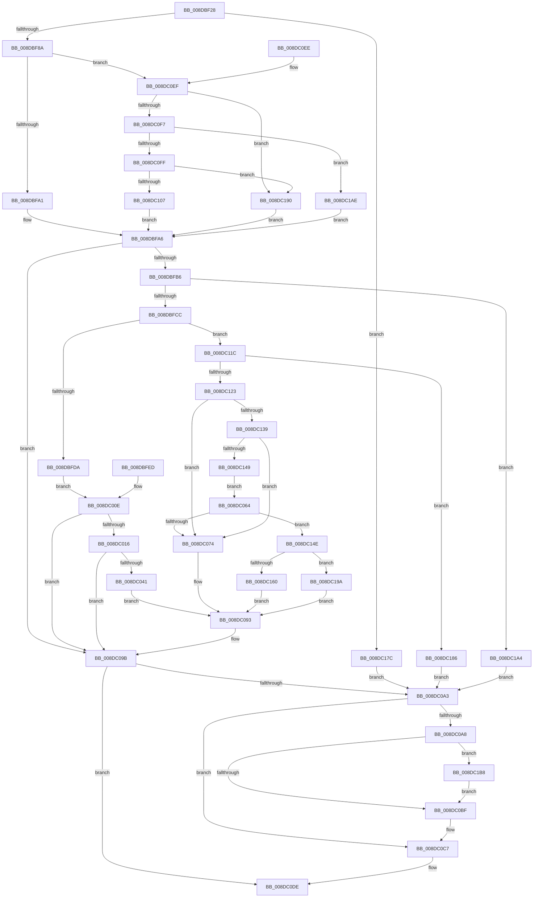

# PiDqIrpQueryGetResult

- RVA: `0x008DBF28`–`0x008DC1CA` (길이 `674` bytes)
- VA: `0x00000001408DBF28`
- 실행 섹션: `PAGE`
- PDB 이름 있음: `예`; PDB Function 태그: `아니요`
- unwind 정보 RVA: `0x000858B0`
- 디코드: `162`개 명령, `674/674` bytes 표시
- 미해석 바이트: `0` (있으면 어셈블리에 `.byte`로 보존)

> 이 문서는 커널 이미지의 기계어와 PDB 기호를 분석해 생성했습니다. 4번과 5번은 함수 원형과 자료형을 바이너리 사용 방식에서 추정한 C 해석이며 원본 소스 복구 결과는 아닙니다.

## 1. Dependencies

- 직접 호출 지점: **13**; 고유 호출 대상: **7**
- 직접 호출자로 확인된 함수: **1**
- RIP 상대 이미지 참조: **1**

### Outgoing calls
- `0x008DBF8D` → [PiDqQueryLock](PiDqQueryLock_function_008DDA0C.md) (function, `0x008DDA0C`)
- `0x008DBFA9` → [PiDqQueryUnlock](PiDqQueryUnlock_function_008DDA6C.md) (function, `0x008DDA6C`)
- `0x008DBFE6` → [ProbeForWrite](../8E/ProbeForWrite_function_008E91C0.md) (function, `0x008E91C0`)
- `0x008DC036` → [PiDqQuerySerializeActionQueue](PiDqQuerySerializeActionQueue_function_008DD340.md) (function, `0x008DD340`)
- `0x008DC044` → [PiDqQueryLock](PiDqQueryLock_function_008DDA0C.md) (function, `0x008DDA0C`)
- `0x008DC05D` → [PiDqQueryGetNextIoctlInfo](PiDqQueryGetNextIoctlInfo_function_008DCB54.md) (function, `0x008DCB54`)
- `0x008DC083` → [PiDqQueryGetNextIoctlInfo](PiDqQueryGetNextIoctlInfo_function_008DCB54.md) (function, `0x008DCB54`)
- `0x008DC096` → [PiDqQueryUnlock](PiDqQueryUnlock_function_008DDA6C.md) (function, `0x008DDA6C`)
- `0x008DC0AB` → [PiDqQueryLock](PiDqQueryLock_function_008DDA0C.md) (function, `0x008DDA0C`)
- `0x008DC0C2` → [PiDqQueryUnlock](PiDqQueryUnlock_function_008DDA6C.md) (function, `0x008DDA6C`)
- `0x008DC0D9` → [PiDqIrpComplete](PiDqIrpComplete_function_008DCF08.md) (function, `0x008DCF08`)
- `0x008DC126` → [PiDqQueryLock](PiDqQueryLock_function_008DDA0C.md) (function, `0x008DDA0C`)
- `0x008DC1C0` → [PiDqQueryFreeActiveData](PiDqQueryFreeActiveData_function_008DE4FC.md) (function, `0x008DE4FC`)

### Direct callers
- [PiDqDispatch](PiDqDispatch_function_008DC8A0.md) at `0x008DCA17`

### Static image references
- `0x008DC14E` → RVA `0x005A7CA0` (`PiDqIrpCancel`; read)

## 2. Other-region calls and transfers

- 다른 실행 섹션으로 향하는 call: **0**
- 별도 외부 분기/꼬리 이동을 확인하지 못했습니다.

## 3. Assembly (complete function range)

```asm
008DBF28  4C 8B DC                        mov r11, rsp
008DBF2B  49 89 4B 08                     mov qword ptr [r11 + 8], rcx
008DBF2F  53                              push rbx
008DBF30  56                              push rsi
008DBF31  57                              push rdi
008DBF32  41 54                           push r12
008DBF34  41 55                           push r13
008DBF36  41 57                           push r15
008DBF38  48 83 EC 68                     sub rsp, 0x68
008DBF3C  4C 8B F9                        mov r15, rcx
008DBF3F  33 DB                           xor ebx, ebx
008DBF41  4C 8B A1 B8 00 00 00            mov r12, qword ptr [rcx + 0xb8]
008DBF48  49 8B 44 24 30                  mov rax, qword ptr [r12 + 0x30]
008DBF4D  48 8B 78 20                     mov rdi, qword ptr [rax + 0x20]
008DBF51  48 89 7C 24 38                  mov qword ptr [rsp + 0x38], rdi
008DBF56  41 8B 44 24 18                  mov eax, dword ptr [r12 + 0x18]
008DBF5B  89 44 24 30                     mov dword ptr [rsp + 0x30], eax
008DBF5F  45 32 ED                        xor r13b, r13b
008DBF62  44 88 AC 24 A8 00 00 00         mov byte ptr [rsp + 0xa8], r13b
008DBF6A  41 21 5B 18                     and dword ptr [r11 + 0x18], ebx
008DBF6E  41 21 5B 20                     and dword ptr [r11 + 0x20], ebx
008DBF72  0F 57 C0                        xorps xmm0, xmm0
008DBF75  0F 11 44 24 50                  movups xmmword ptr [rsp + 0x50], xmm0
008DBF7A  48 8D B7 D8 00 00 00            lea rsi, [rdi + 0xd8]
008DBF81  48 85 FF                        test rdi, rdi
008DBF84  0F 84 F2 01 00 00               je 0x1408dc17c
008DBF8A  48 8B CF                        mov rcx, rdi
008DBF8D  E8 7A 1A 00 00                  call 0x1408dda0c
008DBF92  48 89 74 24 40                  mov qword ptr [rsp + 0x40], rsi
008DBF97  8B 06                           mov eax, dword ptr [rsi]
008DBF99  A8 08                           test al, 8
008DBF9B  0F 84 4E 01 00 00               je 0x1408dc0ef
008DBFA1  BB 20 01 00 C0                  mov ebx, 0xc0000120
008DBFA6  48 8B CF                        mov rcx, rdi
008DBFA9  E8 BE 1A 00 00                  call 0x1408dda6c
008DBFAE  85 DB                           test ebx, ebx
008DBFB0  0F 88 E5 00 00 00               js 0x1408dc09b
008DBFB6  49 83 C4 08                     add r12, 8
008DBFBA  4C 89 64 24 48                  mov qword ptr [rsp + 0x48], r12
008DBFBF  41 8B 04 24                     mov eax, dword ptr [r12]
008DBFC3  83 F8 10                        cmp eax, 0x10
008DBFC6  0F 82 D8 01 00 00               jb 0x1408dc1a4
008DBFCC  81 7C 24 30 07 00 47 00         cmp dword ptr [rsp + 0x30], 0x470007
008DBFD4  0F 85 42 01 00 00               jne 0x1408dc11c
008DBFDA  8B D0                           mov edx, eax
008DBFDC  41 B8 08 00 00 00               mov r8d, 8
008DBFE2  49 8B 4F 70                     mov rcx, qword ptr [r15 + 0x70]
008DBFE6  E8 D5 D1 00 00                  call 0x1408e91c0
008DBFEB  EB 21                           jmp 0x1408dc00e
008DBFED  8B D8                           mov ebx, eax
008DBFEF  4C 8B BC 24 A0 00 00 00         mov r15, qword ptr [rsp + 0xa0]
008DBFF7  48 8B 7C 24 38                  mov rdi, qword ptr [rsp + 0x38]
008DBFFC  44 8A AC 24 A8 00 00 00         mov r13b, byte ptr [rsp + 0xa8]
008DC004  48 8B 74 24 40                  mov rsi, qword ptr [rsp + 0x40]
008DC009  4C 8B 64 24 48                  mov r12, qword ptr [rsp + 0x48]
008DC00E  85 DB                           test ebx, ebx
008DC010  0F 88 85 00 00 00               js 0x1408dc09b
008DC016  48 8D 84 24 B8 00 00 00         lea rax, [rsp + 0xb8]
008DC01E  48 89 44 24 20                  mov qword ptr [rsp + 0x20], rax
008DC023  4C 8D 8C 24 B0 00 00 00         lea r9, [rsp + 0xb0]
008DC02B  45 8B 04 24                     mov r8d, dword ptr [r12]
008DC02F  49 8B 57 70                     mov rdx, qword ptr [r15 + 0x70]
008DC033  48 8B CF                        mov rcx, rdi
008DC036  E8 05 13 00 00                  call 0x1408dd340
008DC03B  8B D8                           mov ebx, eax
008DC03D  85 C0                           test eax, eax
008DC03F  78 5A                           js 0x1408dc09b
008DC041  48 8B CF                        mov rcx, rdi
008DC044  E8 C3 19 00 00                  call 0x1408dda0c
008DC049  4C 8D 4C 24 50                  lea r9, [rsp + 0x50]
008DC04E  44 8B 84 24 B8 00 00 00         mov r8d, dword ptr [rsp + 0xb8]
008DC056  41 8B 14 24                     mov edx, dword ptr [r12]
008DC05A  48 8B CF                        mov rcx, rdi
008DC05D  E8 F2 0A 00 00                  call 0x1408dcb54
008DC062  EB 2F                           jmp 0x1408dc093
008DC064  48 8B 47 18                     mov rax, qword ptr [rdi + 0x18]
008DC068  8B 48 28                        mov ecx, dword ptr [rax + 0x28]
008DC06B  F6 C1 01                        test cl, 1
008DC06E  0F 85 DA 00 00 00               jne 0x1408dc14e
008DC074  4C 8D 4C 24 50                  lea r9, [rsp + 0x50]
008DC079  45 33 C0                        xor r8d, r8d
008DC07C  41 8B 14 24                     mov edx, dword ptr [r12]
008DC080  48 8B CF                        mov rcx, rdi
008DC083  E8 CC 0A 00 00                  call 0x1408dcb54
008DC088  C7 84 24 B0 00 00 00 10 00 00 00  mov dword ptr [rsp + 0xb0], 0x10
008DC093  48 8B CF                        mov rcx, rdi
008DC096  E8 D1 19 00 00                  call 0x1408dda6c
008DC09B  81 FB 03 01 00 00               cmp ebx, 0x103
008DC0A1  74 3B                           je 0x1408dc0de
008DC0A3  45 84 ED                        test r13b, r13b
008DC0A6  74 1F                           je 0x1408dc0c7
008DC0A8  48 8B CF                        mov rcx, rdi
008DC0AB  E8 5C 19 00 00                  call 0x1408dda0c
008DC0B0  8B 06                           mov eax, dword ptr [rsi]
008DC0B2  83 E0 EF                        and eax, 0xffffffef
008DC0B5  89 06                           mov dword ptr [rsi], eax
008DC0B7  85 DB                           test ebx, ebx
008DC0B9  0F 88 F9 00 00 00               js 0x1408dc1b8
008DC0BF  48 8B CF                        mov rcx, rdi
008DC0C2  E8 A5 19 00 00                  call 0x1408dda6c
008DC0C7  4C 8D 4C 24 50                  lea r9, [rsp + 0x50]
008DC0CC  44 8B 84 24 B0 00 00 00         mov r8d, dword ptr [rsp + 0xb0]
008DC0D4  8B D3                           mov edx, ebx
008DC0D6  49 8B CF                        mov rcx, r15
008DC0D9  E8 2A 0E 00 00                  call 0x1408dcf08
008DC0DE  8B C3                           mov eax, ebx
008DC0E0  48 83 C4 68                     add rsp, 0x68
008DC0E4  41 5F                           pop r15
008DC0E6  41 5D                           pop r13
008DC0E8  41 5C                           pop r12
008DC0EA  5F                              pop rdi
008DC0EB  5E                              pop rsi
008DC0EC  5B                              pop rbx
008DC0ED  C3                              ret
008DC0EE  CC                              int3
008DC0EF  A8 04                           test al, 4
008DC0F1  0F 84 99 00 00 00               je 0x1408dc190
008DC0F7  A8 01                           test al, 1
008DC0F9  0F 85 AF 00 00 00               jne 0x1408dc1ae
008DC0FF  A8 10                           test al, 0x10
008DC101  0F 85 89 00 00 00               jne 0x1408dc190
008DC107  83 C8 10                        or eax, 0x10
008DC10A  89 06                           mov dword ptr [rsi], eax
008DC10C  41 B5 01                        mov r13b, 1
008DC10F  44 88 AC 24 A8 00 00 00         mov byte ptr [rsp + 0xa8], r13b
008DC117  E9 8A FE FF FF                  jmp 0x1408dbfa6
008DC11C  49 83 7F 18 00                  cmp qword ptr [r15 + 0x18], 0
008DC121  74 63                           je 0x1408dc186
008DC123  48 8B CF                        mov rcx, rdi
008DC126  E8 E1 18 00 00                  call 0x1408dda0c
008DC12B  48 83 BF B8 00 00 00 00         cmp qword ptr [rdi + 0xb8], 0
008DC133  0F 85 3B FF FF FF               jne 0x1408dc074
008DC139  48 8D 87 C0 00 00 00            lea rax, [rdi + 0xc0]
008DC140  48 39 00                        cmp qword ptr [rax], rax
008DC143  0F 85 2B FF FF FF               jne 0x1408dc074
008DC149  E9 16 FF FF FF                  jmp 0x1408dc064
008DC14E  48 8D 05 4B BB CC FF            lea rax, [rip - 0x3344b5]
008DC155  49 87 47 68                     xchg qword ptr [r15 + 0x68], rax
008DC159  41 80 7F 44 00                  cmp byte ptr [r15 + 0x44], 0
008DC15E  75 3A                           jne 0x1408dc19a
008DC160  4C 89 BF B0 00 00 00            mov qword ptr [rdi + 0xb0], r15
008DC167  49 8B 87 B8 00 00 00            mov rax, qword ptr [r15 + 0xb8]
008DC16E  80 48 03 01                     or byte ptr [rax + 3], 1
008DC172  BB 03 01 00 00                  mov ebx, 0x103
008DC177  E9 17 FF FF FF                  jmp 0x1408dc093
008DC17C  BB BB 00 00 C0                  mov ebx, 0xc00000bb
008DC181  E9 1D FF FF FF                  jmp 0x1408dc0a3
008DC186  BB 0D 00 00 C0                  mov ebx, 0xc000000d
008DC18B  E9 13 FF FF FF                  jmp 0x1408dc0a3
008DC190  BB BB 00 00 C0                  mov ebx, 0xc00000bb
008DC195  E9 0C FE FF FF                  jmp 0x1408dbfa6
008DC19A  BB 20 01 00 C0                  mov ebx, 0xc0000120
008DC19F  E9 EF FE FF FF                  jmp 0x1408dc093
008DC1A4  BB 23 00 00 C0                  mov ebx, 0xc0000023
008DC1A9  E9 F5 FE FF FF                  jmp 0x1408dc0a3
008DC1AE  BB 9A 00 00 C0                  mov ebx, 0xc000009a
008DC1B3  E9 EE FD FF FF                  jmp 0x1408dbfa6
008DC1B8  83 C8 01                        or eax, 1
008DC1BB  89 06                           mov dword ptr [rsi], eax
008DC1BD  48 8B CF                        mov rcx, rdi
008DC1C0  E8 37 23 00 00                  call 0x1408de4fc
008DC1C5  E9 F5 FE FF FF                  jmp 0x1408dc0bf
```

## 4. C-style interpretation (structured pseudocode)

```c
__int64 __fastcall PiDqIrpQueryGetResult(__int64 a1)
{
    __int64 result;
    __int64 v_r12;
    __int64 v_r13;
    __int64 v_rbx;
    __int64 v_rsp;
    unsigned __int64 v_stack_m48;
    unsigned __int64 v_stack_m50;
    unsigned __int64 v_stack_m58;
    unsigned __int64 v_stack_m60;
    unsigned int v_stack_m68;
    unsigned __int64 v_stack_m78;
    unsigned __int8 v_stack_p10;
    unsigned __int64 v_stack_p18;
    unsigned __int64 v_stack_p20;
    unsigned __int64 v_stack_p8;
    unsigned __int8 v_stack_pA8;

    *(unsigned __int64 *)(v_rsp + 8) = a1;
    v_rsp = (v_rsp) - (104);
    v_rbx = 0;
    v_stack_m60 = *(unsigned __int64 *)(*(unsigned __int64 *)(*(unsigned __int64 *)(a1 + 184) + 48) + 32);
    v_stack_m68 = (unsigned int)((unsigned int)(*(unsigned int *)(*(unsigned __int64 *)(a1 + 184) + 24)));
    v_r13 = 0;
    v_stack_p10 = 0;
    v_stack_m48 = v_xmm0;
    if (*(unsigned __int64 *)(*(unsigned __int64 *)(*(unsigned __int64 *)(a1 + 184) + 48) + 32) == 0) goto loc_008DC17C;
    result = PiDqQueryLock(*(unsigned __int64 *)(*(unsigned __int64 *)(*(unsigned __int64 *)(a1 + 184) + 48) + 32), a2, a3, a4);
    v_stack_m58 = *(unsigned __int64 *)(*(unsigned __int64 *)(*(unsigned __int64 *)(a1 + 184) + 48) + 32) + 216;
    if ((((unsigned __int8)((unsigned int)(*(unsigned int *)(*(unsigned __int64 *)(*(unsigned __int64 *)(*(unsigned __int64 *)(a1 + 184) + 48) + 32) + 216)))) & (8)) == 0) goto loc_008DC0EF;
loc_008DBFA6:
    result = PiDqQueryUnlock(*(unsigned __int64 *)(*(unsigned __int64 *)(*(unsigned __int64 *)(a1 + 184) + 48) + 32), a2, a3, a4);
    if (sign_flag) goto loc_008DC09B;
    v_r12 = (*(unsigned __int64 *)(a1 + 184)) + (8);
    v_stack_m50 = v_r12;
    if (((unsigned int)((unsigned int)(*(unsigned int *)(v_r12)))) < 16) goto loc_008DC1A4;
    if (v_stack_m68 != 0x470007ULL) goto loc_008DC11C;
    result = ProbeForWrite(*(unsigned __int64 *)(a1 + 112), (unsigned int)((unsigned int)((unsigned int)(*(unsigned int *)(v_r12)))), 8, a4);
    goto loc_008DC00E;
loc_008DC00E:
    if (sign_flag) goto loc_008DC09B;
    v_stack_m78 = v_stack_p20;
    result = PiDqQuerySerializeActionQueue(*(unsigned __int64 *)(*(unsigned __int64 *)(*(unsigned __int64 *)(a1 + 184) + 48) + 32), *(unsigned __int64 *)(a1 + 112), (unsigned int)(*(unsigned int *)(v_r12)), v_stack_p18);
    if (sign_flag) goto loc_008DC09B;
    result = PiDqQueryLock(*(unsigned __int64 *)(*(unsigned __int64 *)(*(unsigned __int64 *)(a1 + 184) + 48) + 32), *(unsigned __int64 *)(a1 + 112), (unsigned int)(*(unsigned int *)(v_r12)), v_stack_p18);
    result = PiDqQueryGetNextIoctlInfo(*(unsigned __int64 *)(*(unsigned __int64 *)(*(unsigned __int64 *)(a1 + 184) + 48) + 32), (unsigned int)(*(unsigned int *)(v_r12)), (unsigned int)(v_stack_p20), v_stack_m48);
    goto loc_008DC093;
loc_008DC064:
    if ((((unsigned __int8)((unsigned int)(*(unsigned int *)(*(unsigned __int64 *)(*(unsigned __int64 *)(*(unsigned __int64 *)(*(unsigned __int64 *)(a1 + 184) + 48) + 32) + 24) + 40)))) & (1)) != 0) goto loc_008DC14E;
loc_008DC074:
    a3 = 0;
    result = PiDqQueryGetNextIoctlInfo(*(unsigned __int64 *)(*(unsigned __int64 *)(*(unsigned __int64 *)(a1 + 184) + 48) + 32), (unsigned int)(*(unsigned int *)(v_r12)), a3, v_stack_m48);
    v_stack_p18 = 16;
loc_008DC093:
    result = PiDqQueryUnlock(*(unsigned __int64 *)(*(unsigned __int64 *)(*(unsigned __int64 *)(a1 + 184) + 48) + 32), (unsigned int)(*(unsigned int *)(v_r12)), a3, v_stack_m48);
loc_008DC09B:
    if (((unsigned int)((unsigned int)((unsigned int)(result)))) == 259) goto loc_008DC0DE;
loc_008DC0A3:
    if (0 == 0) goto loc_008DC0C7;
    result = PiDqQueryLock(*(unsigned __int64 *)(*(unsigned __int64 *)(*(unsigned __int64 *)(a1 + 184) + 48) + 32), (unsigned int)(*(unsigned int *)(v_r12)), a3, v_stack_m48);
    result = (unsigned int)(((unsigned int)(*(unsigned int *)(*(unsigned __int64 *)(*(unsigned __int64 *)(*(unsigned __int64 *)(a1 + 184) + 48) + 32) + 216))) & (0xFFFFFFEFULL));
    *(unsigned int *)(*(unsigned __int64 *)(*(unsigned __int64 *)(*(unsigned __int64 *)(a1 + 184) + 48) + 32) + 216) = (unsigned int)(result);
    if (sign_flag) goto loc_008DC1B8;
loc_008DC0BF:
    result = PiDqQueryUnlock(*(unsigned __int64 *)(*(unsigned __int64 *)(*(unsigned __int64 *)(a1 + 184) + 48) + 32), (unsigned int)(*(unsigned int *)(v_r12)), a3, v_stack_m48);
loc_008DC0C7:
    result = PiDqIrpComplete(a1, (unsigned int)((unsigned int)((unsigned int)((unsigned int)(result)))), (unsigned int)(v_stack_p18), v_stack_m48);
loc_008DC0DE:
    v_rsp = (v_rsp) + (104);
    return (unsigned int)((unsigned int)((unsigned int)((unsigned int)(result))));
loc_008DC0EF:
    if ((((unsigned __int8)((unsigned int)((unsigned int)((unsigned int)((unsigned int)(result)))))) & (4)) == 0) goto loc_008DC190;
    if ((((unsigned __int8)((unsigned int)((unsigned int)((unsigned int)((unsigned int)(result)))))) & (1)) != 0) goto loc_008DC1AE;
    if ((((unsigned __int8)((unsigned int)((unsigned int)((unsigned int)((unsigned int)(result)))))) & (16)) != 0) goto loc_008DC190;
    result = (unsigned int)(((unsigned int)((unsigned int)((unsigned int)((unsigned int)(result))))) | (16));
    *(unsigned int *)(*(unsigned __int64 *)(*(unsigned __int64 *)(*(unsigned __int64 *)(a1 + 184) + 48) + 32) + 216) = (unsigned int)(result);
    v_stack_pA8 = 1;
    goto loc_008DBFA6;
loc_008DC11C:
    if ((*(unsigned __int64 *)(a1 + 24)) == 0) goto loc_008DC186;
    result = PiDqQueryLock(*(unsigned __int64 *)(*(unsigned __int64 *)(*(unsigned __int64 *)(a1 + 184) + 48) + 32), (unsigned int)((unsigned int)((unsigned int)((unsigned int)(result)))), (unsigned int)(v_stack_p18), v_stack_m48);
    if ((*(unsigned __int64 *)(*(unsigned __int64 *)(*(unsigned __int64 *)(*(unsigned __int64 *)(a1 + 184) + 48) + 32) + 184)) != 0) goto loc_008DC074;
    if ((*(unsigned __int64 *)(*(unsigned __int64 *)(*(unsigned __int64 *)(*(unsigned __int64 *)(a1 + 184) + 48) + 32) + 192)) != (*(unsigned __int64 *)(*(unsigned __int64 *)(*(unsigned __int64 *)(a1 + 184) + 48) + 32) + 192)) goto loc_008DC074;
    goto loc_008DC064;
loc_008DC14E:
    if ((*(unsigned __int8 *)(a1 + 68)) != 0) goto loc_008DC19A;
    *(unsigned __int64 *)(*(unsigned __int64 *)(*(unsigned __int64 *)(*(unsigned __int64 *)(a1 + 184) + 48) + 32) + 176) = a1;
    goto loc_008DC093;
loc_008DC17C:
    goto loc_008DC0A3;
loc_008DC186:
    goto loc_008DC0A3;
loc_008DC190:
    goto loc_008DBFA6;
loc_008DC19A:
    goto loc_008DC093;
loc_008DC1A4:
    goto loc_008DC0A3;
loc_008DC1AE:
    goto loc_008DBFA6;
loc_008DC1B8:
    result = (unsigned int)((*(unsigned __int64 *)(a1 + 184)) | (1));
    *(unsigned int *)(*(unsigned __int64 *)(*(unsigned __int64 *)(*(unsigned __int64 *)(a1 + 184) + 48) + 32) + 216) = (unsigned int)(result);
    result = PiDqQueryFreeActiveData(*(unsigned __int64 *)(*(unsigned __int64 *)(*(unsigned __int64 *)(a1 + 184) + 48) + 32), (unsigned int)((unsigned int)((unsigned int)((unsigned int)(result)))), (unsigned int)(v_stack_p18), v_stack_m48);
    goto loc_008DC0BF;
}
```

## 5. (Beta) C Style

```c
int64_t PiDqIrpQueryGetResult(void *Arg1)
{
    uint8_t *arg1 = (uint8_t *)Arg1;

    int64_t result;
    int64_t local_r12;
    int64_t local_r13;
    int64_t local_rbx;
    int64_t local_rsp;
    uint64_t v_stack_m48;
    uint64_t v_stack_m50;
    uint64_t v_stack_m58;
    uint64_t v_stack_m60;
    uint32_t v_stack_m68;
    uint64_t v_stack_m78;
    uint8_t v_stack_p10;
    uint64_t v_stack_p18;
    uint64_t v_stack_p20;
    uint64_t v_stack_p8;
    uint8_t v_stack_pA8;

    *(void **)(local_rsp + 0x8) = Arg1;
    local_rsp = (local_rsp) - (104);
    local_rbx = 0;
    v_stack_m60 = *(uint64_t *)(*(uint64_t *)(*(uint64_t *)(arg1 + 0xB8) + 0x30) + 0x20);
    v_stack_m68 = (uint32_t)((uint32_t)(*(uint32_t *)(*(uint64_t *)(arg1 + 0xB8) + 0x18)));
    local_r13 = 0;
    v_stack_p10 = 0;
    v_stack_m48 = v_xmm0;
    if (*(uint64_t *)(*(uint64_t *)(*(uint64_t *)(arg1 + 0xB8) + 0x30) + 0x20) == 0) goto loc_008DC17C;
    result = PiDqQueryLock(*(uint64_t *)(*(uint64_t *)(*(uint64_t *)(arg1 + 0xB8) + 0x30) + 0x20), a2, a3, a4);
    v_stack_m58 = *(uint64_t *)(*(uint64_t *)(*(uint64_t *)(arg1 + 0xB8) + 0x30) + 0x20) + 216;
    if ((((uint8_t)((uint32_t)(*(uint32_t *)(*(uint64_t *)(*(uint64_t *)(*(uint64_t *)(arg1 + 0xB8) + 0x30) + 0x20) + 0xD8)))) & (8)) == 0) goto loc_008DC0EF;
loc_008DBFA6:
    result = PiDqQueryUnlock(*(uint64_t *)(*(uint64_t *)(*(uint64_t *)(arg1 + 0xB8) + 0x30) + 0x20), a2, a3, a4);
    if (sign_flag) goto loc_008DC09B;
    local_r12 = (*(uint64_t *)(arg1 + 0xB8)) + (8);
    v_stack_m50 = local_r12;
    if (((uint32_t)((uint32_t)(*(uint32_t *)(local_r12)))) < 16) goto loc_008DC1A4;
    if (v_stack_m68 != 0x470007ULL) goto loc_008DC11C;
    result = ProbeForWrite(*(uint64_t *)(arg1 + 0x70), (uint32_t)((uint32_t)((uint32_t)(*(uint32_t *)(local_r12)))), 8, a4);
    goto loc_008DC00E;
loc_008DC00E:
    if (sign_flag) goto loc_008DC09B;
    v_stack_m78 = v_stack_p20;
    result = PiDqQuerySerializeActionQueue(*(uint64_t *)(*(uint64_t *)(*(uint64_t *)(arg1 + 0xB8) + 0x30) + 0x20), *(uint64_t *)(arg1 + 0x70), (uint32_t)(*(uint32_t *)(local_r12)), v_stack_p18);
    if (sign_flag) goto loc_008DC09B;
    result = PiDqQueryLock(*(uint64_t *)(*(uint64_t *)(*(uint64_t *)(arg1 + 0xB8) + 0x30) + 0x20), *(uint64_t *)(arg1 + 0x70), (uint32_t)(*(uint32_t *)(local_r12)), v_stack_p18);
    result = PiDqQueryGetNextIoctlInfo(*(uint64_t *)(*(uint64_t *)(*(uint64_t *)(arg1 + 0xB8) + 0x30) + 0x20), (uint32_t)(*(uint32_t *)(local_r12)), (uint32_t)(v_stack_p20), v_stack_m48);
    goto loc_008DC093;
loc_008DC064:
    if ((((uint8_t)((uint32_t)(*(uint32_t *)(*(uint64_t *)(*(uint64_t *)(*(uint64_t *)(*(uint64_t *)(arg1 + 0xB8) + 0x30) + 0x20) + 0x18) + 0x28)))) & (1)) != 0) goto loc_008DC14E;
loc_008DC074:
    a3 = 0;
    result = PiDqQueryGetNextIoctlInfo(*(uint64_t *)(*(uint64_t *)(*(uint64_t *)(arg1 + 0xB8) + 0x30) + 0x20), (uint32_t)(*(uint32_t *)(local_r12)), a3, v_stack_m48);
    v_stack_p18 = 16;
loc_008DC093:
    result = PiDqQueryUnlock(*(uint64_t *)(*(uint64_t *)(*(uint64_t *)(arg1 + 0xB8) + 0x30) + 0x20), (uint32_t)(*(uint32_t *)(local_r12)), a3, v_stack_m48);
loc_008DC09B:
    if (((uint32_t)((uint32_t)((uint32_t)(result)))) == 259) goto loc_008DC0DE;
loc_008DC0A3:
    if (0 == 0) goto loc_008DC0C7;
    result = PiDqQueryLock(*(uint64_t *)(*(uint64_t *)(*(uint64_t *)(arg1 + 0xB8) + 0x30) + 0x20), (uint32_t)(*(uint32_t *)(local_r12)), a3, v_stack_m48);
    result = (uint32_t)(((uint32_t)(*(uint32_t *)(*(uint64_t *)(*(uint64_t *)(*(uint64_t *)(arg1 + 0xB8) + 0x30) + 0x20) + 0xD8))) & (0xFFFFFFEFULL));
    *(uint32_t *)(*(uint64_t *)(*(uint64_t *)(*(uint64_t *)(arg1 + 0xB8) + 0x30) + 0x20) + 0xD8) = (uint32_t)(result);
    if (sign_flag) goto loc_008DC1B8;
loc_008DC0BF:
    result = PiDqQueryUnlock(*(uint64_t *)(*(uint64_t *)(*(uint64_t *)(arg1 + 0xB8) + 0x30) + 0x20), (uint32_t)(*(uint32_t *)(local_r12)), a3, v_stack_m48);
loc_008DC0C7:
    result = PiDqIrpComplete(Arg1, (uint32_t)((uint32_t)((uint32_t)((uint32_t)(result)))), (uint32_t)(v_stack_p18), v_stack_m48);
loc_008DC0DE:
    local_rsp = (local_rsp) + (104);
    return (uint32_t)((uint32_t)((uint32_t)((uint32_t)(result))));
loc_008DC0EF:
    if ((((uint8_t)((uint32_t)((uint32_t)((uint32_t)((uint32_t)(result)))))) & (4)) == 0) goto loc_008DC190;
    if ((((uint8_t)((uint32_t)((uint32_t)((uint32_t)((uint32_t)(result)))))) & (1)) != 0) goto loc_008DC1AE;
    if ((((uint8_t)((uint32_t)((uint32_t)((uint32_t)((uint32_t)(result)))))) & (16)) != 0) goto loc_008DC190;
    result = (uint32_t)(((uint32_t)((uint32_t)((uint32_t)((uint32_t)(result))))) | (16));
    *(uint32_t *)(*(uint64_t *)(*(uint64_t *)(*(uint64_t *)(arg1 + 0xB8) + 0x30) + 0x20) + 0xD8) = (uint32_t)(result);
    v_stack_pA8 = 1;
    goto loc_008DBFA6;
loc_008DC11C:
    if ((*(uint64_t *)(arg1 + 0x18)) == 0) goto loc_008DC186;
    result = PiDqQueryLock(*(uint64_t *)(*(uint64_t *)(*(uint64_t *)(arg1 + 0xB8) + 0x30) + 0x20), (uint32_t)((uint32_t)((uint32_t)((uint32_t)(result)))), (uint32_t)(v_stack_p18), v_stack_m48);
    if ((*(uint64_t *)(*(uint64_t *)(*(uint64_t *)(*(uint64_t *)(arg1 + 0xB8) + 0x30) + 0x20) + 0xB8)) != 0) goto loc_008DC074;
    if ((*(uint64_t *)(*(uint64_t *)(*(uint64_t *)(*(uint64_t *)(arg1 + 0xB8) + 0x30) + 0x20) + 0xC0)) != (*(uint64_t *)(*(uint64_t *)(*(uint64_t *)(arg1 + 0xB8) + 0x30) + 0x20) + 192)) goto loc_008DC074;
    goto loc_008DC064;
loc_008DC14E:
    if ((*(uint8_t *)(arg1 + 0x44)) != 0) goto loc_008DC19A;
    *(void **)(*(uint64_t *)(*(uint64_t *)(*(uint64_t *)(arg1 + 0xB8) + 0x30) + 0x20) + 0xB0) = Arg1;
    goto loc_008DC093;
loc_008DC17C:
    goto loc_008DC0A3;
loc_008DC186:
    goto loc_008DC0A3;
loc_008DC190:
    goto loc_008DBFA6;
loc_008DC19A:
    goto loc_008DC093;
loc_008DC1A4:
    goto loc_008DC0A3;
loc_008DC1AE:
    goto loc_008DBFA6;
loc_008DC1B8:
    result = (uint32_t)((*(uint64_t *)(arg1 + 0xB8)) | (1));
    *(uint32_t *)(*(uint64_t *)(*(uint64_t *)(*(uint64_t *)(arg1 + 0xB8) + 0x30) + 0x20) + 0xD8) = (uint32_t)(result);
    result = PiDqQueryFreeActiveData(*(uint64_t *)(*(uint64_t *)(*(uint64_t *)(arg1 + 0xB8) + 0x30) + 0x20), (uint32_t)((uint32_t)((uint32_t)((uint32_t)(result)))), (uint32_t)(v_stack_p18), v_stack_m48);
    goto loc_008DC0BF;
}
```

### 관측된 메모리 오프셋

구조체 형식이 확인되지 않은 접근은 인자 기준의 오프셋으로만 기록했습니다.

| 기준 인자 | 오프셋 표현 | 폭 (bit) | 접근 |
|---|---:|---:|---|
| `Arg1` | `+ 0x18` | `64` | `R` |
| `Arg1` | `+ 0x44` | `8` | `R` |
| `Arg1` | `+ 0x68` | `64` | `R/W` |
| `Arg1` | `+ 0x70` | `64` | `R` |
| `Arg1` | `+ 0xB8` | `64` | `R` |

## 6. Execution-region graph

[열기: 2D/3D 그래프와 함수 탐색 컨트롤 패널](../../../control-panel.html?section=page&rva=0x008DBF28&view=graph)

- 2D 그래프는 위에서 아래로 흐르고, 3D 그래프는 빈 공간을 드래그해 회전합니다. Shift+드래그는 이동, 휠은 확대·축소, 함수 노드 선택은 대상 보고서 이동입니다.

### Static fallback


