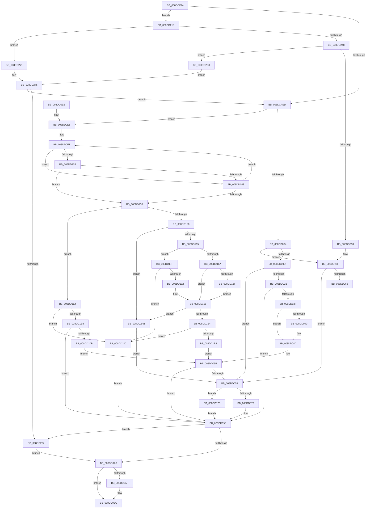

# PiDqObjectManagerEnumerateAndRegisterQuery

- RVA: `0x008DCF74`–`0x008DD2D1` (길이 `861` bytes)
- VA: `0x00000001408DCF74`
- 실행 섹션: `PAGE`
- PDB 이름 있음: `예`; PDB Function 태그: `예`
- unwind 정보 RVA: `0x00085A04`
- 디코드: `227`개 명령, `861/861` bytes 표시
- 미해석 바이트: `0` (있으면 어셈블리에 `.byte`로 보존)

> 이 문서는 커널 이미지의 기계어와 PDB 기호를 분석해 생성했습니다. 4번과 5번은 함수 원형과 자료형을 바이너리 사용 방식에서 추정한 C 해석이며 원본 소스 복구 결과는 아닙니다.

## 1. Dependencies

- 직접 호출 지점: **23**; 고유 호출 대상: **19**
- 직접 호출자로 확인된 함수: **1**
- RIP 상대 이미지 참조: **3**

### Outgoing calls
- `0x008DCFF0` → [PiDqQueryLock](PiDqQueryLock_function_008DDA0C.md) (function, `0x008DDA0C`)
- `0x008DD01D` → [PiDmGetObject](PiDmGetObject_function_008DFAE0.md) (function, `0x008DFAE0`)
- `0x008DD037` → [PiDmObjectIsEnumerable](../8E/PiDmObjectIsEnumerable_function_008E6458.md) (function, `0x008E6458`)
- `0x008DD046` → [PiDqQueryEnumObject](PiDqQueryEnumObject_function_008DF424.md) (function, `0x008DF424`)
- `0x008DD050` → [PiDmObjectRelease](../8E/PiDmObjectRelease_function_008E4F70.md) (function, `0x008E4F70`)
- `0x008DD069` → [ExAllocatePool2](../../poolcode/B8/ExAllocatePool2_function_00B820F0.md) (function, `0x00B820F0`)
- `0x008DD08C` → [PiDqQueryAppendActionEntry](PiDqQueryAppendActionEntry_function_008DEB34.md) (function, `0x008DEB34`)
- `0x008DD09B` → [PiDqQueryUnlock](PiDqQueryUnlock_function_008DDA6C.md) (function, `0x008DDA6C`)
- `0x008DD0B2` → [ExReleaseResourceLite](../../text/25/ExReleaseResourceLite_function_0025FA10.md) (function, `0x0025FA10`)
- `0x008DD0B7` → [KeLeaveCriticalRegion](../../text/25/KeLeaveCriticalRegion_function_0025D8B0.md) (function, `0x0025D8B0`)
- `0x008DD0C5` → [_security_check_cookie](../../text/6A/_security_check_cookie_function_006AC640.md) (function, `0x006AC640`)
- `0x008DD133` → [ConstraintEval](ConstraintEval_function_008DC1D0.md) (function, `0x008DC1D0`)
- `0x008DD187` → [PnpStringFromGuid](../8F/PnpStringFromGuid_function_008F5A2C.md) (function, `0x008F5A2C`)
- `0x008DD1A2` → [PiDmGetObject](PiDmGetObject_function_008DFAE0.md) (function, `0x008DFAE0`)
- `0x008DD1CB` → [PiDmListEnumObjectsWithCallback](../8E/PiDmListEnumObjectsWithCallback_function_008E3B60.md) (function, `0x008E3B60`)
- `0x008DD1D7` → [PiDmObjectRelease](../8E/PiDmObjectRelease_function_008E4F70.md) (function, `0x008E4F70`)
- `0x008DD1F9` → [PiDmEnumObjectsWithCallback](../8E/PiDmEnumObjectsWithCallback_function_008E3920.md) (function, `0x008E3920`)
- `0x008DD22F` → [ExAcquireResourceSharedLite](../../text/21/ExAcquireResourceSharedLite_function_00211BC0.md) (function, `0x00211BC0`)
- `0x008DD238` → [ExAcquireFastMutex](../../text/20/ExAcquireFastMutex_function_0020E5A0.md) (function, `0x0020E5A0`)
- `0x008DD27A` → [ExReleaseFastMutex](../../text/25/ExReleaseFastMutex_function_002519C0.md) (function, `0x002519C0`)
- `0x008DD28A` → [PiDqQueryLock](PiDqQueryLock_function_008DDA0C.md) (function, `0x008DDA0C`)
- `0x008DD299` → [PiDqQueryFreeActiveData](PiDqQueryFreeActiveData_function_008DE4FC.md) (function, `0x008DE4FC`)
- `0x008DD2A1` → [PiDqQueryUnlock](PiDqQueryUnlock_function_008DDA6C.md) (function, `0x008DDA6C`)

### Direct callers
- [PiDqQuerySerializeActionQueue](PiDqQuerySerializeActionQueue_function_008DD340.md) at `0x008DD3AA`

### Static image references
- `0x008DCF90` → RVA `0x00E0A740` (`.data`; read)
- `0x008DD0EB` → RVA `0x00001C60` (`.rdata`; read)
- `0x008DD1BD` → RVA `0x008DF400` (`PiDqEnumQueryObjectsCallback`; read)

## 2. Other-region calls and transfers

- 다른 실행 섹션으로 향하는 call: **7**
  - `0x008DD069` → [ExAllocatePool2](../../poolcode/B8/ExAllocatePool2_function_00B820F0.md) (`PAGE` → `POOLCODE`)
  - `0x008DD0B2` → [ExReleaseResourceLite](../../text/25/ExReleaseResourceLite_function_0025FA10.md) (`PAGE` → `.text`)
  - `0x008DD0B7` → [KeLeaveCriticalRegion](../../text/25/KeLeaveCriticalRegion_function_0025D8B0.md) (`PAGE` → `.text`)
  - `0x008DD0C5` → [_security_check_cookie](../../text/6A/_security_check_cookie_function_006AC640.md) (`PAGE` → `.text`)
  - `0x008DD22F` → [ExAcquireResourceSharedLite](../../text/21/ExAcquireResourceSharedLite_function_00211BC0.md) (`PAGE` → `.text`)
  - `0x008DD238` → [ExAcquireFastMutex](../../text/20/ExAcquireFastMutex_function_0020E5A0.md) (`PAGE` → `.text`)
  - `0x008DD27A` → [ExReleaseFastMutex](../../text/25/ExReleaseFastMutex_function_002519C0.md) (`PAGE` → `.text`)
- call이 아닌 외부 분기/꼬리 이동: **1**
  - `0x008DD26C` → [sub_00B1CD26](../B1/Unknown_function_00B1CD26.md) (`tail-transfer`)

## 3. Assembly (complete function range)

```asm
008DCF74  48 89 5C 24 18                  mov qword ptr [rsp + 0x18], rbx
008DCF79  55                              push rbp
008DCF7A  56                              push rsi
008DCF7B  57                              push rdi
008DCF7C  41 54                           push r12
008DCF7E  41 55                           push r13
008DCF80  41 56                           push r14
008DCF82  41 57                           push r15
008DCF84  48 8D 6C 24 D9                  lea rbp, [rsp - 0x27]
008DCF89  48 81 EC 00 01 00 00            sub rsp, 0x100
008DCF90  48 8B 05 A9 D7 52 00            mov rax, qword ptr [rip + 0x52d7a9]
008DCF97  48 33 C4                        xor rax, rsp
008DCF9A  48 89 45 17                     mov qword ptr [rbp + 0x17], rax
008DCF9E  48 8B 42 18                     mov rax, qword ptr [rdx + 0x18]
008DCFA2  45 33 ED                        xor r13d, r13d
008DCFA5  0F 57 C9                        xorps xmm1, xmm1
008DCFA8  4C 89 6C 24 38                  mov qword ptr [rsp + 0x38], r13
008DCFAD  0F 57 C0                        xorps xmm0, xmm0
008DCFB0  4C 8B F1                        mov r14, rcx
008DCFB3  33 C9                           xor ecx, ecx
008DCFB5  49 83 CF FF                     or r15, 0xffffffffffffffff
008DCFB9  8A 40 28                        mov al, byte ptr [rax + 0x28]
008DCFBC  48 8B FA                        mov rdi, rdx
008DCFBF  24 01                           and al, 1
008DCFC1  48 89 4D 97                     mov qword ptr [rbp - 0x69], rcx
008DCFC5  88 44 24 30                     mov byte ptr [rsp + 0x30], al
008DCFC9  41 8B DD                        mov ebx, r13d
008DCFCC  45 8B E5                        mov r12d, r13d
008DCFCF  0F 11 45 9F                     movups xmmword ptr [rbp - 0x61], xmm0
008DCFD3  0F 11 45 AF                     movups xmmword ptr [rbp - 0x51], xmm0
008DCFD7  0F 11 4C 24 40                  movups xmmword ptr [rsp + 0x40], xmm1
008DCFDC  0F 11 4C 24 50                  movups xmmword ptr [rsp + 0x50], xmm1
008DCFE1  0F 11 4D 87                     movups xmmword ptr [rbp - 0x79], xmm1
008DCFE5  84 C0                           test al, al
008DCFE7  0F 85 2B 02 00 00               jne 0x1408dd218
008DCFED  48 8B CF                        mov rcx, rdi
008DCFF0  E8 17 0A 00 00                  call 0x1408dda0c
008DCFF5  48 8B 57 18                     mov rdx, qword ptr [rdi + 0x18]
008DCFF9  8B 4A 14                        mov ecx, dword ptr [rdx + 0x14]
008DCFFC  85 C9                           test ecx, ecx
008DCFFE  0F 84 E2 00 00 00               je 0x1408dd0e6
008DD004  83 E9 01                        sub ecx, 1
008DD007  0F 85 52 02 00 00               jne 0x1408dd25f
008DD00D  48 8B 52 18                     mov rdx, qword ptr [rdx + 0x18]
008DD011  4C 8D 44 24 38                  lea r8, [rsp + 0x38]
008DD016  41 8B 8E E8 00 00 00            mov ecx, dword ptr [r14 + 0xe8]
008DD01D  E8 BE 2A 00 00                  call 0x1408dfae0
008DD022  8B D8                           mov ebx, eax
008DD024  3D 34 00 00 C0                  cmp eax, 0xc0000034
008DD029  74 2E                           je 0x1408dd059
008DD02B  85 C0                           test eax, eax
008DD02D  78 69                           js 0x1408dd098
008DD02F  48 8B 74 24 38                  mov rsi, qword ptr [rsp + 0x38]
008DD034  48 8B CE                        mov rcx, rsi
008DD037  E8 1C 94 00 00                  call 0x1408e6458
008DD03C  84 C0                           test al, al
008DD03E  74 0D                           je 0x1408dd04d
008DD040  48 8B D6                        mov rdx, rsi
008DD043  48 8B CF                        mov rcx, rdi
008DD046  E8 D9 23 00 00                  call 0x1408df424
008DD04B  8B D8                           mov ebx, eax
008DD04D  48 8B CE                        mov rcx, rsi
008DD050  E8 1B 7F 00 00                  call 0x1408e4f70
008DD055  85 DB                           test ebx, ebx
008DD057  78 3F                           js 0x1408dd098
008DD059  BA 28 00 00 00                  mov edx, 0x28
008DD05E  B9 00 01 00 00                  mov ecx, 0x100
008DD063  41 B8 50 6E 70 58               mov r8d, 0x58706e50
008DD069  E8 82 50 2A 00                  call 0x140b820f0
008DD06E  48 85 C0                        test rax, rax
008DD071  0F 84 FE 00 00 00               je 0x1408dd175
008DD077  48 8B D0                        mov rdx, rax
008DD07A  44 89 68 20                     mov dword ptr [rax + 0x20], r13d
008DD07E  48 8B CF                        mov rcx, rdi
008DD081  4C 89 68 10                     mov qword ptr [rax + 0x10], r13
008DD085  4C 89 68 18                     mov qword ptr [rax + 0x18], r13
008DD089  41 8B DD                        mov ebx, r13d
008DD08C  E8 A3 1A 00 00                  call 0x1408deb34
008DD091  83 8F D8 00 00 00 20            or dword ptr [rdi + 0xd8], 0x20
008DD098  48 8B CF                        mov rcx, rdi
008DD09B  E8 CC 09 00 00                  call 0x1408dda6c
008DD0A0  85 DB                           test ebx, ebx
008DD0A2  0F 88 DF 01 00 00               js 0x1408dd287
008DD0A8  44 38 6C 24 30                  cmp byte ptr [rsp + 0x30], r13b
008DD0AD  74 0D                           je 0x1408dd0bc
008DD0AF  49 8B CE                        mov rcx, r14
008DD0B2  E8 59 29 98 FF                  call 0x14025fa10
008DD0B7  E8 F4 07 98 FF                  call 0x14025d8b0
008DD0BC  8B C3                           mov eax, ebx
008DD0BE  48 8B 4D 17                     mov rcx, qword ptr [rbp + 0x17]
008DD0C2  48 33 CC                        xor rcx, rsp
008DD0C5  E8 76 F5 DC FF                  call 0x1406ac640
008DD0CA  48 8B 9C 24 50 01 00 00         mov rbx, qword ptr [rsp + 0x150]
008DD0D2  48 81 C4 00 01 00 00            add rsp, 0x100
008DD0D9  41 5F                           pop r15
008DD0DB  41 5E                           pop r14
008DD0DD  41 5D                           pop r13
008DD0DF  41 5C                           pop r12
008DD0E1  5F                              pop rdi
008DD0E2  5E                              pop rsi
008DD0E3  5D                              pop rbp
008DD0E4  C3                              ret
008DD0E5  CC                              int3
008DD0E6  B9 01 00 00 C0                  mov ecx, 0xc0000001
008DD0EB  48 8D 35 6E 4B 72 FF            lea rsi, [rip - 0x8db492]
008DD0F2  8B D9                           mov ebx, ecx
008DD0F4  45 8B FD                        mov r15d, r13d
008DD0F7  41 8B 86 E8 00 00 00            mov eax, dword ptr [r14 + 0xe8]
008DD0FE  4C 8B EE                        mov r13, rsi
008DD101  39 06                           cmp dword ptr [rsi], eax
008DD103  75 3E                           jne 0x1408dd143
008DD105  48 8B 46 08                     mov rax, qword ptr [rsi + 8]
008DD109  4C 8D 45 9F                     lea r8, [rbp - 0x61]
008DD10D  48 8B 4F 18                     mov rcx, qword ptr [rdi + 0x18]
008DD111  44 8B 4E 10                     mov r9d, dword ptr [rsi + 0x10]
008DD115  0F 10 00                        movups xmm0, xmmword ptr [rax]
008DD118  8B 40 10                        mov eax, dword ptr [rax + 0x10]
008DD11B  48 8B 51 58                     mov rdx, qword ptr [rcx + 0x58]
008DD11F  8B 49 50                        mov ecx, dword ptr [rcx + 0x50]
008DD122  89 45 AF                        mov dword ptr [rbp - 0x51], eax
008DD125  48 8D 44 24 40                  lea rax, [rsp + 0x40]
008DD12A  48 89 44 24 20                  mov qword ptr [rsp + 0x20], rax
008DD12F  0F 11 45 9F                     movups xmmword ptr [rbp - 0x61], xmm0
008DD133  E8 98 F0 FF FF                  call 0x1408dc1d0
008DD138  B9 01 00 00 C0                  mov ecx, 0xc0000001
008DD13D  8B D8                           mov ebx, eax
008DD13F  3B C1                           cmp eax, ecx
008DD141  75 0D                           jne 0x1408dd150
008DD143  41 FF C7                        inc r15d
008DD146  48 83 C6 20                     add rsi, 0x20
008DD14A  41 83 FF 06                     cmp r15d, 6
008DD14E  72 A7                           jb 0x1408dd0f7
008DD150  85 DB                           test ebx, ebx
008DD152  0F 88 8C 00 00 00               js 0x1408dd1e4
008DD158  8B 45 8F                        mov eax, dword ptr [rbp - 0x71]
008DD15B  41 3B 45 14                     cmp eax, dword ptr [r13 + 0x14]
008DD15F  0F 85 46 01 00 00               jne 0x1408dd2ab
008DD165  83 F8 0D                        cmp eax, 0xd
008DD168  74 15                           je 0x1408dd17f
008DD16A  83 F8 12                        cmp eax, 0x12
008DD16D  75 27                           jne 0x1408dd196
008DD16F  4C 8B 65 97                     mov r12, qword ptr [rbp - 0x69]
008DD173  EB 21                           jmp 0x1408dd196
008DD175  BB 9A 00 00 C0                  mov ebx, 0xc000009a
008DD17A  E9 19 FF FF FF                  jmp 0x1408dd098
008DD17F  48 8B 4D 97                     mov rcx, qword ptr [rbp - 0x69]
008DD183  48 8D 55 C7                     lea rdx, [rbp - 0x39]
008DD187  E8 A0 88 01 00                  call 0x1408f5a2c
008DD18C  8B D8                           mov ebx, eax
008DD18E  85 C0                           test eax, eax
008DD190  78 7E                           js 0x1408dd210
008DD192  4C 8D 65 C7                     lea r12, [rbp - 0x39]
008DD196  41 8B 4D 18                     mov ecx, dword ptr [r13 + 0x18]
008DD19A  4C 8D 44 24 38                  lea r8, [rsp + 0x38]
008DD19F  49 8B D4                        mov rdx, r12
008DD1A2  E8 39 29 00 00                  call 0x1408dfae0
008DD1A7  8B D8                           mov ebx, eax
008DD1A9  3D 34 00 00 C0                  cmp eax, 0xc0000034
008DD1AE  0F 84 F7 00 00 00               je 0x1408dd2ab
008DD1B4  85 C0                           test eax, eax
008DD1B6  78 58                           js 0x1408dd210
008DD1B8  48 8B 54 24 38                  mov rdx, qword ptr [rsp + 0x38]
008DD1BD  4C 8D 05 3C 22 00 00            lea r8, [rip + 0x223c]
008DD1C4  41 8B 4D 1C                     mov ecx, dword ptr [r13 + 0x1c]
008DD1C8  4C 8B CF                        mov r9, rdi
008DD1CB  E8 90 69 00 00                  call 0x1408e3b60
008DD1D0  48 8B 4C 24 38                  mov rcx, qword ptr [rsp + 0x38]
008DD1D5  8B D8                           mov ebx, eax
008DD1D7  E8 94 7D 00 00                  call 0x1408e4f70
008DD1DC  45 33 ED                        xor r13d, r13d
008DD1DF  E9 71 FE FF FF                  jmp 0x1408dd055
008DD1E4  3B D9                           cmp ebx, ecx
008DD1E6  75 28                           jne 0x1408dd210
008DD1E8  41 8B 8E E8 00 00 00            mov ecx, dword ptr [r14 + 0xe8]
008DD1EF  48 8D 15 0A 22 00 00            lea rdx, [rip + 0x220a]
008DD1F6  4C 8B C7                        mov r8, rdi
008DD1F9  E8 22 67 00 00                  call 0x1408e3920
008DD1FE  45 33 ED                        xor r13d, r13d
008DD201  8B D8                           mov ebx, eax
008DD203  85 C0                           test eax, eax
008DD205  0F 88 8D FE FF FF               js 0x1408dd098
008DD20B  E9 45 FE FF FF                  jmp 0x1408dd055
008DD210  45 33 ED                        xor r13d, r13d
008DD213  E9 80 FE FF FF                  jmp 0x1408dd098
008DD218  65 48 8B 04 25 88 01 00 00      mov rax, qword ptr gs:[0x188]
008DD221  B2 01                           mov dl, 1
008DD223  49 8B CE                        mov rcx, r14
008DD226  66 44 01 B8 E4 01 00 00         add word ptr [rax + 0x1e4], r15w
008DD22E  90                              nop
008DD22F  E8 8C 49 93 FF                  call 0x140211bc0
008DD234  49 8D 4E 68                     lea rcx, [r14 + 0x68]
008DD238  E8 63 13 93 FF                  call 0x14020e5a0
008DD23D  41 8B 86 E4 00 00 00            mov eax, dword ptr [r14 + 0xe4]
008DD244  A8 02                           test al, 2
008DD246  75 29                           jne 0x1408dd271
008DD248  49 8D 86 C0 00 00 00            lea rax, [r14 + 0xc0]
008DD24F  48 8B 48 08                     mov rcx, qword ptr [rax + 8]
008DD253  48 39 01                        cmp qword ptr [rcx], rax
008DD256  74 5B                           je 0x1408dd2b3
008DD258  B9 03 00 00 00                  mov ecx, 3
008DD25D  CD 29                           int 0x29
008DD25F  83 F9 01                        cmp ecx, 1
008DD262  0F 85 F1 FD FF FF               jne 0x1408dd059
008DD268  48 8B 72 20                     mov rsi, qword ptr [rdx + 0x20]
008DD26C  E9 B5 FA 23 00                  jmp 0x140b1cd26
008DD271  BB 9A 00 00 C0                  mov ebx, 0xc000009a
008DD276  49 8D 4E 68                     lea rcx, [r14 + 0x68]
008DD27A  E8 41 47 97 FF                  call 0x1402519c0
008DD27F  85 DB                           test ebx, ebx
008DD281  0F 89 66 FD FF FF               jns 0x1408dcfed
008DD287  48 8B CF                        mov rcx, rdi
008DD28A  E8 7D 07 00 00                  call 0x1408dda0c
008DD28F  83 8F D8 00 00 00 01            or dword ptr [rdi + 0xd8], 1
008DD296  48 8B CF                        mov rcx, rdi
008DD299  E8 5E 12 00 00                  call 0x1408de4fc
008DD29E  48 8B CF                        mov rcx, rdi
008DD2A1  E8 C6 07 00 00                  call 0x1408dda6c
008DD2A6  E9 FD FD FF FF                  jmp 0x1408dd0a8
008DD2AB  45 33 ED                        xor r13d, r13d
008DD2AE  E9 A6 FD FF FF                  jmp 0x1408dd059
008DD2B3  48 89 07                        mov qword ptr [rdi], rax
008DD2B6  48 89 4F 08                     mov qword ptr [rdi + 8], rcx
008DD2BA  48 89 39                        mov qword ptr [rcx], rdi
008DD2BD  48 89 78 08                     mov qword ptr [rax + 8], rdi
008DD2C1  41 FF 86 E0 00 00 00            inc dword ptr [r14 + 0xe0]
008DD2C8  F0 FF 87 D4 00 00 00            lock inc dword ptr [rdi + 0xd4]
008DD2CF  EB A5                           jmp 0x1408dd276
```

## 4. C-style interpretation (structured pseudocode)

```c
__int64 __fastcall PiDqObjectManagerEnumerateAndRegisterQuery(__int64 a1, __int64 a2)
{
    __int64 result;
    __int64 v_r13;
    __int64 v_r15;
    __int64 v_rbx;
    __int64 v_rsi;
    __int64 v_rsp;
    unsigned __int64 v_stack_m100;
    unsigned __int8 v_stack_m108;
    unsigned __int64 v_stack_m48;
    unsigned __int64 v_stack_m5F;
    unsigned __int64 v_stack_m98;
    unsigned __int64 v_stack_mB0;
    unsigned __int64 v_stack_mC0;
    unsigned __int64 v_stack_mC8;
    unsigned int v_stack_mD0;
    unsigned __int64 v_stack_mD8;
    unsigned __int64 v_stack_mE8;
    unsigned __int64 v_stack_mF8;
    unsigned __int64 v_stack_p18;
    unsigned __int64 v_stack_p20;
    unsigned __int64 v_stack_p38;
    unsigned __int64 v_stack_p40;

    v_stack_p18 = v_rbx;
    v_rsp = (v_rsp) - (256);
    result = (*(unsigned __int64 *)(v_rip + 5429161)) ^ (v_rsp);
    v_stack_m48 = result;
    v_r13 = 0;
    v_stack_m100 = 0;
    a1 = 0;
    v_r15 = (v_r15) | (-1);
    result = (unsigned __int8)((*(unsigned __int8 *)(*(unsigned __int64 *)(a2 + 24) + 40)) & (1));
    v_stack_mC8 = 0;
    v_stack_m108 = (unsigned __int8)(result);
    v_stack_mC0 = v_xmm0;
    v_stack_mB0 = v_xmm0;
    v_stack_mF8 = v_xmm1;
    v_stack_mE8 = v_xmm1;
    v_stack_mD8 = v_xmm1;
    if ((unsigned __int8)(result) != 0) goto loc_008DD218;
loc_008DCFED:
    result = PiDqQueryLock(a2, a2, a3, a4);
    if ((unsigned int)((unsigned int)(*(unsigned int *)(*(unsigned __int64 *)(a2 + 24) + 20))) == 0) goto loc_008DD0E6;
    a1 = (unsigned int)(((unsigned int)(*(unsigned int *)(*(unsigned __int64 *)(a2 + 24) + 20))) - (1));
    if (condition_is_not_equal) goto loc_008DD25F;
    result = PiDmGetObject((unsigned int)(*(unsigned int *)(a1 + 232)), *(unsigned __int64 *)(*(unsigned __int64 *)(a2 + 24) + 24), v_stack_m100, a4);
    if (((unsigned int)(result)) == 0xC0000034ULL) goto loc_008DD059;
    if (sign_flag) goto loc_008DD098;
    result = PiDmObjectIsEnumerable(v_stack_m100, *(unsigned __int64 *)(*(unsigned __int64 *)(a2 + 24) + 24), v_stack_m100, a4);
    v_rbx = (unsigned int)((unsigned int)(result));
    if ((unsigned __int8)(result) != 0) {
        a2 = v_stack_m100;
        a1 = a2;
        result = PiDqQueryEnumObject(a1, a2, v_stack_m100, a4);
        v_rbx = (unsigned int)(result);
    }
    result = PiDmObjectRelease(v_stack_m100, a2, v_stack_m100, a4);
loc_008DD055:
    if (sign_flag) goto loc_008DD098;
loc_008DD059:
    result = ExAllocatePool2(256, 40, (unsigned int)(0x58706E50ULL), a4);
    if (result == 0) goto loc_008DD175;
    *(unsigned int *)(result + 32) = 0;
    *(unsigned __int64 *)(result + 16) = 0;
    *(unsigned __int64 *)(result + 24) = 0;
    result = PiDqQueryAppendActionEntry(a2, result, (unsigned int)(0x58706E50ULL), a4);
loc_008DD098:
    result = PiDqQueryUnlock(a2, result, (unsigned int)(0x58706E50ULL), a4);
    if (sign_flag) goto loc_008DD287;
loc_008DD0A8:
    if (v_stack_m108 != 0) {
        a1 = a1;
        result = ExReleaseResourceLite(a1, result, (unsigned int)(0x58706E50ULL), a4);
        result = KeLeaveCriticalRegion(a1, result, (unsigned int)(0x58706E50ULL), a4);
    }
    a1 = (v_stack_m48) ^ (v_rsp);
    result = _security_check_cookie(a1, result, (unsigned int)(0x58706E50ULL), a4);
    v_rsp = (v_rsp) + (256);
    return result;
loc_008DD0E6:
loc_008DD0F7:
    if ((*(unsigned int *)(v_rip - 9286802)) != ((unsigned int)((unsigned int)(*(unsigned int *)(a1 + 232))))) goto loc_008DD143;
    v_stack_mB0 = (unsigned int)((unsigned int)(*(unsigned int *)(*(unsigned __int64 *)(v_rip - 9286802 + 8) + 16)));
    v_stack_p20 = v_stack_p40;
    v_stack_mC0 = v_xmm0;
    result = ConstraintEval((unsigned int)(*(unsigned int *)(*(unsigned __int64 *)(a2 + 24) + 80)), *(unsigned __int64 *)(*(unsigned __int64 *)(a2 + 24) + 88), v_stack_mC0, (unsigned int)(*(unsigned int *)(v_rip - 9286802 + 16)));
    if (((unsigned int)(result)) != ((unsigned int)((unsigned int)(0xC0000001ULL)))) goto loc_008DD150;
loc_008DD143:
    v_r15 = (unsigned int)((0) + 1);
    v_rsi = (v_rip - 9286802) + (32);
    if (((unsigned int)(v_r15)) < 6) goto loc_008DD0F7;
loc_008DD150:
    if (sign_flag) goto loc_008DD1E4;
    if (((unsigned int)((unsigned int)(v_stack_mD0))) != (*(unsigned int *)(v_rip - 9286802 + 20))) goto loc_008DD2AB;
    if (((unsigned int)((unsigned int)(v_stack_mD0))) == 13) goto loc_008DD17F;
    if (((unsigned int)((unsigned int)(v_stack_mD0))) != 18) goto loc_008DD196;
    goto loc_008DD196;
loc_008DD175:
    goto loc_008DD098;
loc_008DD17F:
    result = PnpStringFromGuid(v_stack_mC8, v_stack_m98, v_stack_mC0, (unsigned int)(*(unsigned int *)(v_rip - 9286802 + 16)));
    if (sign_flag) goto loc_008DD210;
loc_008DD196:
    result = PiDmGetObject((unsigned int)(*(unsigned int *)(v_rip - 9286802 + 24)), v_stack_m98, v_stack_p38, (unsigned int)(*(unsigned int *)(v_rip - 9286802 + 16)));
    if (((unsigned int)(result)) == 0xC0000034ULL) goto loc_008DD2AB;
    if (sign_flag) goto loc_008DD210;
    result = PiDmListEnumObjectsWithCallback((unsigned int)(*(unsigned int *)(v_rip - 9286802 + 28)), v_stack_p38, v_rip + 8764, a2);
    result = PiDmObjectRelease(v_stack_p38, v_stack_p38, v_rip + 8764, a2);
    v_r13 = 0;
    goto loc_008DD055;
loc_008DD1E4:
    if (((unsigned int)((unsigned int)((unsigned int)(result)))) != ((unsigned int)(v_stack_p38))) goto loc_008DD210;
    result = PiDmEnumObjectsWithCallback((unsigned int)(*(unsigned int *)(a1 + 232)), v_rip + 8714, a2, a2);
    v_r13 = 0;
    if (sign_flag) goto loc_008DD098;
    goto loc_008DD055;
loc_008DD210:
    v_r13 = 0;
    goto loc_008DD098;
loc_008DD218:
    result = ExAcquireResourceSharedLite(a1, 1, a2, a2);
    result = ExAcquireFastMutex(a1 + 104, 1, a2, a2);
    if ((((unsigned __int8)((unsigned int)(*(unsigned int *)(a1 + 228)))) & (2)) != 0) goto loc_008DD271;
    if ((*(unsigned __int64 *)(*(unsigned __int64 *)(a1 + 192 + 8))) == (a1 + 192)) goto loc_008DD2B3;
loc_008DD25F:
    if (3 != 1) goto loc_008DD059;
loc_008DD271:
loc_008DD276:
    result = ExReleaseFastMutex(a1 + 104, 1, a2, a2);
    if (!sign_flag) goto loc_008DCFED;
loc_008DD287:
    result = PiDqQueryLock(a2, 1, a2, a2);
    result = PiDqQueryFreeActiveData(a2, 1, a2, a2);
    result = PiDqQueryUnlock(a2, 1, a2, a2);
    goto loc_008DD0A8;
loc_008DD2AB:
    v_r13 = 0;
    goto loc_008DD059;
loc_008DD2B3:
    *(unsigned __int64 *)(a2) = result;
    *(unsigned __int64 *)(a2 + 8) = a2;
    *(unsigned __int64 *)(a2) = a2;
    *(unsigned __int64 *)(result + 8) = a2;
    goto loc_008DD276;
}
```

## 5. (Beta) C Style

```c
int64_t PiDqObjectManagerEnumerateAndRegisterQuery(void *Arg1, void *Arg2)
{
    uint8_t *arg1 = (uint8_t *)Arg1;
    uint8_t *arg2 = (uint8_t *)Arg2;

    int64_t result;
    int64_t local_r13;
    int64_t local_r15;
    int64_t local_rbx;
    int64_t local_rsi;
    int64_t local_rsp;
    uint64_t v_stack_m100;
    uint8_t v_stack_m108;
    uint64_t v_stack_m48;
    uint64_t v_stack_m5F;
    uint64_t v_stack_m98;
    uint64_t v_stack_mB0;
    uint64_t v_stack_mC0;
    uint64_t v_stack_mC8;
    uint32_t v_stack_mD0;
    uint64_t v_stack_mD8;
    uint64_t v_stack_mE8;
    uint64_t v_stack_mF8;
    uint64_t v_stack_p18;
    uint64_t v_stack_p20;
    uint64_t v_stack_p38;
    uint64_t v_stack_p40;

    v_stack_p18 = local_rbx;
    local_rsp = (local_rsp) - (256);
    result = (*(uint64_t *)(v_rip + 0x52D7A9)) ^ (local_rsp);
    v_stack_m48 = result;
    local_r13 = 0;
    v_stack_m100 = 0;
    Arg1 = 0;
    local_r15 = (local_r15) | (-1);
    result = (uint8_t)((*(uint8_t *)(*(uint64_t *)(arg2 + 0x18) + 0x28)) & (1));
    v_stack_mC8 = 0;
    v_stack_m108 = (uint8_t)(result);
    v_stack_mC0 = v_xmm0;
    v_stack_mB0 = v_xmm0;
    v_stack_mF8 = v_xmm1;
    v_stack_mE8 = v_xmm1;
    v_stack_mD8 = v_xmm1;
    if ((uint8_t)(result) != 0) goto loc_008DD218;
loc_008DCFED:
    result = PiDqQueryLock(Arg2, Arg2, a3, a4);
    if ((uint32_t)((uint32_t)(*(uint32_t *)(*(uint64_t *)(arg2 + 0x18) + 0x14))) == 0) goto loc_008DD0E6;
    Arg1 = (uint32_t)(((uint32_t)(*(uint32_t *)(*(uint64_t *)(arg2 + 0x18) + 0x14))) - (1));
    if (condition_is_not_equal) goto loc_008DD25F;
    result = PiDmGetObject((uint32_t)(*(uint32_t *)(arg1 + 0xE8)), *(uint64_t *)(*(uint64_t *)(arg2 + 0x18) + 0x18), v_stack_m100, a4);
    if (((uint32_t)(result)) == 0xC0000034ULL) goto loc_008DD059;
    if (sign_flag) goto loc_008DD098;
    result = PiDmObjectIsEnumerable(v_stack_m100, *(uint64_t *)(*(uint64_t *)(arg2 + 0x18) + 0x18), v_stack_m100, a4);
    local_rbx = (uint32_t)((uint32_t)(result));
    if ((uint8_t)(result) != 0) {
        Arg2 = v_stack_m100;
        Arg1 = Arg2;
        result = PiDqQueryEnumObject(Arg1, Arg2, v_stack_m100, a4);
        local_rbx = (uint32_t)(result);
    }
    result = PiDmObjectRelease(v_stack_m100, Arg2, v_stack_m100, a4);
loc_008DD055:
    if (sign_flag) goto loc_008DD098;
loc_008DD059:
    result = ExAllocatePool2(256, 40, (uint32_t)(0x58706E50ULL), a4);
    if (result == 0) goto loc_008DD175;
    *(uint32_t *)(result + 0x20) = 0;
    *(uint64_t *)(result + 0x10) = 0;
    *(uint64_t *)(result + 0x18) = 0;
    result = PiDqQueryAppendActionEntry(Arg2, result, (uint32_t)(0x58706E50ULL), a4);
loc_008DD098:
    result = PiDqQueryUnlock(Arg2, result, (uint32_t)(0x58706E50ULL), a4);
    if (sign_flag) goto loc_008DD287;
loc_008DD0A8:
    if (v_stack_m108 != 0) {
        Arg1 = Arg1;
        result = ExReleaseResourceLite(Arg1, result, (uint32_t)(0x58706E50ULL), a4);
        result = KeLeaveCriticalRegion(Arg1, result, (uint32_t)(0x58706E50ULL), a4);
    }
    Arg1 = (v_stack_m48) ^ (local_rsp);
    result = _security_check_cookie(Arg1, result, (uint32_t)(0x58706E50ULL), a4);
    local_rsp = (local_rsp) + (256);
    return result;
loc_008DD0E6:
loc_008DD0F7:
    if ((*(uint32_t *)(v_rip - 0x8DB492)) != ((uint32_t)((uint32_t)(*(uint32_t *)(arg1 + 0xE8))))) goto loc_008DD143;
    v_stack_mB0 = (uint32_t)((uint32_t)(*(uint32_t *)(*(uint64_t *)(v_rip - 0x8DB492 + 0x8) + 0x10)));
    v_stack_p20 = v_stack_p40;
    v_stack_mC0 = v_xmm0;
    result = ConstraintEval((uint32_t)(*(uint32_t *)(*(uint64_t *)(arg2 + 0x18) + 0x50)), *(uint64_t *)(*(uint64_t *)(arg2 + 0x18) + 0x58), v_stack_mC0, (uint32_t)(*(uint32_t *)(v_rip - 0x8DB492 + 0x10)));
    if (((uint32_t)(result)) != ((uint32_t)((uint32_t)(0xC0000001ULL)))) goto loc_008DD150;
loc_008DD143:
    local_r15 = (uint32_t)((0) + 1);
    local_rsi = (v_rip - 9286802) + (32);
    if (((uint32_t)(local_r15)) < 6) goto loc_008DD0F7;
loc_008DD150:
    if (sign_flag) goto loc_008DD1E4;
    if (((uint32_t)((uint32_t)(v_stack_mD0))) != (*(uint32_t *)(v_rip - 0x8DB492 + 0x14))) goto loc_008DD2AB;
    if (((uint32_t)((uint32_t)(v_stack_mD0))) == 13) goto loc_008DD17F;
    if (((uint32_t)((uint32_t)(v_stack_mD0))) != 18) goto loc_008DD196;
    goto loc_008DD196;
loc_008DD175:
    goto loc_008DD098;
loc_008DD17F:
    result = PnpStringFromGuid(v_stack_mC8, v_stack_m98, v_stack_mC0, (uint32_t)(*(uint32_t *)(v_rip - 0x8DB492 + 0x10)));
    if (sign_flag) goto loc_008DD210;
loc_008DD196:
    result = PiDmGetObject((uint32_t)(*(uint32_t *)(v_rip - 0x8DB492 + 0x18)), v_stack_m98, v_stack_p38, (uint32_t)(*(uint32_t *)(v_rip - 0x8DB492 + 0x10)));
    if (((uint32_t)(result)) == 0xC0000034ULL) goto loc_008DD2AB;
    if (sign_flag) goto loc_008DD210;
    result = PiDmListEnumObjectsWithCallback((uint32_t)(*(uint32_t *)(v_rip - 0x8DB492 + 0x1C)), v_stack_p38, v_rip + 8764, Arg2);
    result = PiDmObjectRelease(v_stack_p38, v_stack_p38, v_rip + 8764, Arg2);
    local_r13 = 0;
    goto loc_008DD055;
loc_008DD1E4:
    if (((uint32_t)((uint32_t)((uint32_t)(result)))) != ((uint32_t)(v_stack_p38))) goto loc_008DD210;
    result = PiDmEnumObjectsWithCallback((uint32_t)(*(uint32_t *)(arg1 + 0xE8)), v_rip + 8714, Arg2, Arg2);
    local_r13 = 0;
    if (sign_flag) goto loc_008DD098;
    goto loc_008DD055;
loc_008DD210:
    local_r13 = 0;
    goto loc_008DD098;
loc_008DD218:
    result = ExAcquireResourceSharedLite(Arg1, 1, Arg2, Arg2);
    result = ExAcquireFastMutex(Arg1 + 104, 1, Arg2, Arg2);
    if ((((uint8_t)((uint32_t)(*(uint32_t *)(arg1 + 0xE4)))) & (2)) != 0) goto loc_008DD271;
    if ((*(uint64_t *)(*(uint64_t *)(arg1 + 0xC0 + 0x8))) == (Arg1 + 192)) goto loc_008DD2B3;
loc_008DD25F:
    if (3 != 1) goto loc_008DD059;
loc_008DD271:
loc_008DD276:
    result = ExReleaseFastMutex(Arg1 + 104, 1, Arg2, Arg2);
    if (!sign_flag) goto loc_008DCFED;
loc_008DD287:
    result = PiDqQueryLock(Arg2, 1, Arg2, Arg2);
    result = PiDqQueryFreeActiveData(Arg2, 1, Arg2, Arg2);
    result = PiDqQueryUnlock(Arg2, 1, Arg2, Arg2);
    goto loc_008DD0A8;
loc_008DD2AB:
    local_r13 = 0;
    goto loc_008DD059;
loc_008DD2B3:
    *(uint64_t *)(arg2) = result;
    *(void **)(arg2 + 0x8) = Arg2;
    *(void **)(arg2) = Arg2;
    *(void **)(result + 0x8) = Arg2;
    goto loc_008DD276;
}
```

### 관측된 메모리 오프셋

구조체 형식이 확인되지 않은 접근은 인자 기준의 오프셋으로만 기록했습니다.

| 기준 인자 | 오프셋 표현 | 폭 (bit) | 접근 |
|---|---:|---:|---|
| `Arg1` | `+ 0x8` | `64` | `R` |
| `Arg1` | `+ 0x8` | `64` | `W` |
| `Arg1` | `+ 0x68` | `64` | `R` |
| `Arg1` | `+ 0xC0` | `64` | `R` |
| `Arg1` | `+ 0xE0` | `32` | `R/W` |
| `Arg1` | `+ 0xE4` | `32` | `R` |
| `Arg1` | `+ 0xE8` | `32` | `R` |
| `Arg2` | `+ 0x0` | `64` | `W` |
| `Arg2` | `+ 0x8` | `64` | `W` |
| `Arg2` | `+ 0x18` | `64` | `R` |
| `Arg2` | `+ 0xD4` | `32` | `R/W` |
| `Arg2` | `+ 0xD8` | `32` | `R/W` |

## 6. Execution-region graph

[열기: 2D/3D 그래프와 함수 탐색 컨트롤 패널](../../../control-panel.html?section=page&rva=0x008DCF74&view=graph)

- 2D 그래프는 위에서 아래로 흐르고, 3D 그래프는 빈 공간을 드래그해 회전합니다. Shift+드래그는 이동, 휠은 확대·축소, 함수 노드 선택은 대상 보고서 이동입니다.

### Static fallback


