# PiDqObjectManagerServiceActionQueue

- RVA: `0x008DD640`–`0x008DD9D7` (길이 `919` bytes)
- VA: `0x00000001408DD640`
- 실행 섹션: `PAGE`
- PDB 이름 있음: `예`; PDB Function 태그: `예`
- unwind 정보 RVA: `0x00085A6C`
- 디코드: `236`개 명령, `919/919` bytes 표시
- 미해석 바이트: `0` (있으면 어셈블리에 `.byte`로 보존)

> 이 문서는 커널 이미지의 기계어와 PDB 기호를 분석해 생성했습니다. 4번과 5번은 함수 원형과 자료형을 바이너리 사용 방식에서 추정한 C 해석이며 원본 소스 복구 결과는 아닙니다.

## 1. Dependencies

- 직접 호출 지점: **24**; 고유 호출 대상: **18**
- 직접 호출자로 확인된 함수: **0**
- RIP 상대 이미지 참조: **4**

### Outgoing calls
- `0x008DD6C0` → [ExAcquireResourceExclusiveLite](../../text/21/ExAcquireResourceExclusiveLite_function_00214E20.md) (function, `0x00214E20`)
- `0x008DD6C8` → [ExAcquireFastMutex](../../text/20/ExAcquireFastMutex_function_0020E5A0.md) (function, `0x0020E5A0`)
- `0x008DD74B` → [ExAllocatePool2](../../poolcode/B8/ExAllocatePool2_function_00B820F0.md) (function, `0x00B820F0`)
- `0x008DD797` → [ExReleaseFastMutex](../../text/25/ExReleaseFastMutex_function_002519C0.md) (function, `0x002519C0`)
- `0x008DD7DD` → [PiPnpRtlObjectEventRelease](../8E/PiPnpRtlObjectEventRelease_function_008E6E24.md) (function, `0x008E6E24`)
- `0x008DD7EA` → [ExFreePoolWithTag](../../poolcode/B8/ExFreePoolWithTag_function_00B82870.md) (function, `0x00B82870`)
- `0x008DD7FD` → [ExAcquireFastMutex](../../text/20/ExAcquireFastMutex_function_0020E5A0.md) (function, `0x0020E5A0`)
- `0x008DD828` → [ExReleaseFastMutex](../../text/25/ExReleaseFastMutex_function_002519C0.md) (function, `0x002519C0`)
- `0x008DD830` → [ExReleaseResourceLite](../../text/25/ExReleaseResourceLite_function_0025FA10.md) (function, `0x0025FA10`)
- `0x008DD835` → [KeLeaveCriticalRegion](../../text/25/KeLeaveCriticalRegion_function_0025D8B0.md) (function, `0x0025D8B0`)
- `0x008DD84B` → [_security_check_cookie](../../text/6A/_security_check_cookie_function_006AC640.md) (function, `0x006AC640`)
- `0x008DD880` → [PiDqQueryRelease](PiDqQueryRelease_function_008DE800.md) (function, `0x008DE800`)
- `0x008DD897` → [ExFreePoolWithTag](../../poolcode/B8/ExFreePoolWithTag_function_00B82870.md) (function, `0x00B82870`)
- `0x008DD8D4` → [PnpIsNullGuid](PnpIsNullGuid_function_008DD9E0.md) (function, `0x008DD9E0`)
- `0x008DD8ED` → [IoSetActivityIdThread](../../text/46/IoSetActivityIdThread_function_00466340.md) (function, `0x00466340`)
- `0x008DD909` → [PiDqQueryLock](PiDqQueryLock_function_008DDA0C.md) (function, `0x008DDA0C`)
- `0x008DD917` → [PiDqQueryUnlock](PiDqQueryUnlock_function_008DDA6C.md) (function, `0x008DDA6C`)
- `0x008DD928` → [PiDqQueryApplyObjectEvent](PiDqQueryApplyObjectEvent_function_008DDACC.md) (function, `0x008DDACC`)
- `0x008DD930` → [PiDqQueryLock](PiDqQueryLock_function_008DDA0C.md) (function, `0x008DDA0C`)
- `0x008DD94E` → [PiDqQueryCompletePendedIrp](PiDqQueryCompletePendedIrp_function_008DE594.md) (function, `0x008DE594`)
- `0x008DD956` → [PiDqQueryUnlock](PiDqQueryUnlock_function_008DDA6C.md) (function, `0x008DDA6C`)
- `0x008DD96D` → [IoClearActivityIdThread](../../text/46/IoClearActivityIdThread_function_0046BFF0.md) (function, `0x0046BFF0`)
- `0x008DD9B8` → [McTemplateK0p_EtwWriteTransfer](../../text/4D/McTemplateK0p_EtwWriteTransfer_function_004D2F24.md) (function, `0x004D2F24`)
- `0x008DD9D0` → [McTemplateK0p_EtwWriteTransfer](../../text/4D/McTemplateK0p_EtwWriteTransfer_function_004D2F24.md) (function, `0x004D2F24`)

### Direct callers
- 이 함수 시작 RVA로 연결되는 직접 call은 확인되지 않았습니다. 간접 호출은 완전히 역산할 수 없습니다.

### Static image references
- `0x008DD662` → RVA `0x00E0A740` (`.data`; read)
- `0x008DD8F9` → RVA `0x00EF012B` (`.data`; read)
- `0x008DD9AE` → RVA `0x00026E50` (`.rdata`; read)
- `0x008DD9C6` → RVA `0x000270E0` (`.rdata`; read)

## 2. Other-region calls and transfers

- 다른 실행 섹션으로 향하는 call: **15**
  - `0x008DD6C0` → [ExAcquireResourceExclusiveLite](../../text/21/ExAcquireResourceExclusiveLite_function_00214E20.md) (`PAGE` → `.text`)
  - `0x008DD6C8` → [ExAcquireFastMutex](../../text/20/ExAcquireFastMutex_function_0020E5A0.md) (`PAGE` → `.text`)
  - `0x008DD74B` → [ExAllocatePool2](../../poolcode/B8/ExAllocatePool2_function_00B820F0.md) (`PAGE` → `POOLCODE`)
  - `0x008DD797` → [ExReleaseFastMutex](../../text/25/ExReleaseFastMutex_function_002519C0.md) (`PAGE` → `.text`)
  - `0x008DD7EA` → [ExFreePoolWithTag](../../poolcode/B8/ExFreePoolWithTag_function_00B82870.md) (`PAGE` → `POOLCODE`)
  - `0x008DD7FD` → [ExAcquireFastMutex](../../text/20/ExAcquireFastMutex_function_0020E5A0.md) (`PAGE` → `.text`)
  - `0x008DD828` → [ExReleaseFastMutex](../../text/25/ExReleaseFastMutex_function_002519C0.md) (`PAGE` → `.text`)
  - `0x008DD830` → [ExReleaseResourceLite](../../text/25/ExReleaseResourceLite_function_0025FA10.md) (`PAGE` → `.text`)
  - `0x008DD835` → [KeLeaveCriticalRegion](../../text/25/KeLeaveCriticalRegion_function_0025D8B0.md) (`PAGE` → `.text`)
  - `0x008DD84B` → [_security_check_cookie](../../text/6A/_security_check_cookie_function_006AC640.md) (`PAGE` → `.text`)
  - `0x008DD897` → [ExFreePoolWithTag](../../poolcode/B8/ExFreePoolWithTag_function_00B82870.md) (`PAGE` → `POOLCODE`)
  - `0x008DD8ED` → [IoSetActivityIdThread](../../text/46/IoSetActivityIdThread_function_00466340.md) (`PAGE` → `.text`)
  - `0x008DD96D` → [IoClearActivityIdThread](../../text/46/IoClearActivityIdThread_function_0046BFF0.md) (`PAGE` → `.text`)
  - `0x008DD9B8` → [McTemplateK0p_EtwWriteTransfer](../../text/4D/McTemplateK0p_EtwWriteTransfer_function_004D2F24.md) (`PAGE` → `.text`)
  - `0x008DD9D0` → [McTemplateK0p_EtwWriteTransfer](../../text/4D/McTemplateK0p_EtwWriteTransfer_function_004D2F24.md) (`PAGE` → `.text`)
- call이 아닌 외부 분기/꼬리 이동: **1**
  - `0x008DD716` → [sub_00B1CDEE](../B1/Unknown_function_00B1CDEE.md) (`tail-transfer`)

## 3. Assembly (complete function range)

```asm
008DD640  48 89 5C 24 10                  mov qword ptr [rsp + 0x10], rbx
008DD645  48 89 74 24 18                  mov qword ptr [rsp + 0x18], rsi
008DD64A  48 89 7C 24 20                  mov qword ptr [rsp + 0x20], rdi
008DD64F  55                              push rbp
008DD650  41 54                           push r12
008DD652  41 55                           push r13
008DD654  41 56                           push r14
008DD656  41 57                           push r15
008DD658  48 8B EC                        mov rbp, rsp
008DD65B  48 81 EC 80 00 00 00            sub rsp, 0x80
008DD662  48 8B 05 D7 D0 52 00            mov rax, qword ptr [rip + 0x52d0d7]
008DD669  48 33 C4                        xor rax, rsp
008DD66C  48 89 45 F0                     mov qword ptr [rbp - 0x10], rax
008DD670  48 83 65 C8 00                  and qword ptr [rbp - 0x38], 0
008DD675  48 8D B9 D0 00 00 00            lea rdi, [rcx + 0xd0]
008DD67C  0F 57 C0                        xorps xmm0, xmm0
008DD67F  48 89 4D D8                     mov qword ptr [rbp - 0x28], rcx
008DD683  0F 11 45 A8                     movups xmmword ptr [rbp - 0x58], xmm0
008DD687  48 8B F1                        mov rsi, rcx
008DD68A  C6 45 A1 01                     mov byte ptr [rbp - 0x5f], 1
008DD68E  0F 11 45 E0                     movups xmmword ptr [rbp - 0x20], xmm0
008DD692  41 B7 01                        mov r15b, 1
008DD695  4C 8D 71 68                     lea r14, [rcx + 0x68]
008DD699  65 48 8B 04 25 88 01 00 00      mov rax, qword ptr gs:[0x188]
008DD6A2  45 33 E4                        xor r12d, r12d
008DD6A5  45 33 ED                        xor r13d, r13d
008DD6A8  4C 89 65 C0                     mov qword ptr [rbp - 0x40], r12
008DD6AC  B2 01                           mov dl, 1
008DD6AE  44 89 6D B8                     mov dword ptr [rbp - 0x48], r13d
008DD6B2  48 8B CE                        mov rcx, rsi
008DD6B5  41 8A DF                        mov bl, r15b
008DD6B8  66 FF 88 E4 01 00 00            dec word ptr [rax + 0x1e4]
008DD6BF  90                              nop
008DD6C0  E8 5B 77 93 FF                  call 0x140214e20
008DD6C5  49 8B CE                        mov rcx, r14
008DD6C8  E8 D3 0E 93 FF                  call 0x14020e5a0
008DD6CD  48 39 3F                        cmp qword ptr [rdi], rdi
008DD6D0  0F 84 BF 02 00 00               je 0x1408dd995
008DD6D6  0F 10 07                        movups xmm0, xmmword ptr [rdi]
008DD6D9  48 8D 4D A8                     lea rcx, [rbp - 0x58]
008DD6DD  0F 11 45 A8                     movups xmmword ptr [rbp - 0x58], xmm0
008DD6E1  66 48 0F 7E C0                  movq rax, xmm0
008DD6E6  48 89 48 08                     mov qword ptr [rax + 8], rcx
008DD6EA  48 8D 4D A8                     lea rcx, [rbp - 0x58]
008DD6EE  48 8B 45 B0                     mov rax, qword ptr [rbp - 0x50]
008DD6F2  48 89 08                        mov qword ptr [rax], rcx
008DD6F5  48 89 7F 08                     mov qword ptr [rdi + 8], rdi
008DD6F9  48 89 3F                        mov qword ptr [rdi], rdi
008DD6FC  8B 86 E4 00 00 00               mov eax, dword ptr [rsi + 0xe4]
008DD702  A8 02                           test al, 2
008DD704  74 1F                           je 0x1408dd725
008DD706  45 32 FF                        xor r15b, r15b
008DD709  48 8D BE C0 00 00 00            lea rdi, [rsi + 0xc0]
008DD710  48 8B 1F                        mov rbx, qword ptr [rdi]
008DD713  48 3B DF                        cmp rbx, rdi
008DD716  0F 85 D2 F6 23 00               jne 0x140b1cdee
008DD71C  83 A6 E4 00 00 00 FD            and dword ptr [rsi + 0xe4], 0xfffffffd
008DD723  EB 6F                           jmp 0x1408dd794
008DD725  84 DB                           test bl, bl
008DD727  74 E0                           je 0x1408dd709
008DD729  44 8B AE E0 00 00 00            mov r13d, dword ptr [rsi + 0xe0]
008DD730  44 89 6D B8                     mov dword ptr [rbp - 0x48], r13d
008DD734  45 85 ED                        test r13d, r13d
008DD737  74 5B                           je 0x1408dd794
008DD739  41 8B D5                        mov edx, r13d
008DD73C  B9 00 01 00 00                  mov ecx, 0x100
008DD741  48 C1 E2 03                     shl rdx, 3
008DD745  41 B8 50 6E 70 58               mov r8d, 0x58706e50
008DD74B  E8 A0 49 2A 00                  call 0x140b820f0
008DD750  48 89 45 C0                     mov qword ptr [rbp - 0x40], rax
008DD754  4C 8B E0                        mov r12, rax
008DD757  48 85 C0                        test rax, rax
008DD75A  74 AA                           je 0x1408dd706
008DD75C  4C 8D 86 C0 00 00 00            lea r8, [rsi + 0xc0]
008DD763  33 D2                           xor edx, edx
008DD765  49 8B 08                        mov rcx, qword ptr [r8]
008DD768  49 3B C8                        cmp rcx, r8
008DD76B  74 1A                           je 0x1408dd787
008DD76D  41 3B D5                        cmp edx, r13d
008DD770  73 12                           jae 0x1408dd784
008DD772  48 89 0C D0                     mov qword ptr [rax + rdx*8], rcx
008DD776  FF C2                           inc edx
008DD778  F0 FF 81 D4 00 00 00            lock inc dword ptr [rcx + 0xd4]
008DD77F  48 8B 09                        mov rcx, qword ptr [rcx]
008DD782  EB E4                           jmp 0x1408dd768
008DD784  45 32 FF                        xor r15b, r15b
008DD787  48 89 45 C0                     mov qword ptr [rbp - 0x40], rax
008DD78B  45 84 FF                        test r15b, r15b
008DD78E  0F 84 75 FF FF FF               je 0x1408dd709
008DD794  49 8B CE                        mov rcx, r14
008DD797  E8 24 42 97 FF                  call 0x1402519c0
008DD79C  4C 8B 75 A8                     mov r14, qword ptr [rbp - 0x58]
008DD7A0  48 8D 45 A8                     lea rax, [rbp - 0x58]
008DD7A4  4C 3B F0                        cmp r14, rax
008DD7A7  74 48                           je 0x1408dd7f1
008DD7A9  48 8D 45 A8                     lea rax, [rbp - 0x58]
008DD7AD  49 39 46 08                     cmp qword ptr [r14 + 8], rax
008DD7B1  0F 85 EA 00 00 00               jne 0x1408dd8a1
008DD7B7  49 8B 06                        mov rax, qword ptr [r14]
008DD7BA  4C 39 70 08                     cmp qword ptr [rax + 8], r14
008DD7BE  0F 85 DD 00 00 00               jne 0x1408dd8a1
008DD7C4  48 89 45 A8                     mov qword ptr [rbp - 0x58], rax
008DD7C8  48 8D 4D A8                     lea rcx, [rbp - 0x58]
008DD7CC  48 89 48 08                     mov qword ptr [rax + 8], rcx
008DD7D0  45 84 FF                        test r15b, r15b
008DD7D3  0F 85 CF 00 00 00               jne 0x1408dd8a8
008DD7D9  49 8B 4E 10                     mov rcx, qword ptr [r14 + 0x10]
008DD7DD  E8 42 96 00 00                  call 0x1408e6e24
008DD7E2  BA 50 6E 70 58                  mov edx, 0x58706e50
008DD7E7  49 8B CE                        mov rcx, r14
008DD7EA  E8 81 50 2A 00                  call 0x140b82870
008DD7EF  EB AB                           jmp 0x1408dd79c
008DD7F1  4D 85 E4                        test r12, r12
008DD7F4  75 7C                           jne 0x1408dd872
008DD7F6  4C 8D 76 68                     lea r14, [rsi + 0x68]
008DD7FA  49 8B CE                        mov rcx, r14
008DD7FD  E8 9E 0D 93 FF                  call 0x14020e5a0
008DD802  48 8D BE D0 00 00 00            lea rdi, [rsi + 0xd0]
008DD809  48 39 3F                        cmp qword ptr [rdi], rdi
008DD80C  75 17                           jne 0x1408dd825
008DD80E  8B 86 E4 00 00 00               mov eax, dword ptr [rsi + 0xe4]
008DD814  A8 02                           test al, 2
008DD816  75 0D                           jne 0x1408dd825
008DD818  83 E0 FE                        and eax, 0xfffffffe
008DD81B  C6 45 A1 00                     mov byte ptr [rbp - 0x5f], 0
008DD81F  89 86 E4 00 00 00               mov dword ptr [rsi + 0xe4], eax
008DD825  49 8B CE                        mov rcx, r14
008DD828  E8 93 41 97 FF                  call 0x1402519c0
008DD82D  48 8B CE                        mov rcx, rsi
008DD830  E8 DB 21 98 FF                  call 0x14025fa10
008DD835  E8 76 00 98 FF                  call 0x14025d8b0
008DD83A  80 7D A1 00                     cmp byte ptr [rbp - 0x5f], 0
008DD83E  0F 85 55 FE FF FF               jne 0x1408dd699
008DD844  48 8B 4D F0                     mov rcx, qword ptr [rbp - 0x10]
008DD848  48 33 CC                        xor rcx, rsp
008DD84B  E8 F0 ED DC FF                  call 0x1406ac640
008DD850  4C 8D 9C 24 80 00 00 00         lea r11, [rsp + 0x80]
008DD858  49 8B 5B 38                     mov rbx, qword ptr [r11 + 0x38]
008DD85C  49 8B 73 40                     mov rsi, qword ptr [r11 + 0x40]
008DD860  49 8B 7B 48                     mov rdi, qword ptr [r11 + 0x48]
008DD864  49 8B E3                        mov rsp, r11
008DD867  41 5F                           pop r15
008DD869  41 5E                           pop r14
008DD86B  41 5D                           pop r13
008DD86D  41 5C                           pop r12
008DD86F  5D                              pop rbp
008DD870  C3                              ret
008DD871  CC                              int3
008DD872  45 85 ED                        test r13d, r13d
008DD875  74 18                           je 0x1408dd88f
008DD877  49 8B DC                        mov rbx, r12
008DD87A  41 8B FD                        mov edi, r13d
008DD87D  48 8B 0B                        mov rcx, qword ptr [rbx]
008DD880  E8 7B 0F 00 00                  call 0x1408de800
008DD885  48 8D 5B 08                     lea rbx, [rbx + 8]
008DD889  48 83 EF 01                     sub rdi, 1
008DD88D  75 EE                           jne 0x1408dd87d
008DD88F  BA 50 6E 70 58                  mov edx, 0x58706e50
008DD894  49 8B CC                        mov rcx, r12
008DD897  E8 D4 4F 2A 00                  call 0x140b82870
008DD89C  E9 55 FF FF FF                  jmp 0x1408dd7f6
008DD8A1  B9 03 00 00 00                  mov ecx, 3
008DD8A6  CD 29                           int 0x29
008DD8A8  45 85 ED                        test r13d, r13d
008DD8AB  0F 84 28 FF FF FF               je 0x1408dd7d9
008DD8B1  49 8B F4                        mov rsi, r12
008DD8B4  4C 8B 65 C8                     mov r12, qword ptr [rbp - 0x38]
008DD8B8  48 8B 3E                        mov rdi, qword ptr [rsi]
008DD8BB  49 8B 46 18                     mov rax, qword ptr [r14 + 0x18]
008DD8BF  48 39 87 E0 00 00 00            cmp qword ptr [rdi + 0xe0], rax
008DD8C6  0F 87 A6 00 00 00               ja 0x1408dd972
008DD8CC  48 8B 4F 18                     mov rcx, qword ptr [rdi + 0x18]
008DD8D0  C6 45 A0 00                     mov byte ptr [rbp - 0x60], 0
008DD8D4  E8 07 01 00 00                  call 0x1408dd9e0
008DD8D9  84 C0                           test al, al
008DD8DB  75 1C                           jne 0x1408dd8f9
008DD8DD  48 8B 47 18                     mov rax, qword ptr [rdi + 0x18]
008DD8E1  48 8D 4D E0                     lea rcx, [rbp - 0x20]
008DD8E5  0F 10 00                        movups xmm0, xmmword ptr [rax]
008DD8E8  F3 0F 7F 45 E0                  movdqu xmmword ptr [rbp - 0x20], xmm0
008DD8ED  E8 4E 8A B8 FF                  call 0x140466340
008DD8F2  4C 8B E0                        mov r12, rax
008DD8F5  C6 45 A0 01                     mov byte ptr [rbp - 0x60], 1
008DD8F9  F6 05 2B 28 61 00 01            test byte ptr [rip + 0x61282b], 1
008DD900  0F 85 A4 00 00 00               jne 0x1408dd9aa
008DD906  48 8B CF                        mov rcx, rdi
008DD909  E8 FE 00 00 00                  call 0x1408dda0c
008DD90E  8B 9F D8 00 00 00               mov ebx, dword ptr [rdi + 0xd8]
008DD914  48 8B CF                        mov rcx, rdi
008DD917  E8 50 01 00 00                  call 0x1408dda6c
008DD91C  F6 C3 09                        test bl, 9
008DD91F  75 3A                           jne 0x1408dd95b
008DD921  49 8B 56 10                     mov rdx, qword ptr [r14 + 0x10]
008DD925  48 8B CF                        mov rcx, rdi
008DD928  E8 9F 01 00 00                  call 0x1408ddacc
008DD92D  48 8B CF                        mov rcx, rdi
008DD930  E8 D7 00 00 00                  call 0x1408dda0c
008DD935  8B 87 D8 00 00 00               mov eax, dword ptr [rdi + 0xd8]
008DD93B  A8 01                           test al, 1
008DD93D  75 0C                           jne 0x1408dd94b
008DD93F  48 8D 87 C0 00 00 00            lea rax, [rdi + 0xc0]
008DD946  48 39 00                        cmp qword ptr [rax], rax
008DD949  74 08                           je 0x1408dd953
008DD94B  48 8B CF                        mov rcx, rdi
008DD94E  E8 41 0C 00 00                  call 0x1408de594
008DD953  48 8B CF                        mov rcx, rdi
008DD956  E8 11 01 00 00                  call 0x1408dda6c
008DD95B  F6 05 C9 27 61 00 01            test byte ptr [rip + 0x6127c9], 1
008DD962  75 5E                           jne 0x1408dd9c2
008DD964  80 7D A0 00                     cmp byte ptr [rbp - 0x60], 0
008DD968  74 08                           je 0x1408dd972
008DD96A  49 8B CC                        mov rcx, r12
008DD96D  E8 7E E6 B8 FF                  call 0x14046bff0
008DD972  48 83 C6 08                     add rsi, 8
008DD976  49 83 ED 01                     sub r13, 1
008DD97A  0F 85 38 FF FF FF               jne 0x1408dd8b8
008DD980  48 8B 75 D8                     mov rsi, qword ptr [rbp - 0x28]
008DD984  44 8B 6D B8                     mov r13d, dword ptr [rbp - 0x48]
008DD988  4C 89 65 C8                     mov qword ptr [rbp - 0x38], r12
008DD98C  4C 8B 65 C0                     mov r12, qword ptr [rbp - 0x40]
008DD990  E9 44 FE FF FF                  jmp 0x1408dd7d9
008DD995  48 8D 45 A8                     lea rax, [rbp - 0x58]
008DD999  48 89 45 B0                     mov qword ptr [rbp - 0x50], rax
008DD99D  48 8D 45 A8                     lea rax, [rbp - 0x58]
008DD9A1  48 89 45 A8                     mov qword ptr [rbp - 0x58], rax
008DD9A5  E9 52 FD FF FF                  jmp 0x1408dd6fc
008DD9AA  4C 8B 47 18                     mov r8, qword ptr [rdi + 0x18]
008DD9AE  48 8D 15 9B 94 74 FF            lea rdx, [rip - 0x8b6b65]
008DD9B5  4C 8B CF                        mov r9, rdi
008DD9B8  E8 67 55 BF FF                  call 0x1404d2f24
008DD9BD  E9 44 FF FF FF                  jmp 0x1408dd906
008DD9C2  4C 8B 47 18                     mov r8, qword ptr [rdi + 0x18]
008DD9C6  48 8D 15 13 97 74 FF            lea rdx, [rip - 0x8b68ed]
008DD9CD  4C 8B CF                        mov r9, rdi
008DD9D0  E8 4F 55 BF FF                  call 0x1404d2f24
008DD9D5  EB 8D                           jmp 0x1408dd964
```

## 4. C-style interpretation (structured pseudocode)

```c
__int64 __fastcall PiDqObjectManagerServiceActionQueue(__int64 a1)
{
    __int64 result;
    __int64 v_r12;
    __int64 v_r13;
    __int64 v_r15;
    __int64 v_rdi;
    __int64 v_rsi;
    __int64 v_rsp;
    unsigned __int64 v_stack_m28;
    unsigned __int64 v_stack_m38;
    unsigned __int64 v_stack_m48;
    unsigned __int64 v_stack_m50;
    unsigned __int64 v_stack_m60;
    unsigned __int64 v_stack_m68;
    unsigned int v_stack_m70;
    unsigned __int64 v_stack_m78;
    unsigned __int64 v_stack_m80;
    unsigned __int8 v_stack_m87;
    unsigned __int8 v_stack_m88;
    unsigned __int64 v_stack_p10;
    unsigned __int64 v_stack_p18;
    unsigned __int64 v_stack_p20;

    v_stack_p10 = v_rbx;
    v_stack_p18 = v_rsi;
    v_stack_p20 = v_rdi;
    v_rsp = (v_rsp) - (128);
    result = (*(unsigned __int64 *)(v_rip + 5427415)) ^ (v_rsp);
    v_stack_m38 = result;
    v_stack_m50 = a1;
    v_stack_m80 = v_xmm0;
    v_stack_m87 = 1;
    v_stack_m48 = v_xmm0;
loc_008DD699:
    v_r12 = 0;
    v_r13 = 0;
    v_stack_m68 = 0;
    v_stack_m70 = 0;
    result = ExAcquireResourceExclusiveLite(a1, 1, a3, a4);
    result = ExAcquireFastMutex(a1 + 104, 1, a3, a4);
    if ((*(unsigned __int64 *)(a1 + 208)) == (a1 + 208)) goto loc_008DD995;
    v_stack_m80 = v_xmm0;
    *(unsigned __int64 *)(result + 8) = v_stack_m80;
    *(unsigned __int64 *)(v_stack_m78) = v_stack_m80;
    *(unsigned __int64 *)(a1 + 208 + 8) = a1 + 208;
    *(unsigned __int64 *)(a1 + 208) = a1 + 208;
loc_008DD6FC:
    if ((((unsigned __int8)((unsigned int)(*(unsigned int *)(a1 + 228)))) & (2)) == 0) goto loc_008DD725;
loc_008DD706:
    v_r15 = 0;
loc_008DD709:
    goto loc_008DD794;
loc_008DD725:
    if ((unsigned __int8)(*(unsigned __int64 *)(a1 + 192)) == 0) goto loc_008DD709;
    v_stack_m70 = (unsigned int)((unsigned int)(*(unsigned int *)(a1 + 224)));
    if ((unsigned int)((unsigned int)(*(unsigned int *)(a1 + 224))) == 0) goto loc_008DD794;
    a2 = ((unsigned int)((unsigned int)((unsigned int)(*(unsigned int *)(a1 + 224))))) << (3);
    result = ExAllocatePool2(256, a2, (unsigned int)(0x58706E50ULL), a4);
    v_stack_m68 = result;
    if (result == 0) goto loc_008DD706;
    a2 = 0;
loc_008DD768:
    if ((*(unsigned __int64 *)(a1 + 192)) == (a1 + 192)) goto loc_008DD787;
    if (0 >= ((unsigned int)((unsigned int)(*(unsigned int *)(a1 + 224))))) goto loc_008DD784;
    *(unsigned __int64 *)(result + a2 * 8) = *(unsigned __int64 *)(a1 + 192);
    a2 = (unsigned int)((a2) + 1);
    goto loc_008DD768;
loc_008DD784:
    v_r15 = 0;
loc_008DD787:
    v_stack_m68 = result;
    if (0 == 0) goto loc_008DD709;
loc_008DD794:
    result = ExReleaseFastMutex(a1 + 104, a2, a1 + 192, a4);
loc_008DD79C:
    if (v_stack_m80 == v_stack_m80) goto loc_008DD7F1;
    if ((*(unsigned __int64 *)(v_stack_m80 + 8)) != v_stack_m80) goto loc_008DD8A1;
    if ((*(unsigned __int64 *)(*(unsigned __int64 *)(v_stack_m80) + 8)) != v_stack_m80) goto loc_008DD8A1;
    v_stack_m80 = *(unsigned __int64 *)(v_stack_m80);
    *(unsigned __int64 *)(*(unsigned __int64 *)(v_stack_m80) + 8) = v_stack_m80;
    if (0 != 0) goto loc_008DD8A8;
loc_008DD7D9:
    result = PiPnpRtlObjectEventRelease(*(unsigned __int64 *)(v_stack_m80 + 16), a2, a1 + 192, a4);
    result = ExFreePoolWithTag(v_stack_m80, (unsigned int)(0x58706E50ULL), a1 + 192, a4);
    goto loc_008DD79C;
loc_008DD7F1:
    if (result != 0) goto loc_008DD872;
loc_008DD7F6:
    result = ExAcquireFastMutex(a1 + 104, (unsigned int)(0x58706E50ULL), a1 + 192, a4);
    if ((*(unsigned __int64 *)(a1 + 208)) != (a1 + 208)) goto loc_008DD825;
    result = (unsigned int)(*(unsigned int *)(a1 + 228));
    if ((((unsigned __int8)((unsigned int)(*(unsigned int *)(a1 + 228)))) & (2)) == 0) {
        result = (unsigned int)(((unsigned int)(*(unsigned int *)(a1 + 228))) & (0xFFFFFFFEULL));
        v_stack_m87 = 0;
        *(unsigned int *)(a1 + 228) = (unsigned int)(result);
    }
    result = ExReleaseFastMutex(a1 + 104, (unsigned int)(0x58706E50ULL), a1 + 192, a4);
    result = ExReleaseResourceLite(a1, (unsigned int)(0x58706E50ULL), a1 + 192, a4);
    result = KeLeaveCriticalRegion(a1, (unsigned int)(0x58706E50ULL), a1 + 192, a4);
    if (v_stack_m87 != 0) goto loc_008DD699;
    a1 = (v_stack_m38) ^ (v_rsp);
    result = _security_check_cookie(a1, (unsigned int)(0x58706E50ULL), a1 + 192, a4);
    return result;
loc_008DD872:
    if ((unsigned int)((unsigned int)(*(unsigned int *)(a1 + 224))) == 0) goto loc_008DD88F;
loc_008DD87D:
    result = PiDqQueryRelease(*(unsigned __int64 *)(result), (unsigned int)(0x58706E50ULL), a1 + 192, a4);
    v_rdi = ((unsigned int)((unsigned int)((unsigned int)(*(unsigned int *)(a1 + 224))))) - (1);
    if (condition_is_not_equal) goto loc_008DD87D;
loc_008DD88F:
    result = ExFreePoolWithTag(result, (unsigned int)(0x58706E50ULL), a1 + 192, a4);
    goto loc_008DD7F6;
loc_008DD8A1:
loc_008DD8A8:
    if ((unsigned int)((unsigned int)(*(unsigned int *)(a1 + 224))) == 0) goto loc_008DD7D9;
loc_008DD8B8:
    if ((*(unsigned __int64 *)(*(unsigned __int64 *)(result) + 224)) > (*(unsigned __int64 *)(a1 + 104 + 24))) goto loc_008DD972;
    v_stack_m88 = 0;
    result = PnpIsNullGuid(*(unsigned __int64 *)(*(unsigned __int64 *)(result) + 24), (unsigned int)(0x58706E50ULL), a1 + 192, a4);
    v_r12 = v_stack_m60;
    if ((unsigned __int8)(result) == 0) {
        result = *(unsigned __int64 *)(*(unsigned __int64 *)(result) + 24);
        a1 = v_stack_m48;
        v_stack_m48 = v_xmm0;
        result = IoSetActivityIdThread(a1, (unsigned int)(0x58706E50ULL), a1 + 192, a4);
        v_r12 = result;
        v_stack_m88 = 1;
    }
    if (((*(unsigned __int8 *)(v_rip + 6367275)) & (1)) != 0) goto loc_008DD9AA;
loc_008DD906:
    result = PiDqQueryLock(*(unsigned __int64 *)(result), (unsigned int)(0x58706E50ULL), a1 + 192, a4);
    result = PiDqQueryUnlock(*(unsigned __int64 *)(result), (unsigned int)(0x58706E50ULL), a1 + 192, a4);
    if ((((unsigned __int8)((unsigned int)(*(unsigned int *)(*(unsigned __int64 *)(result) + 216)))) & (9)) != 0) goto loc_008DD95B;
    result = PiDqQueryApplyObjectEvent(*(unsigned __int64 *)(result), *(unsigned __int64 *)(a1 + 104 + 16), a1 + 192, a4);
    result = PiDqQueryLock(*(unsigned __int64 *)(result), *(unsigned __int64 *)(a1 + 104 + 16), a1 + 192, a4);
    if ((((unsigned __int8)((unsigned int)(*(unsigned int *)(*(unsigned __int64 *)(result) + 216)))) & (1)) != 0) goto loc_008DD94B;
    result = *(unsigned __int64 *)(result) + 192;
    if ((*(unsigned __int64 *)(*(unsigned __int64 *)(result) + 192)) != (*(unsigned __int64 *)(result) + 192)) {
        a1 = *(unsigned __int64 *)(result);
        result = PiDqQueryCompletePendedIrp(a1, *(unsigned __int64 *)(a1 + 104 + 16), a1 + 192, a4);
    }
    result = PiDqQueryUnlock(*(unsigned __int64 *)(result), *(unsigned __int64 *)(a1 + 104 + 16), a1 + 192, a4);
loc_008DD95B:
    if (((*(unsigned __int8 *)(v_rip + 6367177)) & (1)) != 0) goto loc_008DD9C2;
loc_008DD964:
    if (v_stack_m88 != 0) {
        a1 = v_r12;
        result = IoClearActivityIdThread(a1, *(unsigned __int64 *)(a1 + 104 + 16), a1 + 192, a4);
    }
    v_rsi = (result) + (8);
    v_r13 = ((unsigned int)(*(unsigned int *)(a1 + 224))) - (1);
    if (condition_is_not_equal) goto loc_008DD8B8;
    v_stack_m60 = v_r12;
    goto loc_008DD7D9;
loc_008DD995:
    v_stack_m78 = v_stack_m80;
    v_stack_m80 = v_stack_m80;
    goto loc_008DD6FC;
loc_008DD9AA:
    result = McTemplateK0p_EtwWriteTransfer(a1, v_rip - 9136997, *(unsigned __int64 *)(*(unsigned __int64 *)(result) + 24), *(unsigned __int64 *)(result));
    goto loc_008DD906;
loc_008DD9C2:
    result = McTemplateK0p_EtwWriteTransfer(a1, v_rip - 9136365, *(unsigned __int64 *)(*(unsigned __int64 *)(result) + 24), *(unsigned __int64 *)(result));
    goto loc_008DD964;
}
```

## 5. (Beta) C Style

```c
int64_t PiDqObjectManagerServiceActionQueue(void *Arg1)
{
    uint8_t *arg1 = (uint8_t *)Arg1;

    int64_t result;
    int64_t local_r12;
    int64_t local_r13;
    int64_t local_r15;
    int64_t local_rdi;
    int64_t local_rsi;
    int64_t local_rsp;
    uint64_t v_stack_m28;
    uint64_t v_stack_m38;
    uint64_t v_stack_m48;
    uint64_t v_stack_m50;
    uint64_t v_stack_m60;
    uint64_t v_stack_m68;
    uint32_t v_stack_m70;
    uint64_t v_stack_m78;
    uint64_t v_stack_m80;
    uint8_t v_stack_m87;
    uint8_t v_stack_m88;
    uint64_t v_stack_p10;
    uint64_t v_stack_p18;
    uint64_t v_stack_p20;

    v_stack_p10 = local_rbx;
    v_stack_p18 = local_rsi;
    v_stack_p20 = local_rdi;
    local_rsp = (local_rsp) - (128);
    result = (*(uint64_t *)(v_rip + 0x52D0D7)) ^ (local_rsp);
    v_stack_m38 = result;
    v_stack_m50 = Arg1;
    v_stack_m80 = v_xmm0;
    v_stack_m87 = 1;
    v_stack_m48 = v_xmm0;
loc_008DD699:
    local_r12 = 0;
    local_r13 = 0;
    v_stack_m68 = 0;
    v_stack_m70 = 0;
    result = ExAcquireResourceExclusiveLite(Arg1, 1, a3, a4);
    result = ExAcquireFastMutex(Arg1 + 104, 1, a3, a4);
    if ((*(uint64_t *)(arg1 + 0xD0)) == (Arg1 + 208)) goto loc_008DD995;
    v_stack_m80 = v_xmm0;
    *(uint64_t *)(result + 0x8) = v_stack_m80;
    *(uint64_t *)(v_stack_m78) = v_stack_m80;
    *(void **)(arg1 + 0xD0 + 0x8) = Arg1 + 208;
    *(void **)(arg1 + 0xD0) = Arg1 + 208;
loc_008DD6FC:
    if ((((uint8_t)((uint32_t)(*(uint32_t *)(arg1 + 0xE4)))) & (2)) == 0) goto loc_008DD725;
loc_008DD706:
    local_r15 = 0;
loc_008DD709:
    goto loc_008DD794;
loc_008DD725:
    if ((uint8_t)(*(uint64_t *)(arg1 + 0xC0)) == 0) goto loc_008DD709;
    v_stack_m70 = (uint32_t)((uint32_t)(*(uint32_t *)(arg1 + 0xE0)));
    if ((uint32_t)((uint32_t)(*(uint32_t *)(arg1 + 0xE0))) == 0) goto loc_008DD794;
    a2 = ((uint32_t)((uint32_t)((uint32_t)(*(uint32_t *)(arg1 + 0xE0))))) << (3);
    result = ExAllocatePool2(256, a2, (uint32_t)(0x58706E50ULL), a4);
    v_stack_m68 = result;
    if (result == 0) goto loc_008DD706;
    a2 = 0;
loc_008DD768:
    if ((*(uint64_t *)(arg1 + 0xC0)) == (Arg1 + 192)) goto loc_008DD787;
    if (0 >= ((uint32_t)((uint32_t)(*(uint32_t *)(arg1 + 0xE0))))) goto loc_008DD784;
    *(uint64_t *)(result + a2 * 8) = *(uint64_t *)(arg1 + 0xC0);
    a2 = (uint32_t)((a2) + 1);
    goto loc_008DD768;
loc_008DD784:
    local_r15 = 0;
loc_008DD787:
    v_stack_m68 = result;
    if (0 == 0) goto loc_008DD709;
loc_008DD794:
    result = ExReleaseFastMutex(Arg1 + 104, a2, Arg1 + 192, a4);
loc_008DD79C:
    if (v_stack_m80 == v_stack_m80) goto loc_008DD7F1;
    if ((*(uint64_t *)(v_stack_m80 + 0x8)) != v_stack_m80) goto loc_008DD8A1;
    if ((*(uint64_t *)(*(uint64_t *)(v_stack_m80) + 0x8)) != v_stack_m80) goto loc_008DD8A1;
    v_stack_m80 = *(uint64_t *)(v_stack_m80);
    *(uint64_t *)(*(uint64_t *)(v_stack_m80) + 0x8) = v_stack_m80;
    if (0 != 0) goto loc_008DD8A8;
loc_008DD7D9:
    result = PiPnpRtlObjectEventRelease(*(uint64_t *)(v_stack_m80 + 0x10), a2, Arg1 + 192, a4);
    result = ExFreePoolWithTag(v_stack_m80, (uint32_t)(0x58706E50ULL), Arg1 + 192, a4);
    goto loc_008DD79C;
loc_008DD7F1:
    if (result != 0) goto loc_008DD872;
loc_008DD7F6:
    result = ExAcquireFastMutex(Arg1 + 104, (uint32_t)(0x58706E50ULL), Arg1 + 192, a4);
    if ((*(uint64_t *)(arg1 + 0xD0)) != (Arg1 + 208)) goto loc_008DD825;
    result = (uint32_t)(*(uint32_t *)(arg1 + 0xE4));
    if ((((uint8_t)((uint32_t)(*(uint32_t *)(arg1 + 0xE4)))) & (2)) == 0) {
        result = (uint32_t)(((uint32_t)(*(uint32_t *)(arg1 + 0xE4))) & (0xFFFFFFFEULL));
        v_stack_m87 = 0;
        *(uint32_t *)(arg1 + 0xE4) = (uint32_t)(result);
    }
    result = ExReleaseFastMutex(Arg1 + 104, (uint32_t)(0x58706E50ULL), Arg1 + 192, a4);
    result = ExReleaseResourceLite(Arg1, (uint32_t)(0x58706E50ULL), Arg1 + 192, a4);
    result = KeLeaveCriticalRegion(Arg1, (uint32_t)(0x58706E50ULL), Arg1 + 192, a4);
    if (v_stack_m87 != 0) goto loc_008DD699;
    Arg1 = (v_stack_m38) ^ (local_rsp);
    result = _security_check_cookie(Arg1, (uint32_t)(0x58706E50ULL), Arg1 + 192, a4);
    return result;
loc_008DD872:
    if ((uint32_t)((uint32_t)(*(uint32_t *)(arg1 + 0xE0))) == 0) goto loc_008DD88F;
loc_008DD87D:
    result = PiDqQueryRelease(*(uint64_t *)(result), (uint32_t)(0x58706E50ULL), Arg1 + 192, a4);
    local_rdi = ((uint32_t)((uint32_t)((uint32_t)(*(uint32_t *)(arg1 + 0xE0))))) - (1);
    if (condition_is_not_equal) goto loc_008DD87D;
loc_008DD88F:
    result = ExFreePoolWithTag(result, (uint32_t)(0x58706E50ULL), Arg1 + 192, a4);
    goto loc_008DD7F6;
loc_008DD8A1:
loc_008DD8A8:
    if ((uint32_t)((uint32_t)(*(uint32_t *)(arg1 + 0xE0))) == 0) goto loc_008DD7D9;
loc_008DD8B8:
    if ((*(uint64_t *)(*(uint64_t *)(result) + 0xE0)) > (*(uint64_t *)(arg1 + 0x68 + 0x18))) goto loc_008DD972;
    v_stack_m88 = 0;
    result = PnpIsNullGuid(*(uint64_t *)(*(uint64_t *)(result) + 0x18), (uint32_t)(0x58706E50ULL), Arg1 + 192, a4);
    local_r12 = v_stack_m60;
    if ((uint8_t)(result) == 0) {
        result = *(uint64_t *)(*(uint64_t *)(result) + 0x18);
        Arg1 = v_stack_m48;
        v_stack_m48 = v_xmm0;
        result = IoSetActivityIdThread(Arg1, (uint32_t)(0x58706E50ULL), Arg1 + 192, a4);
        local_r12 = result;
        v_stack_m88 = 1;
    }
    if (((*(uint8_t *)(v_rip + 0x61282B)) & (1)) != 0) goto loc_008DD9AA;
loc_008DD906:
    result = PiDqQueryLock(*(uint64_t *)(result), (uint32_t)(0x58706E50ULL), Arg1 + 192, a4);
    result = PiDqQueryUnlock(*(uint64_t *)(result), (uint32_t)(0x58706E50ULL), Arg1 + 192, a4);
    if ((((uint8_t)((uint32_t)(*(uint32_t *)(*(uint64_t *)(result) + 0xD8)))) & (9)) != 0) goto loc_008DD95B;
    result = PiDqQueryApplyObjectEvent(*(uint64_t *)(result), *(uint64_t *)(arg1 + 0x68 + 0x10), Arg1 + 192, a4);
    result = PiDqQueryLock(*(uint64_t *)(result), *(uint64_t *)(arg1 + 0x68 + 0x10), Arg1 + 192, a4);
    if ((((uint8_t)((uint32_t)(*(uint32_t *)(*(uint64_t *)(result) + 0xD8)))) & (1)) != 0) goto loc_008DD94B;
    result = *(uint64_t *)(result) + 192;
    if ((*(uint64_t *)(*(uint64_t *)(result) + 0xC0)) != (*(uint64_t *)(result) + 192)) {
        Arg1 = *(uint64_t *)(result);
        result = PiDqQueryCompletePendedIrp(Arg1, *(uint64_t *)(arg1 + 0x68 + 0x10), Arg1 + 192, a4);
    }
    result = PiDqQueryUnlock(*(uint64_t *)(result), *(uint64_t *)(arg1 + 0x68 + 0x10), Arg1 + 192, a4);
loc_008DD95B:
    if (((*(uint8_t *)(v_rip + 0x6127C9)) & (1)) != 0) goto loc_008DD9C2;
loc_008DD964:
    if (v_stack_m88 != 0) {
        Arg1 = local_r12;
        result = IoClearActivityIdThread(Arg1, *(uint64_t *)(arg1 + 0x68 + 0x10), Arg1 + 192, a4);
    }
    local_rsi = (result) + (8);
    local_r13 = ((uint32_t)(*(uint32_t *)(arg1 + 0xE0))) - (1);
    if (condition_is_not_equal) goto loc_008DD8B8;
    v_stack_m60 = local_r12;
    goto loc_008DD7D9;
loc_008DD995:
    v_stack_m78 = v_stack_m80;
    v_stack_m80 = v_stack_m80;
    goto loc_008DD6FC;
loc_008DD9AA:
    result = McTemplateK0p_EtwWriteTransfer(Arg1, v_rip - 9136997, *(uint64_t *)(*(uint64_t *)(result) + 0x18), *(uint64_t *)(result));
    goto loc_008DD906;
loc_008DD9C2:
    result = McTemplateK0p_EtwWriteTransfer(Arg1, v_rip - 9136365, *(uint64_t *)(*(uint64_t *)(result) + 0x18), *(uint64_t *)(result));
    goto loc_008DD964;
}
```

### 관측된 메모리 오프셋

구조체 형식이 확인되지 않은 접근은 인자 기준의 오프셋으로만 기록했습니다.

| 기준 인자 | 오프셋 표현 | 폭 (bit) | 접근 |
|---|---:|---:|---|
| `Arg1` | `+ 0x68` | `64` | `R` |
| `Arg1` | `+ 0xD0` | `64` | `R` |

## 6. Execution-region graph

[열기: 2D/3D 그래프와 함수 탐색 컨트롤 패널](../../../control-panel.html?section=page&rva=0x008DD640&view=graph)

- 2D 그래프는 위에서 아래로 흐르고, 3D 그래프는 빈 공간을 드래그해 회전합니다. Shift+드래그는 이동, 휠은 확대·축소, 함수 노드 선택은 대상 보고서 이동입니다.

### Static fallback

```mermaid
flowchart TD
  bb_008DD640[BB_008DD640]
  bb_008DD699[BB_008DD699]
  bb_008DD6D6[BB_008DD6D6]
  bb_008DD6FC[BB_008DD6FC]
  bb_008DD706[BB_008DD706]
  bb_008DD709[BB_008DD709]
  bb_008DD71C[BB_008DD71C]
  bb_008DD725[BB_008DD725]
  bb_008DD729[BB_008DD729]
  bb_008DD739[BB_008DD739]
  bb_008DD75C[BB_008DD75C]
  bb_008DD768[BB_008DD768]
  bb_008DD76D[BB_008DD76D]
  bb_008DD772[BB_008DD772]
  bb_008DD784[BB_008DD784]
  bb_008DD787[BB_008DD787]
  bb_008DD794[BB_008DD794]
  bb_008DD79C[BB_008DD79C]
  bb_008DD7A9[BB_008DD7A9]
  bb_008DD7B7[BB_008DD7B7]
  bb_008DD7C4[BB_008DD7C4]
  bb_008DD7D9[BB_008DD7D9]
  bb_008DD7F1[BB_008DD7F1]
  bb_008DD7F6[BB_008DD7F6]
  bb_008DD80E[BB_008DD80E]
  bb_008DD818[BB_008DD818]
  bb_008DD825[BB_008DD825]
  bb_008DD844[BB_008DD844]
  bb_008DD871[BB_008DD871]
  bb_008DD872[BB_008DD872]
  bb_008DD877[BB_008DD877]
  bb_008DD87D[BB_008DD87D]
  bb_008DD88F[BB_008DD88F]
  bb_008DD8A1[BB_008DD8A1]
  bb_008DD8A8[BB_008DD8A8]
  bb_008DD8B1[BB_008DD8B1]
  bb_008DD8B8[BB_008DD8B8]
  bb_008DD8CC[BB_008DD8CC]
  bb_008DD8DD[BB_008DD8DD]
  bb_008DD8F9[BB_008DD8F9]
  bb_008DD906[BB_008DD906]
  bb_008DD921[BB_008DD921]
  bb_008DD93F[BB_008DD93F]
  bb_008DD94B[BB_008DD94B]
  bb_008DD953[BB_008DD953]
  bb_008DD95B[BB_008DD95B]
  bb_008DD964[BB_008DD964]
  bb_008DD96A[BB_008DD96A]
  bb_008DD972[BB_008DD972]
  bb_008DD980[BB_008DD980]
  bb_008DD995[BB_008DD995]
  bb_008DD9AA[BB_008DD9AA]
  bb_008DD9C2[BB_008DD9C2]
  bb_008DD640 -->|flow| bb_008DD699
  bb_008DD699 -->|branch| bb_008DD995
  bb_008DD699 -->|fallthrough| bb_008DD6D6
  bb_008DD6D6 -->|flow| bb_008DD6FC
  bb_008DD6FC -->|branch| bb_008DD725
  bb_008DD6FC -->|fallthrough| bb_008DD706
  bb_008DD706 -->|flow| bb_008DD709
  bb_008DD709 -->|fallthrough| bb_008DD71C
  bb_008DD71C -->|branch| bb_008DD794
  bb_008DD725 -->|branch| bb_008DD709
  bb_008DD725 -->|fallthrough| bb_008DD729
  bb_008DD729 -->|branch| bb_008DD794
  bb_008DD729 -->|fallthrough| bb_008DD739
  bb_008DD739 -->|branch| bb_008DD706
  bb_008DD739 -->|fallthrough| bb_008DD75C
  bb_008DD75C -->|flow| bb_008DD768
  bb_008DD768 -->|branch| bb_008DD787
  bb_008DD768 -->|fallthrough| bb_008DD76D
  bb_008DD76D -->|branch| bb_008DD784
  bb_008DD76D -->|fallthrough| bb_008DD772
  bb_008DD772 -->|branch| bb_008DD768
  bb_008DD784 -->|flow| bb_008DD787
  bb_008DD787 -->|branch| bb_008DD709
  bb_008DD787 -->|fallthrough| bb_008DD794
  bb_008DD794 -->|flow| bb_008DD79C
  bb_008DD79C -->|branch| bb_008DD7F1
  bb_008DD79C -->|fallthrough| bb_008DD7A9
  bb_008DD7A9 -->|branch| bb_008DD8A1
  bb_008DD7A9 -->|fallthrough| bb_008DD7B7
  bb_008DD7B7 -->|branch| bb_008DD8A1
  bb_008DD7B7 -->|fallthrough| bb_008DD7C4
  bb_008DD7C4 -->|branch| bb_008DD8A8
  bb_008DD7C4 -->|fallthrough| bb_008DD7D9
  bb_008DD7D9 -->|branch| bb_008DD79C
  bb_008DD7F1 -->|branch| bb_008DD872
  bb_008DD7F1 -->|fallthrough| bb_008DD7F6
  bb_008DD7F6 -->|branch| bb_008DD825
  bb_008DD7F6 -->|fallthrough| bb_008DD80E
  bb_008DD80E -->|branch| bb_008DD825
  bb_008DD80E -->|fallthrough| bb_008DD818
  bb_008DD818 -->|flow| bb_008DD825
  bb_008DD825 -->|branch| bb_008DD699
  bb_008DD825 -->|fallthrough| bb_008DD844
  bb_008DD871 -->|flow| bb_008DD872
  bb_008DD872 -->|branch| bb_008DD88F
  bb_008DD872 -->|fallthrough| bb_008DD877
  bb_008DD877 -->|flow| bb_008DD87D
  bb_008DD87D -->|branch| bb_008DD87D
  bb_008DD87D -->|fallthrough| bb_008DD88F
  bb_008DD88F -->|branch| bb_008DD7F6
  bb_008DD8A1 -->|flow| bb_008DD8A8
  bb_008DD8A8 -->|branch| bb_008DD7D9
  bb_008DD8A8 -->|fallthrough| bb_008DD8B1
  bb_008DD8B1 -->|flow| bb_008DD8B8
  bb_008DD8B8 -->|branch| bb_008DD972
  bb_008DD8B8 -->|fallthrough| bb_008DD8CC
  bb_008DD8CC -->|branch| bb_008DD8F9
  bb_008DD8CC -->|fallthrough| bb_008DD8DD
  bb_008DD8DD -->|flow| bb_008DD8F9
  bb_008DD8F9 -->|branch| bb_008DD9AA
  bb_008DD8F9 -->|fallthrough| bb_008DD906
  bb_008DD906 -->|branch| bb_008DD95B
  bb_008DD906 -->|fallthrough| bb_008DD921
  bb_008DD921 -->|branch| bb_008DD94B
  bb_008DD921 -->|fallthrough| bb_008DD93F
  bb_008DD93F -->|branch| bb_008DD953
  bb_008DD93F -->|fallthrough| bb_008DD94B
  bb_008DD94B -->|flow| bb_008DD953
  bb_008DD953 -->|flow| bb_008DD95B
  bb_008DD95B -->|branch| bb_008DD9C2
  bb_008DD95B -->|fallthrough| bb_008DD964
  bb_008DD964 -->|branch| bb_008DD972
  bb_008DD964 -->|fallthrough| bb_008DD96A
  bb_008DD96A -->|flow| bb_008DD972
  bb_008DD972 -->|branch| bb_008DD8B8
  bb_008DD972 -->|fallthrough| bb_008DD980
  bb_008DD980 -->|branch| bb_008DD7D9
  bb_008DD995 -->|branch| bb_008DD6FC
  bb_008DD9AA -->|branch| bb_008DD906
  bb_008DD9C2 -->|branch| bb_008DD964
```


