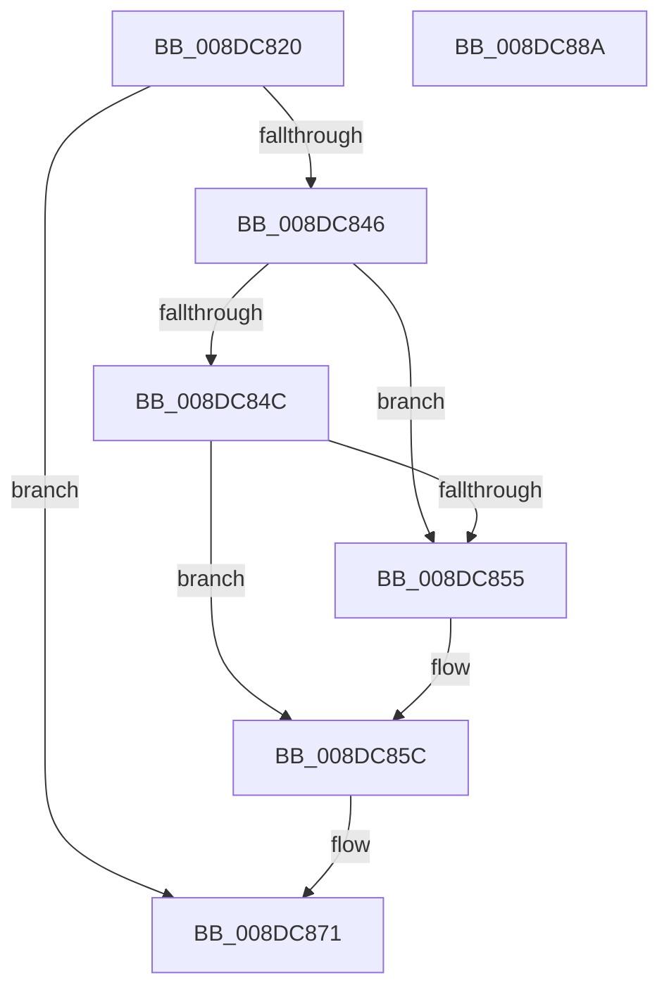

# PiDqObjectManagerUnregisterQuery

- RVA: `0x008DC820`–`0x008DC88B` (길이 `107` bytes)
- VA: `0x00000001408DC820`
- 실행 섹션: `PAGE`
- PDB 이름 있음: `예`; PDB Function 태그: `아니요`
- unwind 정보 RVA: `0x00060BC4`
- 디코드: `31`개 명령, `107/107` bytes 표시
- 미해석 바이트: `0` (있으면 어셈블리에 `.byte`로 보존)

> 이 문서는 커널 이미지의 기계어와 PDB 기호를 분석해 생성했습니다. 4번과 5번은 함수 원형과 자료형을 바이너리 사용 방식에서 추정한 C 해석이며 원본 소스 복구 결과는 아닙니다.

## 1. Dependencies

- 직접 호출 지점: **3**; 고유 호출 대상: **3**
- 직접 호출자로 확인된 함수: **1**
- RIP 상대 이미지 참조: **0**

### Outgoing calls
- `0x008DC839` → [ExAcquireFastMutex](../../text/20/ExAcquireFastMutex_function_0020E5A0.md) (function, `0x0020E5A0`)
- `0x008DC86C` → [PiDqQueryRelease](PiDqQueryRelease_function_008DE800.md) (function, `0x008DE800`)
- `0x008DC875` → [ExReleaseFastMutex](../../text/25/ExReleaseFastMutex_function_002519C0.md) (function, `0x002519C0`)

### Direct callers
- [PiDqDispatch](PiDqDispatch_function_008DC8A0.md) at `0x008DC92C`

### Static image references
- 디코드된 RIP-relative 메모리 참조가 없습니다.

## 2. Other-region calls and transfers

- 다른 실행 섹션으로 향하는 call: **2**
  - `0x008DC839` → [ExAcquireFastMutex](../../text/20/ExAcquireFastMutex_function_0020E5A0.md) (`PAGE` → `.text`)
  - `0x008DC875` → [ExReleaseFastMutex](../../text/25/ExReleaseFastMutex_function_002519C0.md) (`PAGE` → `.text`)
- 별도 외부 분기/꼬리 이동을 확인하지 못했습니다.

## 3. Assembly (complete function range)

```asm
008DC820  48 89 5C 24 08                  mov qword ptr [rsp + 8], rbx
008DC825  48 89 74 24 10                  mov qword ptr [rsp + 0x10], rsi
008DC82A  57                              push rdi
008DC82B  48 83 EC 20                     sub rsp, 0x20
008DC82F  48 8B F1                        mov rsi, rcx
008DC832  48 8B DA                        mov rbx, rdx
008DC835  48 83 C1 68                     add rcx, 0x68
008DC839  E8 62 1D 93 FF                  call 0x14020e5a0
008DC83E  48 8B 03                        mov rax, qword ptr [rbx]
008DC841  48 85 C0                        test rax, rax
008DC844  74 2B                           je 0x1408dc871
008DC846  48 39 58 08                     cmp qword ptr [rax + 8], rbx
008DC84A  75 09                           jne 0x1408dc855
008DC84C  48 8B 4B 08                     mov rcx, qword ptr [rbx + 8]
008DC850  48 39 19                        cmp qword ptr [rcx], rbx
008DC853  74 07                           je 0x1408dc85c
008DC855  B9 03 00 00 00                  mov ecx, 3
008DC85A  CD 29                           int 0x29
008DC85C  48 89 01                        mov qword ptr [rcx], rax
008DC85F  48 89 48 08                     mov qword ptr [rax + 8], rcx
008DC863  48 8B CB                        mov rcx, rbx
008DC866  FF 8E E0 00 00 00               dec dword ptr [rsi + 0xe0]
008DC86C  E8 8F 1F 00 00                  call 0x1408de800
008DC871  48 8D 4E 68                     lea rcx, [rsi + 0x68]
008DC875  E8 46 51 97 FF                  call 0x1402519c0
008DC87A  48 8B 5C 24 30                  mov rbx, qword ptr [rsp + 0x30]
008DC87F  48 8B 74 24 38                  mov rsi, qword ptr [rsp + 0x38]
008DC884  48 83 C4 20                     add rsp, 0x20
008DC888  5F                              pop rdi
008DC889  C3                              ret
008DC88A  CC                              int3
```

## 4. C-style interpretation (structured pseudocode)

```c
__int64 __fastcall PiDqObjectManagerUnregisterQuery(__int64 a1, __int64 a2)
{
    __int64 result;
    __int64 v_rsp;
    unsigned __int64 v_stack_p10;
    unsigned __int64 v_stack_p8;

    v_stack_p8 = v_rbx;
    v_stack_p10 = v_rsi;
    v_rsp = (v_rsp) - (32);
    a1 = (a1) + (104);
    result = ExAcquireFastMutex(a1, a2, a3, a4);
    if (*(unsigned __int64 *)(a2) == 0) goto loc_008DC871;
    if ((*(unsigned __int64 *)(*(unsigned __int64 *)(a2) + 8)) != a2) goto loc_008DC855;
    if ((*(unsigned __int64 *)(*(unsigned __int64 *)(a2 + 8))) != a2) {
        a1 = 3;
    }
    *(unsigned __int64 *)(a1) = *(unsigned __int64 *)(a2);
    *(unsigned __int64 *)(*(unsigned __int64 *)(a2) + 8) = a1;
    result = PiDqQueryRelease(a2, a2, a3, a4);
loc_008DC871:
    result = ExReleaseFastMutex(a1 + 104, a2, a3, a4);
    v_rsp = (v_rsp) + (32);
    return result;
}
```

## 5. (Beta) C Style

```c
int64_t PiDqObjectManagerUnregisterQuery(void *Arg1, void *Arg2)
{
    uint8_t *arg1 = (uint8_t *)Arg1;
    uint8_t *arg2 = (uint8_t *)Arg2;

    int64_t result;
    int64_t local_rsp;
    uint64_t v_stack_p10;
    uint64_t v_stack_p8;

    v_stack_p8 = local_rbx;
    v_stack_p10 = local_rsi;
    local_rsp = (local_rsp) - (32);
    Arg1 = (Arg1) + (104);
    result = ExAcquireFastMutex(Arg1, Arg2, a3, a4);
    if (*(uint64_t *)(arg2) == 0) goto loc_008DC871;
    if ((*(uint64_t *)(*(uint64_t *)(arg2) + 0x8)) != Arg2) goto loc_008DC855;
    if ((*(uint64_t *)(*(uint64_t *)(arg2 + 0x8))) != Arg2) {
        Arg1 = 3;
    }
    *(uint64_t *)(arg1) = *(uint64_t *)(arg2);
    *(void **)(*(uint64_t *)(arg2) + 0x8) = Arg1;
    result = PiDqQueryRelease(Arg2, Arg2, a3, a4);
loc_008DC871:
    result = ExReleaseFastMutex(Arg1 + 104, Arg2, a3, a4);
    local_rsp = (local_rsp) + (32);
    return result;
}
```

### 관측된 메모리 오프셋

구조체 형식이 확인되지 않은 접근은 인자 기준의 오프셋으로만 기록했습니다.

| 기준 인자 | 오프셋 표현 | 폭 (bit) | 접근 |
|---|---:|---:|---|
| `Arg1` | `+ 0x68` | `64` | `R` |
| `Arg1` | `+ 0xE0` | `32` | `R/W` |
| `Arg2` | `+ 0x0` | `64` | `R` |
| `Arg2` | `+ 0x8` | `64` | `R` |

## 6. Execution-region graph

[열기: 2D/3D 그래프와 함수 탐색 컨트롤 패널](../../../control-panel.html?section=page&rva=0x008DC820&view=graph)

- 2D 그래프는 위에서 아래로 흐르고, 3D 그래프는 빈 공간을 드래그해 회전합니다. Shift+드래그는 이동, 휠은 확대·축소, 함수 노드 선택은 대상 보고서 이동입니다.

### Static fallback


