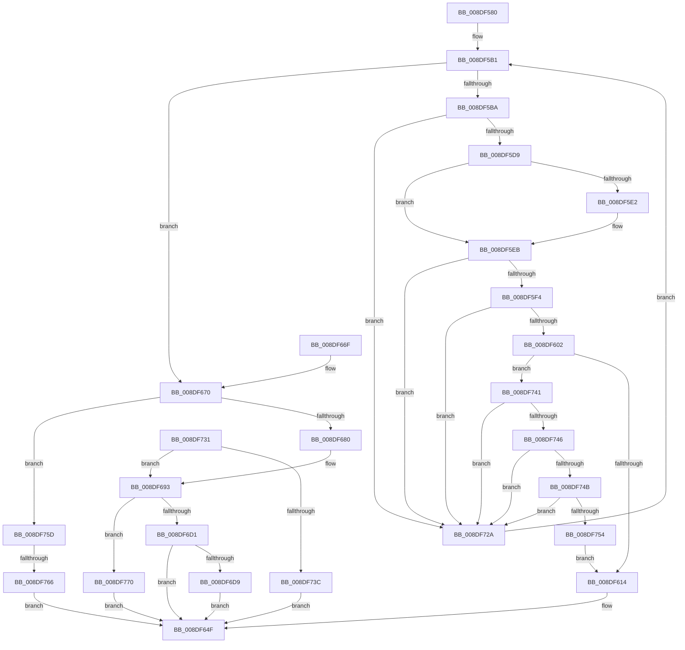

# PiDqPropertyCallback

- RVA: `0x008DF580`–`0x008DF789` (길이 `521` bytes)
- VA: `0x00000001408DF580`
- 실행 섹션: `PAGE`
- PDB 이름 있음: `예`; PDB Function 태그: `예`
- unwind 정보 RVA: `0x00085BD8`
- 디코드: `144`개 명령, `521/521` bytes 표시
- 미해석 바이트: `0` (있으면 어셈블리에 `.byte`로 보존)

> 이 문서는 커널 이미지의 기계어와 PDB 기호를 분석해 생성했습니다. 4번과 5번은 함수 원형과 자료형을 바이너리 사용 방식에서 추정한 C 해석이며 원본 소스 복구 결과는 아닙니다.

## 1. Dependencies

- 직접 호출 지점: **3**; 고유 호출 대상: **3**
- 직접 호출자로 확인된 함수: **1**
- RIP 상대 이미지 참조: **0**

### Outgoing calls
- `0x008DF68B` → [PiDqGetPnpObjectType](PiDqGetPnpObjectType_function_008DF790.md) (function, `0x008DF790`)
- `0x008DF6BF` → [PiDqPnPGetObjectProperty](PiDqPnPGetObjectProperty_function_008DFD90.md) (function, `0x008DFD90`)
- `0x008DF74B` → [wcsicmp](../../text/50/wcsicmp_function_00500080.md) (function, `0x00500080`)

### Direct callers
- [FilterEvalImpliedAnd](FilterEvalImpliedAnd_function_008DE898.md) at `0x008DE926`

### Static image references
- 디코드된 RIP-relative 메모리 참조가 없습니다.

## 2. Other-region calls and transfers

- 다른 실행 섹션으로 향하는 call: **1**
  - `0x008DF74B` → [wcsicmp](../../text/50/wcsicmp_function_00500080.md) (`PAGE` → `.text`)
- call이 아닌 외부 분기/꼬리 이동: **1**
  - `0x008DF760` → [sub_00B1CF0E](../B1/Unknown_function_00B1CF0E.md) (`tail-transfer`)

## 3. Assembly (complete function range)

```asm
008DF580  48 89 5C 24 08                  mov qword ptr [rsp + 8], rbx
008DF585  48 89 6C 24 10                  mov qword ptr [rsp + 0x10], rbp
008DF58A  48 89 74 24 18                  mov qword ptr [rsp + 0x18], rsi
008DF58F  57                              push rdi
008DF590  41 54                           push r12
008DF592  41 55                           push r13
008DF594  41 56                           push r14
008DF596  41 57                           push r15
008DF598  48 83 EC 50                     sub rsp, 0x50
008DF59C  33 ED                           xor ebp, ebp
008DF59E  4D 8B F9                        mov r15, r9
008DF5A1  8B FD                           mov edi, ebp
008DF5A3  44 8B ED                        mov r13d, ebp
008DF5A6  8B F5                           mov esi, ebp
008DF5A8  4D 8B E0                        mov r12, r8
008DF5AB  4C 8B F2                        mov r14, rdx
008DF5AE  48 8B D9                        mov rbx, rcx
008DF5B1  3B 73 18                        cmp esi, dword ptr [rbx + 0x18]
008DF5B4  0F 83 B6 00 00 00               jae 0x1408df670
008DF5BA  8B C6                           mov eax, esi
008DF5BC  4C 8D 43 10                     lea r8, [rbx + 0x10]
008DF5C0  49 8B 10                        mov rdx, qword ptr [r8]
008DF5C3  48 8D 2C 40                     lea rbp, [rax + rax*2]
008DF5C7  48 C1 E5 04                     shl rbp, 4
008DF5CB  8B 44 2A 10                     mov eax, dword ptr [rdx + rbp + 0x10]
008DF5CF  41 39 46 10                     cmp dword ptr [r14 + 0x10], eax
008DF5D3  0F 85 51 01 00 00               jne 0x1408df72a
008DF5D9  49 8B 0E                        mov rcx, qword ptr [r14]
008DF5DC  48 2B 0C 2A                     sub rcx, qword ptr [rdx + rbp]
008DF5E0  75 09                           jne 0x1408df5eb
008DF5E2  49 8B 4E 08                     mov rcx, qword ptr [r14 + 8]
008DF5E6  48 2B 4C 2A 08                  sub rcx, qword ptr [rdx + rbp + 8]
008DF5EB  48 85 C9                        test rcx, rcx
008DF5EE  0F 85 36 01 00 00               jne 0x1408df72a
008DF5F4  8B 44 2A 14                     mov eax, dword ptr [rdx + rbp + 0x14]
008DF5F8  41 39 46 14                     cmp dword ptr [r14 + 0x14], eax
008DF5FC  0F 85 28 01 00 00               jne 0x1408df72a
008DF602  49 8B 4E 18                     mov rcx, qword ptr [r14 + 0x18]
008DF606  48 8B 54 2A 18                  mov rdx, qword ptr [rdx + rbp + 0x18]
008DF60B  48 3B CA                        cmp rcx, rdx
008DF60E  0F 85 2D 01 00 00               jne 0x1408df741
008DF614  48 8B 43 10                     mov rax, qword ptr [rbx + 0x10]
008DF618  8B 4C 28 20                     mov ecx, dword ptr [rax + rbp + 0x20]
008DF61C  41 89 0C 24                     mov dword ptr [r12], ecx
008DF620  8B C6                           mov eax, esi
008DF622  48 8D 0C 40                     lea rcx, [rax + rax*2]
008DF626  49 8B 00                        mov rax, qword ptr [r8]
008DF629  48 03 C9                        add rcx, rcx
008DF62C  8B 4C C8 24                     mov ecx, dword ptr [rax + rcx*8 + 0x24]
008DF630  41 89 0F                        mov dword ptr [r15], ecx
008DF633  8B C6                           mov eax, esi
008DF635  48 8D 0C 40                     lea rcx, [rax + rax*2]
008DF639  49 8B 00                        mov rax, qword ptr [r8]
008DF63C  48 03 C9                        add rcx, rcx
008DF63F  48 8B 4C C8 28                  mov rcx, qword ptr [rax + rcx*8 + 0x28]
008DF644  48 8B 84 24 A0 00 00 00         mov rax, qword ptr [rsp + 0xa0]
008DF64C  48 89 08                        mov qword ptr [rax], rcx
008DF64F  4C 8D 5C 24 50                  lea r11, [rsp + 0x50]
008DF654  8B C7                           mov eax, edi
008DF656  49 8B 5B 30                     mov rbx, qword ptr [r11 + 0x30]
008DF65A  49 8B 6B 38                     mov rbp, qword ptr [r11 + 0x38]
008DF65E  49 8B 73 40                     mov rsi, qword ptr [r11 + 0x40]
008DF662  49 8B E3                        mov rsp, r11
008DF665  41 5F                           pop r15
008DF667  41 5E                           pop r14
008DF669  41 5D                           pop r13
008DF66B  41 5C                           pop r12
008DF66D  5F                              pop rdi
008DF66E  C3                              ret
008DF66F  CC                              int3
008DF670  49 8D 76 14                     lea rsi, [r14 + 0x14]
008DF674  33 ED                           xor ebp, ebp
008DF676  8B 0E                           mov ecx, dword ptr [rsi]
008DF678  85 C9                           test ecx, ecx
008DF67A  0F 85 DD 00 00 00               jne 0x1408df75d
008DF680  48 8B 43 28                     mov rax, qword ptr [rbx + 0x28]
008DF684  48 8B 48 18                     mov rcx, qword ptr [rax + 0x18]
008DF688  8B 49 10                        mov ecx, dword ptr [rcx + 0x10]
008DF68B  E8 00 01 00 00                  call 0x1408df790
008DF690  44 8B D0                        mov r10d, eax
008DF693  8B 4B 18                        mov ecx, dword ptr [rbx + 0x18]
008DF696  4D 8B CE                        mov r9, r14
008DF699  4D 8B C5                        mov r8, r13
008DF69C  48 8D 14 49                     lea rdx, [rcx + rcx*2]
008DF6A0  8B 0E                           mov ecx, dword ptr [rsi]
008DF6A2  48 C1 E2 04                     shl rdx, 4
008DF6A6  48 03 53 10                     add rdx, qword ptr [rbx + 0x10]
008DF6AA  48 89 54 24 30                  mov qword ptr [rsp + 0x30], rdx
008DF6AF  41 8B D2                        mov edx, r10d
008DF6B2  48 89 6C 24 28                  mov qword ptr [rsp + 0x28], rbp
008DF6B7  89 4C 24 20                     mov dword ptr [rsp + 0x20], ecx
008DF6BB  48 8B 4B 20                     mov rcx, qword ptr [rbx + 0x20]
008DF6BF  E8 CC 06 00 00                  call 0x1408dfd90
008DF6C4  8B F8                           mov edi, eax
008DF6C6  3D 0D 00 00 C0                  cmp eax, 0xc000000d
008DF6CB  0F 84 9F 00 00 00               je 0x1408df770
008DF6D1  85 C0                           test eax, eax
008DF6D3  0F 88 76 FF FF FF               js 0x1408df64f
008DF6D9  8B 43 18                        mov eax, dword ptr [rbx + 0x18]
008DF6DC  48 8D 0C 40                     lea rcx, [rax + rax*2]
008DF6E0  48 8B 43 10                     mov rax, qword ptr [rbx + 0x10]
008DF6E4  48 03 C9                        add rcx, rcx
008DF6E7  8B 4C C8 20                     mov ecx, dword ptr [rax + rcx*8 + 0x20]
008DF6EB  41 89 0C 24                     mov dword ptr [r12], ecx
008DF6EF  8B 43 18                        mov eax, dword ptr [rbx + 0x18]
008DF6F2  48 8D 0C 40                     lea rcx, [rax + rax*2]
008DF6F6  48 8B 43 10                     mov rax, qword ptr [rbx + 0x10]
008DF6FA  48 03 C9                        add rcx, rcx
008DF6FD  8B 4C C8 24                     mov ecx, dword ptr [rax + rcx*8 + 0x24]
008DF701  41 89 0F                        mov dword ptr [r15], ecx
008DF704  8B 43 18                        mov eax, dword ptr [rbx + 0x18]
008DF707  48 8D 0C 40                     lea rcx, [rax + rax*2]
008DF70B  48 8B 43 10                     mov rax, qword ptr [rbx + 0x10]
008DF70F  48 03 C9                        add rcx, rcx
008DF712  48 8B 4C C8 28                  mov rcx, qword ptr [rax + rcx*8 + 0x28]
008DF717  48 8B 84 24 A0 00 00 00         mov rax, qword ptr [rsp + 0xa0]
008DF71F  48 89 08                        mov qword ptr [rax], rcx
008DF722  FF 43 18                        inc dword ptr [rbx + 0x18]
008DF725  E9 25 FF FF FF                  jmp 0x1408df64f
008DF72A  FF C6                           inc esi
008DF72C  E9 80 FE FF FF                  jmp 0x1408df5b1
008DF731  44 8B D5                        mov r10d, ebp
008DF734  85 C0                           test eax, eax
008DF736  0F 89 57 FF FF FF               jns 0x1408df693
008DF73C  E9 0E FF FF FF                  jmp 0x1408df64f
008DF741  48 85 C9                        test rcx, rcx
008DF744  74 E4                           je 0x1408df72a
008DF746  48 85 D2                        test rdx, rdx
008DF749  74 DF                           je 0x1408df72a
008DF74B  E8 30 09 C2 FF                  call 0x140500080
008DF750  85 C0                           test eax, eax
008DF752  75 D6                           jne 0x1408df72a
008DF754  4C 8D 43 10                     lea r8, [rbx + 0x10]
008DF758  E9 B7 FE FF FF                  jmp 0x1408df614
008DF75D  83 F9 01                        cmp ecx, 1
008DF760  0F 84 A8 D7 23 00               je 0x140b1cf0e
008DF766  BF 0D 00 00 C0                  mov edi, 0xc000000d
008DF76B  E9 DF FE FF FF                  jmp 0x1408df64f
008DF770  8B FD                           mov edi, ebp
008DF772  48 8B 84 24 A0 00 00 00         mov rax, qword ptr [rsp + 0xa0]
008DF77A  41 89 2C 24                     mov dword ptr [r12], ebp
008DF77E  41 89 2F                        mov dword ptr [r15], ebp
008DF781  48 89 28                        mov qword ptr [rax], rbp
008DF784  E9 C6 FE FF FF                  jmp 0x1408df64f
```

## 4. C-style interpretation (structured pseudocode)

```c
__int64 __fastcall PiDqPropertyCallback(__int64 a1, __int64 a2, __int64 a3, __int64 a4, __int64 a5)
{
    __int64 result;
    __int64 v_rbp;
    __int64 v_rsi;
    __int64 v_rsp;
    unsigned __int64 v_stack_m20;
    unsigned __int64 v_stack_m28;
    unsigned int v_stack_m30;
    unsigned __int64 v_stack_p10;
    unsigned __int64 v_stack_p18;
    unsigned __int64 v_stack_p8;

    v_stack_p8 = v_rbx;
    v_stack_p10 = v_rbp;
    v_stack_p18 = v_rsi;
    v_rsp = (v_rsp) - (80);
    v_rbp = 0;
loc_008DF5B1:
    if (0 >= (*(unsigned int *)(a1 + 24))) goto loc_008DF670;
    v_rbp = (0 + 0 * 2) << (4);
    if ((*(unsigned int *)(a2 + 16)) != ((unsigned int)((unsigned int)(*(unsigned int *)(*(unsigned __int64 *)(a1 + 16) + v_rbp * 1 + 16))))) goto loc_008DF72A;
    a1 = (*(unsigned __int64 *)(a2)) - (*(unsigned __int64 *)(*(unsigned __int64 *)(a1 + 16) + v_rbp * 1));
    if (!(condition_is_not_equal)) {
        a1 = *(unsigned __int64 *)(a2 + 8);
        a1 = (a1) - (*(unsigned __int64 *)(*(unsigned __int64 *)(a1 + 16) + v_rbp * 1 + 8));
    }
    if (a1 != 0) goto loc_008DF72A;
    if ((*(unsigned int *)(a2 + 20)) != ((unsigned int)((unsigned int)(*(unsigned int *)(*(unsigned __int64 *)(a1 + 16) + v_rbp * 1 + 20))))) goto loc_008DF72A;
    if ((*(unsigned __int64 *)(a2 + 24)) != (*(unsigned __int64 *)(*(unsigned __int64 *)(a1 + 16) + v_rbp * 1 + 24))) goto loc_008DF741;
loc_008DF614:
    *(unsigned int *)(a3) = (unsigned int)((unsigned int)(*(unsigned int *)(*(unsigned __int64 *)(a1 + 16) + v_rbp * 1 + 32)));
    a1 = (0 + 0 * 2) + (0 + 0 * 2);
    *(unsigned int *)(a4) = (unsigned int)((unsigned int)(*(unsigned int *)(*(unsigned __int64 *)(a1 + 16) + a1 * 8 + 36)));
    a1 = (0 + 0 * 2) + (0 + 0 * 2);
    *(unsigned __int64 *)(a5) = *(unsigned __int64 *)(*(unsigned __int64 *)(a1 + 16) + a1 * 8 + 40);
loc_008DF64F:
    return 0;
loc_008DF670:
    v_rbp = 0;
    if ((unsigned int)((unsigned int)(*(unsigned int *)(a2 + 20))) != 0) goto loc_008DF75D;
    result = PiDqGetPnpObjectType((unsigned int)(*(unsigned int *)(*(unsigned __int64 *)(*(unsigned __int64 *)(*(unsigned __int64 *)(v_stack_m28 + 48) + 40) + 24) + 16)), *(unsigned __int64 *)(*(unsigned __int64 *)(a1 + 16) + v_rbp * 1 + 24), a1 + 16, a4);
loc_008DF693:
    a2 = ((unsigned int)(*(unsigned int *)(*(unsigned __int64 *)(v_stack_m28 + 48) + 24)) + (unsigned int)(*(unsigned int *)(*(unsigned __int64 *)(v_stack_m28 + 48) + 24)) * 2) << (4);
    a2 = (a2) + (*(unsigned __int64 *)(*(unsigned __int64 *)(v_stack_m28 + 48) + 16));
    v_stack_m20 = a2;
    v_stack_m28 = 0;
    v_stack_m30 = (unsigned int)((unsigned int)(*(unsigned int *)(a2 + 20)));
    result = PiDqPnPGetObjectProperty(*(unsigned __int64 *)(*(unsigned __int64 *)(v_stack_m28 + 48) + 32), (unsigned int)((unsigned int)((unsigned int)((unsigned int)(result)))), 0, a2);
    if (((unsigned int)(result)) == 0xC000000DULL) goto loc_008DF770;
    if (sign_flag) goto loc_008DF64F;
    a1 = ((unsigned int)(*(unsigned int *)(*(unsigned __int64 *)(v_stack_m28 + 48) + 24)) + (unsigned int)(*(unsigned int *)(*(unsigned __int64 *)(v_stack_m28 + 48) + 24)) * 2) + ((unsigned int)(*(unsigned int *)(*(unsigned __int64 *)(v_stack_m28 + 48) + 24)) + (unsigned int)(*(unsigned int *)(*(unsigned __int64 *)(v_stack_m28 + 48) + 24)) * 2);
    *(unsigned int *)(a3) = (unsigned int)((unsigned int)(*(unsigned int *)(*(unsigned __int64 *)(*(unsigned __int64 *)(v_stack_m28 + 48) + 16) + a1 * 8 + 32)));
    a1 = ((unsigned int)(*(unsigned int *)(*(unsigned __int64 *)(v_stack_m28 + 48) + 24)) + (unsigned int)(*(unsigned int *)(*(unsigned __int64 *)(v_stack_m28 + 48) + 24)) * 2) + ((unsigned int)(*(unsigned int *)(*(unsigned __int64 *)(v_stack_m28 + 48) + 24)) + (unsigned int)(*(unsigned int *)(*(unsigned __int64 *)(v_stack_m28 + 48) + 24)) * 2);
    *(unsigned int *)(a4) = (unsigned int)((unsigned int)(*(unsigned int *)(*(unsigned __int64 *)(*(unsigned __int64 *)(v_stack_m28 + 48) + 16) + a1 * 8 + 36)));
    a1 = ((unsigned int)(*(unsigned int *)(*(unsigned __int64 *)(v_stack_m28 + 48) + 24)) + (unsigned int)(*(unsigned int *)(*(unsigned __int64 *)(v_stack_m28 + 48) + 24)) * 2) + ((unsigned int)(*(unsigned int *)(*(unsigned __int64 *)(v_stack_m28 + 48) + 24)) + (unsigned int)(*(unsigned int *)(*(unsigned __int64 *)(v_stack_m28 + 48) + 24)) * 2);
    *(unsigned __int64 *)(a5) = *(unsigned __int64 *)(*(unsigned __int64 *)(*(unsigned __int64 *)(v_stack_m28 + 48) + 16) + a1 * 8 + 40);
    goto loc_008DF64F;
loc_008DF72A:
    v_rsi = (unsigned int)((a2 + 20) + 1);
    goto loc_008DF5B1;
loc_008DF741:
    if (*(unsigned __int64 *)(*(unsigned __int64 *)(*(unsigned __int64 *)(v_stack_m28 + 48) + 16) + a1 * 8 + 40) == 0) goto loc_008DF72A;
    if ((unsigned int)((unsigned int)((unsigned int)((unsigned int)(result)))) == 0) goto loc_008DF72A;
    result = wcsicmp(*(unsigned __int64 *)(*(unsigned __int64 *)(*(unsigned __int64 *)(v_stack_m28 + 48) + 16) + a1 * 8 + 40), (unsigned int)((unsigned int)((unsigned int)((unsigned int)(result)))), 0, a2);
    if ((unsigned int)(result) != 0) goto loc_008DF72A;
    goto loc_008DF614;
loc_008DF75D:
    goto loc_008DF64F;
loc_008DF770:
    *(unsigned int *)(a3) = 0;
    *(unsigned int *)(a4) = 0;
    *(unsigned __int64 *)(a5) = 0;
    goto loc_008DF64F;
}
```

## 5. (Beta) C Style

```c
int64_t PiDqPropertyCallback(void *Arg1, void *Arg2, void *Arg3, void *Arg4, void *Arg5)
{
    uint8_t *arg1 = (uint8_t *)Arg1;
    uint8_t *arg2 = (uint8_t *)Arg2;
    uint8_t *arg3 = (uint8_t *)Arg3;
    uint8_t *arg4 = (uint8_t *)Arg4;
    uint8_t *arg5 = (uint8_t *)Arg5;

    int64_t result;
    int64_t local_rbp;
    int64_t local_rsi;
    int64_t local_rsp;
    uint64_t v_stack_m20;
    uint64_t v_stack_m28;
    uint32_t v_stack_m30;
    uint64_t v_stack_p10;
    uint64_t v_stack_p18;
    uint64_t v_stack_p8;

    v_stack_p8 = local_rbx;
    v_stack_p10 = local_rbp;
    v_stack_p18 = local_rsi;
    local_rsp = (local_rsp) - (80);
    local_rbp = 0;
loc_008DF5B1:
    if (0 >= (*(uint32_t *)(arg1 + 0x18))) goto loc_008DF670;
    local_rbp = (0 + 0 * 2) << (4);
    if ((*(uint32_t *)(arg2 + 0x10)) != ((uint32_t)((uint32_t)(*(uint32_t *)(*(uint64_t *)(arg1 + 0x10) + local_rbp * 1 + 0x10))))) goto loc_008DF72A;
    Arg1 = (*(uint64_t *)(arg2)) - (*(uint64_t *)(*(uint64_t *)(arg1 + 0x10) + local_rbp * 1));
    if (!(condition_is_not_equal)) {
        Arg1 = *(uint64_t *)(arg2 + 0x8);
        Arg1 = (Arg1) - (*(uint64_t *)(*(uint64_t *)(arg1 + 0x10) + local_rbp * 1 + 0x8));
    }
    if (Arg1 != NULL) goto loc_008DF72A;
    if ((*(uint32_t *)(arg2 + 0x14)) != ((uint32_t)((uint32_t)(*(uint32_t *)(*(uint64_t *)(arg1 + 0x10) + local_rbp * 1 + 0x14))))) goto loc_008DF72A;
    if ((*(uint64_t *)(arg2 + 0x18)) != (*(uint64_t *)(*(uint64_t *)(arg1 + 0x10) + local_rbp * 1 + 0x18))) goto loc_008DF741;
loc_008DF614:
    *(uint32_t *)(arg3) = (uint32_t)((uint32_t)(*(uint32_t *)(*(uint64_t *)(arg1 + 0x10) + local_rbp * 1 + 0x20)));
    Arg1 = (0 + 0 * 2) + (0 + 0 * 2);
    *(uint32_t *)(arg4) = (uint32_t)((uint32_t)(*(uint32_t *)(*(uint64_t *)(arg1 + 0x10) + arg1 * 8 + 0x24)));
    Arg1 = (0 + 0 * 2) + (0 + 0 * 2);
    *(uint64_t *)(arg5) = *(uint64_t *)(*(uint64_t *)(arg1 + 0x10) + arg1 * 8 + 0x28);
loc_008DF64F:
    return 0;
loc_008DF670:
    local_rbp = 0;
    if ((uint32_t)((uint32_t)(*(uint32_t *)(arg2 + 0x14))) != 0) goto loc_008DF75D;
    result = PiDqGetPnpObjectType((uint32_t)(*(uint32_t *)(*(uint64_t *)(*(uint64_t *)(*(uint64_t *)(v_stack_m28 + 0x30) + 0x28) + 0x18) + 0x10)), *(uint64_t *)(*(uint64_t *)(arg1 + 0x10) + local_rbp * 1 + 0x18), Arg1 + 16, Arg4);
loc_008DF693:
    Arg2 = ((uint32_t)(*(uint32_t *)(*(uint64_t *)(v_stack_m28 + 0x30) + 0x18)) + (uint32_t)(*(uint32_t *)(*(uint64_t *)(v_stack_m28 + 0x30) + 0x18)) * 2) << (4);
    Arg2 = (Arg2) + (*(uint64_t *)(*(uint64_t *)(v_stack_m28 + 0x30) + 0x10));
    v_stack_m20 = Arg2;
    v_stack_m28 = 0;
    v_stack_m30 = (uint32_t)((uint32_t)(*(uint32_t *)(arg2 + 0x14)));
    result = PiDqPnPGetObjectProperty(*(uint64_t *)(*(uint64_t *)(v_stack_m28 + 0x30) + 0x20), (uint32_t)((uint32_t)((uint32_t)((uint32_t)(result)))), 0, Arg2);
    if (((uint32_t)(result)) == 0xC000000DULL) goto loc_008DF770;
    if (sign_flag) goto loc_008DF64F;
    Arg1 = ((uint32_t)(*(uint32_t *)(*(uint64_t *)(v_stack_m28 + 0x30) + 0x18)) + (uint32_t)(*(uint32_t *)(*(uint64_t *)(v_stack_m28 + 0x30) + 0x18)) * 2) + ((uint32_t)(*(uint32_t *)(*(uint64_t *)(v_stack_m28 + 0x30) + 0x18)) + (uint32_t)(*(uint32_t *)(*(uint64_t *)(v_stack_m28 + 0x30) + 0x18)) * 2);
    *(uint32_t *)(arg3) = (uint32_t)((uint32_t)(*(uint32_t *)(*(uint64_t *)(*(uint64_t *)(v_stack_m28 + 0x30) + 0x10) + arg1 * 8 + 0x20)));
    Arg1 = ((uint32_t)(*(uint32_t *)(*(uint64_t *)(v_stack_m28 + 0x30) + 0x18)) + (uint32_t)(*(uint32_t *)(*(uint64_t *)(v_stack_m28 + 0x30) + 0x18)) * 2) + ((uint32_t)(*(uint32_t *)(*(uint64_t *)(v_stack_m28 + 0x30) + 0x18)) + (uint32_t)(*(uint32_t *)(*(uint64_t *)(v_stack_m28 + 0x30) + 0x18)) * 2);
    *(uint32_t *)(arg4) = (uint32_t)((uint32_t)(*(uint32_t *)(*(uint64_t *)(*(uint64_t *)(v_stack_m28 + 0x30) + 0x10) + arg1 * 8 + 0x24)));
    Arg1 = ((uint32_t)(*(uint32_t *)(*(uint64_t *)(v_stack_m28 + 0x30) + 0x18)) + (uint32_t)(*(uint32_t *)(*(uint64_t *)(v_stack_m28 + 0x30) + 0x18)) * 2) + ((uint32_t)(*(uint32_t *)(*(uint64_t *)(v_stack_m28 + 0x30) + 0x18)) + (uint32_t)(*(uint32_t *)(*(uint64_t *)(v_stack_m28 + 0x30) + 0x18)) * 2);
    *(uint64_t *)(arg5) = *(uint64_t *)(*(uint64_t *)(*(uint64_t *)(v_stack_m28 + 0x30) + 0x10) + arg1 * 8 + 0x28);
    goto loc_008DF64F;
loc_008DF72A:
    local_rsi = (uint32_t)((Arg2 + 20) + 1);
    goto loc_008DF5B1;
loc_008DF741:
    if (*(uint64_t *)(*(uint64_t *)(*(uint64_t *)(v_stack_m28 + 0x30) + 0x10) + arg1 * 8 + 0x28) == 0) goto loc_008DF72A;
    if ((uint32_t)((uint32_t)((uint32_t)((uint32_t)(result)))) == 0) goto loc_008DF72A;
    result = wcsicmp(*(uint64_t *)(*(uint64_t *)(*(uint64_t *)(v_stack_m28 + 0x30) + 0x10) + arg1 * 8 + 0x28), (uint32_t)((uint32_t)((uint32_t)((uint32_t)(result)))), 0, Arg2);
    if ((uint32_t)(result) != 0) goto loc_008DF72A;
    goto loc_008DF614;
loc_008DF75D:
    goto loc_008DF64F;
loc_008DF770:
    *(uint32_t *)(arg3) = 0;
    *(uint32_t *)(arg4) = 0;
    *(uint64_t *)(arg5) = 0;
    goto loc_008DF64F;
}
```

### 관측된 메모리 오프셋

구조체 형식이 확인되지 않은 접근은 인자 기준의 오프셋으로만 기록했습니다.

| 기준 인자 | 오프셋 표현 | 폭 (bit) | 접근 |
|---|---:|---:|---|
| `Arg1` | `+ 0x0` | `64` | `R` |
| `Arg1` | `+ 0x10` | `64` | `R` |
| `Arg1` | `+ 0x18` | `32` | `R` |
| `Arg1` | `+ 0x18` | `32` | `R/W` |
| `Arg1` | `+ 0x20` | `64` | `R` |
| `Arg1` | `+ 0x28` | `64` | `R` |
| `Arg2` | `+ 0x0` | `32` | `R` |
| `Arg2` | `+ 0x0` | `64` | `R` |
| `Arg2` | `+ 0x8` | `64` | `R` |
| `Arg2` | `+ 0x10` | `32` | `R` |
| `Arg2` | `+ 0x14` | `32` | `R` |
| `Arg2` | `+ 0x14` | `64` | `R` |
| `Arg2` | `+ 0x18` | `64` | `R` |
| `Arg3` | `+ 0x0` | `32` | `W` |
| `Arg4` | `+ 0x0` | `32` | `W` |
| `Arg5` | `+ 0x0` | `64` | `W` |

## 6. Execution-region graph

[열기: 2D/3D 그래프와 함수 탐색 컨트롤 패널](../../../control-panel.html?section=page&rva=0x008DF580&view=graph)

- 2D 그래프는 위에서 아래로 흐르고, 3D 그래프는 빈 공간을 드래그해 회전합니다. Shift+드래그는 이동, 휠은 확대·축소, 함수 노드 선택은 대상 보고서 이동입니다.

### Static fallback


