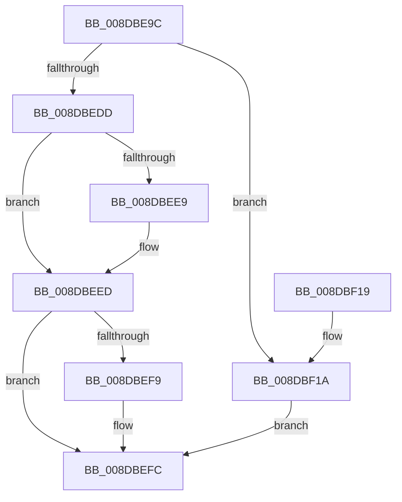

# PiDqQueryActionQueueEntryCreate

- RVA: `0x008DBE9C`–`0x008DBF21` (길이 `133` bytes)
- VA: `0x00000001408DBE9C`
- 실행 섹션: `PAGE`
- PDB 이름 있음: `예`; PDB Function 태그: `아니요`
- unwind 정보 RVA: `0x0006B020`
- 디코드: `40`개 명령, `133/133` bytes 표시
- 미해석 바이트: `0` (있으면 어셈블리에 `.byte`로 보존)

> 이 문서는 커널 이미지의 기계어와 PDB 기호를 분석해 생성했습니다. 4번과 5번은 함수 원형과 자료형을 바이너리 사용 방식에서 추정한 C 해석이며 원본 소스 복구 결과는 아닙니다.

## 1. Dependencies

- 직접 호출 지점: **1**; 고유 호출 대상: **1**
- 직접 호출자로 확인된 함수: **1**
- RIP 상대 이미지 참조: **0**

### Outgoing calls
- `0x008DBED0` → [ExAllocatePool2](../../poolcode/B8/ExAllocatePool2_function_00B820F0.md) (function, `0x00B820F0`)

### Direct callers
- [PiDqQueryApplyObjectEvent](PiDqQueryApplyObjectEvent_function_008DDACC.md) at `0x008DE0F0`

### Static image references
- 디코드된 RIP-relative 메모리 참조가 없습니다.

## 2. Other-region calls and transfers

- 다른 실행 섹션으로 향하는 call: **1**
  - `0x008DBED0` → [ExAllocatePool2](../../poolcode/B8/ExAllocatePool2_function_00B820F0.md) (`PAGE` → `POOLCODE`)
- 별도 외부 분기/꼬리 이동을 확인하지 못했습니다.

## 3. Assembly (complete function range)

```asm
008DBE9C  48 8B C4                        mov rax, rsp
008DBE9F  48 89 58 08                     mov qword ptr [rax + 8], rbx
008DBEA3  48 89 68 10                     mov qword ptr [rax + 0x10], rbp
008DBEA7  48 89 70 18                     mov qword ptr [rax + 0x18], rsi
008DBEAB  48 89 78 20                     mov qword ptr [rax + 0x20], rdi
008DBEAF  41 56                           push r14
008DBEB1  48 83 EC 20                     sub rsp, 0x20
008DBEB5  49 8B F8                        mov rdi, r8
008DBEB8  48 8B F2                        mov rsi, rdx
008DBEBB  8B E9                           mov ebp, ecx
008DBEBD  33 DB                           xor ebx, ebx
008DBEBF  B9 00 01 00 00                  mov ecx, 0x100
008DBEC4  41 B8 50 6E 70 58               mov r8d, 0x58706e50
008DBECA  4D 8B F1                        mov r14, r9
008DBECD  8D 53 28                        lea edx, [rbx + 0x28]
008DBED0  E8 1B 62 2A 00                  call 0x140b820f0
008DBED5  49 89 06                        mov qword ptr [r14], rax
008DBED8  48 85 C0                        test rax, rax
008DBEDB  74 3D                           je 0x1408dbf1a
008DBEDD  89 68 20                        mov dword ptr [rax + 0x20], ebp
008DBEE0  48 89 70 10                     mov qword ptr [rax + 0x10], rsi
008DBEE4  48 85 F6                        test rsi, rsi
008DBEE7  74 04                           je 0x1408dbeed
008DBEE9  F0 FF 46 08                     lock inc dword ptr [rsi + 8]
008DBEED  49 8B 06                        mov rax, qword ptr [r14]
008DBEF0  48 89 78 18                     mov qword ptr [rax + 0x18], rdi
008DBEF4  48 85 FF                        test rdi, rdi
008DBEF7  74 03                           je 0x1408dbefc
008DBEF9  F0 FF 07                        lock inc dword ptr [rdi]
008DBEFC  48 8B 6C 24 38                  mov rbp, qword ptr [rsp + 0x38]
008DBF01  8B C3                           mov eax, ebx
008DBF03  48 8B 5C 24 30                  mov rbx, qword ptr [rsp + 0x30]
008DBF08  48 8B 74 24 40                  mov rsi, qword ptr [rsp + 0x40]
008DBF0D  48 8B 7C 24 48                  mov rdi, qword ptr [rsp + 0x48]
008DBF12  48 83 C4 20                     add rsp, 0x20
008DBF16  41 5E                           pop r14
008DBF18  C3                              ret
008DBF19  CC                              int3
008DBF1A  BB 9A 00 00 C0                  mov ebx, 0xc000009a
008DBF1F  EB DB                           jmp 0x1408dbefc
```

## 4. C-style interpretation (structured pseudocode)

```c
__int64 __fastcall PiDqQueryActionQueueEntryCreate(int a1, __int64 a2, __int64 a3, __int64 a4)
{
    __int64 result;
    __int64 v_rbx;
    __int64 v_rsp;
    unsigned __int64 v_stack_p10;
    unsigned __int64 v_stack_p18;
    unsigned __int64 v_stack_p20;
    unsigned __int64 v_stack_p8;

    *(unsigned __int64 *)(v_rsp + 8) = v_rbx;
    *(unsigned __int64 *)(v_rsp + 16) = v_rbp;
    *(unsigned __int64 *)(v_rsp + 24) = v_rsi;
    *(unsigned __int64 *)(v_rsp + 32) = v_rdi;
    v_rsp = (v_rsp) - (32);
    v_rbx = 0;
    result = ExAllocatePool2(256, v_rbx + 40, (unsigned int)(0x58706E50ULL), a4);
    *(unsigned __int64 *)(a4) = result;
    if (result == 0) goto loc_008DBF1A;
    *(unsigned int *)(result + 32) = (unsigned int)((unsigned int)(a1));
    *(unsigned __int64 *)(result + 16) = a2;
    if (a2 != 0) {
    }
    *(unsigned __int64 *)(*(unsigned __int64 *)(a4) + 24) = a3;
    if (a3 != 0) {
    }
    v_rsp = (v_rsp) + (32);
    return 0;
loc_008DBF1A:
    goto loc_008DBEFC;
}
```

## 5. (Beta) C Style

```c
int64_t PiDqQueryActionQueueEntryCreate(int32_t Arg1, int64_t Arg2, int64_t Arg3, void *Arg4)
{
    uint8_t *arg4 = (uint8_t *)Arg4;

    int64_t result;
    int64_t local_rbx;
    int64_t local_rsp;
    uint64_t v_stack_p10;
    uint64_t v_stack_p18;
    uint64_t v_stack_p20;
    uint64_t v_stack_p8;

    *(uint64_t *)(local_rsp + 0x8) = local_rbx;
    *(uint64_t *)(local_rsp + 0x10) = local_rbp;
    *(uint64_t *)(local_rsp + 0x18) = local_rsi;
    *(uint64_t *)(local_rsp + 0x20) = local_rdi;
    local_rsp = (local_rsp) - (32);
    local_rbx = 0;
    result = ExAllocatePool2(256, local_rbx + 40, (uint32_t)(0x58706E50ULL), Arg4);
    *(uint64_t *)(arg4) = result;
    if (result == 0) goto loc_008DBF1A;
    *(uint32_t *)(result + 0x20) = (uint32_t)((uint32_t)(Arg1));
    *(uint64_t *)(result + 0x10) = Arg2;
    if (Arg2 != 0) {
    }
    *(uint64_t *)(*(uint64_t *)(arg4) + 0x18) = Arg3;
    if (Arg3 != 0) {
    }
    local_rsp = (local_rsp) + (32);
    return 0;
loc_008DBF1A:
    goto loc_008DBEFC;
}
```

### 관측된 메모리 오프셋

구조체 형식이 확인되지 않은 접근은 인자 기준의 오프셋으로만 기록했습니다.

| 기준 인자 | 오프셋 표현 | 폭 (bit) | 접근 |
|---|---:|---:|---|
| `Arg4` | `+ 0x0` | `64` | `R` |
| `Arg4` | `+ 0x0` | `64` | `W` |

## 6. Execution-region graph

[열기: 2D/3D 그래프와 함수 탐색 컨트롤 패널](../../../control-panel.html?section=page&rva=0x008DBE9C&view=graph)

- 2D 그래프는 위에서 아래로 흐르고, 3D 그래프는 빈 공간을 드래그해 회전합니다. Shift+드래그는 이동, 휠은 확대·축소, 함수 노드 선택은 대상 보고서 이동입니다.

### Static fallback


