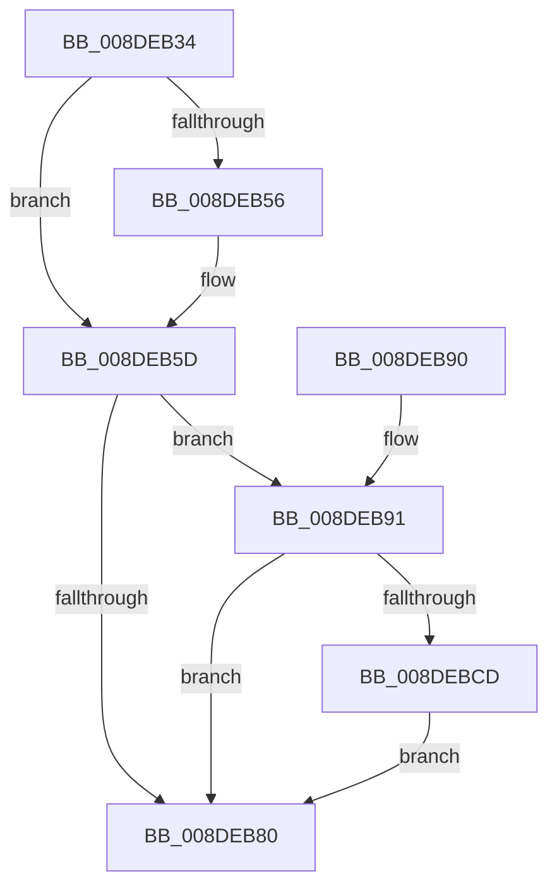

# PiDqQueryAppendActionEntry

- RVA: `0x008DEB34`–`0x008DEBDE` (길이 `170` bytes)
- VA: `0x00000001408DEB34`
- 실행 섹션: `PAGE`
- PDB 이름 있음: `예`; PDB Function 태그: `아니요`
- unwind 정보 RVA: `0x00085B60`
- 디코드: `46`개 명령, `170/170` bytes 표시
- 미해석 바이트: `0` (있으면 어셈블리에 `.byte`로 보존)

> 이 문서는 커널 이미지의 기계어와 PDB 기호를 분석해 생성했습니다. 4번과 5번은 함수 원형과 자료형을 바이너리 사용 방식에서 추정한 C 해석이며 원본 소스 복구 결과는 아닙니다.

## 1. Dependencies

- 직접 호출 지점: **6**; 고유 호출 대상: **6**
- 직접 호출자로 확인된 함수: **3**
- RIP 상대 이미지 참조: **0**

### Outgoing calls
- `0x008DEB98` → [PiDqGetPnpObjectType](PiDqGetPnpObjectType_function_008DF790.md) (function, `0x008DF790`)
- `0x008DEB9F` → [PiDmGetObjectManagerForObjectType](../95/PiDmGetObjectManagerForObjectType_function_00951140.md) (function, `0x00951140`)
- `0x008DEBAA` → [PiDmObjectManagerAcquireSharedLock](../95/PiDmObjectManagerAcquireSharedLock_function_009511A0.md) (function, `0x009511A0`)
- `0x008DEBB3` → [RtlNumberGenericTableElementsAvl](../../text/46/RtlNumberGenericTableElementsAvl_function_004657E0.md) (function, `0x004657E0`)
- `0x008DEBBD` → [PiDmObjectManagerReleaseLock](../95/PiDmObjectManagerReleaseLock_function_0095111C.md) (function, `0x0095111C`)
- `0x008DEBD7` → [PiDqQueryFreeActiveData](PiDqQueryFreeActiveData_function_008DE4FC.md) (function, `0x008DE4FC`)

### Direct callers
- [PiDqObjectManagerEnumerateAndRegisterQuery](PiDqObjectManagerEnumerateAndRegisterQuery_function_008DCF74.md) at `0x008DD08C`
- [PiDqQueryApplyObjectEvent](PiDqQueryApplyObjectEvent_function_008DDACC.md) at `0x008DE10C`
- [PiDqQueryEnumObject](PiDqQueryEnumObject_function_008DF424.md) at `0x008DF53C`

### Static image references
- 디코드된 RIP-relative 메모리 참조가 없습니다.

## 2. Other-region calls and transfers

- 다른 실행 섹션으로 향하는 call: **1**
  - `0x008DEBB3` → [RtlNumberGenericTableElementsAvl](../../text/46/RtlNumberGenericTableElementsAvl_function_004657E0.md) (`PAGE` → `.text`)
- 별도 외부 분기/꼬리 이동을 확인하지 못했습니다.

## 3. Assembly (complete function range)

```asm
008DEB34  48 89 5C 24 08                  mov qword ptr [rsp + 8], rbx
008DEB39  48 89 74 24 10                  mov qword ptr [rsp + 0x10], rsi
008DEB3E  57                              push rdi
008DEB3F  48 83 EC 20                     sub rsp, 0x20
008DEB43  48 8D 81 C0 00 00 00            lea rax, [rcx + 0xc0]
008DEB4A  48 8B F1                        mov rsi, rcx
008DEB4D  48 8B 48 08                     mov rcx, qword ptr [rax + 8]
008DEB51  48 39 01                        cmp qword ptr [rcx], rax
008DEB54  74 07                           je 0x1408deb5d
008DEB56  B9 03 00 00 00                  mov ecx, 3
008DEB5B  CD 29                           int 0x29
008DEB5D  48 89 02                        mov qword ptr [rdx], rax
008DEB60  48 89 4A 08                     mov qword ptr [rdx + 8], rcx
008DEB64  48 89 11                        mov qword ptr [rcx], rdx
008DEB67  48 89 50 08                     mov qword ptr [rax + 8], rdx
008DEB6B  8B 86 D0 00 00 00               mov eax, dword ptr [rsi + 0xd0]
008DEB71  FF C0                           inc eax
008DEB73  89 86 D0 00 00 00               mov dword ptr [rsi + 0xd0], eax
008DEB79  3D E8 03 00 00                  cmp eax, 0x3e8
008DEB7E  77 11                           ja 0x1408deb91
008DEB80  48 8B 5C 24 30                  mov rbx, qword ptr [rsp + 0x30]
008DEB85  48 8B 74 24 38                  mov rsi, qword ptr [rsp + 0x38]
008DEB8A  48 83 C4 20                     add rsp, 0x20
008DEB8E  5F                              pop rdi
008DEB8F  C3                              ret
008DEB90  CC                              int3
008DEB91  48 8B 4E 18                     mov rcx, qword ptr [rsi + 0x18]
008DEB95  8B 49 10                        mov ecx, dword ptr [rcx + 0x10]
008DEB98  E8 F3 0B 00 00                  call 0x1408df790
008DEB9D  8B C8                           mov ecx, eax
008DEB9F  E8 9C 25 07 00                  call 0x140951140
008DEBA4  48 8B C8                        mov rcx, rax
008DEBA7  48 8B F8                        mov rdi, rax
008DEBAA  E8 F1 25 07 00                  call 0x1409511a0
008DEBAF  48 8D 4F 68                     lea rcx, [rdi + 0x68]
008DEBB3  E8 28 6C B8 FF                  call 0x1404657e0
008DEBB8  48 8B CF                        mov rcx, rdi
008DEBBB  8B D8                           mov ebx, eax
008DEBBD  E8 5A 25 07 00                  call 0x14095111c
008DEBC2  8D 04 1B                        lea eax, [rbx + rbx]
008DEBC5  39 86 D0 00 00 00               cmp dword ptr [rsi + 0xd0], eax
008DEBCB  76 B3                           jbe 0x1408deb80
008DEBCD  83 8E D8 00 00 00 01            or dword ptr [rsi + 0xd8], 1
008DEBD4  48 8B CE                        mov rcx, rsi
008DEBD7  E8 20 F9 FF FF                  call 0x1408de4fc
008DEBDC  EB A2                           jmp 0x1408deb80
```

## 4. C-style interpretation (structured pseudocode)

```c
__int64 __fastcall PiDqQueryAppendActionEntry(__int64 a1, __int64 a2)
{
    __int64 result;
    __int64 v_rsp;
    unsigned __int64 v_stack_p10;
    unsigned __int64 v_stack_p8;

    v_stack_p8 = v_rbx;
    v_stack_p10 = v_rsi;
    v_rsp = (v_rsp) - (32);
    if ((*(unsigned __int64 *)(*(unsigned __int64 *)(a1 + 192 + 8))) != (a1 + 192)) {
        a1 = 3;
    }
    *(unsigned __int64 *)(a2) = a1 + 192;
    *(unsigned __int64 *)(a2 + 8) = a1;
    *(unsigned __int64 *)(a1) = a2;
    *(unsigned __int64 *)(a1 + 192 + 8) = a2;
    result = (unsigned int)(((unsigned int)(*(unsigned int *)(a1 + 208))) + 1);
    *(unsigned int *)(a1 + 208) = (unsigned int)(result);
    if (((unsigned int)(result)) > 1000) goto loc_008DEB91;
loc_008DEB80:
    v_rsp = (v_rsp) + (32);
    return result;
loc_008DEB91:
    result = PiDqGetPnpObjectType((unsigned int)(*(unsigned int *)(*(unsigned __int64 *)(v_stack_p10 + 24) + 16)), a2, a3, a4);
    result = PiDmGetObjectManagerForObjectType((unsigned int)((unsigned int)(result)), a2, a3, a4);
    result = PiDmObjectManagerAcquireSharedLock(result, a2, a3, a4);
    result = RtlNumberGenericTableElementsAvl(result + 104, a2, a3, a4);
    result = PiDmObjectManagerReleaseLock(result, a2, a3, a4);
    if ((*(unsigned int *)(v_stack_p10 + 208)) <= ((unsigned int)((unsigned int)((unsigned int)(result)) + (unsigned int)((unsigned int)(result)) * 1))) goto loc_008DEB80;
    result = PiDqQueryFreeActiveData(v_stack_p10, a2, a3, a4);
    goto loc_008DEB80;
}
```

## 5. (Beta) C Style

```c
int64_t PiDqQueryAppendActionEntry(void *Arg1, void *Arg2)
{
    uint8_t *arg1 = (uint8_t *)Arg1;
    uint8_t *arg2 = (uint8_t *)Arg2;

    int64_t result;
    int64_t local_rsp;
    uint64_t v_stack_p10;
    uint64_t v_stack_p8;

    v_stack_p8 = local_rbx;
    v_stack_p10 = local_rsi;
    local_rsp = (local_rsp) - (32);
    if ((*(uint64_t *)(*(uint64_t *)(arg1 + 0xC0 + 0x8))) != (Arg1 + 192)) {
        Arg1 = 3;
    }
    *(void **)(arg2) = Arg1 + 192;
    *(void **)(arg2 + 0x8) = Arg1;
    *(void **)(arg1) = Arg2;
    *(void **)(arg1 + 0xC0 + 0x8) = Arg2;
    result = (uint32_t)(((uint32_t)(*(uint32_t *)(arg1 + 0xD0))) + 1);
    *(uint32_t *)(arg1 + 0xD0) = (uint32_t)(result);
    if (((uint32_t)(result)) > 1000) goto loc_008DEB91;
loc_008DEB80:
    local_rsp = (local_rsp) + (32);
    return result;
loc_008DEB91:
    result = PiDqGetPnpObjectType((uint32_t)(*(uint32_t *)(*(uint64_t *)(v_stack_p10 + 0x18) + 0x10)), Arg2, a3, a4);
    result = PiDmGetObjectManagerForObjectType((uint32_t)((uint32_t)(result)), Arg2, a3, a4);
    result = PiDmObjectManagerAcquireSharedLock(result, Arg2, a3, a4);
    result = RtlNumberGenericTableElementsAvl(result + 104, Arg2, a3, a4);
    result = PiDmObjectManagerReleaseLock(result, Arg2, a3, a4);
    if ((*(uint32_t *)(v_stack_p10 + 0xD0)) <= ((uint32_t)((uint32_t)((uint32_t)(result)) + (uint32_t)((uint32_t)(result)) * 1))) goto loc_008DEB80;
    result = PiDqQueryFreeActiveData(v_stack_p10, Arg2, a3, a4);
    goto loc_008DEB80;
}
```

### 관측된 메모리 오프셋

구조체 형식이 확인되지 않은 접근은 인자 기준의 오프셋으로만 기록했습니다.

| 기준 인자 | 오프셋 표현 | 폭 (bit) | 접근 |
|---|---:|---:|---|
| `Arg1` | `+ 0x8` | `64` | `R` |
| `Arg1` | `+ 0x8` | `64` | `W` |
| `Arg1` | `+ 0x18` | `64` | `R` |
| `Arg1` | `+ 0xC0` | `64` | `R` |
| `Arg1` | `+ 0xD0` | `32` | `R` |
| `Arg1` | `+ 0xD0` | `32` | `W` |
| `Arg1` | `+ 0xD8` | `32` | `R/W` |
| `Arg2` | `+ 0x0` | `64` | `W` |
| `Arg2` | `+ 0x8` | `64` | `W` |

## 6. Execution-region graph

[열기: 2D/3D 그래프와 함수 탐색 컨트롤 패널](../../../control-panel.html?section=page&rva=0x008DEB34&view=graph)

- 2D 그래프는 위에서 아래로 흐르고, 3D 그래프는 빈 공간을 드래그해 회전합니다. Shift+드래그는 이동, 휠은 확대·축소, 함수 노드 선택은 대상 보고서 이동입니다.

### Static fallback


