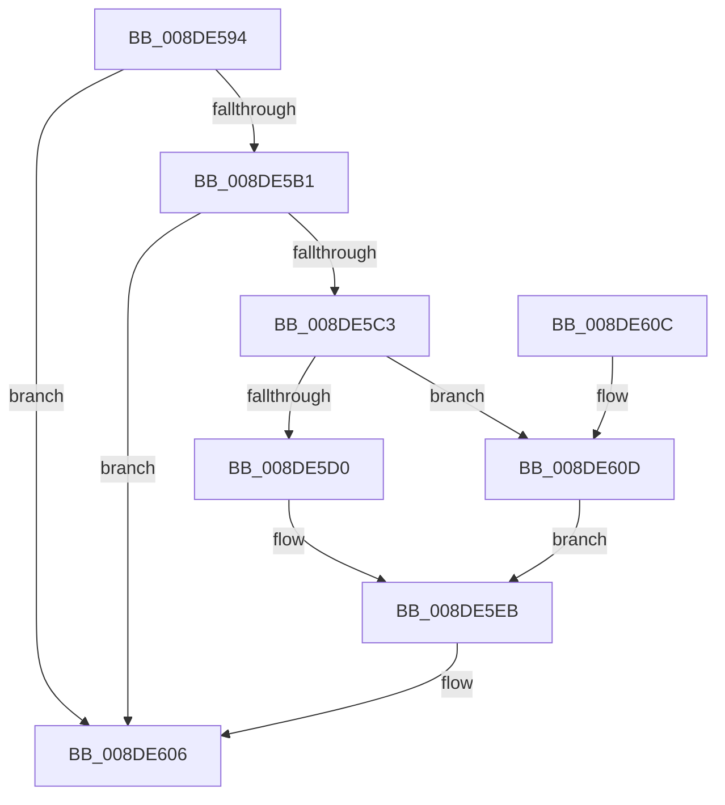

# PiDqQueryCompletePendedIrp

- RVA: `0x008DE594`–`0x008DE617` (길이 `131` bytes)
- VA: `0x00000001408DE594`
- 실행 섹션: `PAGE`
- PDB 이름 있음: `예`; PDB Function 태그: `아니요`
- unwind 정보 RVA: `0x00085AEC`
- 디코드: `35`개 명령, `131/131` bytes 표시
- 미해석 바이트: `0` (있으면 어셈블리에 `.byte`로 보존)

> 이 문서는 커널 이미지의 기계어와 PDB 기호를 분석해 생성했습니다. 4번과 5번은 함수 원형과 자료형을 바이너리 사용 방식에서 추정한 C 해석이며 원본 소스 복구 결과는 아닙니다.

## 1. Dependencies

- 직접 호출 지점: **2**; 고유 호출 대상: **2**
- 직접 호출자로 확인된 함수: **2**
- RIP 상대 이미지 참조: **0**

### Outgoing calls
- `0x008DE5DB` → [PiDqQueryGetNextIoctlInfo](PiDqQueryGetNextIoctlInfo_function_008DCB54.md) (function, `0x008DCB54`)
- `0x008DE5F2` → [PiDqIrpComplete](PiDqIrpComplete_function_008DCF08.md) (function, `0x008DCF08`)

### Direct callers
- [PiDqObjectManagerServiceActionQueue](PiDqObjectManagerServiceActionQueue_function_008DD640.md) at `0x008DD94E`
- [sub_00B1CDEE](../B1/Unknown_function_00B1CDEE.md) at `0x00B1CE08`

### Static image references
- 디코드된 RIP-relative 메모리 참조가 없습니다.

## 2. Other-region calls and transfers

- 다른 실행 섹션으로 향하는 call: **0**
- 별도 외부 분기/꼬리 이동을 확인하지 못했습니다.

## 3. Assembly (complete function range)

```asm
008DE594  40 53                           push rbx
008DE596  48 83 EC 30                     sub rsp, 0x30
008DE59A  48 8B D9                        mov rbx, rcx
008DE59D  0F 57 C0                        xorps xmm0, xmm0
008DE5A0  48 8B 89 B0 00 00 00            mov rcx, qword ptr [rcx + 0xb0]
008DE5A7  0F 11 44 24 20                  movups xmmword ptr [rsp + 0x20], xmm0
008DE5AC  48 85 C9                        test rcx, rcx
008DE5AF  74 55                           je 0x1408de606
008DE5B1  48 8B 91 B8 00 00 00            mov rdx, qword ptr [rcx + 0xb8]
008DE5B8  33 C0                           xor eax, eax
008DE5BA  48 87 41 68                     xchg qword ptr [rcx + 0x68], rax
008DE5BE  48 85 C0                        test rax, rax
008DE5C1  74 43                           je 0x1408de606
008DE5C3  8B 83 D8 00 00 00               mov eax, dword ptr [rbx + 0xd8]
008DE5C9  45 33 C0                        xor r8d, r8d
008DE5CC  A8 01                           test al, 1
008DE5CE  75 3D                           jne 0x1408de60d
008DE5D0  8B 52 08                        mov edx, dword ptr [rdx + 8]
008DE5D3  4C 8D 4C 24 20                  lea r9, [rsp + 0x20]
008DE5D8  48 8B CB                        mov rcx, rbx
008DE5DB  E8 74 E5 FF FF                  call 0x1408dcb54
008DE5E0  33 D2                           xor edx, edx
008DE5E2  4C 8D 4C 24 20                  lea r9, [rsp + 0x20]
008DE5E7  44 8D 42 10                     lea r8d, [rdx + 0x10]
008DE5EB  48 8B 8B B0 00 00 00            mov rcx, qword ptr [rbx + 0xb0]
008DE5F2  E8 11 E9 FF FF                  call 0x1408dcf08
008DE5F7  83 A3 D8 00 00 00 EF            and dword ptr [rbx + 0xd8], 0xffffffef
008DE5FE  48 83 A3 B0 00 00 00 00         and qword ptr [rbx + 0xb0], 0
008DE606  48 83 C4 30                     add rsp, 0x30
008DE60A  5B                              pop rbx
008DE60B  C3                              ret
008DE60C  CC                              int3
008DE60D  45 33 C9                        xor r9d, r9d
008DE610  BA 9A 00 00 C0                  mov edx, 0xc000009a
008DE615  EB D4                           jmp 0x1408de5eb
```

## 4. C-style interpretation (structured pseudocode)

```c
__int64 __fastcall PiDqQueryCompletePendedIrp(__int64 a1, __int64 a2, int a3)
{
    __int64 result;
    __int64 v_rsp;
    unsigned __int64 v_stack_m18;

    v_rsp = (v_rsp) - (48);
    v_stack_m18 = v_xmm0;
    if (*(unsigned __int64 *)(a1 + 176) == 0) goto loc_008DE606;
    result = 0;
    if (0 == 0) goto loc_008DE606;
    a3 = 0;
    if ((((unsigned __int8)((unsigned int)(*(unsigned int *)(a1 + 216)))) & (1)) != 0) goto loc_008DE60D;
    result = PiDqQueryGetNextIoctlInfo(a1, (unsigned int)(*(unsigned int *)(*(unsigned __int64 *)(*(unsigned __int64 *)(a1 + 176) + 184) + 8)), a3, v_stack_m18);
    a2 = 0;
loc_008DE5EB:
    result = PiDqIrpComplete(*(unsigned __int64 *)(a1 + 176), a2, a2 + 16, v_stack_m18);
loc_008DE606:
    v_rsp = (v_rsp) + (48);
    return result;
loc_008DE60D:
    a4 = 0;
    goto loc_008DE5EB;
}
```

## 5. (Beta) C Style

```c
int64_t PiDqQueryCompletePendedIrp(void *Arg1, int64_t Arg2, int32_t Arg3)
{
    uint8_t *arg1 = (uint8_t *)Arg1;

    int64_t result;
    int64_t local_rsp;
    uint64_t v_stack_m18;

    local_rsp = (local_rsp) - (48);
    v_stack_m18 = v_xmm0;
    if (*(uint64_t *)(arg1 + 0xB0) == 0) goto loc_008DE606;
    result = 0;
    if (0 == 0) goto loc_008DE606;
    Arg3 = 0;
    if ((((uint8_t)((uint32_t)(*(uint32_t *)(arg1 + 0xD8)))) & (1)) != 0) goto loc_008DE60D;
    result = PiDqQueryGetNextIoctlInfo(Arg1, (uint32_t)(*(uint32_t *)(*(uint64_t *)(*(uint64_t *)(arg1 + 0xB0) + 0xB8) + 0x8)), Arg3, v_stack_m18);
    Arg2 = 0;
loc_008DE5EB:
    result = PiDqIrpComplete(*(uint64_t *)(arg1 + 0xB0), Arg2, Arg2 + 16, v_stack_m18);
loc_008DE606:
    local_rsp = (local_rsp) + (48);
    return result;
loc_008DE60D:
    a4 = 0;
    goto loc_008DE5EB;
}
```

### 관측된 메모리 오프셋

구조체 형식이 확인되지 않은 접근은 인자 기준의 오프셋으로만 기록했습니다.

| 기준 인자 | 오프셋 표현 | 폭 (bit) | 접근 |
|---|---:|---:|---|
| `Arg1` | `+ 0xB0` | `64` | `R` |
| `Arg1` | `+ 0xB0` | `64` | `R/W` |
| `Arg1` | `+ 0xD8` | `32` | `R` |
| `Arg1` | `+ 0xD8` | `32` | `R/W` |

## 6. Execution-region graph

[열기: 2D/3D 그래프와 함수 탐색 컨트롤 패널](../../../control-panel.html?section=page&rva=0x008DE594&view=graph)

- 2D 그래프는 위에서 아래로 흐르고, 3D 그래프는 빈 공간을 드래그해 회전합니다. Shift+드래그는 이동, 휠은 확대·축소, 함수 노드 선택은 대상 보고서 이동입니다.

### Static fallback


