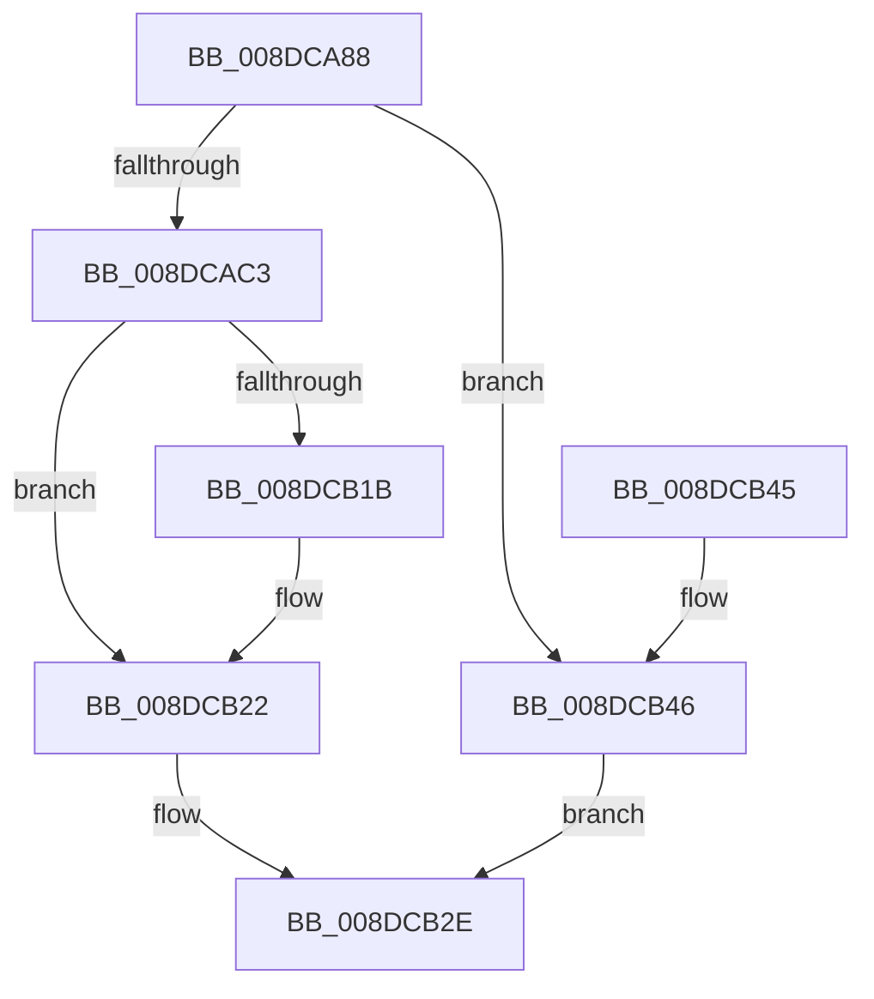

# PiDqQueryCreate

- RVA: `0x008DCA88`–`0x008DCB4D` (길이 `197` bytes)
- VA: `0x00000001408DCA88`
- 실행 섹션: `PAGE`
- PDB 이름 있음: `예`; PDB Function 태그: `아니요`
- unwind 정보 RVA: `0x00085980`
- 디코드: `47`개 명령, `197/197` bytes 표시
- 미해석 바이트: `0` (있으면 어셈블리에 `.byte`로 보존)

> 이 문서는 커널 이미지의 기계어와 PDB 기호를 분석해 생성했습니다. 4번과 5번은 함수 원형과 자료형을 바이너리 사용 방식에서 추정한 C 해석이며 원본 소스 복구 결과는 아닙니다.

## 1. Dependencies

- 직접 호출 지점: **3**; 고유 호출 대상: **3**
- 직접 호출자로 확인된 함수: **1**
- RIP 상대 이미지 참조: **4**

### Outgoing calls
- `0x008DCAB2` → [ExAllocatePool2](../../poolcode/B8/ExAllocatePool2_function_00B820F0.md) (function, `0x00B820F0`)
- `0x008DCB03` → [RtlInitializeGenericTableAvl](../../text/46/RtlInitializeGenericTableAvl_function_00466100.md) (function, `0x00466100`)
- `0x008DCB26` → [SeCaptureSubjectContext](../86/SeCaptureSubjectContext_function_0086B820.md) (function, `0x0086B820`)

### Direct callers
- [PiDqDispatch](PiDqDispatch_function_008DC8A0.md) at `0x008DC9CB`

### Static image references
- `0x008DCACE` → RVA `0x00F8B390` (`.data`; read/write)
- `0x008DCAE9` → RVA `0x00A710C0` (`PiDqFreeGenericTableEntry`; read)
- `0x008DCAF5` → RVA `0x00A68650` (`PiDqAllocateGenericTableEntry`; read)
- `0x008DCAFC` → RVA `0x0099F940` (`PiDqCompareAddresses`; read)

## 2. Other-region calls and transfers

- 다른 실행 섹션으로 향하는 call: **2**
  - `0x008DCAB2` → [ExAllocatePool2](../../poolcode/B8/ExAllocatePool2_function_00B820F0.md) (`PAGE` → `POOLCODE`)
  - `0x008DCB03` → [RtlInitializeGenericTableAvl](../../text/46/RtlInitializeGenericTableAvl_function_00466100.md) (`PAGE` → `.text`)
- 별도 외부 분기/꼬리 이동을 확인하지 못했습니다.

## 3. Assembly (complete function range)

```asm
008DCA88  48 89 5C 24 08                  mov qword ptr [rsp + 8], rbx
008DCA8D  48 89 6C 24 10                  mov qword ptr [rsp + 0x10], rbp
008DCA92  48 89 74 24 18                  mov qword ptr [rsp + 0x18], rsi
008DCA97  57                              push rdi
008DCA98  48 83 EC 30                     sub rsp, 0x30
008DCA9C  48 8B F2                        mov rsi, rdx
008DCA9F  40 8A E9                        mov bpl, cl
008DCAA2  33 FF                           xor edi, edi
008DCAA4  BA E8 00 00 00                  mov edx, 0xe8
008DCAA9  41 B8 50 6E 70 58               mov r8d, 0x58706e50
008DCAAF  8D 4F 40                        lea ecx, [rdi + 0x40]
008DCAB2  E8 39 56 2A 00                  call 0x140b820f0
008DCAB7  48 8B D8                        mov rbx, rax
008DCABA  48 85 C0                        test rax, rax
008DCABD  0F 84 83 00 00 00               je 0x1408dcb46
008DCAC3  8D 4F 01                        lea ecx, [rdi + 1]
008DCAC6  89 88 D4 00 00 00               mov dword ptr [rax + 0xd4], ecx
008DCACC  8B C1                           mov eax, ecx
008DCACE  F0 48 0F C1 05 B9 E8 6A 00      lock xadd qword ptr [rip + 0x6ae8b9], rax
008DCAD7  48 03 C1                        add rax, rcx
008DCADA  48 89 7B 40                     mov qword ptr [rbx + 0x40], rdi
008DCADE  48 8D 4B 48                     lea rcx, [rbx + 0x48]
008DCAE2  48 89 83 E0 00 00 00            mov qword ptr [rbx + 0xe0], rax
008DCAE9  4C 8D 0D D0 45 19 00            lea r9, [rip + 0x1945d0]
008DCAF0  48 89 7C 24 20                  mov qword ptr [rsp + 0x20], rdi
008DCAF5  4C 8D 05 54 BB 18 00            lea r8, [rip + 0x18bb54]
008DCAFC  48 8D 15 3D 2E 0C 00            lea rdx, [rip + 0xc2e3d]
008DCB03  E8 F8 95 B8 FF                  call 0x140466100
008DCB08  48 8D 8B C0 00 00 00            lea rcx, [rbx + 0xc0]
008DCB0F  48 89 49 08                     mov qword ptr [rcx + 8], rcx
008DCB13  48 89 09                        mov qword ptr [rcx], rcx
008DCB16  40 84 ED                        test bpl, bpl
008DCB19  74 07                           je 0x1408dcb22
008DCB1B  83 8B D8 00 00 00 02            or dword ptr [rbx + 0xd8], 2
008DCB22  48 8D 4B 20                     lea rcx, [rbx + 0x20]
008DCB26  E8 F5 EC F8 FF                  call 0x14086b820
008DCB2B  48 89 1E                        mov qword ptr [rsi], rbx
008DCB2E  48 8B 5C 24 40                  mov rbx, qword ptr [rsp + 0x40]
008DCB33  8B C7                           mov eax, edi
008DCB35  48 8B 6C 24 48                  mov rbp, qword ptr [rsp + 0x48]
008DCB3A  48 8B 74 24 50                  mov rsi, qword ptr [rsp + 0x50]
008DCB3F  48 83 C4 30                     add rsp, 0x30
008DCB43  5F                              pop rdi
008DCB44  C3                              ret
008DCB45  CC                              int3
008DCB46  BF 9A 00 00 C0                  mov edi, 0xc000009a
008DCB4B  EB E1                           jmp 0x1408dcb2e
```

## 4. C-style interpretation (structured pseudocode)

```c
__int64 __fastcall PiDqQueryCreate(unsigned __int8 a1, __int64 a2)
{
    __int64 result;
    __int64 v_rdi;
    __int64 v_rsp;
    unsigned __int64 v_stack_m18;
    unsigned __int64 v_stack_p10;
    unsigned __int64 v_stack_p18;
    unsigned __int64 v_stack_p8;

    v_stack_p8 = v_rbx;
    v_stack_p10 = v_rbp;
    v_stack_p18 = v_rsi;
    v_rsp = (v_rsp) - (48);
    v_rdi = 0;
    result = ExAllocatePool2(v_rdi + 64, 232, (unsigned int)(0x58706E50ULL), a4);
    if (result == 0) goto loc_008DCB46;
    *(unsigned int *)(result + 212) = (unsigned int)(v_rdi + 1);
    result = ((unsigned int)((unsigned int)(v_rdi + 1))) + (v_rdi + 1);
    *(unsigned __int64 *)(result + 64) = 0;
    *(unsigned __int64 *)(result + 224) = result;
    v_stack_m18 = 0;
    result = RtlInitializeGenericTableAvl(result + 72, v_rip + 798269, v_rip + 1620820, v_rip + 1656272);
    *(unsigned __int64 *)(result + 192 + 8) = result + 192;
    *(unsigned __int64 *)(result + 192) = result + 192;
    if (a1 != 0) {
    }
    result = SeCaptureSubjectContext(result + 32, v_rip + 798269, v_rip + 1620820, v_rip + 1656272);
    *(unsigned __int64 *)(a2) = result;
loc_008DCB2E:
    v_rsp = (v_rsp) + (48);
    return 0;
loc_008DCB46:
    goto loc_008DCB2E;
}
```

## 5. (Beta) C Style

```c
int64_t PiDqQueryCreate(uint8_t Arg1, void *Arg2)
{
    uint8_t *arg2 = (uint8_t *)Arg2;

    int64_t result;
    int64_t local_rdi;
    int64_t local_rsp;
    uint64_t v_stack_m18;
    uint64_t v_stack_p10;
    uint64_t v_stack_p18;
    uint64_t v_stack_p8;

    v_stack_p8 = local_rbx;
    v_stack_p10 = local_rbp;
    v_stack_p18 = local_rsi;
    local_rsp = (local_rsp) - (48);
    local_rdi = 0;
    result = ExAllocatePool2(local_rdi + 64, 232, (uint32_t)(0x58706E50ULL), a4);
    if (result == 0) goto loc_008DCB46;
    *(uint32_t *)(result + 0xD4) = (uint32_t)(local_rdi + 1);
    result = ((uint32_t)((uint32_t)(local_rdi + 1))) + (local_rdi + 1);
    *(uint64_t *)(result + 0x40) = 0;
    *(uint64_t *)(result + 0xE0) = result;
    v_stack_m18 = 0;
    result = RtlInitializeGenericTableAvl(result + 72, v_rip + 798269, v_rip + 1620820, v_rip + 1656272);
    *(uint64_t *)(result + 0xC0 + 0x8) = result + 192;
    *(uint64_t *)(result + 0xC0) = result + 192;
    if (Arg1 != 0) {
    }
    result = SeCaptureSubjectContext(result + 32, v_rip + 798269, v_rip + 1620820, v_rip + 1656272);
    *(uint64_t *)(arg2) = result;
loc_008DCB2E:
    local_rsp = (local_rsp) + (48);
    return 0;
loc_008DCB46:
    goto loc_008DCB2E;
}
```

### 관측된 메모리 오프셋

구조체 형식이 확인되지 않은 접근은 인자 기준의 오프셋으로만 기록했습니다.

| 기준 인자 | 오프셋 표현 | 폭 (bit) | 접근 |
|---|---:|---:|---|
| `Arg2` | `+ 0x0` | `64` | `W` |

## 6. Execution-region graph

[열기: 2D/3D 그래프와 함수 탐색 컨트롤 패널](../../../control-panel.html?section=page&rva=0x008DCA88&view=graph)

- 2D 그래프는 위에서 아래로 흐르고, 3D 그래프는 빈 공간을 드래그해 회전합니다. Shift+드래그는 이동, 휠은 확대·축소, 함수 노드 선택은 대상 보고서 이동입니다.

### Static fallback


