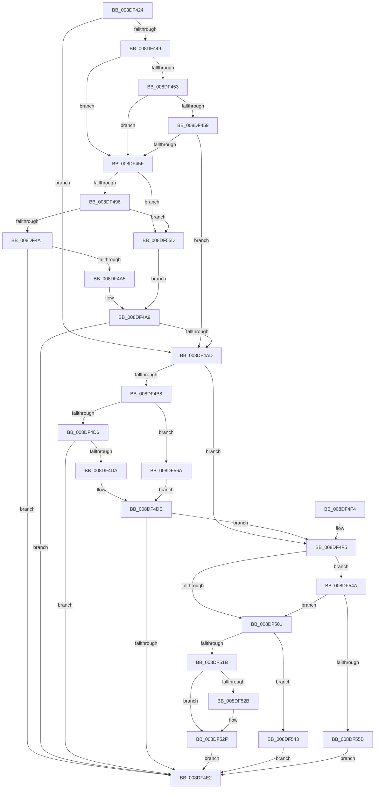

# PiDqQueryEnumObject

- RVA: `0x008DF424`–`0x008DF577` (길이 `339` bytes)
- VA: `0x00000001408DF424`
- 실행 섹션: `PAGE`
- PDB 이름 있음: `예`; PDB Function 태그: `아니요`
- unwind 정보 RVA: `0x00085BC4`
- 디코드: `96`개 명령, `339/339` bytes 표시
- 미해석 바이트: `0` (있으면 어셈블리에 `.byte`로 보존)

> 이 문서는 커널 이미지의 기계어와 PDB 기호를 분석해 생성했습니다. 4번과 5번은 함수 원형과 자료형을 바이너리 사용 방식에서 추정한 C 해석이며 원본 소스 복구 결과는 아닙니다.

## 1. Dependencies

- 직접 호출 지점: **5**; 고유 호출 대상: **5**
- 직접 호출자로 확인된 함수: **3**
- RIP 상대 이미지 참조: **1**

### Outgoing calls
- `0x008DF484` → [PiPnpRtlApplyMandatoryFilters](../8E/PiPnpRtlApplyMandatoryFilters_function_008E5C80.md) (function, `0x008E5C80`)
- `0x008DF4C4` → [PiDqQueryEvaluateFilter](../8E/PiDqQueryEvaluateFilter_function_008E01C4.md) (function, `0x008E01C4`)
- `0x008DF511` → [ExAllocatePool2](../../poolcode/B8/ExAllocatePool2_function_00B820F0.md) (function, `0x00B820F0`)
- `0x008DF53C` → [PiDqQueryAppendActionEntry](PiDqQueryAppendActionEntry_function_008DEB34.md) (function, `0x008DEB34`)
- `0x008DF550` → [PiDqQueryAddObjectToResultSet](../A5/PiDqQueryAddObjectToResultSet_function_00A55624.md) (function, `0x00A55624`)

### Direct callers
- [PiDqObjectManagerEnumerateAndRegisterQuery](PiDqObjectManagerEnumerateAndRegisterQuery_function_008DCF74.md) at `0x008DD046`
- [PiDqEnumQueryObjectsCallback](PiDqEnumQueryObjectsCallback_function_008DF400.md) at `0x008DF411`
- [sub_00B1CD26](../B1/Unknown_function_00B1CD26.md) at `0x00B1CDB3`

### Static image references
- `0x008DF478` → RVA `0x00E66398` (`.data`; read)

## 2. Other-region calls and transfers

- 다른 실행 섹션으로 향하는 call: **1**
  - `0x008DF511` → [ExAllocatePool2](../../poolcode/B8/ExAllocatePool2_function_00B820F0.md) (`PAGE` → `POOLCODE`)
- 별도 외부 분기/꼬리 이동을 확인하지 못했습니다.

## 3. Assembly (complete function range)

```asm
008DF424  48 89 5C 24 10                  mov qword ptr [rsp + 0x10], rbx
008DF429  48 89 74 24 20                  mov qword ptr [rsp + 0x20], rsi
008DF42E  57                              push rdi
008DF42F  48 83 EC 30                     sub rsp, 0x30
008DF433  4C 8B 41 18                     mov r8, qword ptr [rcx + 0x18]
008DF437  48 8B FA                        mov rdi, rdx
008DF43A  48 8B F1                        mov rsi, rcx
008DF43D  C6 44 24 40 01                  mov byte ptr [rsp + 0x40], 1
008DF442  41 83 78 14 00                  cmp dword ptr [r8 + 0x14], 0
008DF447  75 64                           jne 0x1408df4ad
008DF449  45 8B 40 10                     mov r8d, dword ptr [r8 + 0x10]
008DF44D  41 83 E8 01                     sub r8d, 1
008DF451  74 0C                           je 0x1408df45f
008DF453  41 83 E8 01                     sub r8d, 1
008DF457  74 06                           je 0x1408df45f
008DF459  41 83 F8 01                     cmp r8d, 1
008DF45D  75 4E                           jne 0x1408df4ad
008DF45F  44 8B 42 1C                     mov r8d, dword ptr [rdx + 0x1c]
008DF463  48 8D 41 20                     lea rax, [rcx + 0x20]
008DF467  48 8B 52 10                     mov rdx, qword ptr [rdx + 0x10]
008DF46B  48 8D 4C 24 40                  lea rcx, [rsp + 0x40]
008DF470  48 89 4C 24 28                  mov qword ptr [rsp + 0x28], rcx
008DF475  45 33 C9                        xor r9d, r9d
008DF478  48 8B 0D 19 6F 58 00            mov rcx, qword ptr [rip + 0x586f19]
008DF47F  48 89 44 24 20                  mov qword ptr [rsp + 0x20], rax
008DF484  E8 F7 67 00 00                  call 0x1408e5c80
008DF489  8B D8                           mov ebx, eax
008DF48B  3D 34 00 00 C0                  cmp eax, 0xc0000034
008DF490  0F 84 C7 00 00 00               je 0x1408df55d
008DF496  3D 25 02 00 C0                  cmp eax, 0xc0000225
008DF49B  0F 84 BC 00 00 00               je 0x1408df55d
008DF4A1  85 C0                           test eax, eax
008DF4A3  78 3D                           js 0x1408df4e2
008DF4A5  8A 44 24 40                     mov al, byte ptr [rsp + 0x40]
008DF4A9  84 C0                           test al, al
008DF4AB  74 35                           je 0x1408df4e2
008DF4AD  48 8B 46 18                     mov rax, qword ptr [rsi + 0x18]
008DF4B1  48 83 78 58 00                  cmp qword ptr [rax + 0x58], 0
008DF4B6  74 3D                           je 0x1408df4f5
008DF4B8  48 8B 57 10                     mov rdx, qword ptr [rdi + 0x10]
008DF4BC  4C 8D 44 24 40                  lea r8, [rsp + 0x40]
008DF4C1  48 8B CE                        mov rcx, rsi
008DF4C4  E8 FB 0C 00 00                  call 0x1408e01c4
008DF4C9  8B D8                           mov ebx, eax
008DF4CB  3D 34 00 00 C0                  cmp eax, 0xc0000034
008DF4D0  0F 84 94 00 00 00               je 0x1408df56a
008DF4D6  85 C0                           test eax, eax
008DF4D8  78 08                           js 0x1408df4e2
008DF4DA  8A 44 24 40                     mov al, byte ptr [rsp + 0x40]
008DF4DE  84 C0                           test al, al
008DF4E0  75 13                           jne 0x1408df4f5
008DF4E2  48 8B 74 24 58                  mov rsi, qword ptr [rsp + 0x58]
008DF4E7  8B C3                           mov eax, ebx
008DF4E9  48 8B 5C 24 48                  mov rbx, qword ptr [rsp + 0x48]
008DF4EE  48 83 C4 30                     add rsp, 0x30
008DF4F2  5F                              pop rdi
008DF4F3  C3                              ret
008DF4F4  CC                              int3
008DF4F5  48 8B 46 18                     mov rax, qword ptr [rsi + 0x18]
008DF4F9  8B 48 28                        mov ecx, dword ptr [rax + 0x28]
008DF4FC  F6 C1 01                        test cl, 1
008DF4FF  75 49                           jne 0x1408df54a
008DF501  BA 28 00 00 00                  mov edx, 0x28
008DF506  B9 00 01 00 00                  mov ecx, 0x100
008DF50B  41 B8 50 6E 70 58               mov r8d, 0x58706e50
008DF511  E8 DA 2B 2A 00                  call 0x140b820f0
008DF516  48 85 C0                        test rax, rax
008DF519  74 28                           je 0x1408df543
008DF51B  C7 40 20 01 00 00 00            mov dword ptr [rax + 0x20], 1
008DF522  48 89 78 10                     mov qword ptr [rax + 0x10], rdi
008DF526  48 85 FF                        test rdi, rdi
008DF529  74 04                           je 0x1408df52f
008DF52B  F0 FF 47 08                     lock inc dword ptr [rdi + 8]
008DF52F  48 83 60 18 00                  and qword ptr [rax + 0x18], 0
008DF534  33 DB                           xor ebx, ebx
008DF536  48 8B D0                        mov rdx, rax
008DF539  48 8B CE                        mov rcx, rsi
008DF53C  E8 F3 F5 FF FF                  call 0x1408deb34
008DF541  EB 9F                           jmp 0x1408df4e2
008DF543  BB 9A 00 00 C0                  mov ebx, 0xc000009a
008DF548  EB 98                           jmp 0x1408df4e2
008DF54A  48 8B D7                        mov rdx, rdi
008DF54D  48 8B CE                        mov rcx, rsi
008DF550  E8 CF 60 17 00                  call 0x140a55624
008DF555  8B D8                           mov ebx, eax
008DF557  85 C0                           test eax, eax
008DF559  79 A6                           jns 0x1408df501
008DF55B  EB 85                           jmp 0x1408df4e2
008DF55D  32 C0                           xor al, al
008DF55F  88 44 24 40                     mov byte ptr [rsp + 0x40], al
008DF563  33 DB                           xor ebx, ebx
008DF565  E9 3F FF FF FF                  jmp 0x1408df4a9
008DF56A  32 C0                           xor al, al
008DF56C  88 44 24 40                     mov byte ptr [rsp + 0x40], al
008DF570  33 DB                           xor ebx, ebx
008DF572  E9 67 FF FF FF                  jmp 0x1408df4de
```

## 4. C-style interpretation (structured pseudocode)

```c
__int64 __fastcall PiDqQueryEnumObject(__int64 a1, __int64 a2, __int64 a3, int a4)
{
    __int64 result;
    __int64 v_rbx;
    __int64 v_rsp;
    unsigned __int64 v_stack_m10;
    unsigned __int64 v_stack_m18;
    unsigned __int64 v_stack_p10;
    unsigned __int64 v_stack_p20;
    unsigned __int8 v_stack_p40;
    unsigned __int8 v_stack_p8;

    v_stack_p10 = v_rbx;
    v_stack_p20 = v_rsi;
    v_rsp = (v_rsp) - (48);
    v_stack_p8 = 1;
    if ((*(unsigned int *)(*(unsigned __int64 *)(a1 + 24) + 20)) != 0) goto loc_008DF4AD;
    a3 = (unsigned int)(((unsigned int)(*(unsigned int *)(*(unsigned __int64 *)(a1 + 24) + 16))) - (1));
    if (condition_is_equal) goto loc_008DF45F;
    a3 = (unsigned int)((a3) - (1));
    if (condition_is_equal) goto loc_008DF45F;
    if (((unsigned int)(a3)) != 1) goto loc_008DF4AD;
loc_008DF45F:
    v_stack_m10 = v_stack_p8;
    a4 = 0;
    v_stack_m18 = a1 + 32;
    result = PiPnpRtlApplyMandatoryFilters(*(unsigned __int64 *)(v_rip + 5795609), *(unsigned __int64 *)(a2 + 16), (unsigned int)(*(unsigned int *)(a2 + 28)), a4);
    if (((unsigned int)(result)) == 0xC0000034ULL) goto loc_008DF55D;
    if (((unsigned int)(result)) == 0xC0000225ULL) goto loc_008DF55D;
    if (sign_flag) goto loc_008DF4E2;
loc_008DF4A9:
    if ((unsigned __int8)(v_stack_p8) == 0) goto loc_008DF4E2;
loc_008DF4AD:
    if ((*(unsigned __int64 *)(*(unsigned __int64 *)(a1 + 24) + 88)) == 0) goto loc_008DF4F5;
    result = PiDqQueryEvaluateFilter(a1, *(unsigned __int64 *)(a2 + 16), v_stack_p8, a4);
    if (((unsigned int)(result)) == 0xC0000034ULL) goto loc_008DF56A;
    if (sign_flag) goto loc_008DF4E2;
loc_008DF4DE:
    if ((unsigned __int8)(v_stack_p8) != 0) goto loc_008DF4F5;
loc_008DF4E2:
    v_rsp = (v_rsp) + (48);
    return (unsigned int)((unsigned int)((unsigned int)((unsigned int)(result))));
loc_008DF4F5:
    if ((((unsigned __int8)((unsigned int)(*(unsigned int *)(*(unsigned __int64 *)(v_stack_p20 + 24) + 40)))) & (1)) != 0) goto loc_008DF54A;
loc_008DF501:
    result = ExAllocatePool2(256, 40, (unsigned int)(0x58706E50ULL), a4);
    if (result == 0) goto loc_008DF543;
    *(unsigned int *)(result + 32) = 1;
    *(unsigned __int64 *)(result + 16) = a2;
    if (a2 != 0) {
    }
    v_rbx = 0;
    result = PiDqQueryAppendActionEntry(v_stack_p20, result, (unsigned int)(0x58706E50ULL), a4);
    goto loc_008DF4E2;
loc_008DF543:
    goto loc_008DF4E2;
loc_008DF54A:
    result = PiDqQueryAddObjectToResultSet(v_stack_p20, a2, (unsigned int)(0x58706E50ULL), a4);
    if (!sign_flag) goto loc_008DF501;
    goto loc_008DF4E2;
loc_008DF55D:
    result = 0;
    v_stack_p40 = 0;
    v_rbx = 0;
    goto loc_008DF4A9;
loc_008DF56A:
    result = 0;
    v_stack_p40 = 0;
    v_rbx = 0;
    goto loc_008DF4DE;
}
```

## 5. (Beta) C Style

```c
int64_t PiDqQueryEnumObject(void *Arg1, void *Arg2, int64_t Arg3, int32_t Arg4)
{
    uint8_t *arg1 = (uint8_t *)Arg1;
    uint8_t *arg2 = (uint8_t *)Arg2;

    int64_t result;
    int64_t local_rbx;
    int64_t local_rsp;
    uint64_t v_stack_m10;
    uint64_t v_stack_m18;
    uint64_t v_stack_p10;
    uint64_t v_stack_p20;
    uint8_t v_stack_p40;
    uint8_t v_stack_p8;

    v_stack_p10 = local_rbx;
    v_stack_p20 = local_rsi;
    local_rsp = (local_rsp) - (48);
    v_stack_p8 = 1;
    if ((*(uint32_t *)(*(uint64_t *)(arg1 + 0x18) + 0x14)) != 0) goto loc_008DF4AD;
    Arg3 = (uint32_t)(((uint32_t)(*(uint32_t *)(*(uint64_t *)(arg1 + 0x18) + 0x10))) - (1));
    if (condition_is_equal) goto loc_008DF45F;
    Arg3 = (uint32_t)((Arg3) - (1));
    if (condition_is_equal) goto loc_008DF45F;
    if (((uint32_t)(Arg3)) != 1) goto loc_008DF4AD;
loc_008DF45F:
    v_stack_m10 = v_stack_p8;
    Arg4 = 0;
    v_stack_m18 = Arg1 + 32;
    result = PiPnpRtlApplyMandatoryFilters(*(uint64_t *)(v_rip + 0x586F19), *(uint64_t *)(arg2 + 0x10), (uint32_t)(*(uint32_t *)(arg2 + 0x1C)), Arg4);
    if (((uint32_t)(result)) == 0xC0000034ULL) goto loc_008DF55D;
    if (((uint32_t)(result)) == 0xC0000225ULL) goto loc_008DF55D;
    if (sign_flag) goto loc_008DF4E2;
loc_008DF4A9:
    if ((uint8_t)(v_stack_p8) == 0) goto loc_008DF4E2;
loc_008DF4AD:
    if ((*(uint64_t *)(*(uint64_t *)(arg1 + 0x18) + 0x58)) == 0) goto loc_008DF4F5;
    result = PiDqQueryEvaluateFilter(Arg1, *(uint64_t *)(arg2 + 0x10), v_stack_p8, Arg4);
    if (((uint32_t)(result)) == 0xC0000034ULL) goto loc_008DF56A;
    if (sign_flag) goto loc_008DF4E2;
loc_008DF4DE:
    if ((uint8_t)(v_stack_p8) != 0) goto loc_008DF4F5;
loc_008DF4E2:
    local_rsp = (local_rsp) + (48);
    return (uint32_t)((uint32_t)((uint32_t)((uint32_t)(result))));
loc_008DF4F5:
    if ((((uint8_t)((uint32_t)(*(uint32_t *)(*(uint64_t *)(v_stack_p20 + 0x18) + 0x28)))) & (1)) != 0) goto loc_008DF54A;
loc_008DF501:
    result = ExAllocatePool2(256, 40, (uint32_t)(0x58706E50ULL), Arg4);
    if (result == 0) goto loc_008DF543;
    *(uint32_t *)(result + 0x20) = 1;
    *(void **)(result + 0x10) = Arg2;
    if (Arg2 != NULL) {
    }
    local_rbx = 0;
    result = PiDqQueryAppendActionEntry(v_stack_p20, result, (uint32_t)(0x58706E50ULL), Arg4);
    goto loc_008DF4E2;
loc_008DF543:
    goto loc_008DF4E2;
loc_008DF54A:
    result = PiDqQueryAddObjectToResultSet(v_stack_p20, Arg2, (uint32_t)(0x58706E50ULL), Arg4);
    if (!sign_flag) goto loc_008DF501;
    goto loc_008DF4E2;
loc_008DF55D:
    result = 0;
    v_stack_p40 = 0;
    local_rbx = 0;
    goto loc_008DF4A9;
loc_008DF56A:
    result = 0;
    v_stack_p40 = 0;
    local_rbx = 0;
    goto loc_008DF4DE;
}
```

### 관측된 메모리 오프셋

구조체 형식이 확인되지 않은 접근은 인자 기준의 오프셋으로만 기록했습니다.

| 기준 인자 | 오프셋 표현 | 폭 (bit) | 접근 |
|---|---:|---:|---|
| `Arg1` | `+ 0x18` | `64` | `R` |
| `Arg1` | `+ 0x20` | `64` | `R` |
| `Arg2` | `+ 0x10` | `64` | `R` |
| `Arg2` | `+ 0x1C` | `32` | `R` |

## 6. Execution-region graph

[열기: 2D/3D 그래프와 함수 탐색 컨트롤 패널](../../../control-panel.html?section=page&rva=0x008DF424&view=graph)

- 2D 그래프는 위에서 아래로 흐르고, 3D 그래프는 빈 공간을 드래그해 회전합니다. Shift+드래그는 이동, 휠은 확대·축소, 함수 노드 선택은 대상 보고서 이동입니다.

### Static fallback


