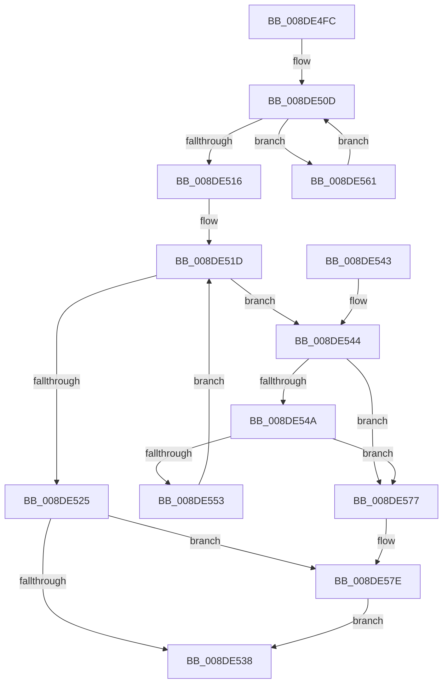

# PiDqQueryFreeActiveData

- RVA: `0x008DE4FC`–`0x008DE58D` (길이 `145` bytes)
- VA: `0x00000001408DE4FC`
- 실행 섹션: `PAGE`
- PDB 이름 있음: `예`; PDB Function 태그: `아니요`
- unwind 정보 RVA: `0x00080A00`
- 디코드: `41`개 명령, `145/145` bytes 표시
- 미해석 바이트: `0` (있으면 어셈블리에 `.byte`로 보존)

> 이 문서는 커널 이미지의 기계어와 PDB 기호를 분석해 생성했습니다. 4번과 5번은 함수 원형과 자료형을 바이너리 사용 방식에서 추정한 C 해석이며 원본 소스 복구 결과는 아닙니다.

## 1. Dependencies

- 직접 호출 지점: **4**; 고유 호출 대상: **4**
- 직접 호출자로 확인된 함수: **7**
- RIP 상대 이미지 참조: **0**

### Outgoing calls
- `0x008DE50D` → [RtlIsGenericTableEmptyAvl](../../text/45/RtlIsGenericTableEmptyAvl_function_00457B60.md) (function, `0x00457B60`)
- `0x008DE55A` → [PiDqQueryActionQueueEntryFree](PiDqQueryActionQueueEntryFree_function_008DE1B0.md) (function, `0x008DE1B0`)
- `0x008DE56C` → [PiDqQueryDeleteObjectFromResultSet](PiDqQueryDeleteObjectFromResultSet_function_008DC600.md) (function, `0x008DC600`)
- `0x008DE57E` → [PiDqActionDataFree](PiDqActionDataFree_function_008DE4A8.md) (function, `0x008DE4A8`)

### Direct callers
- [PiDqIrpQueryGetResult](PiDqIrpQueryGetResult_function_008DBF28.md) at `0x008DC1C0`
- [PiDqIrpQueryCreate](PiDqIrpQueryCreate_function_008DCC04.md) at `0x008DCEF7`
- [PiDqObjectManagerEnumerateAndRegisterQuery](PiDqObjectManagerEnumerateAndRegisterQuery_function_008DCF74.md) at `0x008DD299`
- [PiDqQueryApplyObjectEvent](PiDqQueryApplyObjectEvent_function_008DDACC.md) at `0x008DDDC9`
- [PiDqQueryRelease](PiDqQueryRelease_function_008DE800.md) at `0x008DE836`
- [PiDqQueryAppendActionEntry](PiDqQueryAppendActionEntry_function_008DEB34.md) at `0x008DEBD7`
- [sub_00B1CDEE](../B1/Unknown_function_00B1CDEE.md) at `0x00B1CE00`

### Static image references
- 디코드된 RIP-relative 메모리 참조가 없습니다.

## 2. Other-region calls and transfers

- 다른 실행 섹션으로 향하는 call: **1**
  - `0x008DE50D` → [RtlIsGenericTableEmptyAvl](../../text/45/RtlIsGenericTableEmptyAvl_function_00457B60.md) (`PAGE` → `.text`)
- 별도 외부 분기/꼬리 이동을 확인하지 못했습니다.

## 3. Assembly (complete function range)

```asm
008DE4FC  48 89 5C 24 08                  mov qword ptr [rsp + 8], rbx
008DE501  57                              push rdi
008DE502  48 83 EC 20                     sub rsp, 0x20
008DE506  48 8B D9                        mov rbx, rcx
008DE509  48 83 C1 48                     add rcx, 0x48
008DE50D  E8 4E 96 B7 FF                  call 0x140457b60
008DE512  84 C0                           test al, al
008DE514  74 4B                           je 0x1408de561
008DE516  48 8D BB C0 00 00 00            lea rdi, [rbx + 0xc0]
008DE51D  48 8B 0F                        mov rcx, qword ptr [rdi]
008DE520  48 3B CF                        cmp rcx, rdi
008DE523  75 1F                           jne 0x1408de544
008DE525  83 A3 D0 00 00 00 00            and dword ptr [rbx + 0xd0], 0
008DE52C  48 8B 8B B8 00 00 00            mov rcx, qword ptr [rbx + 0xb8]
008DE533  48 85 C9                        test rcx, rcx
008DE536  75 46                           jne 0x1408de57e
008DE538  48 8B 5C 24 30                  mov rbx, qword ptr [rsp + 0x30]
008DE53D  48 83 C4 20                     add rsp, 0x20
008DE541  5F                              pop rdi
008DE542  C3                              ret
008DE543  CC                              int3
008DE544  48 39 79 08                     cmp qword ptr [rcx + 8], rdi
008DE548  75 2D                           jne 0x1408de577
008DE54A  48 8B 01                        mov rax, qword ptr [rcx]
008DE54D  48 39 48 08                     cmp qword ptr [rax + 8], rcx
008DE551  75 24                           jne 0x1408de577
008DE553  48 89 07                        mov qword ptr [rdi], rax
008DE556  48 89 78 08                     mov qword ptr [rax + 8], rdi
008DE55A  E8 51 FC FF FF                  call 0x1408de1b0
008DE55F  EB BC                           jmp 0x1408de51d
008DE561  48 8B 53 58                     mov rdx, qword ptr [rbx + 0x58]
008DE565  48 8B CB                        mov rcx, rbx
008DE568  48 8B 52 20                     mov rdx, qword ptr [rdx + 0x20]
008DE56C  E8 8F E0 FF FF                  call 0x1408dc600
008DE571  48 8D 4B 48                     lea rcx, [rbx + 0x48]
008DE575  EB 96                           jmp 0x1408de50d
008DE577  B9 03 00 00 00                  mov ecx, 3
008DE57C  CD 29                           int 0x29
008DE57E  E8 25 FF FF FF                  call 0x1408de4a8
008DE583  48 83 A3 B8 00 00 00 00         and qword ptr [rbx + 0xb8], 0
008DE58B  EB AB                           jmp 0x1408de538
```

## 4. C-style interpretation (structured pseudocode)

```c
__int64 __fastcall PiDqQueryFreeActiveData(__int64 a1)
{
    __int64 result;
    __int64 v_rsp;
    unsigned __int64 v_stack_p8;

    v_stack_p8 = v_rbx;
    v_rsp = (v_rsp) - (32);
    a1 = (a1) + (72);
loc_008DE50D:
    result = RtlIsGenericTableEmptyAvl(a1, a2, a3, a4);
    if ((unsigned __int8)(result) == 0) goto loc_008DE561;
loc_008DE51D:
    if ((*(unsigned __int64 *)(a1 + 192)) != (a1 + 192)) goto loc_008DE544;
    if (*(unsigned __int64 *)(a1 + 184) != 0) goto loc_008DE57E;
loc_008DE538:
    v_rsp = (v_rsp) + (32);
    return result;
loc_008DE544:
    if ((*(unsigned __int64 *)(*(unsigned __int64 *)(a1 + 184) + 8)) != (a1 + 192)) goto loc_008DE577;
    if ((*(unsigned __int64 *)(*(unsigned __int64 *)(*(unsigned __int64 *)(a1 + 184)) + 8)) != (*(unsigned __int64 *)(a1 + 184))) goto loc_008DE577;
    *(unsigned __int64 *)(a1 + 192) = *(unsigned __int64 *)(*(unsigned __int64 *)(a1 + 184));
    *(unsigned __int64 *)(*(unsigned __int64 *)(*(unsigned __int64 *)(a1 + 184)) + 8) = a1 + 192;
    result = PiDqQueryActionQueueEntryFree(*(unsigned __int64 *)(a1 + 184), a2, a3, a4);
    goto loc_008DE51D;
loc_008DE561:
    result = PiDqQueryDeleteObjectFromResultSet(v_stack_p8, *(unsigned __int64 *)(*(unsigned __int64 *)(v_stack_p8 + 88) + 32), a3, a4);
    goto loc_008DE50D;
loc_008DE577:
loc_008DE57E:
    result = PiDqActionDataFree(3, *(unsigned __int64 *)(*(unsigned __int64 *)(v_stack_p8 + 88) + 32), a3, a4);
    goto loc_008DE538;
}
```

## 5. (Beta) C Style

```c
int64_t PiDqQueryFreeActiveData(void *Arg1)
{
    uint8_t *arg1 = (uint8_t *)Arg1;

    int64_t result;
    int64_t local_rsp;
    uint64_t v_stack_p8;

    v_stack_p8 = local_rbx;
    local_rsp = (local_rsp) - (32);
    Arg1 = (Arg1) + (72);
loc_008DE50D:
    result = RtlIsGenericTableEmptyAvl(Arg1, a2, a3, a4);
    if ((uint8_t)(result) == 0) goto loc_008DE561;
loc_008DE51D:
    if ((*(uint64_t *)(arg1 + 0xC0)) != (Arg1 + 192)) goto loc_008DE544;
    if (*(uint64_t *)(arg1 + 0xB8) != 0) goto loc_008DE57E;
loc_008DE538:
    local_rsp = (local_rsp) + (32);
    return result;
loc_008DE544:
    if ((*(uint64_t *)(*(uint64_t *)(arg1 + 0xB8) + 0x8)) != (Arg1 + 192)) goto loc_008DE577;
    if ((*(uint64_t *)(*(uint64_t *)(*(uint64_t *)(arg1 + 0xB8)) + 0x8)) != (*(uint64_t *)(arg1 + 0xB8))) goto loc_008DE577;
    *(uint64_t *)(arg1 + 0xC0) = *(uint64_t *)(*(uint64_t *)(arg1 + 0xB8));
    *(void **)(*(uint64_t *)(*(uint64_t *)(arg1 + 0xB8)) + 0x8) = Arg1 + 192;
    result = PiDqQueryActionQueueEntryFree(*(uint64_t *)(arg1 + 0xB8), a2, a3, a4);
    goto loc_008DE51D;
loc_008DE561:
    result = PiDqQueryDeleteObjectFromResultSet(v_stack_p8, *(uint64_t *)(*(uint64_t *)(v_stack_p8 + 0x58) + 0x20), a3, a4);
    goto loc_008DE50D;
loc_008DE577:
loc_008DE57E:
    result = PiDqActionDataFree(3, *(uint64_t *)(*(uint64_t *)(v_stack_p8 + 0x58) + 0x20), a3, a4);
    goto loc_008DE538;
}
```

### 관측된 메모리 오프셋

구조체 형식이 확인되지 않은 접근은 인자 기준의 오프셋으로만 기록했습니다.

| 기준 인자 | 오프셋 표현 | 폭 (bit) | 접근 |
|---|---:|---:|---|
| `Arg1` | `+ 0x0` | `64` | `R` |
| `Arg1` | `+ 0x0` | `64` | `W` |
| `Arg1` | `+ 0x48` | `64` | `R` |
| `Arg1` | `+ 0x58` | `64` | `R` |
| `Arg1` | `+ 0xB8` | `64` | `R` |
| `Arg1` | `+ 0xB8` | `64` | `R/W` |
| `Arg1` | `+ 0xC0` | `64` | `R` |
| `Arg1` | `+ 0xD0` | `32` | `R/W` |

## 6. Execution-region graph

[열기: 2D/3D 그래프와 함수 탐색 컨트롤 패널](../../../control-panel.html?section=page&rva=0x008DE4FC&view=graph)

- 2D 그래프는 위에서 아래로 흐르고, 3D 그래프는 빈 공간을 드래그해 회전합니다. Shift+드래그는 이동, 휠은 확대·축소, 함수 노드 선택은 대상 보고서 이동입니다.

### Static fallback


