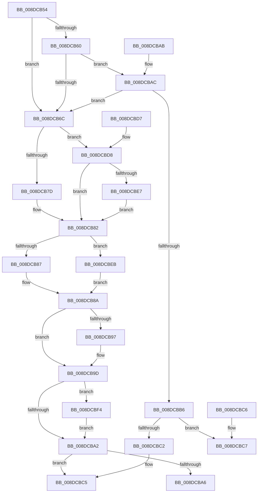

# PiDqQueryGetNextIoctlInfo

- RVA: `0x008DCB54`–`0x008DCBFD` (길이 `169` bytes)
- VA: `0x00000001408DCB54`
- 실행 섹션: `PAGE`
- PDB 이름 있음: `예`; PDB Function 태그: `아니요`
- unwind 정보 RVA: `0x000DB714`
- 디코드: `52`개 명령, `169/169` bytes 표시
- 미해석 바이트: `0` (있으면 어셈블리에 `.byte`로 보존)

> 이 문서는 커널 이미지의 기계어와 PDB 기호를 분석해 생성했습니다. 4번과 5번은 함수 원형과 자료형을 바이너리 사용 방식에서 추정한 C 해석이며 원본 소스 복구 결과는 아닙니다.

## 1. Dependencies

- 직접 호출 지점: **0**; 고유 호출 대상: **0**
- 직접 호출자로 확인된 함수: **3**
- RIP 상대 이미지 참조: **0**

### Outgoing calls
- 직접 디코드된 call 명령이 없습니다.

### Direct callers
- [PiDqIrpQueryGetResult](PiDqIrpQueryGetResult_function_008DBF28.md) at `0x008DC05D`
- [PiDqIrpQueryGetResult](PiDqIrpQueryGetResult_function_008DBF28.md) at `0x008DC083`
- [PiDqIrpQueryCreate](PiDqIrpQueryCreate_function_008DCC04.md) at `0x008DCE42`
- [PiDqQueryCompletePendedIrp](PiDqQueryCompletePendedIrp_function_008DE594.md) at `0x008DE5DB`

### Static image references
- 디코드된 RIP-relative 메모리 참조가 없습니다.

## 2. Other-region calls and transfers

- 다른 실행 섹션으로 향하는 call: **0**
- 별도 외부 분기/꼬리 이동을 확인하지 못했습니다.

## 3. Assembly (complete function range)

```asm
008DCB54  45 33 D2                        xor r10d, r10d
008DCB57  4C 39 91 B8 00 00 00            cmp qword ptr [rcx + 0xb8], r10
008DCB5E  75 0C                           jne 0x1408dcb6c
008DCB60  48 8D 81 C0 00 00 00            lea rax, [rcx + 0xc0]
008DCB67  48 39 00                        cmp qword ptr [rax], rax
008DCB6A  74 40                           je 0x1408dcbac
008DCB6C  41 C7 01 07 00 47 00            mov dword ptr [r9], 0x470007
008DCB73  8B 81 D8 00 00 00               mov eax, dword ptr [rcx + 0xd8]
008DCB79  A8 20                           test al, 0x20
008DCB7B  75 5B                           jne 0x1408dcbd8
008DCB7D  B8 04 00 00 00                  mov eax, 4
008DCB82  45 85 C0                        test r8d, r8d
008DCB85  75 64                           jne 0x1408dcbeb
008DCB87  C1 E0 0A                        shl eax, 0xa
008DCB8A  B9 00 00 01 00                  mov ecx, 0x10000
008DCB8F  41 89 41 04                     mov dword ptr [r9 + 4], eax
008DCB93  3B C1                           cmp eax, ecx
008DCB95  76 06                           jbe 0x1408dcb9d
008DCB97  41 89 49 04                     mov dword ptr [r9 + 4], ecx
008DCB9B  8B C1                           mov eax, ecx
008DCB9D  41 3B C0                        cmp eax, r8d
008DCBA0  72 52                           jb 0x1408dcbf4
008DCBA2  3B C2                           cmp eax, edx
008DCBA4  73 1F                           jae 0x1408dcbc5
008DCBA6  41 89 51 04                     mov dword ptr [r9 + 4], edx
008DCBAA  C3                              ret
008DCBAB  CC                              int3
008DCBAC  8B 81 D8 00 00 00               mov eax, dword ptr [rcx + 0xd8]
008DCBB2  A8 20                           test al, 0x20
008DCBB4  74 B6                           je 0x1408dcb6c
008DCBB6  48 8B 41 18                     mov rax, qword ptr [rcx + 0x18]
008DCBBA  8B 48 28                        mov ecx, dword ptr [rax + 0x28]
008DCBBD  F6 C1 01                        test cl, 1
008DCBC0  75 05                           jne 0x1408dcbc7
008DCBC2  4D 89 11                        mov qword ptr [r9], r10
008DCBC5  C3                              ret
008DCBC6  CC                              int3
008DCBC7  41 C7 01 08 00 47 00            mov dword ptr [r9], 0x470008
008DCBCE  41 C7 41 04 10 00 00 00         mov dword ptr [r9 + 4], 0x10
008DCBD6  C3                              ret
008DCBD7  CC                              int3
008DCBD8  8B 81 D0 00 00 00               mov eax, dword ptr [rcx + 0xd0]
008DCBDE  4C 39 91 B8 00 00 00            cmp qword ptr [rcx + 0xb8], r10
008DCBE5  74 9B                           je 0x1408dcb82
008DCBE7  FF C0                           inc eax
008DCBE9  EB 97                           jmp 0x1408dcb82
008DCBEB  41 0F AF C0                     imul eax, r8d
008DCBEF  83 C0 10                        add eax, 0x10
008DCBF2  EB 96                           jmp 0x1408dcb8a
008DCBF4  45 89 41 04                     mov dword ptr [r9 + 4], r8d
008DCBF8  41 8B C0                        mov eax, r8d
008DCBFB  EB A5                           jmp 0x1408dcba2
```

## 4. C-style interpretation (structured pseudocode)

```c
__int64 __fastcall PiDqQueryGetNextIoctlInfo(__int64 a1, int a2, int a3, __int64 a4)
{
    __int64 result;
    __int64 v_r10;

    v_r10 = 0;
    if ((*(unsigned __int64 *)(a1 + 184)) != 0) goto loc_008DCB6C;
    if ((*(unsigned __int64 *)(a1 + 192)) == (a1 + 192)) goto loc_008DCBAC;
loc_008DCB6C:
    *(unsigned int *)(a4) = 0x470007ULL;
    if ((((unsigned __int8)((unsigned int)(*(unsigned int *)(a1 + 216)))) & (32)) != 0) goto loc_008DCBD8;
loc_008DCB82:
    if (a3 != 0) goto loc_008DCBEB;
    result = (unsigned int)((4) << (10));
loc_008DCB8A:
    *(unsigned int *)(a4 + 4) = (unsigned int)(result);
    if (((unsigned int)(result)) >= = ((unsigned int)((unsigned int)(0x10000ULL)))) {
        *(unsigned int *)(a4 + 4) = (unsigned int)((unsigned int)(0x10000ULL));
        result = (unsigned int)((unsigned int)(0x10000ULL));
    }
    if (((unsigned int)(result)) < a3) goto loc_008DCBF4;
loc_008DCBA2:
    if (((unsigned int)(result)) >= a2) goto loc_008DCBC5;
    *(unsigned int *)(a4 + 4) = a2;
    return result;
loc_008DCBAC:
    if ((((unsigned __int8)((unsigned int)(*(unsigned int *)((unsigned int)(0x10000ULL) + 216)))) & (32)) == 0) goto loc_008DCB6C;
    if ((((unsigned __int8)((unsigned int)(*(unsigned int *)(*(unsigned __int64 *)((unsigned int)(0x10000ULL) + 24) + 40)))) & (1)) != 0) goto loc_008DCBC7;
    *(unsigned __int64 *)(a4) = 0;
loc_008DCBC5:
    return *(unsigned __int64 *)((unsigned int)(0x10000ULL) + 24);
loc_008DCBC7:
    *(unsigned int *)(a4) = 0x470008ULL;
    *(unsigned int *)(a4 + 4) = 16;
    return *(unsigned __int64 *)((unsigned int)(0x10000ULL) + 24);
loc_008DCBD8:
    if ((*(unsigned __int64 *)((unsigned int)(*(unsigned int *)(*(unsigned __int64 *)((unsigned int)(0x10000ULL) + 24) + 40)) + 184)) == 0) goto loc_008DCB82;
    result = (unsigned int)(((unsigned int)(*(unsigned int *)((unsigned int)(*(unsigned int *)(*(unsigned __int64 *)((unsigned int)(0x10000ULL) + 24) + 40)) + 208))) + 1);
    goto loc_008DCB82;
loc_008DCBEB:
    result = (unsigned int)((result) * (a3));
    result = (unsigned int)((result) + (16));
    goto loc_008DCB8A;
loc_008DCBF4:
    *(unsigned int *)(a4 + 4) = a3;
    goto loc_008DCBA2;
}
```

## 5. (Beta) C Style

```c
int64_t PiDqQueryGetNextIoctlInfo(void *Arg1, int32_t Arg2, int32_t Arg3, void *Arg4)
{
    uint8_t *arg1 = (uint8_t *)Arg1;
    uint8_t *arg4 = (uint8_t *)Arg4;

    int64_t result;
    int64_t local_r10;

    local_r10 = 0;
    if ((*(uint64_t *)(arg1 + 0xB8)) != 0) goto loc_008DCB6C;
    if ((*(uint64_t *)(arg1 + 0xC0)) == (Arg1 + 192)) goto loc_008DCBAC;
loc_008DCB6C:
    *(uint32_t *)(arg4) = 0x470007ULL;
    if ((((uint8_t)((uint32_t)(*(uint32_t *)(arg1 + 0xD8)))) & (32)) != 0) goto loc_008DCBD8;
loc_008DCB82:
    if (Arg3 != 0) goto loc_008DCBEB;
    result = (uint32_t)((4) << (10));
loc_008DCB8A:
    *(uint32_t *)(arg4 + 0x4) = (uint32_t)(result);
    if (((uint32_t)(result)) >= = ((uint32_t)((uint32_t)(0x10000ULL)))) {
        *(uint32_t *)(arg4 + 0x4) = (uint32_t)((uint32_t)(0x10000ULL));
        result = (uint32_t)((uint32_t)(0x10000ULL));
    }
    if (((uint32_t)(result)) < Arg3) goto loc_008DCBF4;
loc_008DCBA2:
    if (((uint32_t)(result)) >= Arg2) goto loc_008DCBC5;
    *(uint32_t *)(arg4 + 0x4) = Arg2;
    return result;
loc_008DCBAC:
    if ((((uint8_t)((uint32_t)(*(uint32_t *)((uint32_t)(0x10000ULL) + 0xD8)))) & (32)) == 0) goto loc_008DCB6C;
    if ((((uint8_t)((uint32_t)(*(uint32_t *)(*(uint64_t *)((uint32_t)(0x10000ULL) + 0x18) + 0x28)))) & (1)) != 0) goto loc_008DCBC7;
    *(uint64_t *)(arg4) = 0;
loc_008DCBC5:
    return *(uint64_t *)((uint32_t)(0x10000ULL) + 0x18);
loc_008DCBC7:
    *(uint32_t *)(arg4) = 0x470008ULL;
    *(uint32_t *)(arg4 + 0x4) = 16;
    return *(uint64_t *)((uint32_t)(0x10000ULL) + 0x18);
loc_008DCBD8:
    if ((*(uint64_t *)((uint32_t)(*(uint32_t *)(*(uint64_t *)((uint32_t)(0x10000ULL) + 0x18) + 0x28)) + 0xB8)) == 0) goto loc_008DCB82;
    result = (uint32_t)(((uint32_t)(*(uint32_t *)((uint32_t)(*(uint32_t *)(*(uint64_t *)((uint32_t)(0x10000ULL) + 0x18) + 0x28)) + 0xD0))) + 1);
    goto loc_008DCB82;
loc_008DCBEB:
    result = (uint32_t)((result) * (Arg3));
    result = (uint32_t)((result) + (16));
    goto loc_008DCB8A;
loc_008DCBF4:
    *(uint32_t *)(arg4 + 0x4) = Arg3;
    goto loc_008DCBA2;
}
```

### 관측된 메모리 오프셋

구조체 형식이 확인되지 않은 접근은 인자 기준의 오프셋으로만 기록했습니다.

| 기준 인자 | 오프셋 표현 | 폭 (bit) | 접근 |
|---|---:|---:|---|
| `Arg1` | `+ 0x0` | `64` | `R` |
| `Arg1` | `+ 0x18` | `64` | `R` |
| `Arg1` | `+ 0xB8` | `64` | `R` |
| `Arg1` | `+ 0xC0` | `64` | `R` |
| `Arg1` | `+ 0xD0` | `32` | `R` |
| `Arg1` | `+ 0xD8` | `32` | `R` |
| `Arg4` | `+ 0x0` | `32` | `W` |
| `Arg4` | `+ 0x0` | `64` | `W` |
| `Arg4` | `+ 0x4` | `32` | `W` |

## 6. Execution-region graph

[열기: 2D/3D 그래프와 함수 탐색 컨트롤 패널](../../../control-panel.html?section=page&rva=0x008DCB54&view=graph)

- 2D 그래프는 위에서 아래로 흐르고, 3D 그래프는 빈 공간을 드래그해 회전합니다. Shift+드래그는 이동, 휠은 확대·축소, 함수 노드 선택은 대상 보고서 이동입니다.

### Static fallback


