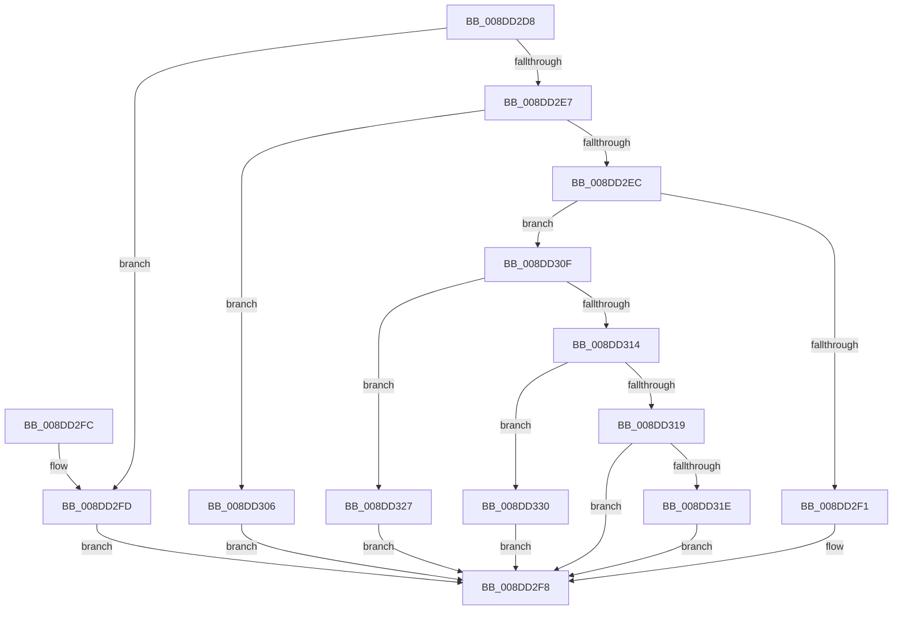

# PiDqQueryGetObjectManager

- RVA: `0x008DD2D8`–`0x008DD339` (길이 `97` bytes)
- VA: `0x00000001408DD2D8`
- 실행 섹션: `PAGE`
- PDB 이름 있음: `예`; PDB Function 태그: `아니요`
- unwind 정보 RVA: `0x000DB714`
- 디코드: `29`개 명령, `97/97` bytes 표시
- 미해석 바이트: `0` (있으면 어셈블리에 `.byte`로 보존)

> 이 문서는 커널 이미지의 기계어와 PDB 기호를 분석해 생성했습니다. 4번과 5번은 함수 원형과 자료형을 바이너리 사용 방식에서 추정한 C 해석이며 원본 소스 복구 결과는 아닙니다.

## 1. Dependencies

- 직접 호출 지점: **0**; 고유 호출 대상: **0**
- 직접 호출자로 확인된 함수: **2**
- RIP 상대 이미지 참조: **6**

### Outgoing calls
- 직접 디코드된 call 명령이 없습니다.

### Direct callers
- [PiDqDispatch](PiDqDispatch_function_008DC8A0.md) at `0x008DC911`
- [PiDqQuerySerializeActionQueue](PiDqQuerySerializeActionQueue_function_008DD340.md) at `0x008DD39F`

### Static image references
- `0x008DD2F1` → RVA `0x00F8AEA0` (`.data`; read)
- `0x008DD2FD` → RVA `0x00F8ADA0` (`.data`; read)
- `0x008DD306` → RVA `0x00F8B1A0` (`.data`; read)
- `0x008DD31E` → RVA `0x00F8AFA0` (`.data`; read)
- `0x008DD327` → RVA `0x00F8B2A0` (`.data`; read)
- `0x008DD330` → RVA `0x00F8B0A0` (`.data`; read)

## 2. Other-region calls and transfers

- 다른 실행 섹션으로 향하는 call: **0**
- 별도 외부 분기/꼬리 이동을 확인하지 못했습니다.

## 3. Assembly (complete function range)

```asm
008DD2D8  48 8B 49 18                     mov rcx, qword ptr [rcx + 0x18]
008DD2DC  45 33 C0                        xor r8d, r8d
008DD2DF  8B 51 10                        mov edx, dword ptr [rcx + 0x10]
008DD2E2  83 EA 01                        sub edx, 1
008DD2E5  74 16                           je 0x1408dd2fd
008DD2E7  83 EA 01                        sub edx, 1
008DD2EA  74 1A                           je 0x1408dd306
008DD2EC  83 EA 01                        sub edx, 1
008DD2EF  75 1E                           jne 0x1408dd30f
008DD2F1  4C 8D 05 A8 DB 6A 00            lea r8, [rip + 0x6adba8]
008DD2F8  49 8B C0                        mov rax, r8
008DD2FB  C3                              ret
008DD2FC  CC                              int3
008DD2FD  4C 8D 05 9C DA 6A 00            lea r8, [rip + 0x6ada9c]
008DD304  EB F2                           jmp 0x1408dd2f8
008DD306  4C 8D 05 93 DE 6A 00            lea r8, [rip + 0x6ade93]
008DD30D  EB E9                           jmp 0x1408dd2f8
008DD30F  83 EA 01                        sub edx, 1
008DD312  74 13                           je 0x1408dd327
008DD314  83 EA 03                        sub edx, 3
008DD317  74 17                           je 0x1408dd330
008DD319  83 FA 04                        cmp edx, 4
008DD31C  75 DA                           jne 0x1408dd2f8
008DD31E  4C 8D 05 7B DC 6A 00            lea r8, [rip + 0x6adc7b]
008DD325  EB D1                           jmp 0x1408dd2f8
008DD327  4C 8D 05 72 DF 6A 00            lea r8, [rip + 0x6adf72]
008DD32E  EB C8                           jmp 0x1408dd2f8
008DD330  4C 8D 05 69 DD 6A 00            lea r8, [rip + 0x6add69]
008DD337  EB BF                           jmp 0x1408dd2f8
```

## 4. C-style interpretation (structured pseudocode)

```c
__int64 __fastcall PiDqQueryGetObjectManager(__int64 a1, __int64 a2, int a3)
{
    a3 = 0;
    a2 = (unsigned int)(((unsigned int)(*(unsigned int *)(*(unsigned __int64 *)(a1 + 24) + 16))) - (1));
    if (condition_is_equal) goto loc_008DD2FD;
    a2 = (unsigned int)((a2) - (1));
    if (condition_is_equal) goto loc_008DD306;
    a2 = (unsigned int)((a2) - (1));
    if (condition_is_not_equal) goto loc_008DD30F;
loc_008DD2F8:
    return v_rip + 7003048;
loc_008DD2FD:
    goto loc_008DD2F8;
loc_008DD306:
    goto loc_008DD2F8;
loc_008DD30F:
    a2 = (unsigned int)((a2) - (1));
    if (condition_is_equal) goto loc_008DD327;
    a2 = (unsigned int)((a2) - (3));
    if (condition_is_equal) goto loc_008DD330;
    if (((unsigned int)(a2)) != 4) goto loc_008DD2F8;
    goto loc_008DD2F8;
loc_008DD327:
    goto loc_008DD2F8;
loc_008DD330:
    goto loc_008DD2F8;
}
```

## 5. (Beta) C Style

```c
int64_t PiDqQueryGetObjectManager(void *Arg1, int64_t Arg2, int32_t Arg3)
{
    uint8_t *arg1 = (uint8_t *)Arg1;

    Arg3 = 0;
    Arg2 = (uint32_t)(((uint32_t)(*(uint32_t *)(*(uint64_t *)(arg1 + 0x18) + 0x10))) - (1));
    if (condition_is_equal) goto loc_008DD2FD;
    Arg2 = (uint32_t)((Arg2) - (1));
    if (condition_is_equal) goto loc_008DD306;
    Arg2 = (uint32_t)((Arg2) - (1));
    if (condition_is_not_equal) goto loc_008DD30F;
loc_008DD2F8:
    return v_rip + 7003048;
loc_008DD2FD:
    goto loc_008DD2F8;
loc_008DD306:
    goto loc_008DD2F8;
loc_008DD30F:
    Arg2 = (uint32_t)((Arg2) - (1));
    if (condition_is_equal) goto loc_008DD327;
    Arg2 = (uint32_t)((Arg2) - (3));
    if (condition_is_equal) goto loc_008DD330;
    if (((uint32_t)(Arg2)) != 4) goto loc_008DD2F8;
    goto loc_008DD2F8;
loc_008DD327:
    goto loc_008DD2F8;
loc_008DD330:
    goto loc_008DD2F8;
}
```

### 관측된 메모리 오프셋

구조체 형식이 확인되지 않은 접근은 인자 기준의 오프셋으로만 기록했습니다.

| 기준 인자 | 오프셋 표현 | 폭 (bit) | 접근 |
|---|---:|---:|---|
| `Arg1` | `+ 0x18` | `64` | `R` |

## 6. Execution-region graph

[열기: 2D/3D 그래프와 함수 탐색 컨트롤 패널](../../../control-panel.html?section=page&rva=0x008DD2D8&view=graph)

- 2D 그래프는 위에서 아래로 흐르고, 3D 그래프는 빈 공간을 드래그해 회전합니다. Shift+드래그는 이동, 휠은 확대·축소, 함수 노드 선택은 대상 보고서 이동입니다.

### Static fallback


